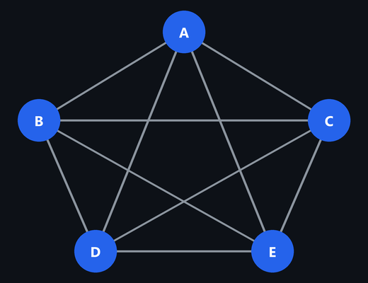
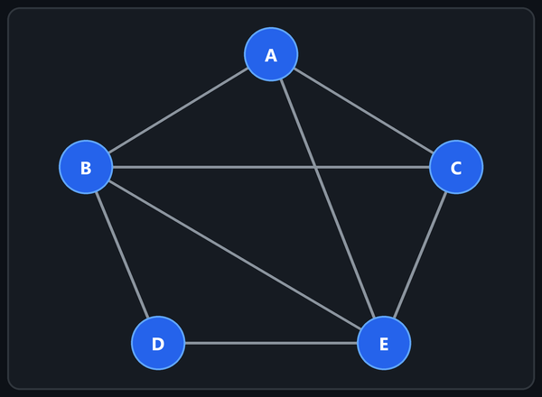

# Advanced Data Structures & Algorithm Analysis (2501CS10)

## Unit-wise Important Questions & Answer Map

| Unit | Question | Topic | Worked Answer (`.md`) |
| :---: | :---: | :--- | :--- |
| **UNIT-I** | Q1 | Importance of Algorithm Analysis, Time vs. Space Complexity | [`UNIT-I.md` — §1](UNIT-I.md#1-importance-of-algorithm-analysis-and-time-vs-space-complexity) |
| | Q2 | Asymptotic Notations ($O, \Omega, \Theta$) | [`UNIT-I.md` — §2](UNIT-I.md#2-asymptotic-notations-big-o-omega-and-theta) |
| | Q3 | Matrix Multiplication Time Complexity (Tabular Method) | [`UNIT-I.md` — §3](UNIT-I.md#3-time-complexity-of-matrix-multiplication-tabular-step-count-method) |
| | Q4 | Concept of Hashing & Hash Functions | [`UNIT-I.md` — §4](UNIT-I.md#4-concept-of-hashing-and-hash-functions) |
| | Q5 | Collision Resolution Techniques | [`UNIT-I.md` — §5](UNIT-I.md#5-collision-resolution-techniques) |
| | Q6 | Static vs. Dynamic Hashing (Extendible Hashing) | [`UNIT-I.md` — §6](UNIT-I.md#6-static-hashing-vs-dynamic-hashing-extendible-hashing) |
| **UNIT-II** | Q1 | Construct AVL Tree (`50, 25, 12, 80, 90, 37, 45, 18, 19, 6`) | [`UNIT-II.md` — §1](UNIT-II.md#1-construct-an-avl-tree-by-step-by-step-insertion) |
| | Q2 | Four Types of AVL Rotations & Applications | [`UNIT-II.md` — §2](UNIT-II.md#2-four-types-of-avl-tree-rotations-and-applications) |
| | Q3 | AVL Tree Deletion Procedure (Delete `15`) | [`UNIT-II.md` — §3](UNIT-II.md#3-deletion-procedure-in-avl-tree-delete-15) |
| | Q4 | Construct B-Tree of Order 4 | [`UNIT-II.md` — §4](UNIT-II.md#4-construct-a-b-tree-of-order-4) |
| | Q5 | B-Tree Deletion Operation & Applications | [`UNIT-II.md` — §5](UNIT-II.md#5-deletion-operation-in-a-b-tree-and-applications) |
| | Q6 | Construct Min/Max Heap (`40, 15, 30, 10, 12, 6, 25, 18`) | [`UNIT-II.md` — §6](UNIT-II.md#6-construct-a-min-heap-and-max-heap) |
| | Q7 | Max Heap Deletion Operation (Delete `90`) | [`UNIT-II.md` — §7](UNIT-II.md#7-deletion-operation-on-given-max-heap) |
| | Q8 | Binary Heap Operations & Priority Queue Applications | [`UNIT-II.md` — §8](UNIT-II.md#8-basic-operations-of-a-binary-heap-and-applications-of-priority-queues) |
| **UNIT-III** | Q1(A) | Divide and Conquer General Methodology | [`UNIT-III.md` — §1(A)](UNIT-III.md#1a-explain-the-general-methodology-of-divide-and-conquer-illustrate-its-three-fundamental-steps-with-examples-8-marks) |
| | Q1(B) | Binary Search (Minimum 15 Keys) | [`UNIT-III.md` — §1(B)](UNIT-III.md#1b-apply-binary-search-to-locate-a-key-in-a-sorted-array-of-at-least-15-keys-show-low-high-and-mid-at-every-iteration-and-count-comparisons-8-marks) |
| | Q2 | Merge Sort (`42, 17, 8, 33, 25, 61, 14, 50, 9, 37`) | [`UNIT-III.md` — §2](UNIT-III.md#2-merge-sort) |
| | Q3 | Quick Sort (`35, 18, 42, 7, 29, 51, 13, 24, 46`) | [`UNIT-III.md` — §3](UNIT-III.md#3-quick-sort) |
| | Q4 | Greedy Job Sequencing with Deadlines | [`UNIT-III.md` — §4](UNIT-III.md#4-greedy-job-sequencing-with-deadlines) |
| | Q5 | Fractional Knapsack Problem ($W = 50$) | [`UNIT-III.md` — §5](UNIT-III.md#5-fractional-knapsack-using-greedy) |
| | Q6 | Minimum Spanning Tree (Kruskal's & Prim's) | [`UNIT-III.md` — §6](UNIT-III.md#6-minimum-spanning-tree-using-kruskals-and-prims-algorithms) |
| | Q7 | Dijkstra's Single-Source Shortest Paths | [`UNIT-III.md` — §7](UNIT-III.md#7-dijkstras-algorithm-from-source-a) |
| **UNIT-IV** | Q1 | Dynamic Programming Methodology & vs. Divide and Conquer | [`UNIT-IV.md` — §1](UNIT-IV.md#1-dynamic-programming-methodology-optimal-substructure-overlapping-subproblems-and-comparison-with-divide-and-conquer) |
| | Q2 | Bellman–Ford Algorithm from Source $S$ | [`UNIT-IV.md` — §2](UNIT-IV.md#2-bellmanford-algorithm-from-source-s) |
| | Q3 | Floyd–Warshall All-Pairs Shortest Paths | [`UNIT-IV.md` — §3](UNIT-IV.md#3-floydwarshall-algorithm-for-all-pairs-shortest-paths) |
| | Q4 | Optimal Binary Search Tree (`do, if, int, while`) | [`UNIT-IV.md` — §4](UNIT-IV.md#4-optimal-binary-search-tree-obst-using-dynamic-programming) |
| | Q5 | 0/1 Knapsack using Dynamic Programming ($W = 10$) | [`UNIT-IV.md` — §5](UNIT-IV.md#5-01-knapsack-using-dynamic-programming) |
| | Q6 | Travelling Salesperson Problem (Held–Karp DP) | [`UNIT-IV.md` — §6](UNIT-IV.md#6-travelling-salesperson-problem-tsp-using-heldkarp-dynamic-programming) |
| **UNIT-V** | Q1 | Backtracking General Methodology & State-Space Tree | [`UNIT-V.md` — §1](UNIT-V.md#1-backtracking-general-methodology-state-space-tree-bounding-conditions-and-comparison-with-exhaustive-search) |
| | Q2 | 4-Queens Problem using Backtracking | [`UNIT-V.md` — §2](UNIT-V.md#2-4-queens-problem-using-backtracking) |
| | Q3 | Sum of Subsets ($S=\{5,10,12,13,15,18\}, M=30$) | [`UNIT-V.md` — §3](UNIT-V.md#3-sum-of-subsets-using-backtracking) |
| | Q4 | 3-Coloring Undirected Graph using Backtracking | [`UNIT-V.md` — §4](UNIT-V.md#4-graph-coloring-using-backtracking-3-colors) |
| | Q5 | Hamiltonian Cycles using Backtracking | [`UNIT-V.md` — §5](UNIT-V.md#5-hamiltonian-cycles-using-backtracking) |
| | Q6 | 0/1 Knapsack (Least Cost Branch and Bound, $W = 16$) | [`UNIT-V.md` — §6](UNIT-V.md#6-01-knapsack-using-least-cost-lc-branch-and-bound) |
| | Q7 | Travelling Salesperson Problem (Branch and Bound) | [`UNIT-V.md` — §7](UNIT-V.md#7-travelling-salesperson-problem-tsp-using-branch-and-bound) |
| | Q8 | Backtracking vs. Branch and Bound | [`UNIT-V.md` — §8](UNIT-V.md#8-compare-and-contrast-backtracking-and-branch-and-bound) |

---

## UNIT-I

1. Explain the importance of algorithm analysis. Differentiate between time complexity and space complexity with suitable examples. — **[→ Answer: `UNIT-I.md` §1](UNIT-I.md#1-importance-of-algorithm-analysis-and-time-vs-space-complexity)**
2. Describe the asymptotic notations $O$, $\Omega$, and $\Theta$. Illustrate each notation with suitable examples. — **[→ Answer: `UNIT-I.md` §2](UNIT-I.md#2-asymptotic-notations-big-o-omega-and-theta)**
3. Analyze the time complexity for matrix multiplication algorithm (tabular method) using asymptotic notation and justify your answer. — **[→ Answer: `UNIT-I.md` §3](UNIT-I.md#3-time-complexity-of-matrix-multiplication-tabular-step-count-method)**
4. Explain the concept of hashing. Discuss different hash functions with suitable examples. — **[→ Answer: `UNIT-I.md` §4](UNIT-I.md#4-concept-of-hashing-and-hash-functions)**
5. Explain the collision resolution techniques Linear Probing, Quadratic Probing, Double Hashing, and Separate Chaining. — **[→ Answer: `UNIT-I.md` §5](UNIT-I.md#5-collision-resolution-techniques)**
6. Differentiate between Static Hashing and Dynamic Hashing. Explain the working of Dynamic Hashing (Extendable hashing) with an example. — **[→ Answer: `UNIT-I.md` §6](UNIT-I.md#6-static-hashing-vs-dynamic-hashing-extendible-hashing)**

---

## UNIT-II

1. Construct an AVL Tree by inserting the following keys: `50, 25, 12, 80, 90, 37, 45, 18, 19, 6`. Show the required rotations. — **[→ Answer: `UNIT-II.md` §1](UNIT-II.md#1-construct-an-avl-tree-by-step-by-step-insertion)**
2. Explain the four types of AVL Tree rotations with suitable examples. Discuss the applications of AVL Trees. — **[→ Answer: `UNIT-II.md` §2](UNIT-II.md#2-four-types-of-avl-tree-rotations-and-applications)**
3. Explain the deletion procedure in AVL tree. Show the balancing operations after **deletion of 15** from the below AVL tree. — **[→ Answer: `UNIT-II.md` §3](UNIT-II.md#3-deletion-procedure-in-avl-tree-delete-15)**

   ```text
                 50
               /    \
             25      75
            /  \    /  \
          15   40  60   80
              /   /  \    \
            35   55  65    90
                    /
                  62
   ```

4. Construct a B-Tree of order 4 by inserting the following keys: `5, 3, 21, 9, 1, 13, 2, 7, 10, 12, 4, 8`. — **[→ Answer: `UNIT-II.md` §4](UNIT-II.md#4-construct-a-b-tree-of-order-4)**
5. Explain the deletion operation in a B-Tree with a suitable example, and applications of B-Trees. — **[→ Answer: `UNIT-II.md` §5](UNIT-II.md#5-deletion-operation-in-a-b-tree-and-applications)**
6. Construct a Min/Max Heap by inserting the following elements: `40, 15, 30, 10, 12, 6, 25, 18`. Show all intermediate steps. — **[→ Answer: `UNIT-II.md` §6](UNIT-II.md#6-construct-a-min-heap-and-max-heap)**
7. Perform one deletion operation on given Max Heap and show the step-by-step process for final Max Heap. — **[→ Answer: `UNIT-II.md` §7](UNIT-II.md#7-deletion-operation-on-given-max-heap)**

   ```text
                  BINARY MAX HEAP

                  90  <-- Root (Maximum element)
                /    \
              60      75
             /  \    /  \
           50   40  30  20
          /  \  /
        10   5 8
   ```

8. Explain the basic operations of a Binary Heap with their time complexities and discuss the applications of Priority Queues. — **[→ Answer: `UNIT-II.md` §8](UNIT-II.md#8-basic-operations-of-a-binary-heap-and-applications-of-priority-queues)**

---

## UNIT-III

1. **A)** Explain the general methodology of the Divide and Conquer strategy. Illustrate its three fundamental steps with suitable examples. — **[→ Answer: `UNIT-III.md` §1(A)](UNIT-III.md#1a-explain-the-general-methodology-of-divide-and-conquer-illustrate-its-three-fundamental-steps-with-examples-8-marks)**

   **B)** Apply the Binary Search algorithm to locate the desired key in the sorted array. Show the low, high, and mid values at every iteration and determine the total number of comparisons ***(Consider your own example dataset with minimum 15 keys)***. — **[→ Answer: `UNIT-III.md` §1(B)](UNIT-III.md#1b-apply-binary-search-to-locate-a-key-in-a-sorted-array-of-at-least-15-keys-show-low-high-and-mid-at-every-iteration-and-count-comparisons-8-marks)**

2. Demonstrate the Merge Sort algorithm on the following dataset. Draw the splitting and merging stages clearly and obtain the final sorted sequence. — **[→ Answer: `UNIT-III.md` §2](UNIT-III.md#2-merge-sort)**

   **Input:** `42, 17, 8, 33, 25, 61, 14, 50, 9, 37`

   Explain the recurrence relation and derive the time complexity of Merge Sort.

3. Analyze the working of Quick Sort using the following dataset. Consider the first element as the pivot in every partitioning step. — **[→ Answer: `UNIT-III.md` §3](UNIT-III.md#3-quick-sort)**

   **Input:** `35, 18, 42, 7, 29, 51, 13, 24, 46`

   Show the partitioning process, identify the pivot positions after each pass, and obtain the sorted array. Compare the best-case and worst-case time complexities of Quick Sort.

4. Apply the Greedy Job Sequencing algorithm to schedule the following jobs to maximize the total profit. Each job requires one unit of time. — **[→ Answer: `UNIT-III.md` §4](UNIT-III.md#4-greedy-job-sequencing-with-deadlines)**

   | Job | Deadline | Profit |
   | :---: | :---: | :---: |
   | J1 | 2 | 100 |
   | J2 | 1 | 19 |
   | J3 | 2 | 27 |
   | J4 | 1 | 25 |
   | J5 | 3 | 15 |
   | J6 | 2 | 35 |
   | J7 | 3 | 40 |

   Determine the selected jobs, their execution order, and the maximum achievable profit. Justify your scheduling decisions.

5. Analyze the Fractional Knapsack problem using the Greedy approach for the following dataset. The knapsack capacity is 50 units. — **[→ Answer: `UNIT-III.md` §5](UNIT-III.md#5-fractional-knapsack-using-greedy)**

   | Item | Weight | Profit |
   | :---: | :---: | :---: |
   | I1 | 10 | 60 |
   | I2 | 20 | 100 |
   | I3 | 30 | 120 |
   | I4 | 15 | 75 |
   | I5 | 25 | 125 |

   Calculate the profit-to-weight ratio of each item, determine the optimal selection, and compute the maximum profit. Explain why the Greedy strategy is applicable to this problem.

6. Construct a Minimum Spanning Tree for the following weighted undirected graph using both Kruskal's and Prim's algorithm. Show each step, identify the edges rejected due to cycle formation, and calculate the total minimum cost. — **[→ Answer: `UNIT-III.md` §6](UNIT-III.md#6-minimum-spanning-tree-using-kruskals-and-prims-algorithms)**

   

7. Evaluate the shortest paths from source vertex **A** to all other vertices using Dijkstra's algorithm for the following weighted graph. Show the distance table after every iteration and identify the shortest path to each destination. — **[→ Answer: `UNIT-III.md` §7](UNIT-III.md#7-dijkstras-algorithm-from-source-a)**

   

   Discuss the limitation of Dijkstra's algorithm when negative edge weights are present.

---

## UNIT-IV

1. Explain the general methodology of Dynamic Programming. Discuss the principles of optimal substructure and overlapping subproblems with suitable examples. Differentiate between Dynamic Programming and Divide and Conquer based on their problem-solving strategies, storage requirements, and computational efficiency. — **[→ Answer: `UNIT-IV.md` §1](UNIT-IV.md#1-dynamic-programming-methodology-optimal-substructure-overlapping-subproblems-and-comparison-with-divide-and-conquer)**

2. Apply the Bellman–Ford algorithm to find the shortest paths from source vertex **S** to all other vertices in the following directed weighted graph. Show the distance values after each iteration and verify whether the graph contains a negative-weight cycle. — **[→ Answer: `UNIT-IV.md` §2](UNIT-IV.md#2-bellmanford-algorithm-from-source-s)**

   

3. Compute the all-pairs shortest path distances using the Floyd–Warshall's algorithm for the following initial cost matrix. Show the distance matrix after considering each intermediate vertex and determine the final shortest path matrix. — **[→ Answer: `UNIT-IV.md` §3](UNIT-IV.md#3-floydwarshall-algorithm-for-all-pairs-shortest-paths)**

   $$D^{(0)} = \begin{bmatrix} 0 & 4 & \infty & 10 \\ \infty & 0 & 3 & \infty \\ \infty & \infty & 0 & 2 \\ \infty & \infty & \infty & 0 \end{bmatrix}$$

   Also, explain the significance of the intermediate vertex in each iteration and derive the time complexity.

4. Analyze the Optimal Binary Search Tree problem for the following ordered keys and their successful and unsuccessful search probabilities. Given $n = 4$ and $\{a_1, a_2, a_3, a_4\} = \{\text{do}, \text{if}, \text{int}, \text{while}\}$, $p\{1:4\} = \{3, 3, 1, 1\}$ and $q\{0:4\} = \{2, 3, 1, 1, 1\}$. Construct the Optimal Binary Search Tree using Dynamic Programming. Show the cost table, identify the root at each subproblem, draw the final tree, and calculate the minimum expected search cost. — **[→ Answer: `UNIT-IV.md` §4](UNIT-IV.md#4-optimal-binary-search-tree-obst-using-dynamic-programming)**

5. Solve the 0/1 Knapsack problem using Dynamic Programming for the following dataset. The knapsack capacity is 10 units. — **[→ Answer: `UNIT-IV.md` §5](UNIT-IV.md#5-01-knapsack-using-dynamic-programming)**

   | Item | Weight | Profit |
   | :---: | :---: | :---: |
   | I1 | 2 | 12 |
   | I2 | 3 | 20 |
   | I3 | 4 | 25 |
   | I4 | 5 | 30 |
   | I5 | 6 | 35 |

   Construct the DP table, identify the selected items, and determine the maximum profit. Explain why selecting items solely by profit-to-weight ratio may not produce the optimal solution.

6. Analyze the Travelling Salesperson Problem using Dynamic Programming for the following cost matrix. Consider city A as the starting and ending city. — **[→ Answer: `UNIT-IV.md` §6](UNIT-IV.md#6-travelling-salesperson-problem-tsp-using-heldkarp-dynamic-programming)**

   $$C = \begin{bmatrix} 0 & 10 & 15 & 20 \\ 10 & 0 & 35 & 25 \\ 15 & 35 & 0 & 30 \\ 20 & 25 & 30 & 0 \end{bmatrix}$$

   Determine the optimal tour and minimum travel cost using the Held–Karp approach. Show the relevant subproblem calculations and explain how overlapping subproblems are utilized.

---

## UNIT-V

1. Explain the general methodology of Backtracking. Discuss the state-space tree, and its basic terms, and the role of bounding conditions. Illustrate the Backtracking approach with a suitable example and distinguish it from the exhaustive search technique. — **[→ Answer: `UNIT-V.md` §1](UNIT-V.md#1-backtracking-general-methodology-state-space-tree-bounding-conditions-and-comparison-with-exhaustive-search)**

2. Apply the Backtracking technique to solve the 4-Queens problem. Draw the state-space tree, demonstrate the placement of queens' row by row, and identify the safe and unsafe positions. Show all distinct solutions and explain how the promising function eliminates invalid configurations. — **[→ Answer: `UNIT-V.md` §2](UNIT-V.md#2-4-queens-problem-using-backtracking)**

3. Use the Backtracking method to identify all subsets whose sum is equal to 30 from the following set $S = \{5 \mid 10 \mid 12 \mid 13 \mid 15 \mid 18\}$. Draw the state-space tree, indicate the promising and non-promising nodes, and list all valid subsets. Explain the pruning conditions used to reduce the search space. — **[→ Answer: `UNIT-V.md` §3](UNIT-V.md#3-sum-of-subsets-using-backtracking)**

4. Analyze the following undirected graph using the Backtracking algorithm and determine all valid color assignments using a maximum of 3 colors. Draw the state-space tree and identify the number of valid colorings. — **[→ Answer: `UNIT-V.md` §4](UNIT-V.md#4-graph-coloring-using-backtracking-3-colors)**

   

5. Apply the Backtracking algorithm to identify all Hamiltonian cycles in the following undirected graph. Start from vertex A and explain how the algorithm rejects paths that cannot form a Hamiltonian cycle. — **[→ Answer: `UNIT-V.md` §5](UNIT-V.md#5-hamiltonian-cycles-using-backtracking)**

   

   Draw the state-space tree for the possible paths and list the distinct Hamiltonian cycles, treating reverse traversals as the same cycle.

6. Analyze the 0/1 Knapsack problem using the Least Cost search Branch and Bound technique for the following dataset. The knapsack capacity is 16 units. — **[→ Answer: `UNIT-V.md` §6](UNIT-V.md#6-01-knapsack-using-least-cost-lc-branch-and-bound)**

   | Item | Weight | Profit |
   | :---: | :---: | :---: |
   | I1 | 2 | 40 |
   | I2 | 5 | 30 |
   | I3 | 10 | 50 |
   | I4 | 5 | 10 |
   | I5 | 4 | 25 |

   Construct the state-space tree, calculate the upper bound and cost at each relevant node, identify the nodes pruned, and determine the optimal item selection and maximum profit.

7. Analyze the Travelling Salesperson Problem using Branch and Bound for the following cost matrix. Consider city **A** as the starting city. — **[→ Answer: `UNIT-V.md` §7](UNIT-V.md#7-travelling-salesperson-problem-tsp-using-branch-and-bound)**

   $$C = \begin{bmatrix} \infty & 12 & 10 & 19 & 8 \\ 12 & \infty & 3 & 7 & 6 \\ 10 & 3 & \infty & 2 & 20 \\ 19 & 7 & 2 & \infty & 4 \\ 8 & 6 & 20 & 4 & \infty \end{bmatrix}$$

   Construct the state-space tree, calculate lower bounds for promising partial tours, eliminate non-promising branches, and determine the optimal tour and its total cost.

8. Compare and contrast the Backtracking and Branch and Bound methods. — **[→ Answer: `UNIT-V.md` §8](UNIT-V.md#8-compare-and-contrast-backtracking-and-branch-and-bound)**

---

## Important Questions for Revision

### A. Most Expected (from your question paper, practise these first)

- **Unit I**
  1. Describe the asymptotic notations $O$, $\Omega$ and $\Theta$ with examples.
  2. Explain collision resolution techniques (linear probing, quadratic probing, double hashing, separate chaining).
  3. Differentiate static and dynamic hashing; explain extendable hashing with an example.
- **Unit II**
  1. Construct an AVL tree for the given keys, showing all rotations.
  2. Show deletion of a node in an AVL tree with balancing.
  3. Construct a B-tree of order 4 for the given keys.
  4. Build a max-heap/min-heap by insertion and perform delete-max.
- **Unit III**
  1. Merge sort on the given data with the recurrence and time complexity.
  2. Quick sort trace with best-case and worst-case complexity.
  3. Job sequencing with deadlines and fractional knapsack.
  4. Kruskal's and Prim's MST; Dijkstra's shortest path.
- **Unit IV**
  1. Optimal Binary Search Tree (cost table, root table, final tree).
  2. 0/1 Knapsack using DP table and traceback.
  3. Floyd–Warshall matrices and complexity; Bellman–Ford iterations.
  4. TSP using Held–Karp.
- **Unit V**
  1. 4-Queens state-space tree; sum of subsets; Hamiltonian cycle; graph colouring.
  2. 0/1 Knapsack and TSP using Branch and Bound.
  3. Backtracking vs Branch and Bound.

### B. Extra Practice Questions (may also be asked)

1. State the Master theorem and solve $T(n) = 4T(n/2) + n^2$.
2. What is a Red-Black tree? List its properties and compare it with an AVL tree.
3. Write the heap sort algorithm and trace it on a sample array.
4. Explain Huffman coding with an example (greedy method).
5. Explain topological sorting and its applications.
6. Find the Longest Common Subsequence (LCS) of two strings using DP.
7. Explain Matrix Chain Multiplication using DP with an example.
8. Explain Strassen's matrix multiplication algorithm and its complexity.
9. Differentiate between P, NP, NP-hard and NP-complete problems.
10. What is a $\text{B}^+$ tree? How does it differ from a B-tree?
11. Explain linear hashing and rehashing; what is the load factor?
12. Write the algorithm for the N-Queens problem and calculate its complexity.
13. Solve the Assignment problem or 15-puzzle using Branch and Bound.
14. Compare Kruskal's and Prim's algorithms.

---

## Quick Revision Tips

1. **Unit I:** Learn the three asymptotic definitions with constants, the hash functions and the 4 collision techniques.
2. **Unit II:** Practise AVL rotations (LL, RR, LR, RL), B-tree split/merge and heap sift-up/sift-down.
3. **Unit III:** Remember the recurrences $T(n) = 2T(n/2) + n$ (merge sort), the greedy sorting rule for each problem and the MST/Dijkstra tables.
4. **Unit IV:** Memorise the DP recurrences (Floyd, OBST, 0/1 knapsack, Held–Karp) and write tables neatly.
5. **Unit V:** State-space trees with bounding conditions; know the difference between Backtracking and Branch and Bound.

