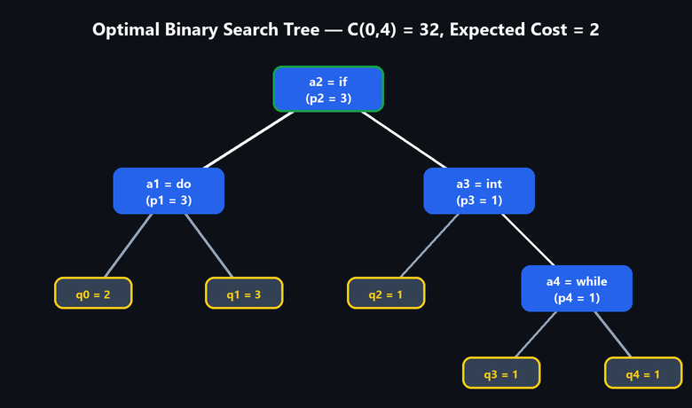
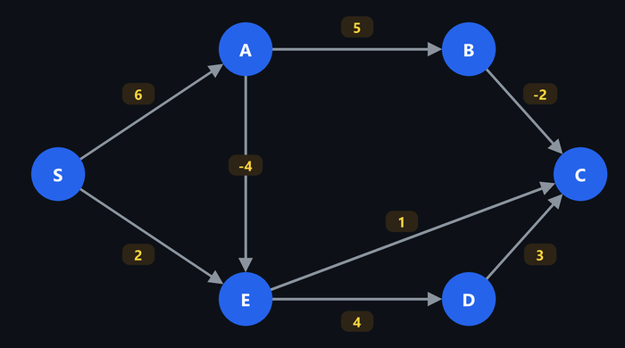
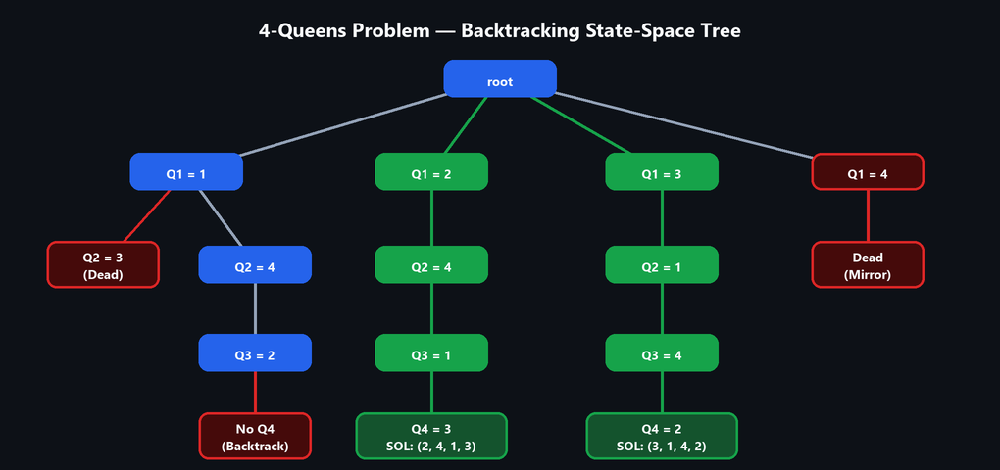
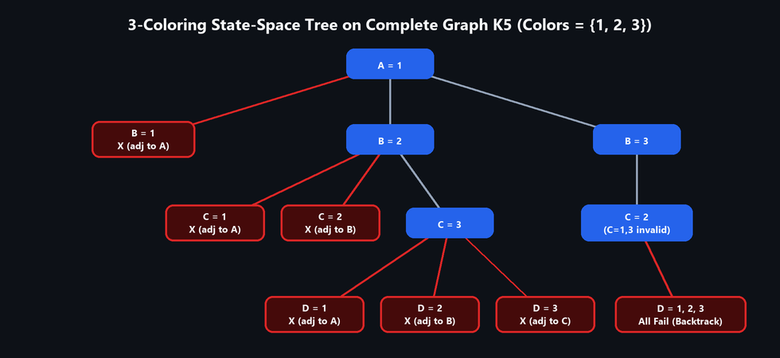
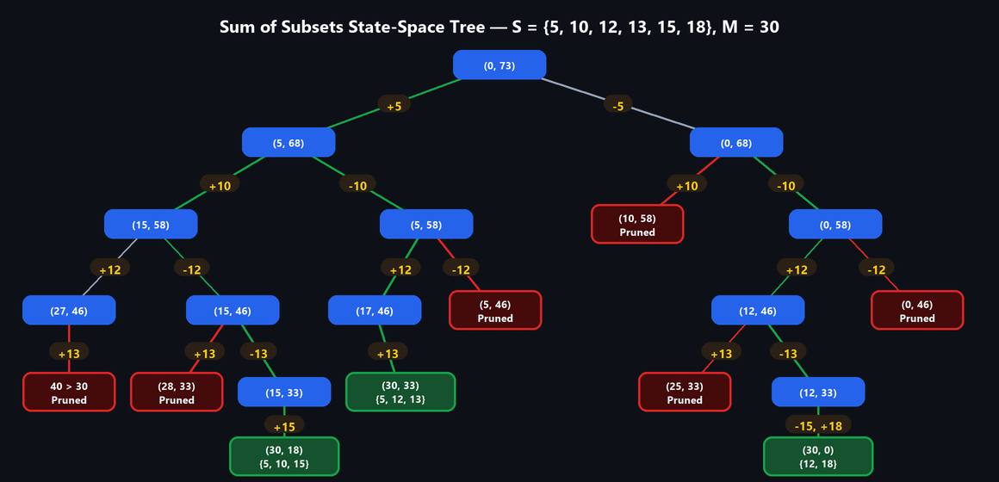
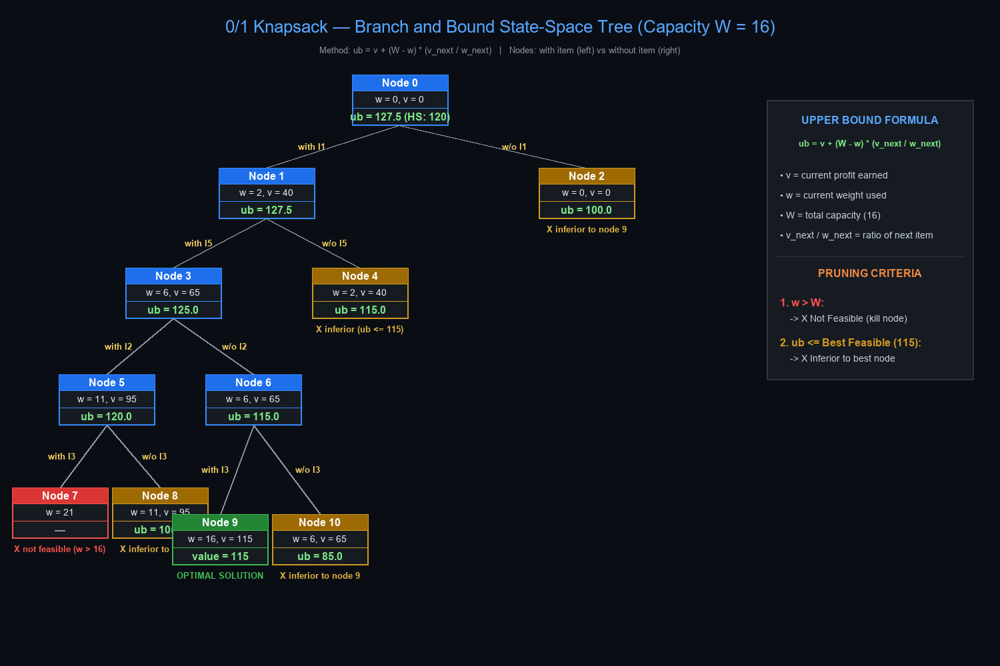
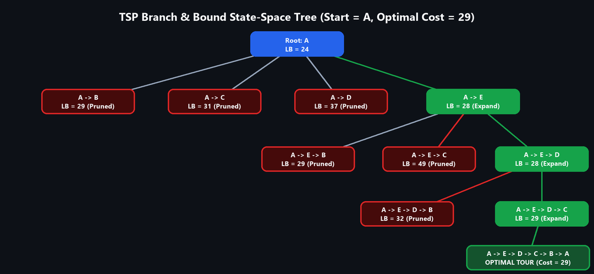

# ADSAA Important Questions for IE 2

**Advanced Data Structures & Algorithm Analysis (2501CS10)**  
Internal Examination 2 covers **Unit III, Unit IV, and Unit V**.

---

## Quick Navigation

- [UNIT – 3 (Divide & Conquer, Greedy Method)](#unit--3)
  1. [Merge Sort](#1-merge-sort)
  2. [Quick Sort](#2-quick-sort)
  3. [Kruskal's Algorithm](#3-kruskals-algorithm)
  4. [Prim's Algorithm](#4-prims-algorithm)
  5. [Fractional Knapsack](#5-fractional-knapsack)
  6. [Job Sequencing with Deadlines](#6-job-sequencing-with-deadlines)
- [UNIT – 4 (Dynamic Programming)](#unit--4)
  1. [0/1 Knapsack – Dynamic Programming (DP)](#1-01-knapsack--dynamic-programming-dp)
  2. [Optimal Binary Search Tree (OBST)](#2-optimal-binary-search-tree-obst)
  3. [Bellman–Ford Algorithm – Single-Source Shortest Path](#3-bellmanford-algorithm--single-source-shortest-path)
  4. [Travelling Salesperson Problem (TSP)](#4-travelling-salesperson-problem-tsp)
  5. [All-Pairs Shortest Path (Floyd–Warshall)](#5-all-pairs-shortest-path-floydwarshall)
- [UNIT – 5 (Backtracking & Branch and Bound)](#unit--5)
  1. [4 Queens Problem — Backtracking](#1-4-queens-problem--backtracking)
  2. [Graph Coloring — Backtracking](#2-graph-coloring--backtracking)
  3. [Difference Between Backtracking and Branch and Bound](#3-difference-between-backtracking-and-branch-and-bound)
  4. [Sum of Subsets Problem — Backtracking](#4-sum-of-subsets-problem--backtracking)
  5. [0/1 Knapsack Using LC Branch and Bound (LC-BB)](#5-01-knapsack-using-lc-branch-and-bound-lc-bb)
  6. [Travelling Salesperson Problem Using LC Branch and Bound (LC-BB)](#6-travelling-salesperson-problem-using-lc-branch-and-bound-lc-bb)
- [IE 1 Reference (Units 1 & 2)](#ie-1-reference-units-1--2)
- [Important Questions for Revision & Tips](#important-questions-for-revision)

---

## UNIT – 3

### 1. Merge Sort

Demonstrate the Merge Sort algorithm on the following dataset. Draw the splitting and merging stages clearly and obtain the final sorted sequence.

**Input:** `42, 17, 8, 33, 25, 61, 14, 50, 9, 37`

Explain the recurrence relation and derive the time complexity of Merge Sort.

- **[→ View Detailed Worked Answer (`UNIT-III.md` §2)](UNIT-III.md#2-merge-sort)**

- **Recurrence:** $T(n) = 2T(n/2) + n$, with $T(1) = 1 \implies T(n) = \Theta(n \log n)$ in best, average, and worst case.
- **Sorted output:** `8, 9, 14, 17, 25, 33, 37, 42, 50, 61`.

---

### 2. Quick Sort

Analyze the working of Quick Sort using the following dataset. Consider the first element as the pivot in every partitioning step.

**Input:** `35, 18, 42, 7, 29, 51, 13, 24, 46`

Show the partitioning process, identify the pivot positions after each pass, and obtain the sorted array. Compare the best-case and worst-case time complexities of Quick Sort.

- **[→ View Detailed Worked Answer (`UNIT-III.md` §3)](UNIT-III.md#3-quick-sort)**

- **Pivot positions:** `35` (Pos 6), `13` (Pos 2), `24` (Pos 4), `51` (Pos 9), `46` (Pos 8).
- **Sorted array:** `7, 13, 18, 24, 29, 35, 42, 46, 51`.
- **Complexity:** Best/Average: $O(n \log n)$; Worst: $O(n^2)$. Space: $O(\log n)$ average.

---

### 3. Kruskal's Algorithm

Construct a Minimum Spanning Tree (MST) for the given weighted undirected graph using **Kruskal's algorithm**. Show each step, identify the edges rejected due to cycle formation, and calculate the total minimum cost.

- **[→ View Detailed Worked Answer (`UNIT-III.md` §6 Part A)](UNIT-III.md#a-kruskals-algorithm-sort-edges-by-weight-add-an-edge-if-it-does-not-form-a-cycle)**

- **Method:** Sort all edges by increasing weight. Add an edge if it connects two disconnected components; reject if it forms a cycle.
- **Accepted edges:** `F–D (1), E–D (2), B–C (3), A–B (4), C–D (6)`.
- **Rejected cycle edges:** `F–E (5), A–F (7), A–E (8), C–E (8), B–F (9), B–E (10), B–D (11)`.
- **MST total cost:** $1 + 2 + 3 + 4 + 6 = \mathbf{16}$.

---

### 4. Prim's Algorithm

Construct a Minimum Spanning Tree (MST) for the given weighted undirected graph using **Prim's algorithm** starting at vertex **A**. Show the vertices in the tree and the cheapest crossing edge selected at every step.

- **[→ View Detailed Worked Answer (`UNIT-III.md` §6 Part B)](UNIT-III.md#b-prims-algorithm-start-at-a-repeatedly-add-the-cheapest-edge-connecting-the-tree-to-a-new-vertex)**

- **Step-by-step additions:**
  1. Tree `{A}`: Add `A–B (4)` $\to$ Tree `{A, B}`
  2. Tree `{A, B}`: Add `B–C (3)` $\to$ Tree `{A, B, C}`
  3. Tree `{A, B, C}`: Add `C–D (6)` $\to$ Tree `{A, B, C, D}`
  4. Tree `{A, B, C, D}`: Add `D–F (1)` $\to$ Tree `{A, B, C, D, F}`
  5. Tree `{A, B, C, D, F}`: Add `D–E (2)` $\to$ Tree `{A, B, C, D, E, F}`
- **MST total cost:** $4 + 3 + 6 + 1 + 2 = \mathbf{16}$.

---

### 5. Fractional Knapsack

Analyze the Fractional Knapsack problem using the Greedy approach for the following dataset. The knapsack capacity is **50 units**.

| Item | Weight | Profit |
| :---: | :---: | :---: |
| I1 | 10 | 60 |
| I2 | 20 | 100 |
| I3 | 30 | 120 |
| I4 | 15 | 75 |
| I5 | 25 | 125 |

Calculate the profit-to-weight ratio of each item, determine the optimal selection, and compute the maximum profit. Explain why the Greedy strategy is applicable.

- **[→ View Detailed Worked Answer (`UNIT-III.md` §5)](UNIT-III.md#5-fractional-knapsack-using-greedy)**

- **Ratios:** $I_1 = 6.0$, $I_2 = 5.0$, $I_4 = 5.0$, $I_5 = 5.0$, $I_3 = 4.0$.
- **Selection:** Take full $I_1$ (10 wt, 60 pr), full $I_2$ (20 wt, 100 pr), full $I_4$ (15 wt, 75 pr), and fraction $5/25 = 0.2$ of $I_5$ (5 wt, 25 pr).
- **Maximum profit:** $60 + 100 + 75 + 25 = \mathbf{260}$.

---

### 6. Job Sequencing with Deadlines

Apply the Greedy Job Sequencing algorithm to schedule the following jobs to maximize the total profit. Each job requires one unit of time.

| Job | Deadline | Profit |
| :---: | :---: | :---: |
| J1 | 2 | 100 |
| J2 | 1 | 19 |
| J3 | 2 | 27 |
| J4 | 1 | 25 |
| J5 | 3 | 15 |
| J6 | 2 | 35 |
| J7 | 3 | 40 |

Determine the selected jobs, their execution order, and the maximum achievable profit. Justify your scheduling decisions.

- **[→ View Detailed Worked Answer (`UNIT-III.md` §4)](UNIT-III.md#4-greedy-job-sequencing-with-deadlines)**

- **Profit order:** $J_1(100, d2), J_7(40, d3), J_6(35, d2), J_3(27, d2), J_4(25, d1), J_2(19, d1), J_5(15, d3)$.
- **Slots assigned:** Slot 1: $J_6$, Slot 2: $J_1$, Slot 3: $J_7$.
- **Execution order:** $J_6 \to J_1 \to J_7$.
- **Maximum profit:** $35 + 100 + 40 = \mathbf{175}$.

---

## UNIT – 4

### 1. 0/1 Knapsack – Dynamic Programming (DP)

Solve the 0/1 Knapsack problem using Dynamic Programming for the following dataset. The knapsack capacity is **10 units**.

| Item | Weight | Profit |
| :---: | :---: | :---: |
| I1 | 2 | 12 |
| I2 | 3 | 20 |
| I3 | 4 | 25 |
| I4 | 5 | 30 |
| I5 | 6 | 35 |

Construct the DP table, identify the selected items, and determine the maximum profit. Explain why selecting items solely by profit-to-weight ratio may not produce the optimal solution.

- **[→ View Detailed Worked Answer (`UNIT-IV.md` §5)](UNIT-IV.md#5-01-knapsack-using-dynamic-programming)**

- **Recurrence:** $V[i][w] = \max(V[i-1][w],\ p_i + V[i-1][w - w_i])$.
- **DP table optimal value:** $V[5][10] = \mathbf{62}$.
- **Selected items:** $I_1, I_2, I_4$ (Total weight $= 2 + 3 + 5 = 10$, Total profit $= 12 + 20 + 30 = \mathbf{62}$).
- **Why greedy fails:** Greedy picks by ratio $I_2, I_3, I_1$ (wt 9, profit 57 < 62). Items cannot be split, leaving unusable capacity.

---

### 2. Optimal Binary Search Tree (OBST)

Analyze the Optimal Binary Search Tree problem for the following ordered keys and their successful and unsuccessful search probabilities. Given $n = 4$ and $\{a_1, a_2, a_3, a_4\} = \{\text{do}, \text{if}, \text{int}, \text{while}\}$, $p\{1:4\} = \{3, 3, 1, 1\}$ and $q\{0:4\} = \{2, 3, 1, 1, 1\}$.

Construct the Optimal Binary Search Tree using Dynamic Programming. Show the cost table, identify the root at each subproblem, draw the final tree, and calculate the minimum expected search cost.

- **[→ View Detailed Worked Answer (`UNIT-IV.md` §4)](UNIT-IV.md#4-optimal-binary-search-tree-obst-using-dynamic-programming)**

- **Optimal root:** $R(0,4) = 2$ (`if`).
- **Tree structure:** Root `if`; Left child `do`; Right child `int`; Right child of `int` is `while`.
- **Minimum cost:** $C(0,4) = 32$.
- **Expected search cost:** $C / W = 32 / 16 = \mathbf{2}$ comparisons per search.

---

### 3. Bellman–Ford Algorithm – Single-Source Shortest Path

Apply the Bellman–Ford algorithm to find the shortest paths from source vertex **S** to all other vertices in the following directed weighted graph. Show the distance values after each iteration and verify whether the graph contains a negative-weight cycle.

- **[→ View Detailed Worked Answer (`UNIT-IV.md` §2)](UNIT-IV.md#2-bellmanford-algorithm-from-source-s)**

- **Edges:** `S→A (6), S→E (2), A→B (5), A→E (-4), B→C (-2), E→C (1), E→D (4), C→D (3)`.
- **Final distances from S:** $S=0, A=6, B=11, C=3, D=6, E=2$.
- **Negative-weight cycle check:** No distance decreases in pass $|V|=6 \implies$ **No negative cycle exists**.

---

### 4. Travelling Salesperson Problem (TSP)

Analyze the Travelling Salesperson Problem using Dynamic Programming for the following cost matrix. Consider city **A** as the starting and ending city.

$$
C = \begin{bmatrix} 0 & 10 & 15 & 20 \\ 10 & 0 & 35 & 25 \\ 15 & 35 & 0 & 30 \\ 20 & 25 & 30 & 0 \end{bmatrix}
$$

Determine the optimal tour and minimum travel cost using the Held–Karp approach. Show the relevant subproblem calculations and explain how overlapping subproblems are utilized.

- **[→ View Detailed Worked Answer (`UNIT-IV.md` §6)](UNIT-IV.md#6-travelling-salesperson-problem-tsp-using-heldkarp-dynamic-programming)**

- **Recurrence:** $g(i, S) = \min_{j \in S} [ c(i, j) + g(j, S - \{j\}) ]$.
- **Optimal tour:** `A → B → D → C → A` (or reverse `A → C → D → B → A`).
- **Minimum tour cost:** $10 + 25 + 30 + 15 = \mathbf{80}$.

---

### 5. All-Pairs Shortest Path (Floyd–Warshall)

Compute the all-pairs shortest path distances using Floyd–Warshall algorithm for the following initial cost matrix. Show the distance matrix after considering each intermediate vertex and determine the final shortest path matrix.

$$
D^{(0)} = \begin{bmatrix} 0 & 4 & \infty & 10 \\ \infty & 0 & 3 & \infty \\ \infty & \infty & 0 & 2 \\ \infty & \infty & \infty & 0 \end{bmatrix}
$$

Explain the significance of the intermediate vertex in each iteration and derive the time complexity.

- **[→ View Detailed Worked Answer (`UNIT-IV.md` §3)](UNIT-IV.md#3-floydwarshall-algorithm-for-all-pairs-shortest-paths)**

- **Recurrence:** $D^{(k)}[i][j] = \min(D^{(k-1)}[i][j],\ D^{(k-1)}[i][k] + D^{(k-1)}[k][j])$.
- **Final distance matrix $D^{(4)}$:**

$$
D^{(4)} = \begin{bmatrix} 0 & 4 & 7 & 9 \\ \infty & 0 & 3 & 5 \\ \infty & \infty & 0 & 2 \\ \infty & \infty & \infty & 0 \end{bmatrix}
$$

- **Time complexity:** $\Theta(V^3)$. Space complexity: $\Theta(V^2)$.

---

## UNIT – 5

### 1. 4 Queens Problem — Backtracking

Apply the Backtracking technique to solve the 4-Queens problem. Draw the state-space tree, demonstrate the placement of queens row by row, and identify the safe and unsafe positions. Show all distinct solutions and explain how the promising function eliminates invalid configurations.

- **[→ View Detailed Worked Answer (`UNIT-V.md` §2)](UNIT-V.md#2-4-queens-problem-using-backtracking)**

- **Two distinct solutions:**
  - Solution 1: `(2, 4, 1, 3)`
  - Solution 2: `(3, 1, 4, 2)`
- **Promising condition:** $x_i \ne x_k$ and $|x_i - x_k| \ne |i - k|$. Avoids generating $4^4 = 256$ placements; only ~26 nodes explored.

---

### 2. Graph Coloring — Backtracking

Analyze the following complete undirected graph $K_5$ using the Backtracking algorithm and determine all valid color assignments using a maximum of **3 colors**. Draw the state-space tree and identify the number of valid colorings.

- **[→ View Detailed Worked Answer (`UNIT-V.md` §4)](UNIT-V.md#4-graph-coloring-using-backtracking-3-colors)**

- **Vertices:** $A, B, C, D, E$ (10 edges, complete graph $K_5$).
- **Result:** $A, B, C$ consume all 3 colors. Vertex $D$ is adjacent to all 3, leaving no valid color.
- **Valid 3-colorings:** $\mathbf{0}$ (Chromatic number of $K_5$ is 5).

---

### 3. Difference Between Backtracking and Branch and Bound

Compare and contrast the Backtracking and Branch and Bound methods based on problem type, tree traversal, bounding mechanism, memory requirements, and efficiency.

- **[→ View Detailed Worked Answer (`UNIT-V.md` §8)](UNIT-V.md#8-compare-and-contrast-backtracking-and-branch-and-bound)**

| Aspect | Backtracking | Branch and Bound |
|---|---|---|
| **Problem Type** | Decision / enumeration (find all or any valid solution) | Optimization (find minimum cost or maximum profit) |
| **Search Strategy** | Depth-First Search (DFS) | BFS, Best-First, or Least Cost (Priority Queue) |
| **Pruning Basis** | Constraint violation (feasibility test) | Cost bounds ($UB$ / $LB$ cannot beat best solution so far) |
| **Memory** | Low (recursion stack $O(\text{depth})$) | Higher (stores all live active nodes) |
| **Examples** | N-Queens, Sum of Subsets, Hamiltonian Cycle | 0/1 Knapsack, TSP, Job Assignment |

---

### 4. Sum of Subsets Problem — Backtracking

Use the Backtracking method to identify all subsets whose sum is equal to **30** from the following set $S = \{5, 10, 12, 13, 15, 18\}$. Draw the state-space tree, indicate the promising and non-promising nodes, and list all valid subsets. Explain the pruning conditions used to reduce the search space.

- **[→ View Detailed Worked Answer (`UNIT-V.md` §3)](UNIT-V.md#3-sum-of-subsets-using-backtracking)**

- **Pruning rules:** (1) $s + w_{\text{next}} \le M$, (2) $s + r \ge M$.
- **Valid subsets with sum 30:**
  1. `{5, 10, 15}` $\implies 5 + 10 + 15 = 30$
  2. `{5, 12, 13}` $\implies 5 + 12 + 13 = 30$
  3. `{12, 18}` $\implies 12 + 18 = 30$

---

### 5. 0/1 Knapsack Using LC Branch and Bound (LC-BB)

Analyze the 0/1 Knapsack problem using the Least Cost search Branch and Bound technique for the following dataset. The knapsack capacity is **16 units**.

| Item | Weight | Profit | Profit / Weight |
| :---: | :---: | :---: | :---: |
| I1 | 2 | 40 | 20.0 |
| I2 | 5 | 30 | 6.0 |
| I3 | 10 | 50 | 5.0 |
| I4 | 5 | 10 | 2.0 |
| I5 | 4 | 25 | 6.25 |

Construct the state-space tree, calculate the upper bound and cost at each relevant node, identify the nodes pruned, and determine the optimal item selection and maximum profit.

- **[→ View Detailed Worked Answer (`UNIT-V.md` §6)](UNIT-V.md#6-01-knapsack-using-least-cost-lc-branch-and-bound)**

- **Sorted order by ratio:** $I_1(2, 40), I_5(4, 25), I_2(5, 30), I_3(10, 50), I_4(5, 10)$.
- **Upper bound formula:** $UB = P + \text{fractional greedy profit of remaining items}$.
- **Optimal selection:** Items $I_1, I_5, I_3$ (Weight $= 2 + 4 + 10 = 16$).
- **Maximum profit:** $40 + 25 + 50 = \mathbf{115}$.

---

### 6. Travelling Salesperson Problem Using LC Branch and Bound (LC-BB)

Analyze the Travelling Salesperson Problem using Branch and Bound for the following cost matrix. Consider city **A** as the starting city.

$$
C = \begin{bmatrix} \infty & 12 & 10 & 19 & 8 \\ 12 & \infty & 3 & 7 & 6 \\ 10 & 3 & \infty & 2 & 20 \\ 19 & 7 & 2 & \infty & 4 \\ 8 & 6 & 20 & 4 & \infty \end{bmatrix}
$$

Construct the state-space tree, calculate lower bounds for promising partial tours, eliminate non-promising branches, and determine the optimal tour and its total cost.

- **[→ View Detailed Worked Answer (`UNIT-V.md` §7)](UNIT-V.md#7-travelling-salesperson-problem-tsp-using-branch-and-bound)**

- **Root lower bound:** $\text{Row reduction (19)} + \text{Column reduction (5)} = \mathbf{24}$.
- **Optimal tour:** `A → E → D → C → B → A`.
- **Minimum cost:** $8 + 4 + 2 + 3 + 12 = \mathbf{29}$.

---

## IE 1 Reference (Units 1 & 2)

For Internal Examination 1 topics, refer directly to:

- **[UNIT-I.md](UNIT-I.md):** Algorithm Analysis, Asymptotic Notations ($O, \Omega, \Theta$), Matrix Multiplication Analysis, Hashing Functions, Collision Resolution (Linear/Quadratic Probing, Double Hashing, Chaining), Static vs. Dynamic Extendible Hashing.
- **[UNIT-II.md](UNIT-II.md):** AVL Tree Construction & 4 Rotations, AVL Deletion, B-Tree Order-4 Construction & Deletion, Min/Max Heap Construction, Max Heap Deletion, Priority Queue Applications.

---

## Important Questions for Revision

### A. Most Expected
- **Unit III:** Merge sort recurrence & trace; Quick sort pivot partitioning; Kruskal's & Prim's MST; Job sequencing & Fractional knapsack.
- **Unit IV:** 0/1 Knapsack DP table & traceback; Optimal Binary Search Tree (OBST); Floyd–Warshall & Bellman–Ford; TSP using Held–Karp DP.
- **Unit V:** 4-Queens state-space tree; Sum of subsets pruning; Hamiltonian cycles; 0/1 Knapsack LC-BB; TSP Branch and Bound; Backtracking vs. Branch and Bound.

### B. Quick Revision Tips
1. **Unit III:** Remember $T(n) = 2T(n/2) + n \implies O(n \log n)$ for Merge Sort; in Quick Sort remember pointer swapping rules and pivot final positions.
2. **Unit IV:** Memorize DP recurrences ($V[i][w]$ for Knapsack, $C(i,j)$ for OBST, $D^{(k)}$ for Floyd, $g(i,S)$ for TSP); always double-check DP table cells.
3. **Unit V:** Draw clean state-space trees; explicitly state the pruning conditions (Bounding functions) that eliminate invalid or non-promising branches.
