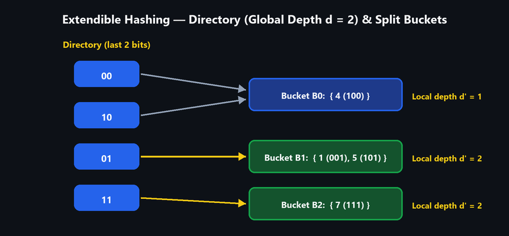

# UNIT I — Algorithm Analysis and Hashing

> **Source:** *Advanced Data Structures & Algorithm Analysis (2501CS10) — Unit-wise Important Questions — Answers | Aditya University*

---

## 1. Importance of Algorithm Analysis and Time vs. Space Complexity

**Q1. Explain the importance of algorithm analysis. Differentiate between time complexity and space complexity with suitable examples.**

Algorithm analysis is the process of estimating the resources (time and memory) an algorithm needs as a function of the input size $n$, independent of machine and language.

### Importance

1. Compare different algorithms for the same problem and choose the best one.
2. Predict performance for large inputs before implementation.
3. Identify the best, average and worst case behaviour.
4. Avoid wasting time and memory (scalability).
5. Gives a machine-independent measure using asymptotic notation.

| Aspect | Time Complexity | Space Complexity |
|---|---|---|
| **Meaning** | Amount of time (number of basic operations) as a function of $n$ | Amount of memory needed as a function of $n$ |
| **Measured by** | Counting steps/operations | Input space + auxiliary (extra) space + recursion stack |
| **Unit** | Number of operations | Number of memory words/bytes |
| **Example 1** | Linear search: $O(n)$ | Linear search: $O(1)$ extra space |
| **Example 2** | Merge sort: $O(n \log n)$ | Merge sort: $O(n)$ auxiliary array |
| **Example 3** | Matrix addition: $O(n^2)$ | Matrix addition: $O(n^2)$ for result |
| **Trade-off** | Can often be reduced by using more memory (e.g. hashing, DP tables) | Can be reduced by recomputation, usually at the cost of time |

---

## 2. Asymptotic Notations: Big-O, Omega, and Theta

**Q2. Describe the asymptotic notations $O$, $\Omega$ and $\Theta$. Illustrate each notation with suitable examples.**

Asymptotic notations describe the growth rate of a function $f(n)$ for large $n$.

### 1. Big-O (upper bound, worst case)

$$
f(n) = O(g(n)) \text{ if there exist constants } c > 0 \text{ and } n_0 \text{ such that } f(n) \le c \cdot g(n) \text{ for all } n \ge n_0.
$$

- **Example:** $f(n) = 3n + 2$. Since $3n + 2 \le 4n$ for $n \ge 2$, $f(n) = O(n)$ ($c = 4, n_0 = 2$).

### 2. Big-Omega $\Omega$ (lower bound, best case)

$$
f(n) = \Omega(g(n)) \text{ if there exist } c > 0 \text{ and } n_0 \text{ such that } f(n) \ge c \cdot g(n) \text{ for all } n \ge n_0.
$$

- **Example:** $3n + 2 \ge 3n$ for $n \ge 1$, so $f(n) = \Omega(n)$ ($c = 3, n_0 = 1$).

### 3. Big-Theta $\Theta$ (tight bound)

$$
f(n) = \Theta(g(n)) \text{ if there exist } c_1, c_2 > 0 \text{ and } n_0 \text{ such that } c_1 \cdot g(n) \le f(n) \le c_2 \cdot g(n) \text{ for all } n \ge n_0.
$$

- **Example:** $3n \le 3n + 2 \le 4n$ for $n \ge 2$, so $f(n) = \Theta(n)$. Equivalent to $f(n) = O(g(n))$ and $f(n) = \Omega(g(n))$.

| Notation | Meaning | Bound | Typical use |
|---|---|---|---|
| $O(g)$ | $f$ grows no faster than $g$ | Upper | Worst case |
| $\Omega(g)$ | $f$ grows at least as fast as $g$ | Lower | Best case |
| $\Theta(g)$ | $f$ grows exactly like $g$ | Tight | Exact rate |

**Order of growth:**

$$
1 < \log n < n < n \log n < n^2 < n^3 < 2^n < n!
$$

---

## 3. Time Complexity of Matrix Multiplication (Tabular / Step-Count Method)

**Q3. Analyze the time complexity of the matrix multiplication algorithm (tabular method) using asymptotic notation and justify your answer.**

### Algorithm (for two $n \times n$ matrices $A$ and $B$)

```text
for i = 1 to n          // runs n times
    for j = 1 to n      // runs n times for each i
        C[i][j] = 0
        for k = 1 to n  // runs n times for each (i, j)
            C[i][j] = C[i][j] + A[i][k] * B[k][j]
```

### Analysis

- The innermost statement executes once for every combination of $(i, j, k)$: $n \times n \times n = n^3$ times.
- The statement `C[i][j] = 0` executes $n^2$ times.
- Loop overhead is proportional to $n^3$ as well.

$$
T(n) = c_1 \cdot n^3 + c_2 \cdot n^2 + c_3 \cdot n + c_4
$$

### Justification

- **Upper bound:** $T(n) \le c \cdot n^3$ for large $n$, so $T(n) = O(n^3)$.
- **Lower bound:** $T(n) \ge c' \cdot n^3$ (at least $n^3$ multiplications are performed in every case), so $T(n) = \Omega(n^3)$.
- Therefore $T(n) = \Theta(n^3)$ in best, average and worst case (the running time does not depend on the values in the matrices).
- **Space complexity:** $\Theta(n^2)$ for the result matrix. (Strassen's method reduces the time to $O(n^{2.81})$.)

---

## 4. Concept of Hashing and Hash Functions

**Q4. Explain the concept of hashing. Discuss different hash functions with suitable examples.**

Hashing is a technique to store and retrieve data in nearly $O(1)$ time. A hash function $h(k)$ maps a key $k$ to an index (address) in a hash table of size $m$. Insert, search and delete use this index directly.

```text
key ---> h(key) ---> index in hash table T[0 .. m-1]
```

**Characteristics of a good hash function:** easy and fast to compute; distributes keys uniformly; minimises collisions; uses all parts of the key.

### Common hash functions

1. **Division method:** $h(k) = k \bmod m$ ($m$ is preferably a prime).
   - *Example:* $m = 10, k = 237$, so $h = 237 \bmod 10 = 7$.
2. **Multiplication method:** $h(k) = \lfloor m \cdot (k \cdot A \bmod 1) \rfloor$, where $0 < A < 1$ (e.g. $A \approx 0.618$).
   - *Example:* $k = 123, m = 100, A = 0.618$: $k \cdot A = 76.014$, fractional part $0.014$, so $h = \lfloor 100 \times 0.014 \rfloor = 1$.
3. **Mid-square method:** Square the key and take the middle digits.
   - *Example:* $k = 123, k^2 = 15129$, middle digits `"12"` gives $h = 12$.
4. **Folding method:** Divide the key into equal parts and add them (shift or boundary folding).
   - *Example:* $k = 123456$, parts $12 + 34 + 56 = 102$, so $h = 102 \bmod 100 = 2$.
5. **Digit analysis:** Choose the digits of the key that are most uniformly distributed (used when all keys are known in advance).

---

## 5. Collision Resolution Techniques

**Q5. Explain the collision resolution techniques: Linear Probing, Quadratic Probing, Double Hashing and Separate Chaining.**

A collision occurs when $h(k_1) = h(k_2)$ for two different keys. Techniques are of two kinds: open addressing (probing) and chaining.

**Example data:** table size $m = 10$, keys `23, 43, 13, 27`, $h(k) = k \bmod 10$. Keys `23, 43, 13` all hash to index `3`.

1. **Linear Probing:** $h(k, i) = (h(k) + i) \bmod m$. Try the next free slot sequentially.
   - `23` goes to `3`; `43` to `3` (occupied), try `4`, so `4`; `13` to `3`, `4` occupied, so `5`; `27` goes to `7`.
   - **Table:** `3:23, 4:43, 5:13, 7:27`.
   - **Drawback:** primary clustering.
2. **Quadratic Probing:** $h(k, i) = (h(k) + i^2) \bmod m$.
   - `23` to `3`; `43` to `3` (occupied), $3+1 = 4$, so `4`; `13` to `3`, `4` occupied, $3+4 = 7$, so `7`; `27` to `7` (occupied), $7+1 = 8$, so `8`.
   - **Table:** `3:23, 4:43, 7:13, 8:27`.
   - Reduces primary clustering but causes secondary clustering.
3. **Double Hashing:** $h(k, i) = (h_1(k) + i \cdot h_2(k)) \bmod m$, with $h_2(k) = 7 - (k \bmod 7)$.
   - `23` to `3`; `43`: $h_2 = 7 - 1 = 6$, $(3+6) \bmod 10 = 9$, so `9`; `13`: $h_2 = 7 - 6 = 1$, $(3+1) = 4$, so `4`; `27` goes to `7`.
   - **Table:** `3:23, 4:13, 7:27, 9:43`.
   - Best distribution; avoids both primary and secondary clustering.
4. **Separate Chaining:** Each table slot holds a linked list of all keys that hash to it.
   - Slot `3`: `23 → 43 → 13`; slot `7`: `27`.
   - Table never overflows; load factor can exceed 1; needs extra memory for pointers.

| Method | Clustering | Extra memory | Table can overflow |
|---|---|---|---|
| Linear probing | Primary | No | Yes |
| Quadratic probing | Secondary | No | Yes |
| Double hashing | Minimal | No | Yes |
| Separate chaining | None | Yes (pointers) | No |

---

## 6. Static Hashing vs. Dynamic Hashing (Extendible Hashing)

**Q6. Differentiate between Static Hashing and Dynamic Hashing. Explain the working of Dynamic (Extendable) Hashing with an example.**

| Feature | Static Hashing | Dynamic Hashing |
|---|---|---|
| **Table size** | Fixed number of buckets | Grows and shrinks with the data |
| **Hash function** | Fixed, $h(k) = k \bmod m$ | Uses a variable number of bits of the hash value |
| **Overflow** | Needs overflow chains/probing; performance degrades | Handled by splitting buckets |
| **Reorganisation** | Costly full rehashing when the table is full | Only one bucket is split at a time |
| **Space** | Wasted if the file is small, overflow if large | Efficient use of space |
| **Example** | Simple hash table | Extendable hashing, linear hashing |

### Extendable Hashing — working

- A directory of $2^d$ pointers is indexed by the first/last $d$ bits of $h(k)$ ($d =$ global depth).
- Each bucket has a local depth $d' \le d$ and a fixed capacity.
- Several directory entries may point to the same bucket.
- **Insert:** find the bucket using $d$ bits. If there is space, insert. If the bucket is full:
  - If $d' < d$: split the bucket, increase its local depth, redistribute keys.
  - If $d' = d$: double the directory ($d = d + 1$), then split the bucket.

### Example

Bucket capacity $= 2$, using the last bits of the binary key. Initial global depth $d = 1$.

1. Insert `4` (`100`) goes to bucket `"0"`: `{4}`. Insert `1` (`001`) goes to bucket `"1"`: `{1}`. Insert `5` (`101`) goes to bucket `"1"`: `{1, 5}` (now full).
2. Insert `7` (`111`): bucket `"1"` is full and $d' = d = 1$, so double the directory ($d = 2$) and split the bucket using 2 bits.
3. Keys with last two bits `01` are `1` and `5`; key with `11` is `7`.

| Directory (last 2 bits) | Points to bucket | Local depth |
|---|---|---:|
| `00` | $B_0 = \{4\}$ | 1 |
| `10` | $B_0 = \{4\}$ (shared) | 1 |
| `01` | $B_1 = \{1, 5\}$ | 2 |
| `11` | $B_2 = \{7\}$ | 2 |



- **Advantages:** no full rehash, grows gracefully, at most two disk accesses.
- **Disadvantage:** the directory itself can become large.
