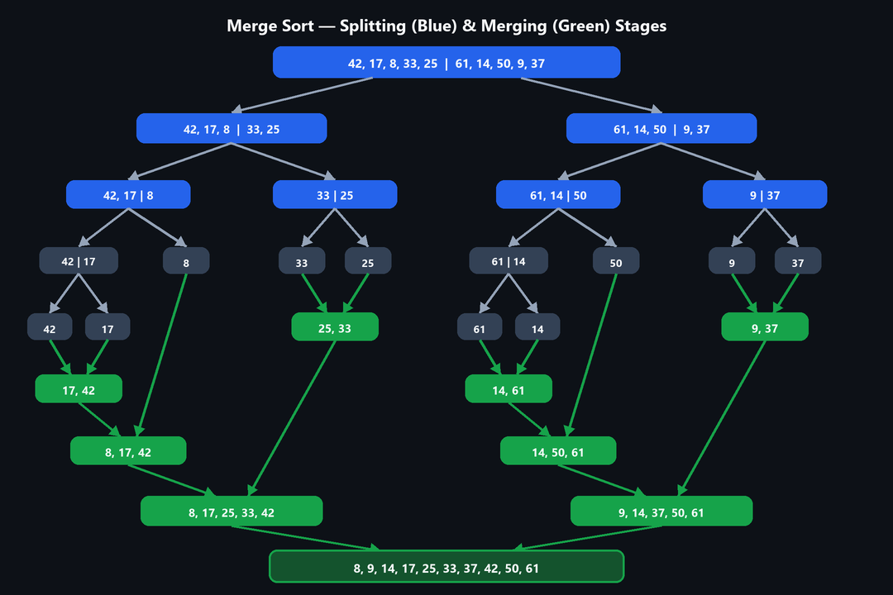
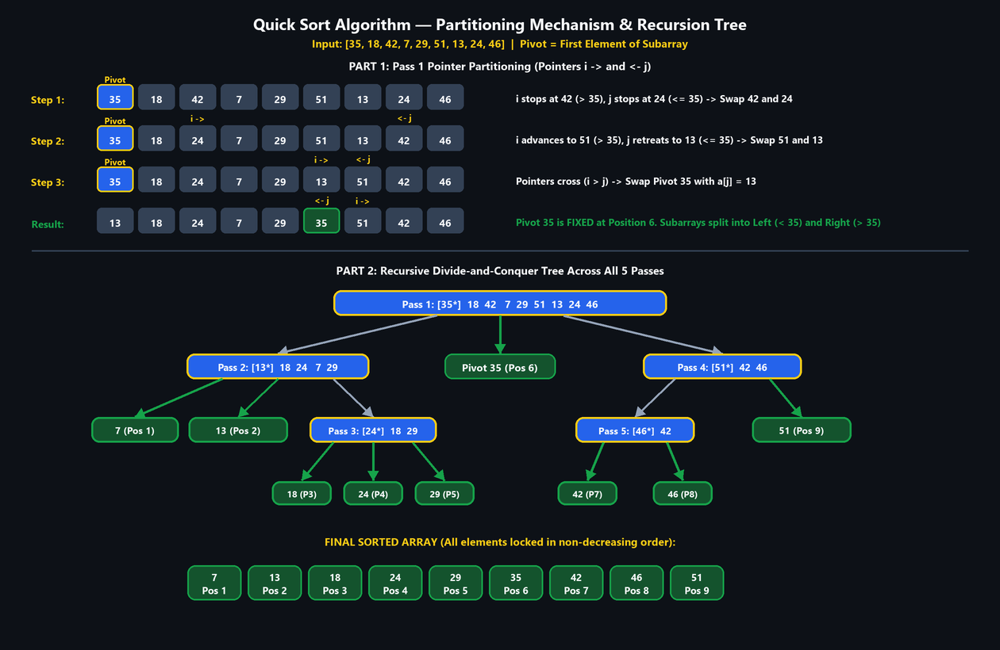
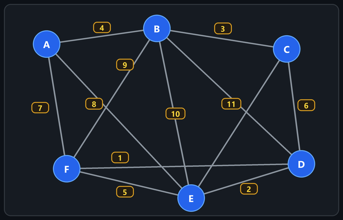
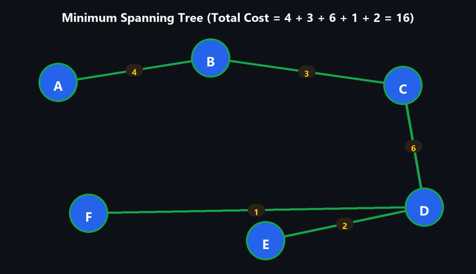
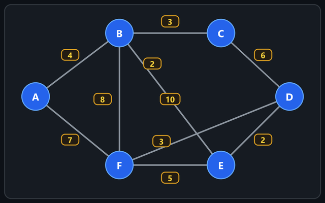

# UNIT III — Divide and Conquer, Greedy Method

> **Source:** *Advanced Data Structures & Algorithm Analysis (2501CS10) — Unit-wise Important Questions — Answers | Aditya University*

---

## 1. Divide and Conquer and Binary Search

### 1(A) Explain the general methodology of Divide and Conquer. Illustrate its three fundamental steps with examples. (8 marks)

Divide and Conquer (D&C) solves a problem by breaking it into smaller sub-problems of the same type, solving them recursively, and combining their results.

#### Three steps

1. **Divide:** Split the problem of size $n$ into $a$ sub-problems, each of size about $n/b$.
2. **Conquer:** Solve each sub-problem recursively (a small sub-problem is solved directly — the base case).
3. **Combine:** Merge the sub-solutions into the solution of the original problem.

**General recurrence:**

$$
T(n) = a \cdot T(n/b) + f(n)
$$

where $f(n)$ is the cost of dividing and combining. (Master theorem gives the solution.)

#### General algorithm

```text
DAndC(P):
    if small(P) return Solve(P)
    divide P into P1, P2, ..., Pk
    return Combine( DAndC(P1), DAndC(P2), ..., DAndC(Pk) )
```

#### Examples

| Problem | Divide | Conquer | Combine | Time |
|---|---|---|---|---|
| **Binary search** | Compare with mid element; keep one half | Search that half | Nothing | $O(\log n)$ |
| **Merge sort** | Split array into two halves | Sort each half | Merge two sorted halves | $O(n \log n)$ |
| **Quick sort** | Partition around pivot | Sort both partitions | Nothing (in place) | $O(n \log n)$ avg |

---

### 1(B) Apply Binary Search to locate a key in a sorted array of at least 15 keys. Show low, high, and mid at every iteration and count comparisons. (8 marks)

**Own dataset (15 sorted keys), indices 0 to 14:**

| Index | 0 | 1 | 2 | 3 | 4 | 5 | 6 | 7 | 8 | 9 | 10 | 11 | 12 | 13 | 14 |
|---|---:|---:|---:|---:|---:|---:|---:|---:|---:|---:|---:|---:|---:|---:|---:|
| **Key** | 5 | 12 | 18 | 23 | 27 | 31 | 36 | 42 | 49 | 54 | 60 | 67 | 73 | 81 | 90 |

Search key $= 81$. $\text{mid} = \lfloor (\text{low} + \text{high}) / 2 \rfloor$.

| Iteration | low | high | mid | A[mid] | Comparison | Action |
|---:|---:|---:|---:|---:|---|---|
| 1 | 0 | 14 | 7 | 42 | $81 > 42$ | $\text{low} = \text{mid} + 1 = 8$ |
| 2 | 8 | 14 | 11 | 67 | $81 > 67$ | $\text{low} = \text{mid} + 1 = 12$ |
| 3 | 12 | 14 | 13 | 81 | $81 = 81$ | Found at index 13 |

**Total comparisons $= 3$** (key found at position 14 in 1-based numbering).

**Complexity:** Best case $O(1)$ (key at the first mid); worst and average case $O(\log n)$. For $n = 15$ at most $\lfloor \log_2 15 \rfloor + 1 = 4$ comparisons are ever required. **Prerequisite:** the array must be sorted.

---

## 2. Merge Sort

**Q2. Demonstrate the Merge Sort algorithm on the dataset `42, 17, 8, 33, 25, 61, 14, 50, 9, 37`. Draw the splitting and merging stages. Explain the recurrence relation and derive the time complexity.**

### Splitting (divide) and Merging (combine) stages



- **Merging steps:**
  - `[42] + [17] → [17, 42]` and `[61] + [14] → [14, 61]`
  - `[17, 42] + [8] → [8, 17, 42]` and `[14, 61] + [50] → [14, 50, 61]`
  - `[33] + [25] → [25, 33]` and `[9] + [37] → [9, 37]`
  - `[8, 17, 42] + [25, 33] → [8, 17, 25, 33, 42]` and `[14, 50, 61] + [9, 37] → [9, 14, 37, 50, 61]`
  - `[8, 17, 25, 33, 42] + [9, 14, 37, 50, 61] → [8, 9, 14, 17, 25, 33, 37, 42, 50, 61]`

**Sorted output:** `8, 9, 14, 17, 25, 33, 37, 42, 50, 61`

### Recurrence relation

- Divide: $O(1)$. Conquer: two sub-problems of size $n/2$. Combine (merge): $O(n)$.

$$
T(n) = 2T(n/2) + n, \quad \text{with } T(1) = 1.
$$

### Derivation (expansion)

$$
\begin{aligned}
T(n) &= 2T(n/2) + n \\
     &= 4T(n/4) + 2n \\
     &= 8T(n/8) + 3n \\
     &\;\;\vdots \\
     &= 2^k T(n/2^k) + k \cdot n
\end{aligned}
$$

Put $n / 2^k = 1$, so $k = \log_2 n$:

$$
T(n) = n \cdot T(1) + n \cdot \log_2 n = \Theta(n \log n)
$$

*(Master theorem: $a = 2, b = 2, f(n) = n = n^{\log_b a}$, case 2, so $\Theta(n \log n)$.)* Time is $O(n \log n)$ in best, average and worst case; extra space is $O(n)$.

---

## 3. Quick Sort

**Q3. Analyze the working of Quick Sort on `35, 18, 42, 7, 29, 51, 13, 24, 46`, taking the first element as the pivot in every step.**

**Partitioning method:** pivot $=$ first element; pointer $i$ moves right to find an element $> \text{pivot}$; pointer $j$ moves left to find an element $\le \text{pivot}$; swap them while $i < j$; finally swap the pivot with `a[j]`.

- **Pass 1 — pivot 35** (array `35 18 42 7 29 51 13 24 46`):
  - $i$ stops at `42`, $j$ stops at `24`: swap, giving `35 18 24 7 29 51 13 42 46`.
  - $i$ stops at `51`, $j$ stops at `13`: swap, giving `35 18 24 7 29 13 51 42 46`.
  - $i$ crosses $j$: swap pivot with `a[j]`, giving `13 18 24 7 29 | 35 | 51 42 46`. Pivot `35` is at position 6.
- **Pass 2 — left part `[13 18 24 7 29]`, pivot 13:** result `7 | 13 | 24 18 29`, so `13` is at position 2.
- **Pass 3 — `[24 18 29]`, pivot 24:** result `18 | 24 | 29`, so `24` is at position 4. (Single elements `7, 18, 29` are already in place.)
- **Pass 4 — right part `[51 42 46]`, pivot 51:** result `46 42 | 51`, so `51` is at position 9.
- **Pass 5 — `[46 42]`, pivot 46:** result `42 | 46`, so `46` is at position 8.

| Pass | Sub-array | Pivot | Pivot final position | Result |
|---:|---|---:|---:|---|
| 1 | whole array | 35 | 6 | `13 18 24 7 29 35 51 42 46` |
| 2 | `13 18 24 7 29` | 13 | 2 | `7 13 24 18 29` |
| 3 | `24 18 29` | 24 | 4 | `18 24 29` |
| 4 | `51 42 46` | 51 | 9 | `46 42 51` |
| 5 | `46 42` | 46 | 8 | `42 46` |



**Sorted array:** `7, 13, 18, 24, 29, 35, 42, 46, 51`

### Complexity comparison

| Case | When | Recurrence | Time |
|---|---|---|---|
| **Best case** | Pivot always splits array into two equal halves | $T(n) = 2T(n/2) + n$ | $O(n \log n)$ |
| **Average case** | Random pivot positions | similar | $O(n \log n)$ |
| **Worst case** | Array already sorted/reverse sorted (pivot is the smallest or largest) | $T(n) = T(n-1) + n$ | $O(n^2)$ |

**Space:** $O(\log n)$ average (recursion stack), $O(n)$ worst case. Quick sort is in-place but not stable.

---

## 4. Greedy Job Sequencing with Deadlines

**Q4. Apply the Greedy Job Sequencing algorithm to maximise total profit (each job takes one unit of time).**

### Given jobs

| Job | J1 | J2 | J3 | J4 | J5 | J6 | J7 |
|---|---:|---:|---:|---:|---:|---:|---:|
| **Deadline** | 2 | 1 | 2 | 1 | 3 | 2 | 3 |
| **Profit** | 100 | 19 | 27 | 25 | 15 | 35 | 40 |

**Greedy rule:** sort jobs by profit in decreasing order; place each job in the latest free slot on or before its deadline; reject it if no slot is free. Maximum deadline $= 3$, so there are 3 time slots: `[0-1], [1-2], [2-3]`.

**Sorted by profit:** `J1(100, d2), J7(40, d3), J6(35, d2), J3(27, d2), J4(25, d1), J2(19, d1), J5(15, d3)`

| Step | Job | Deadline | Slot chosen | Decision |
|---:|---|---:|---|---|
| 1 | J1 (100) | 2 | slot 2 | Accepted |
| 2 | J7 (40) | 3 | slot 3 | Accepted |
| 3 | J6 (35) | 2 | slot 2 is taken, so slot 1 | Accepted |
| 4 | J3 (27) | 2 | slots 2 and 1 full | Rejected |
| 5 | J4 (25) | 1 | slot 1 full | Rejected |
| 6 | J2 (19) | 1 | slot 1 full | Rejected |
| 7 | J5 (15) | 3 | slots 3, 2, 1 full | Rejected |

### Schedule

| Slot 1 | Slot 2 | Slot 3 |
|:---:|:---:|:---:|
| J6 | J1 | J7 |

- **Selected jobs:** `J6, J1, J7`.
- **Execution order:** `J6`, then `J1`, then `J7`.
- **Maximum profit:**

$$
35 + 100 + 40 = \boxed{175}
$$

**Justification:** Always taking the highest-profit job first and delaying it as late as possible keeps earlier slots free for jobs with tight deadlines, so no profitable job is blocked unnecessarily. **Time complexity:** $O(n^2)$ (or $O(n \log n)$ with a disjoint-set structure).

---

## 5. Fractional Knapsack using Greedy

**Q5. Analyze the Fractional Knapsack problem using the Greedy approach (knapsack capacity $= 50$).**

### Given items

| Item | Weight | Profit | Profit / Weight |
|---|---:|---:|---:|
| I1 | 10 | 60 | 6.0 |
| I2 | 20 | 100 | 5.0 |
| I3 | 30 | 120 | 4.0 |
| I4 | 15 | 75 | 5.0 |
| I5 | 25 | 125 | 5.0 |

**Greedy rule:** sort items by profit/weight ratio in decreasing order and take as much as possible of each until the knapsack is full. Order: `I1 (6)`, then `I2, I4, I5 (all 5)`, then `I3 (4)`.

| Step | Item taken | Fraction | Weight added | Profit added | Remaining capacity |
|---:|---|---|---:|---|---:|
| 1 | I1 | full | 10 | $60$ | 40 |
| 2 | I2 | full | 20 | $100$ | 20 |
| 3 | I4 | full | 15 | $75$ | 5 |
| 4 | I5 | $5/25 = 0.2$ | 5 | $0.2 \times 125 = 25$ | 0 |

$$
\text{Maximum profit} = 60 + 100 + 75 + 25 = \boxed{260}
$$

**Solution vector:** $x = (I_1 = 1, I_2 = 1, I_3 = 0, I_4 = 1, I_5 = 0.2)$. *(Items I2, I4, I5 have equal ratio 5, so any order among them gives the same total of 260.)*

**Why greedy works here:** items can be divided, so filling the capacity with the highest value-per-unit-weight material first can never be improved by exchanging it for a lower ratio item (greedy-choice property + optimal substructure). This is not true for 0/1 knapsack. **Time:** $O(n \log n)$ for sorting.

---

## 6. Minimum Spanning Tree using Kruskal’s and Prim’s algorithms

**Q6. Construct a Minimum Spanning Tree of the given weighted undirected graph using Kruskal's and Prim's algorithms.**



### Graph Summary & Problem Objective
- **Vertices ($V$):** 6 vertices — $\{A, B, C, D, E, F\}$
- **Objective:** Find a spanning tree connecting all 6 vertices with minimum total edge weight.
- **MST Property:** For a graph with $|V| = 6$ vertices, an MST must contain exactly:
  $$|V| - 1 = 6 - 1 = \mathbf{5 \text{ edges}}$$
  with zero cycles.
- **All 12 Edges sorted by weight:**
  1. `(F, D)` = 1
  2. `(E, D)` = 2
  3. `(B, C)` = 3
  4. `(A, B)` = 4
  5. `(F, E)` = 5
  6. `(C, D)` = 6
  7. `(A, F)` = 7
  8. `(A, E)` = 8
  9. `(C, E)` = 8
  10. `(B, F)` = 9
  11. `(B, E)` = 10
  12. `(B, D)` = 11

---

### A. Kruskal's algorithm (sort edges by weight; add an edge if it does not form a cycle)

#### Intuition & Mechanism
1. Start with 6 separate singleton components: `"{A}", "{B}", "{C}", "{D}", "{E}", "{F}"`.
2. Consider edges one by one in non-decreasing order of weight.
3. If an edge connects two **different components**, **ACCEPT** it and union the components.
4. If an edge connects vertices already in the **same component**, **REJECT** it (it would form a cycle).
5. Stop as soon as **5 edges** are accepted.

---

#### Step-by-Step Execution of Kruskal's Algorithm

##### Step 1: Consider Edge `(F, D)` — Weight = 1
- **Component of F:** `{F}` | **Component of D:** `{D}`
- **Action:** **ACCEPT** (connects two separate components).
- **Union:** Merge `{F}` and `{D}` $\rightarrow$ `{D, F}`.
- **Visual Forest in Text:**
  ```text
  Component 1: (F) ----- [1] ----- (D)
  Isolated:    (A)   (B)   (C)   (E)
  ```
- **Current MST Edges (1/5):** `{(F, D)}` | **Running Cost:** $1$

---

##### Step 2: Consider Edge `(E, D)` — Weight = 2
- **Component of E:** `{E}` | **Component of D:** `{D, F}`
- **Action:** **ACCEPT** (connects vertex `E` to component `{D, F}`).
- **Union:** Merge `{E}` and `{D, F}` $\rightarrow$ `{D, E, F}`.
- **Visual Forest in Text:**
  ```text
  Component 1: (F) ----- [1] ----- (D) ----- [2] ----- (E)
  Isolated:    (A)   (B)   (C)
  ```
- **Current MST Edges (2/5):** `{(F, D), (E, D)}` | **Running Cost:** $1 + 2 = 3$

---

##### Step 3: Consider Edge `(B, C)` — Weight = 3
- **Component of B:** `{B}` | **Component of C:** `{C}`
- **Action:** **ACCEPT** (creates a new connected component `{B, C}`).
- **Union:** Merge `{B}` and `{C}` $\rightarrow$ `{B, C}`.
- **Visual Forest in Text (2 Trees Growing):**
  ```text
  Component 1: (B) ----- [3] ----- (C)

  Component 2: (F) ----- [1] ----- (D) ----- [2] ----- (E)

  Isolated:    (A)
  ```
- **Current MST Edges (3/5):** `{(F, D), (E, D), (B, C)}` | **Running Cost:** $1 + 2 + 3 = 6$

---

##### Step 4: Consider Edge `(A, B)` — Weight = 4
- **Component of A:** `{A}` | **Component of B:** `{B, C}`
- **Action:** **ACCEPT** (connects singleton `{A}` to component `{B, C}`).
- **Union:** Merge `{A}` and `{B, C}` $\rightarrow$ `{A, B, C}`.
- **Visual Forest in Text (2 Major Trees):**
  ```text
  Component 1: (A) ----- [4] ----- (B) ----- [3] ----- (C)

  Component 2: (F) ----- [1] ----- (D) ----- [2] ----- (E)
  ```
- **Current MST Edges (4/5):** `{(F, D), (E, D), (B, C), (A, B)}` | **Running Cost:** $1 + 2 + 3 + 4 = 10$

---

##### Step 5: Consider Edge `(F, E)` — Weight = 5
- **Component of F:** `{D, E, F}` | **Component of E:** `{D, E, F}`
- **Action:** ❌ **REJECT (Cycle Detected!)**
- **Reason:** Both `F` and `E` already belong to the same connected component via path `F — D — E`. Adding `(F, E)` would close the loop `F — D — E — F`.
- **Visual State:** No change to the tree structure.

---

##### Step 6: Consider Edge `(C, D)` — Weight = 6
- **Component of C:** `{A, B, C}` | **Component of D:** `{D, E, F}`
- **Action:** **ACCEPT** (bridges Component 1 and Component 2 together!).
- **Union:** Merge `{A, B, C}` and `{D, E, F}` $\rightarrow$ `{A, B, C, D, E, F}` (All 6 vertices now united into 1 single spanning tree).
- **Visual Full Spanning Tree in Text:**
  ```text
  (A) ---[4]--- (B) ---[3]--- (C) ---[6]--- (D) ---[2]--- (E)
                                             |
                                            [1]
                                             |
                                            (F)
  ```
- **Current MST Edges (5/5):** `{(F, D), (E, D), (B, C), (A, B), (C, D)}`
- **Total Minimum Cost:** $1 + 2 + 3 + 4 + 6 = \mathbf{16}$

> **Early Termination:** Exactly 5 edges ($|V| - 1$) have been selected. All remaining edges (`A–F 7`, `A–E 8`, `C–E 8`, `B–F 9`, `B–E 10`, `B–D 11`) are discarded because any further addition would create cycles.

---

#### Kruskal's Decision Table Summary

| Step | Edge Examined | Weight | Endpoints Components | Decision | Reason & Cycle Analysis | Running Cost |
|:---:|:---:|:---:|:---:|:---:|:---|:---:|
| **1** | `F–D` | 1 | `{F}` vs `{D}` | **ACCEPT** | Connects separate components | **1** |
| **2** | `E–D` | 2 | `{E}` vs `{D, F}` | **ACCEPT** | Connects `E` to `{D, F}` | **3** |
| **3** | `B–C` | 3 | `{B}` vs `{C}` | **ACCEPT** | Connects `B` and `C` | **6** |
| **4** | `A–B` | 4 | `{A}` vs `{B, C}` | **ACCEPT** | Connects `A` to `{B, C}` | **10** |
| **5** | `F–E` | 5 | `{D, E, F}` vs `{D, E, F}` | ❌ **REJECT** | Creates cycle `F–D–E–F` | 10 |
| **6** | `C–D` | 6 | `{A, B, C}` vs `{D, E, F}` | **ACCEPT** | Bridges all 6 vertices into 1 tree | **16** |
| 7–12 | `A–F`, `A–E`, etc. | $\ge 7$ | Same component | ❌ **SKIP** | $V-1=5$ edges already acquired | **16** |

---

### B. Prim's algorithm (start at A; repeatedly add the cheapest edge connecting the tree to a new vertex)

#### Intuition & Mechanism
1. Start with an arbitrary seed vertex: **Start at vertex A**.
2. Define the tree set: $S = \{A\}$. Non-tree vertices: $V \setminus S = \{B, C, D, E, F\}$.
3. At each step, examine all **cut/crossing edges** connecting a vertex in $S$ to a vertex in $V \setminus S$.
4. Greedily pick the **cheapest crossing edge**, add the newly connected vertex to $S$, and expand the tree.
5. Repeat until all 6 vertices are included in $S$.

---

#### Step-by-Step Execution of Prim's Algorithm

##### Initial State:
- **Tree Vertices ($S$):** `{A}`
- **Unvisited Vertices ($V \setminus S$):** `{B, C, D, E, F}`
- **Visual in Text:**
  ```text
  [Tree S] : (A)
  ```

---

##### Step 1: Grow from `{A}`
- **Available Crossing Edges from A:**
  - `A — B` (weight 4)
  - `A — F` (weight 7)
  - `A — E` (weight 8)
- **Minimum Choice:** `A — B` with weight **4**.
- **Action:** Add vertex **B** and edge `(A, B)`.
- **New Tree Vertices ($S$):** `{A, B}`
- **Visual in Text:**
  ```text
  (A) ----- [4] ----- (B)
  ```
- **Running Cost:** $4$

---

##### Step 2: Grow from `{A, B}`
- **Available Crossing Edges from `{A, B}` to `{C, D, E, F}`:**
  - From A: `A — F (7)`, `A — E (8)`
  - From B: `B — C (3)`, `B — F (9)`, `B — E (10)`, `B — D (11)`
- **Minimum Choice:** `B — C` with weight **3**.
- **Action:** Add vertex **C** and edge `(B, C)`.
- **New Tree Vertices ($S$):** `{A, B, C}`
- **Visual in Text:**
  ```text
  (A) ----- [4] ----- (B) ----- [3] ----- (C)
  ```
- **Running Cost:** $4 + 3 = 7$

---

##### Step 3: Grow from `{A, B, C}`
- **Available Crossing Edges from `{A, B, C}` to `{D, E, F}`:**
  - From A: `A — F (7)`, `A — E (8)`
  - From B: `B — F (9)`, `B — E (10)`, `B — D (11)`
  - From C: `C — D (6)`, `C — E (8)`
- **Minimum Choice:** `C — D` with weight **6**.
- **Action:** Add vertex **D** and edge `(C, D)`.
- **New Tree Vertices ($S$):** `{A, B, C, D}`
- **Visual in Text:**
  ```text
  (A) ----- [4] ----- (B) ----- [3] ----- (C) ----- [6] ----- (D)
  ```
- **Running Cost:** $4 + 3 + 6 = 13$

---

##### Step 4: Grow from `{A, B, C, D}`
- **Available Crossing Edges from `{A, B, C, D}` to `{E, F}`:**
  - From A: `A — F (7)`, `A — E (8)`
  - From B: `B — F (9)`, `B — E (10)`
  - From C: `C — E (8)`
  - From D: `D — F (1)`, `D — E (2)`
- **Minimum Choice:** `D — F` with weight **1**.
- **Action:** Add vertex **F** and edge `(D, F)`.
- **New Tree Vertices ($S$):** `{A, B, C, D, F}`
- **Visual in Text:**
  ```text
  (A) ---[4]--- (B) ---[3]--- (C) ---[6]--- (D)
                                             |
                                            [1]
                                             |
                                            (F)
  ```
- **Running Cost:** $13 + 1 = 14$

---

##### Step 5: Grow from `{A, B, C, D, F}` to `{E}`
- **Available Crossing Edges to unvisited vertex `{E}`:**
  - From A: `A — E (8)`
  - From B: `B — E (10)`
  - From C: `C — E (8)`
  - From D: `D — E (2)`
  - From F: `F — E (5)`
- **Minimum Choice:** `D — E` with weight **2**.
- **Action:** Add vertex **E** and edge `(D, E)`.
- **New Tree Vertices ($S$):** `{A, B, C, D, E, F}` (All 6 vertices reached!)
- **Final Visual Tree in Text:**
  ```text
  (A) ---[4]--- (B) ---[3]--- (C) ---[6]--- (D) ---[2]--- (E)
                                             |
                                            [1]
                                             |
                                            (F)
  ```
- **Total Minimum Cost:** $4 + 3 + 6 + 1 + 2 = \mathbf{16}$

---

#### Prim's Step-by-Step Decision Table

| Step | Tree Vertices ($S$) | Candidate Crossing Edges to ($V \setminus S$) | Cheapest Crossing Edge Selected | New Vertex Added | Step Cost | Total Cost |
|:---:|:---|:---|:---:|:---:|:---:|:---:|
| **1** | `{A}` | `(A,B):4`, `(A,F):7`, `(A,E):8` | `(A, B)` | **B** | 4 | **4** |
| **2** | `{A, B}` | `(B,C):3`, `(A,F):7`, `(A,E):8`, `(B,F):9`, `(B,E):10`, `(B,D):11` | `(B, C)` | **C** | 3 | **7** |
| **3** | `{A, B, C}` | `(C,D):6`, `(A,F):7`, `(A,E):8`, `(C,E):8`, `(B,F):9`, `(B,E):10`, `(B,D):11` | `(C, D)` | **D** | 6 | **13** |
| **4** | `{A, B, C, D}` | `(D,F):1`, `(D,E):2`, `(A,F):7`, `(A,E):8`, `(C,E):8` | `(D, F)` | **F** | 1 | **14** |
| **5** | `{A, B, C, D, F}` | `(D,E):2`, `(F,E):5`, `(A,E):8`, `(C,E):8`, `(B,E):10` | `(D, E)` | **E** | 2 | **16** |

---

### Final Minimum Spanning Tree Result (Cost = 16)



```text
                  [B] -----------(3)----------- [C]
                 /                                \
               (4)                                (6)
               /                                    \
             [A]                                    [D]
                                                   /   \
                                                 (1)   (2)
                                                 /       \
                                               [F]       [E]
```

- **Selected Edges:** `(A, B): 4`, `(B, C): 3`, `(C, D): 6`, `(D, F): 1`, `(D, E): 2`.
- **Total Minimum Weight:**
  $$\text{Cost} = 4 + 3 + 6 + 1 + 2 = \mathbf{16}$$

---

### Comparison: Kruskal's vs. Prim's Algorithm

| Feature | Kruskal's Algorithm | Prim's Algorithm |
|---|---|---|
| **Strategy** | Edge-driven (global sorted edge order) | Vertex-driven (grows a single contiguous tree) |
| **Intermediate State** | May be a disconnected forest of multiple trees | Always a single connected tree at every step |
| **Data Structures** | Disjoint Set Union (DSU / Find-Union) | Priority Queue (Min-Heap) + Adjacency List |
| **Cycle Handling** | Explicit cycle check via DSU | Inherent (never picks an edge between two already-visited vertices) |
| **Time Complexity** | $O(E \log E)$ or $O(E \log V)$ | $O(E \log V)$ with binary heap ($O(V^2)$ with adjacency matrix) |
| **Best Suited For** | Sparse graphs (few edges) | Dense graphs (many edges) |

---

## 7. Dijkstra’s algorithm from source A

**Q7. Evaluate the shortest paths from source A to all other vertices using Dijkstra's algorithm. Discuss the limitation with negative edge weights.**



**Directed edges:** `A→B 4, A→F 7, B→C 3, B→F 8, B→E 2, C→D 6, F→D 3, F→E 5, E→D 2`.

**Distance table (iteration by iteration).** Vertex chosen $=$ unvisited vertex with the smallest distance.

| Iter | Chosen | A | B | C | D | E | F |
|---|---|---:|---:|---:|---:|---:|---:|
| Init | – | 0 | ∞ | ∞ | ∞ | ∞ | ∞ |
| 1 | A | 0 | 4 | ∞ | ∞ | ∞ | 7 |
| 2 | B (4) | 0 | 4 | 7 | ∞ | 6 | 7 |
| 3 | E (6) | 0 | 4 | 7 | 8 | 6 | 7 |
| 4 | C (7) | 0 | 4 | 7 | 8 | 6 | 7 |
| 5 | F (7) | 0 | 4 | 7 | 8 | 6 | 7 |
| 6 | D (8) | 0 | 4 | 7 | 8 | 6 | 7 |

*(Iteration 2: B relaxes $C = 4+3 = 7$, $F = 4+8 = 12$ (no improvement over 7), $E = 4+2 = 6$. Iteration 3: E relaxes $D = 6+2 = 8$. Later relaxations give no improvement, e.g. $C \to D = 13, F \to D = 10$.)*

### Shortest paths from A

| Destination | Distance | Path |
|---|---:|---|
| B | 4 | `A → B` |
| C | 7 | `A → B → C` |
| E | 6 | `A → B → E` |
| F | 7 | `A → F` |
| D | 8 | `A → B → E → D` |

### Limitation with negative edge weights

Dijkstra's greedy assumption is that once a vertex is selected, its distance is final, because any other path can only be longer. With a negative edge, a longer path through unvisited vertices can later become shorter, so a finalised distance may be wrong. With a negative cycle, shortest paths are not even defined. Hence Dijkstra gives incorrect results on graphs with negative weights; use Bellman–Ford instead.

**Complexity:** $O(V^2)$ with an array, $O((V + E) \log V)$ with a min-heap.
