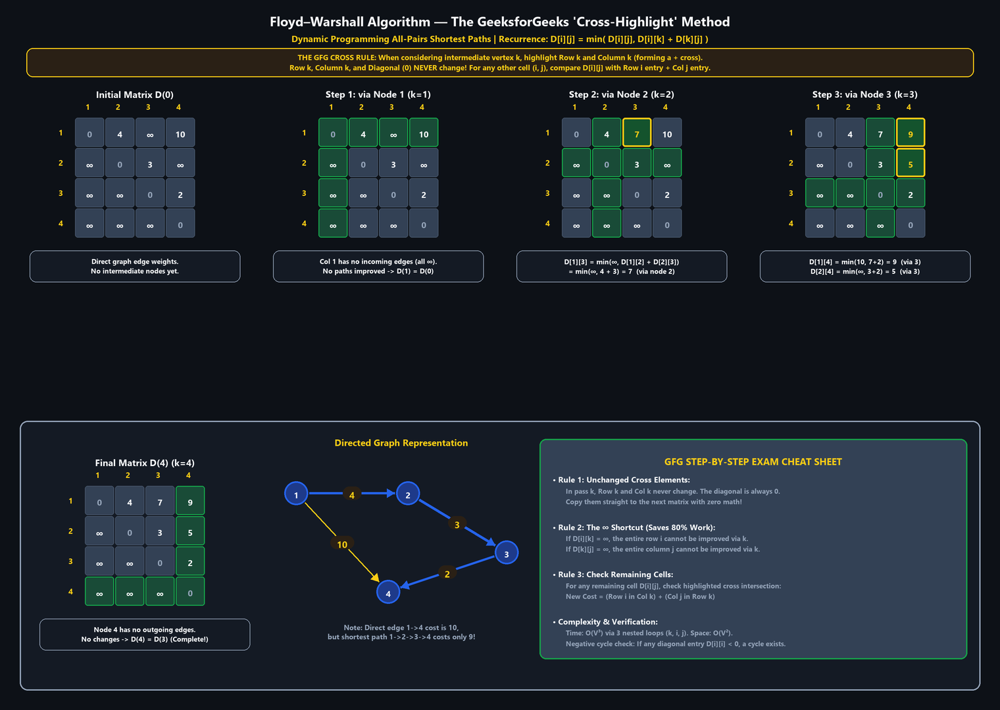

# UNIT IV — Dynamic Programming

> **Source:** *Advanced Data Structures & Algorithm Analysis (2501CS10) — Unit-wise Important Questions — Answers | Aditya University*

---

## 1. Dynamic Programming: methodology, optimal substructure, overlapping subproblems, and comparison with Divide and Conquer

**Q1. Explain the general methodology of Dynamic Programming. Discuss optimal substructure and overlapping subproblems. Differentiate DP from Divide and Conquer.**

Dynamic Programming (DP) solves a complex problem by breaking it into overlapping sub-problems, solving each sub-problem only once, and storing its result (in a table) for reuse. It is mainly used for optimisation problems.

### Steps of DP

1. Characterise the structure of an optimal solution.
2. Define the value of an optimal solution recursively (recurrence).
3. Compute values bottom-up (tabulation) or top-down with memoisation.
4. Construct the optimal solution from the table.

### Principles

1. **Optimal substructure:** an optimal solution to the problem contains optimal solutions to its sub-problems.
   - *Example:* in shortest paths, if the shortest path from A to C goes through B, then its `A→B` and `B→C` parts are themselves shortest paths (Floyd–Warshall, Bellman–Ford).
2. **Overlapping subproblems:** the same sub-problems are solved again and again in a naive recursion.
   - *Example:* Fibonacci: $F(5) = F(4) + F(3)$, and $F(4) = F(3) + F(2)$. $F(3)$ is computed twice. DP stores $F(i)$ in a table and reduces $O(2^n)$ to $O(n)$.

### Dynamic Programming vs. Divide and Conquer

| Basis | Dynamic Programming | Divide and Conquer |
|---|---|---|
| **Sub-problems** | Overlapping (same sub-problem appears repeatedly) | Independent (no overlap) |
| **Strategy** | Solves each sub-problem once and stores the answer | Solves each sub-problem recursively, again every time |
| **Approach** | Bottom-up (or memoised top-down) | Top-down |
| **Storage** | Needs a table (extra memory) | No table; uses only recursion stack |
| **Efficiency** | Polynomial time by avoiding recomputation | Efficient only when sub-problems don't overlap; otherwise exponential |
| **Used for** | Optimisation (knapsack, OBST, TSP, shortest paths) | Sorting, searching, matrix multiplication |
| **Examples** | Floyd–Warshall, 0/1 knapsack, LCS | Merge sort, quick sort, binary search |

---

## 2. Bellman–Ford algorithm from source S

**Q2. Apply the Bellman–Ford algorithm to find shortest paths from source S in the given directed weighted graph. Show the distance values after each iteration and check for a negative cycle.**


> *Note:* the figure refers to an edge list that was not included in the file, so the edge directions below are assumed (left to right as drawn).

**Edges (assumed directions):** `S→A 6, S→E 2, A→B 5, A→E −4, B→C −2, E→C 1, E→D 4, C→D 3`. Vertices: `S, A, B, C, D, E` ($|V| = 6$, so $|V| - 1 = 5$ passes are allowed).

**Relaxation rule:**

$$
\text{if } d[u] + w(u, v) < d[v] \text{ then } d[v] = d[u] + w(u, v).
$$

### Iteration 1 (edges processed in the order listed)

- `S→A`: $d[A] = 6$. `S→E`: $d[E] = 2$.
- `A→B`: $d[B] = 6 + 5 = 11$. `A→E`: $6 - 4 = 2$, no change.
- `B→C`: $d[C] = 11 - 2 = 9$. `E→C`: $2 + 1 = 3$, so $d[C] = 3$.
- `E→D`: $d[D] = 2 + 4 = 6$. `C→D`: $3 + 3 = 6$, no change.

| Iteration | S | A | B | C | D | E |
|---|---:|---:|---:|---:|---:|---:|
| Initial | 0 | ∞ | ∞ | ∞ | ∞ | ∞ |
| 1 | 0 | 6 | 11 | 3 | 6 | 2 |
| 2 | 0 | 6 | 11 | 3 | 6 | 2 |
| 3 to 5 | 0 | 6 | 11 | 3 | 6 | 2 |

No value changes in iteration 2, so the algorithm can stop early.

### Negative cycle check ($|V|$-th pass)

Try to relax every edge once more. No distance decreases, therefore the graph contains **no negative-weight cycle** (all edges go "forward" in the order `S, A, B, E, C, D`, so no cycle exists at all).

### Shortest distances from S

`A = 6, B = 11, C = 3, D = 6, E = 2`.

| Vertex | Distance | Path |
|---|---:|---|
| A | 6 | `S → A` |
| E | 2 | `S → E` (or `S → A → E`, also 2) |
| C | 3 | `S → E → C` |
| D | 6 | `S → E → D` (or `S → E → C → D`) |
| B | 11 | `S → A → B` |

**Complexity:** $O(V \cdot E)$. Unlike Dijkstra, it handles negative weights and detects negative cycles (if any edge can still be relaxed after $V - 1$ passes).

---

## 3. Floyd–Warshall algorithm for all-pairs shortest paths

**Q3. Compute the all-pairs shortest path distances using Floyd–Warshall algorithm for the following initial cost matrix. Show the distance matrix after considering each intermediate vertex and determine the final shortest path matrix. Explain the significance of the intermediate vertex in each iteration and derive the time complexity.**

$$
D^{(0)} =
\begin{bmatrix}
0 & 4 & \infty & 10 \\
\infty & 0 & 3 & \infty \\
\infty & \infty & 0 & 2 \\
\infty & \infty & \infty & 0
\end{bmatrix}
$$



---

### 1. How It Works (The Simple GfG Method)

Formula:
$$
\text{dist}[i][j] = \min(\text{dist}[i][j],\ \text{dist}[i][k] + \text{dist}[k][j])
$$

In simple words: **Is it faster to go directly ($i \to j$), or take a stop at node $k$ ($i \to k \to j$)? Pick whichever is smaller.**

#### How to fill the matrix in 2 easy steps:
In each step $k$:
1. **Highlight Row $k$ and Column $k$:**
   - Row $k$, Column $k$, and the diagonal (`0`) **never change**. Copy them straight to the next table.
2. **For the other cells:**
   - Add the two highlighted numbers from that cell's row and column.
   - If that sum is smaller than what's already there, write the smaller number! (If either number is $\infty$, skip it).

---

### 2. Step-by-Step Walkthrough

#### Initial Matrix $D^{(0)}$:
Direct roads: $1 \to 2$ (4), $1 \to 4$ (10), $2 \to 3$ (3), $3 \to 4$ (2).

$$
D^{(0)} =
\begin{bmatrix}
0 & 4 & \infty & 10 \\
\infty & 0 & 3 & \infty \\
\infty & \infty & 0 & 2 \\
\infty & \infty & \infty & 0
\end{bmatrix}
$$

---

#### Step 1: Intermediate Node $k = 1$
- Highlight Row 1 and Column 1.
- Can any node reach node 1? No (Column 1 is all $\infty$).
- **No road changes.**

$$
D^{(1)} =
\begin{bmatrix}
0 & 4 & \infty & 10 \\
\infty & 0 & 3 & \infty \\
\infty & \infty & 0 & 2 \\
\infty & \infty & \infty & 0
\end{bmatrix}
$$

---

#### Step 2: Intermediate Node $k = 2$
- Highlight Row 2 and Column 2.
- Check path through 2:
  - From 1 to 2 is **4**, and from 2 to 3 is **3**.
  - So from 1 to 3 via 2 costs $4 + 3 = \mathbf{7}$.
  - Previous cost was $\infty$, so **update cell $(1, 3) = 7$**.

$$
D^{(2)} =
\begin{bmatrix}
0 & 4 & \mathbf{7}^* & 10 \\
\infty & 0 & 3 & \infty \\
\infty & \infty & 0 & 2 \\
\infty & \infty & \infty & 0
\end{bmatrix}
$$

---

#### Step 3: Intermediate Node $k = 3$
- Highlight Row 3 and Column 3.
- Check paths through 3:
  1. From 1 to 3 is **7**, and from 3 to 4 is **2** $\implies 7 + 2 = \mathbf{9}$.  
     Old cost was 10, so **update cell $(1, 4) = 9$** (shorter than direct road 10!).
  2. From 2 to 3 is **3**, and from 3 to 4 is **2** $\implies 3 + 2 = \mathbf{5}$.  
     Old cost was $\infty$, so **update cell $(2, 4) = 5$**.

$$
D^{(3)} =
\begin{bmatrix}
0 & 4 & 7 & \mathbf{9}^* \\
\infty & 0 & 3 & \mathbf{5}^* \\
\infty & \infty & 0 & 2 \\
\infty & \infty & \infty & 0
\end{bmatrix}
$$

---

#### Step 4: Intermediate Node $k = 4$
- Highlight Row 4 and Column 4.
- Does node 4 lead to anywhere? No (Row 4 is all $\infty$).
- **No road changes.** All pairs are finished!

$$
D^{(4)} =
\begin{bmatrix}
0 & 4 & 7 & 9 \\
\infty & 0 & 3 & 5 \\
\infty & \infty & 0 & 2 \\
\infty & \infty & \infty & 0
\end{bmatrix}
$$

---

### 3. Summary of Shortest Path Changes

| Node Pair $(i, j)$ | Initial Direct Cost $D^{(0)}$ | Final Shortest Cost $D^{(4)}$ | Intermediate Node Used | Actual Shortest Route |
|:---:|:---:|:---:|:---:|:---|
| **$1 \to 2$** | 4 | **4** | None (direct) | $1 \to 2$ |
| **$1 \to 3$** | $\infty$ | **7** | Node 2 (in $k=2$) | $1 \to 2 \to 3$ |
| **$1 \to 4$** | 10 | **9** | Node 3 (in $k=3$) | $1 \to 2 \to 3 \to 4$ (beats direct edge!) |
| **$2 \to 3$** | 3 | **3** | None (direct) | $2 \to 3$ |
| **$2 \to 4$** | $\infty$ | **5** | Node 3 (in $k=3$) | $2 \to 3 \to 4$ |
| **$3 \to 4$** | 2 | **2** | None (direct) | $3 \to 4$ |
| Other pairs | $\infty$ | $\infty$ | — | No directed path exists |

---

### 4. Significance of the Intermediate Vertex

1. **Stepping Stones:**
   At step $k$, we check whether stopping at node $k$ gives a shorter shortcut between any two cities.
2. **Two Possibilities for Any Path:**
   - If taking node $k$ does **not** help: keep the previous shortest distance.
   - If stopping at node $k$ **is shorter**: update distance to $(\text{distance to } k) + (\text{distance from } k)$.
3. **Final Result:**
   After testing all vertices ($k = 1$ to $n$) as possible stops, every shortcut has been checked. The final matrix gives the shortest possible distance between every pair of nodes.

---

### 5. Complexity Analysis & Negative Cycles

- **Time Complexity:**
  - The algorithm executes 3 nested loops:
    - Outer loop runs for intermediate vertex $k = 1$ to $n$ ($n$ iterations).
    - Middle loop runs for source vertex $i = 1$ to $n$ ($n$ iterations).
    - Inner loop runs for destination vertex $j = 1$ to $n$ ($n$ iterations).
  - Total elementary operations: $n \times n \times n = \Theta(n^3)$ or $\mathbf{\Theta(V^3)}$.
- **Space Complexity:**
  - $\mathbf{\Theta(V^2)}$ to store the distance matrix of size $n \times n$.
- **Negative-Weight Cycle Detection:**
  - Floyd–Warshall naturally handles negative edge weights.
  - If after $n$ iterations any diagonal entry becomes negative ($D[i][i] < 0$), it proves the graph contains a **negative-weight cycle** reachable from $i$.

---

## 4. Optimal Binary Search Tree (OBST) using Dynamic Programming

**Q4. Optimal Binary Search Tree: $n = 4$, keys $\{\text{do}, \text{if}, \text{int}, \text{while}\}$, $p(1:4) = \{3, 3, 1, 1\}$, $q(0:4) = \{2, 3, 1, 1, 1\}$.**

### 1. The Core Idea in Simple Words
- We have 4 words: $a_1 = \text{do},\ a_2 = \text{if},\ a_3 = \text{int},\ a_4 = \text{while}$.
- We are given how often each word is searched ($p$) and how often unsuccessful searches fall between them ($q$).
- **Goal:** Build a Binary Search Tree that minimizes total search comparisons. Words searched more often should be placed closer to the root!

---

### 2. The 3 Simple Values to Compute
For any range of keys $(i, j)$:

1. **$W(i, j)$ (Weight):** Total search frequency in that range.  
   $$W(i, j) = W(i, j-1) + p_j + q_j$$
2. **$C(i, j)$ (Cost):** Minimum search cost.  
   $$C(i, j) = W(i, j) + \min_{i < k \le j} \left[ C(i, k-1) + C(k, j) \right]$$
3. **$R(i, j)$ (Root):** The key $k$ that gave the minimum cost becomes the root of that subtree.

---

### 3. Step-by-Step Table Construction (By Size $d = j - i$)

#### Size $d = 0$ (No keys — dummy leaves):
$W(i, i) = q_i$, and $C(i, i) = 0$, $R(i, i) = 0$.
- $(0,0)=2,\ (1,1)=3,\ (2,2)=1,\ (3,3)=1,\ (4,4)=1$.

#### Size $d = 1$ (Subtrees with 1 key):
Each key is its own root; cost equals its weight ($C = W$):
- $(0, 1)$ [Key 1: **do**]: $W = 2 + 3 + 3 = \mathbf{8},\ C = \mathbf{8},\ R = \mathbf{1}$
- $(1, 2)$ [Key 2: **if**]: $W = 3 + 3 + 1 = \mathbf{7},\ C = \mathbf{7},\ R = \mathbf{2}$
- $(2, 3)$ [Key 3: **int**]: $W = 1 + 1 + 1 = \mathbf{3},\ C = \mathbf{3},\ R = \mathbf{3}$
- $(3, 4)$ [Key 4: **while**]: $W = 1 + 1 + 1 = \mathbf{3},\ C = \mathbf{3},\ R = \mathbf{4}$

#### Size $d = 2$ (Subtrees with 2 keys):
Try each key as root and take the minimum:
- $(0, 2)$ [Keys 1, 2]: $W = 8 + 3 + 1 = \mathbf{12}$.  
  Test $k=1: 0 + 7 = 7$ vs $k=2: 8 + 0 = 8 \implies \min = 7$ (at $k=1$).  
  $C = 12 + 7 = \mathbf{19},\ R = \mathbf{1}$.
- $(1, 3)$ [Keys 2, 3]: $W = 7 + 1 + 1 = \mathbf{9}$.  
  Test $k=2: 0 + 3 = 3$ vs $k=3: 7 + 0 = 7 \implies \min = 3$ (at $k=2$).  
  $C = 9 + 3 = \mathbf{12},\ R = \mathbf{2}$.
- $(2, 4)$ [Keys 3, 4]: $W = 3 + 1 + 1 = \mathbf{5}$.  
  Test $k=3: 0 + 3 = 3$ vs $k=4: 3 + 0 = 3 \implies \min = 3$ (tie; pick $k=3$).  
  $C = 5 + 3 = \mathbf{8},\ R = \mathbf{3}$.

#### Size $d = 3$ (Subtrees with 3 keys):
- $(0, 3)$ [Keys 1, 2, 3]: $W = 12 + 1 + 1 = \mathbf{14}$.  
  Test $k=1: 0+12=12$, $k=2: 8+3=\mathbf{11}$, $k=3: 19+0=19 \implies \min = 11$ (at $k=2$).  
  $C = 14 + 11 = \mathbf{25},\ R = \mathbf{2}$.
- $(1, 4)$ [Keys 2, 3, 4]: $W = 9 + 1 + 1 = \mathbf{11}$.  
  Test $k=2: 0+8=\mathbf{8}$, $k=3: 7+3=10$, $k=4: 12+0=12 \implies \min = 8$ (at $k=2$).  
  $C = 11 + 8 = \mathbf{19},\ R = \mathbf{2}$.

#### Size $d = 4$ (Full Tree — All 4 keys):
- $(0, 4)$ [Keys 1, 2, 3, 4]: $W = 14 + 1 + 1 = \mathbf{16}$.  
  Test $k=1: 0+19=19$, $k=2: 8+8=\mathbf{16}$, $k=3: 19+3=22$, $k=4: 25+0=25 \implies \min = 16$ (at $k=2$).  
  $C = 16 + 16 = \mathbf{32},\ R = \mathbf{2}$.

---

### 4. Summary Cost Table

| $d = j - i$ | Subtree $(i, j)$ | Weight $W$ | Minimum Cost $C$ | Root $R$ |
|:---:|:---:|:---:|:---:|:---:|
| **0** | $(0,0), (1,1), (2,2), (3,3), (4,4)$ | $2, 3, 1, 1, 1$ | $0$ | $0$ |
| **1** | $(0,1)$ [do]<br>$(1,2)$ [if]<br>$(2,3)$ [int]<br>$(3,4)$ [while] | $8$<br>$7$<br>$3$<br>$3$ | $8$<br>$7$<br>$3$<br>$3$ | $1$<br>$2$<br>$3$<br>$4$ |
| **2** | $(0,2)$<br>$(1,3)$<br>$(2,4)$ | $12$<br>$9$<br>$5$ | $19$<br>$12$<br>$8$ | $1$<br>$2$<br>$3$ |
| **3** | $(0,3)$<br>$(1,4)$ | $14$<br>$11$ | $25$<br>$19$ | $2$<br>$2$ |
| **4** | **$(0,4)$ [Overall]** | **$16$** | **$32$** | **$2$** |

---

### 5. Constructing the Final Tree from Roots
Look at the root values in reverse:
1. Root of full range $(0, 4)$ is $R(0, 4) = 2 \implies \mathbf{a_2\ (\text{“if”})}$.
2. **Left subtree of “if”** covers range $(0, 1) \implies R(0, 1) = 1 \implies \mathbf{a_1\ (\text{“do”})}$.
3. **Right subtree of “if”** covers range $(2, 4) \implies R(2, 4) = 3 \implies \mathbf{a_3\ (\text{“int”})}$.
4. **Right subtree of “int”** covers range $(3, 4) \implies R(3, 4) = 4 \implies \mathbf{a_4\ (\text{“while”})}$.

```text
            if
           /  \
         do    int
                 \
                while
```


- **Minimum Total Cost:** $C(0,4) = \mathbf{32}$
- **Average Search Cost:** $\frac{C}{W} = \frac{32}{16} = \mathbf{2}$ comparisons per search.
- **Complexity:** Time: $O(n^3)$ (reduces to $O(n^2)$ using Knuth's optimization), Space: $O(n^2)$.

---

## 5. 0/1 Knapsack using Dynamic Programming

**Q5. Solve the 0/1 Knapsack problem using Dynamic Programming (capacity $= 10$).**

| Item | I1 | I2 | I3 | I4 | I5 |
|---|---:|---:|---:|---:|---:|
| **Weight ($w_i$)** | 2 | 3 | 4 | 5 | 6 |
| **Profit ($p_i$)** | 12 | 20 | 25 | 30 | 35 |

---

### 1. The Core Rule (Skip or Take)
For each item $i$ and current capacity $w$:

1. **Option 1 (Skip item):** We don't take it $\implies$ profit is simply the value from the row above: $V[i-1][w]$.
2. **Option 2 (Take item):** If capacity allows ($w_i \le w$), we take it $\implies$ profit is its profit plus the best we could do with remaining capacity: $p_i + V[i-1][w - w_i]$.
3. **Decision:** Pick whichever gives higher profit!
   $$\mathbf{V[i][w] = \max(\text{Skip},\ \text{Take})}$$

---

### 2. DP Table $V[i][w]$ (Items $\times$ Capacities 0 to 10)

| Item $\setminus$ Capacity | 0 | 1 | 2 | 3 | 4 | 5 | 6 | 7 | 8 | 9 | 10 |
|:---|---:|---:|---:|---:|---:|---:|---:|---:|---:|---:|---:|
| **0 (No item)** | 0 | 0 | 0 | 0 | 0 | 0 | 0 | 0 | 0 | 0 | 0 |
| **1 (wt 2, pf 12)** | 0 | 0 | 12 | 12 | 12 | 12 | 12 | 12 | 12 | 12 | 12 |
| **2 (wt 3, pf 20)** | 0 | 0 | 12 | 20 | 20 | 32 | 32 | 32 | 32 | 32 | 32 |
| **3 (wt 4, pf 25)** | 0 | 0 | 12 | 20 | 25 | 32 | 37 | 45 | 45 | 57 | 57 |
| **4 (wt 5, pf 30)** | 0 | 0 | 12 | 20 | 25 | 32 | 37 | 45 | 50 | 57 | **62** |
| **5 (wt 6, pf 35)** | 0 | 0 | 12 | 20 | 25 | 32 | 37 | 45 | 50 | 57 | **62** |

$$\text{Maximum Profit} = V[5][10] = \mathbf{62}$$

---

### 3. Finding Which Items Were Selected (Traceback)
Start at bottom-right cell $V[5][10] = 62$ and work upwards:
- **Rule:** If the cell equals the cell above it, the item was **NOT taken**. If it is bigger, the item **WAS taken** (subtract its weight and jump columns).

1. $V[5][10] = V[4][10] = 62 \implies$ **I5 NOT taken**.
2. $V[4][10] = 62 \ne V[3][10] = 57 \implies$ **I4 TAKEN!**  
   Remaining capacity $= 10 - 5 = \mathbf{5}$.
3. Look at capacity 5: $V[3][5] = V[2][5] = 32 \implies$ **I3 NOT taken**.
4. $V[2][5] = 32 \ne V[1][5] = 12 \implies$ **I2 TAKEN!**  
   Remaining capacity $= 5 - 3 = \mathbf{2}$.
5. Look at capacity 2: $V[1][2] = 12 \ne V[0][2] = 0 \implies$ **I1 TAKEN!**  
   Remaining capacity $= 2 - 2 = \mathbf{0}$.

**Selected Items:** **`I1, I2, I4`**  
- **Total Weight:** $2 + 3 + 5 = \mathbf{10}$
- **Total Profit:** $12 + 20 + 30 = \mathbf{62}$

---

### 4. Why Greedy Fails for 0/1 Knapsack
- Greedy sorts by Profit/Weight ratio: $I_2(6.67) > I_3(6.25) > I_1(6.0) = I_4(6.0) > I_5(5.83)$.
- Greedy picks $I_2, I_3, I_1$ (total weight $3+4+2=9$, profit $20+25+12=57$).
- The remaining capacity $1$ is completely wasted because items cannot be divided.
- Dynamic Programming tests all valid subset combinations to find the true optimal profit ($62 > 57$).
- **Complexity:** Time: $O(n \cdot W)$, Space: $O(n \cdot W)$.

---

## 6. Travelling Salesperson Problem (TSP) using Held–Karp Dynamic Programming

**Q6. Analyze the Travelling Salesperson Problem using Dynamic Programming (Held–Karp), starting and ending at city A.**

### Cost Matrix (Cities A, B, C, D)

$$
C =
\begin{bmatrix}
0 & 10 & 15 & 20 \\
10 & 0 & 35 & 25 \\
15 & 35 & 0 & 30 \\
20 & 25 & 30 & 0
\end{bmatrix}
$$

---

### 1. The Core Idea in Simple Words
- Start at city A, visit cities $\{B, C, D\}$ once each, and return to A with minimum total cost.
- **Formula:**
  $$g(i, S) = \min_{j \in S} \left[ \text{cost}(i \to j) + g(j, S - \{j\}) \right]$$
  *(Meaning: From city $i$, try visiting each available city $j$, then add the best cost to finish the rest of the tour).*

---

### 2. Step-by-Step Calculation (From Small Subsets to Large)

#### Step 1: 0 Cities Left ($S = \emptyset$) — Return Directly to A
- $g(B, \emptyset) = \text{cost}(B \to A) = \mathbf{10}$
- $g(C, \emptyset) = \text{cost}(C \to A) = \mathbf{15}$
- $g(D, \emptyset) = \text{cost}(D \to A) = \mathbf{20}$

#### Step 2: 1 City Left ($|S| = 1$)
Go to that city, then return to A:
- $g(B, \{C\}) = c(B,C) + g(C, \emptyset) = 35 + 15 = \mathbf{50}$
- $g(B, \{D\}) = c(B,D) + g(D, \emptyset) = 25 + 20 = \mathbf{45}$
- $g(C, \{B\}) = c(C,B) + g(B, \emptyset) = 35 + 10 = \mathbf{45}$
- $g(C, \{D\}) = c(C,D) + g(D, \emptyset) = 30 + 20 = \mathbf{50}$
- $g(D, \{B\}) = c(D,B) + g(B, \emptyset) = 25 + 10 = \mathbf{35}$
- $g(D, \{C\}) = c(D,C) + g(C, \emptyset) = 30 + 15 = \mathbf{45}$

#### Step 3: 2 Cities Left ($|S| = 2$)
Try both options and take the minimum:
- **From B through $\{C, D\}$:**  
  $\min(c(B,C) + g(C,\{D\}),\ c(B,D) + g(D,\{C\})) = \min(35 + 50,\ 25 + 45) = \min(85, \mathbf{70}) = \mathbf{70}$ *(via D)*
- **From C through $\{B, D\}$:**  
  $\min(c(C,B) + g(B,\{D\}),\ c(C,D) + g(D,\{B\})) = \min(35 + 45,\ 30 + 35) = \min(80, \mathbf{65}) = \mathbf{65}$ *(via D)*
- **From D through $\{B, C\}$:**  
  $\min(c(D,B) + g(B,\{C\}),\ c(D,C) + g(C,\{B\})) = \min(25 + 50,\ 30 + 45) = \min(75, 75) = \mathbf{75}$

#### Step 4: Final Tour from Start City A ($S = \{B, C, D\}$)
Test each city as the first stop after A:
$$
\begin{aligned}
g(A, \{B, C, D\}) &= \min\Big( c(A,B) + g(B,\{C,D\}),\ c(A,C) + g(C,\{B,D\}),\ c(A,D) + g(D,\{B,C\}) \Big) \\
&= \min\Big( 10 + 70,\ 15 + 65,\ 20 + 75 \Big) \\
&= \min(80,\ 80,\ 95) = \mathbf{80}
\end{aligned}
$$

---

### 3. Optimal Tour & Cost
- **Optimal Route:** **`A → B → D → C → A`** (or its reverse `A → C → D → B → A`)
- **Total Minimum Cost:** $10 + 25 + 30 + 15 = \mathbf{80}$

---

### 4. Overlapping Subproblems & Complexity
- Brute force checks all $(n-1)!$ tours ($O(n!)$ time — impractical for large graphs).
- DP stores the computed costs of subsets in a table and reuses them repeatedly.
- **Time Complexity:** $O(n^2 \cdot 2^n)$
- **Space Complexity:** $O(n \cdot 2^n)$
