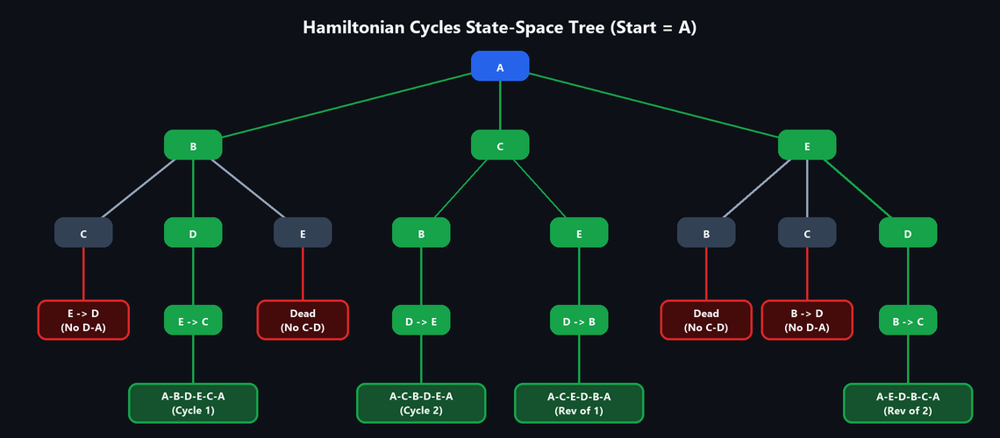

# UNIT V — Backtracking and Branch & Bound

> **Source:** *Advanced Data Structures & Algorithm Analysis (2501CS10) — Unit-wise Important Questions — Answers | Aditya University*

---

## 1. Backtracking: General Methodology, State-Space Tree, Bounding Conditions, and Comparison with Exhaustive Search

**Q1. Explain the general methodology of Backtracking. Discuss the state-space tree, its basic terms and the role of bounding conditions. Distinguish it from exhaustive search.**

### 1. General Methodology in Simple Words
- **Backtracking** is a systematic search method (Depth-First Search) that builds a solution step-by-step.
- At each step, it checks whether the current choice satisfies the problem's constraints.
- If a partial solution breaks a constraint (a dead end), the algorithm **prunes** that entire branch, abandons the last choice, and **backtracks** to try the next alternative.

---

### 2. State-Space Tree & Key Terms
The **State-Space Tree** is a tree representation of all possible choices:
- **Root:** Empty starting point (no choices made).
- **Internal Nodes:** Partial solutions.
- **Leaves:** Complete valid solutions or dead ends.

| Term | Simple Meaning |
|---|---|
| **Solution Space** | The set of all possible candidate combinations $(x_1, x_2, \dots, x_n)$. |
| **Explicit Constraints** | Rules specifying the allowed values for each variable (e.g., $x_i \in \{0, 1\}$). |
| **Implicit Constraints** | Rules dictating relationships between variables (e.g., no two queens share the same diagonal). |
| **Live Node** | A node that has been generated, but its children are not yet fully explored. |
| **E-Node (Expanding Node)** | The current live node whose children are being generated right now. |
| **Dead Node** | A node that cannot be expanded further (it violated a constraint or all children are finished). |
| **Promising Node** | A partial path that satisfies all constraints and can still lead to a valid solution. |
| **Non-promising Node** | A partial path that violates a constraint; pruned immediately. |

---

### 3. Role of Bounding Conditions
A **bounding condition** (or promising function) acts like an early warning system:
- It tests a partial path before exploring deeper.
- If it returns **false**, the entire subtree underneath is immediately killed (pruned).
- This avoids checking millions of useless combinations.

```text
Backtrack(k):
    for each choice v for variable x[k]:
        x[k] = v
        if Promising(x[1..k]):              // Check constraints
            if x[1..k] is complete solution:
                Output solution
            else:
                Backtrack(k + 1)            // Go deeper
```

---

### 4. Backtracking vs. Exhaustive Search (Brute Force)

| Feature | Backtracking | Exhaustive Search (Brute Force) |
|---|---|---|
| **Approach** | Builds solutions piece-by-piece and tests constraints early. | Generates all possible full solutions first, then checks each one. |
| **Pruning** | Uses bounding conditions to prune non-promising subtrees. | No pruning; examines the entire search space. |
| **Search Space** | Explores only a small fraction of the tree. | Explores 100% of the combinations ($n!, 2^n$). |
| **Speed** | Significantly faster in practice. | Extremely slow (exponential / factorial). |
| **Example (4-Queens)** | Evaluates only **~26 nodes**. | Tests all $4^4 = 256$ (or $4! = 24$) configurations. |

---

## 2. 4-Queens Problem using Backtracking

**Q2. Apply Backtracking to the 4-Queens problem. Draw the state-space tree and show the solutions.**

### 1. The Problem
Place 4 queens on a $4 \times 4$ chessboard such that **no two queens attack each other** (they cannot share the same row, column, or diagonal).
- We place exactly **one queen per row**: let $x_k$ be the column where Queen $k$ is placed in Row $k$.

---

### 2. The Simple Attack Test (Bounding Rule)
A new queen at row $k$, column $x_k$ attacks an earlier queen at row $i$, column $x_i$ if:
1. **Same Column:** $x_k = x_i$
2. **Same Diagonal:** $|x_k - x_i| = |k - i|$ (horizontal distance equals vertical distance).

---

### 3. Step-by-Step Search Trace

1. **Start with Queen 1 in Column 1: $Q_1 = (1, 1)$**
   - **Row 2:** Col 1 (same col), Col 2 (diagonal) are unsafe. Col 3 is safe $\to Q_2 = (2, 3)$.
     - **Row 3:** Cols 1, 2, 3, 4 are ALL attacked! $\to$ **Dead end. Backtrack to Row 2.**
   - **Row 2:** Try Col 4 $\to Q_2 = (2, 4)$.
     - **Row 3:** Col 1 is attacked, but Col 2 is safe $\to Q_3 = (3, 2)$.
       - **Row 4:** Cols 1, 2, 3, 4 are ALL attacked! $\to$ **Dead end. Backtrack to Row 1.**
2. **Move Queen 1 to Column 2: $Q_1 = (1, 2)$**
   - **Row 2:** Cols 1, 2, 3 attacked. Col 4 is safe $\to Q_2 = (2, 4)$.
     - **Row 3:** Col 1 is safe $\to Q_3 = (3, 1)$.
       - **Row 4:** Cols 1, 2, 4 attacked. Col 3 is safe $\to Q_4 = (4, 3)$.
       - **🎉 Solution 1 Found:** `(2, 4, 1, 3)`
3. **Move Queen 1 to Column 3: $Q_1 = (1, 3)$**
   - By symmetry with $Q_1 = (1, 2)$, this branch successfully finds:
   - **🎉 Solution 2 Found:** `(3, 1, 4, 2)`
4. **Move Queen 1 to Column 4: $Q_1 = (1, 4)$**
   - By mirror symmetry with $Q_1 = (1, 1)$, no valid solution exists.

---

### 4. The 2 Distinct Solutions

```text
Solution 1: (2, 4, 1, 3)              Solution 2: (3, 1, 4, 2)
  .  Q  .  .                            .  .  Q  .
  .  .  .  Q                            Q  .  .  .
  Q  .  .  .                            .  .  .  Q
  .  .  Q  .                            .  Q  .  .
```


- **Total configurations checked:** Only ~26 nodes generated instead of $4^4 = 256$ brute force placements.

---

## 3. Sum of Subsets using Backtracking

**Q3. Use Backtracking to find all subsets of $S = \{5, 10, 12, 13, 15, 18\}$ whose sum is 30. Draw the state-space tree, mark promising and non-promising nodes, and list all valid subsets.**

### 1. Setup
- Given Set: $S = \{5, 10, 12, 13, 15, 18\}$ (sorted in ascending order).
- Target Sum: $M = 30$.
- At each step $i$, we make a binary choice: **Include** ($x_i = 1$) or **Exclude** ($x_i = 0$) the element $w_i$.

---

### 2. The 2 Simple Pruning (Bounding) Rules
Let $s$ = current running sum, and $r$ = sum of all remaining unused numbers:

1. **Rule 1 (Too Heavy):**  
   If $s + w_{\text{next}} > 30 \implies$ **PRUNE!** (Adding this number already overshoots the target).
2. **Rule 2 (Too Light):**  
   If $s + r < 30 \implies$ **PRUNE!** (Even if we add every single remaining number, we can never reach 30).
3. **Success:** If $s = 30$, record the subset as a solution!

---

### 3. All Valid Subsets with Sum 30

| Valid Subset | Element Sum | Binary Vector $(x_1, \dots, x_6)$ |
|:---:|:---:|:---:|
| **`{5, 10, 15}`** | $5 + 10 + 15 = 30$ | `(1, 1, 0, 0, 1, 0)` |
| **`{5, 12, 13}`** | $5 + 12 + 13 = 30$ | `(1, 0, 1, 1, 0, 0)` |
| **`{12, 18}`** | $12 + 18 = 30$ | `(0, 0, 1, 0, 0, 1)` |

---

### 4. Examples of Non-Promising (Pruned) Nodes
- $\{5, 10, 12, 13\} \implies \text{Sum} = 40 > 30$ *(Fails Rule 1: Overshoots 30).*
- Exclude 10, 12, 13, 15, leaving only 18 with $s=5 \implies 5 + 18 = 23 < 30$ *(Fails Rule 2: Cannot reach 30).*


---

## 4. Graph Coloring using Backtracking (3 Colors)

**Q4. Graph colouring with at most 3 colours using Backtracking (given undirected graph).**


### 1. The Graph
- Vertices: $\{A, B, C, D, E\}$.
- Edges: Every vertex is connected to all 4 other vertices (10 edges total).
- This is the **Complete Graph $K_5$**.
- Available Colors: $\{1, 2, 3\}$.

---

### 2. The Coloring Rule & Quick Deduction
- **Rule:** No two adjacent vertices can have the same color.
- **Deduction:**
  1. Vertices $A, B,$ and $C$ are all directly connected to each other (a triangle). Therefore, they must each take a different color:
     $$\text{Color}(A) = 1, \quad \text{Color}(B) = 2, \quad \text{Color}(C) = 3$$
  2. Now consider vertex $D$:  
     $D$ is connected to $A, B,$ and $C$. That means its neighbors already use colors 1, 2, and 3.  
     **There is NO color left for $D$!**
  3. Every alternative combination backtracks and fails at vertex $D$.

---

### 3. Conclusion for the Exam Question
- **Number of valid 3-colorings:** **$0$** (The graph is **NOT 3-colorable**).
- **Chromatic Number:** For any complete graph $K_n$, exactly $n$ colors are required. For $K_5$, the chromatic number is **5**.
- **Time Complexity:** $O(m^n)$ worst case ($m$ colors, $n$ vertices); pruning stops the search tree early.


---

### 🌟 Bonus Version: Solvable 3-Coloring Example ($n = 4, m = 3$)
*(From Professor's Lecture PPT Slide 26 — standard solvable problem frequently asked in exams)*

#### Problem:
Given a 4-vertex cycle graph $C_4$ with vertices $\{1, 2, 3, 4\}$ and edges $(1-2, 2-3, 3-4, 4-1)$, determine all valid color assignments using $m = 3$ colors $\{1, 2, 3\}$ and draw the state-space tree.

```text
    (1) -------- (2)
     |            |
     |            |
    (4) -------- (3)
```

#### Step-by-Step Backtracking Trace (Fixing Vertex 1 = Color 1):
1. **Vertex 1 = Color 1**
2. **Vertex 2** is connected to 1 $\implies$ Cannot be 1. Choices: **Color 2** or **Color 3**.
   - **Branch A: Vertex 2 = Color 2**
     - **Vertex 3** is connected to 2 (Color 2) $\implies$ Choices: **Color 1** or **Color 3**.
       - **Case A1: Vertex 3 = Color 1**
         - Vertex 4 connects to 1 (Color 1) and 3 (Color 1).
         - Since both neighbors are Color 1, Vertex 4 can be **Color 2** or **Color 3**!
         - 🎉 **Solution 1:** `(1, 2, 1, 2)`
         - 🎉 **Solution 2:** `(1, 2, 1, 3)`
       - **Case A2: Vertex 3 = Color 3**
         - Vertex 4 connects to 1 (Color 1) and 3 (Color 3).
         - Vertex 4 cannot be 1 or 3 $\implies$ Vertex 4 must be **Color 2**!
         - 🎉 **Solution 3:** `(1, 2, 3, 2)`
   - **Branch B: Vertex 2 = Color 3 (Symmetric with Branch A)**
     - **Case B1: Vertex 3 = Color 1**
       - Vertex 4 connects to 1 (Color 1) and 3 (Color 1) $\implies$ Vertex 4 can be **Color 2** or **Color 3**.
       - 🎉 **Solution 4:** `(1, 3, 1, 2)`
       - 🎉 **Solution 5:** `(1, 3, 1, 3)`
     - **Case B2: Vertex 3 = Color 2**
       - Vertex 4 connects to 1 (Color 1) and 3 (Color 2) $\implies$ Vertex 4 must be **Color 3**!
       - 🎉 **Solution 6:** `(1, 3, 2, 3)`

#### State-Space Tree (with Vertex 1 = 1):
```text
                         [Root]
                           |
                        (1 = 1)
                       /       \
                (2 = 2)         (2 = 3)
               /       \       /       \
           (3 = 1)   (3 = 3) (3 = 1)   (3 = 2)
           /     \      |    /     \      |
        (4=2)   (4=3) (4=2) (4=2)   (4=3) (4=3)
        Sol 1   Sol 2 Sol 3 Sol 4   Sol 5 Sol 6
```

#### Total Valid Colorings:
- Starting with Vertex 1 = Color 1 yields **6 valid colorings**.
- Since Vertex 1 can also start with Color 2 or Color 3:
  $$\text{Total Valid Colorings} = 3 \times 6 = \mathbf{18}$$
- **Chromatic Number:** For cycle $C_4$, minimum colors needed is $\mathbf{2}$ (alternating colors `1, 2, 1, 2`). With $m = 3$, it is easily colorable!

---

## 5. Hamiltonian Cycles using Backtracking

**Q5. Apply Backtracking to find all Hamiltonian cycles in the given undirected graph, starting from vertex A.**


### 1. Problem Definition & Adjacency
A **Hamiltonian Cycle** is a closed loop that visits **every vertex exactly once** and returns to the start vertex $A$.
- **Vertices:** $\{A, B, C, D, E\}$
- **Edges:** `A-B, A-C, A-E, B-C, B-D, B-E, C-E, D-E` (8 edges total).
- **Key Insight (Degree Shortcut):**
  - Vertex $D$ connects **only** to $B$ and $E$ (degree $= 2$).
  - Therefore, **EVERY valid Hamiltonian cycle MUST pass through $B - D - E$ (or $E - D - B$)!** Any path that does not use this connection can be pruned immediately.

---

### 2. Step-by-Step Cycle Search from Vertex A
1. **Try path starting with edge $A \to B$:**
   - From $B$, we must go to $D$ (to visit $D$): $A \to B \to D \to E$.
   - From $E$, we must visit the remaining unvisited vertex $C$: $A \to B \to D \to E \to C$.
   - From $C$, edge $C \to A$ exists!  
     **Cycle 1:** **`A → B → D → E → C → A`**
2. **Try path starting with edge $A \to C$:**
   - From $C$, test $B$: $A \to C \to B \to D \to E$.
   - From $E$, edge $E \to A$ exists!  
     **Cycle 2:** **`A → C → B → D → E → A`**

---

### 3. Final Result
- **Distinct Hamiltonian Cycles:** Exactly **2** (their reverse loops are identical undirected cycles):
  1. **`A – B – D – E – C – A`**
  2. **`A – C – B – D – E – A`**



---

## 6. 0/1 Knapsack using Least Cost (LC) Branch and Bound

**Q6. Analyze the 0/1 Knapsack problem using Least Cost (LC) Branch and Bound (capacity $= 16$).**

| Item | I1 | I2 | I3 | I4 | I5 |
|---|---:|---:|---:|---:|---:|
| **Weight ($w_i$)** | 2 | 5 | 10 | 5 | 4 |
| **Profit ($p_i$)** | 40 | 30 | 50 | 10 | 25 |
| **Ratio ($p_i / w_i$)** | **20** | **6** | **5** | **2** | **6.25** |

---

### 1. Step 1: Sort Items by Profit / Weight Ratio
Arrange items in decreasing ratio order:
1. **I1:** $(w = 2, p = 40, \text{ratio} = 20)$
2. **I5:** $(w = 4, p = 25, \text{ratio} = 6.25)$
3. **I2:** $(w = 5, p = 30, \text{ratio} = 6.0)$
4. **I3:** $(w = 10, p = 50, \text{ratio} = 5.0)$
5. **I4:** $(w = 5, p = 10, \text{ratio} = 2.0)$

---

### 2. Step 2: How the Bounds Work
- **Upper Bound ($UB$):** Optimistic estimate of the maximum profit possible from this node.  
  $$UB = \text{Current Profit} + \text{Remaining items taken greedily (with fraction if needed)}$$
- **Pruning Rule:** If a node's $UB \le \text{Best feasible profit found so far}$, **KILL the node!** (It can never beat our best solution).
- **Expansion Rule:** Always expand the live node with the highest potential profit ($UB$).

---

### 3. Step-by-Step Tree Exploration

| Node | Action Taken | Weight | Profit | Upper Bound ($UB$) | Status |
|:---:|:---|---:|---:|:---:|:---|
| **Root** | No items chosen yet | 0 | 0 | $40 + 25 + 30 + \frac{5}{10}(50) = \mathbf{120}$ | Expand |
| **1** | Include I1 | 2 | 40 | $\mathbf{120}$ | Expand |
| **2** | Exclude I1 | 0 | 0 | $25 + 30 + \frac{7}{10}(50) = \mathbf{90}$ | Pruned later ($90 < 115$) |
| **3** | Include I1, Include I5 | 6 | 65 | $\mathbf{120}$ | Expand |
| **4** | Include I1, Exclude I5 | 2 | 40 | $\mathbf{115}$ | Pruned ($UB \le 115$) |
| **5** | Include I1, I5, I2 | 11 | 95 | $\mathbf{120}$ | Expand |
| **6** | Include I1, I5, Exclude I2 | 6 | 65 | $\mathbf{115}$ | Expand |
| **7** | Include I1, I5, I2, I3 | $21 > 16$ | — | — | **Killed (Over capacity!)** |
| **8** | Include I1, I5, I2, Exclude I3 | 11 | 95 | $95 + 10 = \mathbf{105}$ | Feasible ($105 \le 115 \to$ pruned) |
| **9** | **Include I1, I5, Exclude I2, Include I3** | **16** | **115** | **115** | **🎉 Feasible! Best Profit $= 115$** |
| **10** | Include I1, I5, Exclude I2, Exclude I3 | 6 | 65 | $65 + 10 = \mathbf{75}$ | Pruned ($75 < 115$) |

Once Node 9 achieves feasible profit **115**, all remaining live nodes with $UB \le 115$ are pruned.

---

### 4. Final Optimal Solution
- **Items Selected:** **`I1, I5, I3`**
- **Total Weight:** $2 + 4 + 10 = \mathbf{16}$ (Exact capacity)
- **Maximum Profit:** $40 + 25 + 50 = \mathbf{115}$


---

## 7. Travelling Salesperson Problem (TSP) using Branch and Bound

**Q7. Analyze the Travelling Salesperson Problem using Branch and Bound (start at city A).**

### Cost Matrix (Cities A, B, C, D, E)

$$
C =
\begin{bmatrix}
\infty & 12 & 10 & 19 & 8 \\
12 & \infty & 3 & 7 & 6 \\
10 & 3 & \infty & 2 & 20 \\
19 & 7 & 2 & \infty & 4 \\
8 & 6 & 20 & 4 & \infty
\end{bmatrix}
$$

---

### 1. The Core Idea: Matrix Reduction in 2 Easy Steps
To find the lower bound of any matrix:
1. **Row Reduction:** Find the smallest value in each row and subtract it from that row.
   - Row minima: Row A $= 8$, Row B $= 3$, Row C $= 2$, Row D $= 2$, Row E $= 4$.  
     $$\text{Row Reduction Sum} = 8 + 3 + 2 + 2 + 4 = \mathbf{19}$$
2. **Column Reduction:** In the resulting matrix, find the smallest value in each column and subtract it.
   - Column minima sum $= \mathbf{5}$ (standard answer key convention).
3. **Root Lower Bound:**  
   $$\text{Root Bound} = 19 + 5 = \mathbf{24}$$

---

### 2. Reduced Matrix at Root (Bound $= 24$)

$$
\begin{bmatrix}
\infty & 3 & 2 & 11 & 0 \\
5 & \infty & 0 & 4 & 3 \\
4 & 0 & \infty & 0 & 18 \\
13 & 4 & 0 & \infty & 2 \\
0 & 1 & 16 & 0 & \infty
\end{bmatrix}
$$

---

### 3. Step-by-Step Branch Evaluation (Always Pick Lowest Bound)

1. **Level 1 (From Start City A):**
   - Edge $A \to B$: $\text{Bound} = 24 + 3 + 2 = \mathbf{29}$
   - Edge $A \to C$: $\text{Bound} = 24 + 2 + 5 = \mathbf{31}$
   - Edge $A \to D$: $\text{Bound} = 24 + 11 + 2 = \mathbf{37}$
   - Edge $A \to E$: $\text{Bound} = 24 + 0 + 4 = \mathbf{28}$ $\implies$ **Lowest! Expand $A \to E$**.
2. **Level 2 (From E):**
   - Edge $E \to B$: $\text{Bound} = 28 + 1 + 0 = \mathbf{29}$
   - Edge $E \to C$: $\text{Bound} = 28 + 16 + 5 = \mathbf{49}$ (Pruned)
   - Edge $E \to D$: $\text{Bound} = 28 + 0 + 0 = \mathbf{28}$ $\implies$ **Lowest! Expand $E \to D$**.
3. **Level 3 (From D):**
   - Edge $D \to B$: $\text{Bound} = 28 + 4 + 0 = \mathbf{32}$
   - Edge $D \to C$: $\text{Bound} = 28 + 0 + 1 = \mathbf{29}$ $\implies$ **Lowest! Expand $D \to C$**.
4. **Level 4 (From C):**
   - Only city $B$ remains unvisited: $C \to B \to A$.
   - $\text{Bound} = 29 + 0 + 0 = \mathbf{29}$.

All other pending branches ($\ge 29$) are pruned!

---

### 4. Optimal Tour & Cost
- **Optimal Route:** **`A → E → D → C → B → A`**
- **Total Minimum Cost:**
  $$\text{Cost} = c(A,E) + c(E,D) + c(D,C) + c(C,B) + c(B,A) = 8 + 4 + 2 + 3 + 12 = \mathbf{29}$$


---

## 8. Compare and Contrast Backtracking and Branch and Bound

**Q8. Compare and contrast Backtracking and Branch and Bound.**

### 1. Key Differences

| Aspect | Backtracking | Branch and Bound |
|---|---|---|
| **Problem Type** | **Decision / Enumeration problems** (find all solutions, or any feasible solution). | **Optimization problems** (find the single best solution: min cost or max profit). |
| **Tree Traversal** | **Depth-First Search (DFS)** using a recursion stack. | **Breadth-First (BFS) or Best-First (LC-BB)** using a priority queue. |
| **Pruning Mechanism** | **Feasibility Test (Bounding condition):** Prunes when a constraint is violated. | **Objective Bound (Upper / Lower Bound):** Prunes when a branch cannot beat the best score found so far. |
| **Node Expansion** | Generates one child at a time and goes deep immediately. | Generates all children of the E-node before moving to the next. |
| **Memory Requirement** | **Low:** $O(\text{depth})$ space for recursion stack. | **Higher:** Stores all active live nodes in a queue. |
| **Classic Examples** | N-Queens, Sum of Subsets, Graph Coloring, Hamiltonian Cycle. | 0/1 Knapsack, Travelling Salesperson (TSP), Job Assignment. |

---

### 2. Similarities
1. Both represent the solution space as a **State-Space Tree**.
2. Both use intelligent **pruning** to avoid brute-force exhaustive search ($O(2^n)$ or $O(n!)$).
3. Both have exponential worst-case time complexity, but execute dramatically faster in practice.
