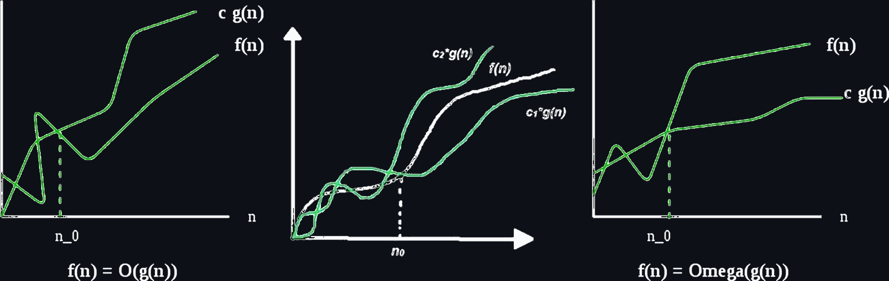
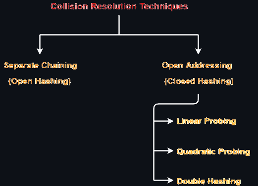
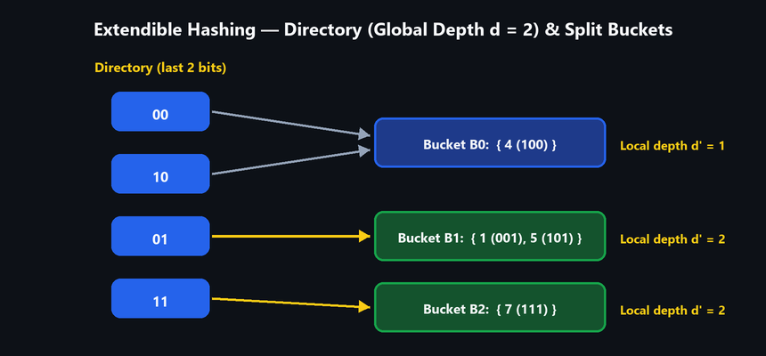

# UNIT I — Algorithm Analysis and Hashing

> **Course:** Advanced Data Structures & Algorithm Analysis (`2501CS10`) | Aditya University  
> **Exam Priority:** Priority 2 (Foundation & High Yield) · **Unit Difficulty:** Easy (3/10)  
> **Source:** *Unit-wise Important Questions — Answers | Aditya University*

---

## Part A: 2-Mark Questions

### Q1: What is an algorithm?

#### Definition
An algorithm is a step-by-step sequence of well-defined instructions to solve a specific problem or perform a task. It must take zero or more inputs, produce at least one output, and terminate in finite steps.

#### Key Properties
- **Input:** Zero or more externally supplied values.
- **Output:** At least one result produced.
- **Definiteness:** Each step must be clear and unambiguous.
- **Finiteness:** Must terminate after a finite number of steps.
- **Effectiveness:** Every operation must be basic enough to execute.

---

### Q2: Differentiate between time complexity and space complexity.

#### Comparison
| Basis | Time Complexity | Space Complexity |
|---|---|---|
| **Meaning** | How fast an algorithm runs as input size $n$ grows | Total memory required by an algorithm for input size $n$ |
| **Measured by** | Counting elementary operations / loop steps | Fixed memory (code, constants) + Variable memory (inputs, dynamic memory, stack) |
| **Example** | Simple loop of size $n \implies O(n)$ | Array of size $n \implies O(n)$ space |

---

### Q3: What is the purpose of Asymptotic notations?

#### Definition
Asymptotic notations are mathematical tools used to describe how the running time or memory usage of an algorithm grows as the input size $n \to \infty$, independent of machine hardware and programming language.

#### Three Core Notations
| Notation | Name | Mathematical Condition | Bound Represented |
|---|---|---|---|
| **$O(g(n))$** | Big-O | $f(n) \le c \cdot g(n)$ for $n \ge n_0$ | Upper bound (Worst case) |
| **$\Omega(g(n))$** | Big-Omega | $f(n) \ge c \cdot g(n)$ for $n \ge n_0$ | Lower bound (Best case) |
| **$\Theta(g(n))$** | Big-Theta | $c_1 \cdot g(n) \le f(n) \le c_2 \cdot g(n)$ for $n \ge n_0$ | Tight bound (Exact rate) |

---

### Q4: Define hashing.

#### Definition
Hashing is a technique used to store and retrieve data in $O(1)$ average time by mapping an arbitrary search key $k$ to a fixed-size table index using a mathematical function called a **hash function** $h(k)$.

---

### Q5: What is a hash table? State any two desirable properties of a good hash function.

#### Hash Table
A data structure that stores key-value pairs in an array where index locations are determined by $h(k)$.

#### Two Desirable Properties
1. **Uniform Distribution:** Spreads keys evenly across all table slots to minimize collisions.
2. **Fast Computation:** Computes index in $O(1)$ time with minimal arithmetic operations.

---

### Q6: What is the use of a hash function?

#### Core Purpose
Maps a large key space into a bounded array index range $[0, m-1]$.
- Enables direct $O(1)$ average search, insertion, and deletion.
- Used in database indexing, compiler symbol tables, caches, and memory addressing.

---

### Q7: Define collision resolution.

#### Definition
A collision occurs when two distinct keys hash to the same slot ($h(k_1) = h(k_2)$ for $k_1 \neq k_2$). Collision resolution is the systematic method used to find an alternative slot or store multiple colliding keys.

---

### Q8: List out all collision resolution techniques.

#### Classification
| Category | Technique | Working Principle |
|---|---|---|
| **Open Hashing** | Separate Chaining | Each slot stores a linked list of colliding elements. |
| **Closed Hashing (Open Addressing)** | Linear Probing | Probes slots sequentially: $(h(k) + i) \bmod m$. |
| | Quadratic Probing | Probes slots in quadratic jumps: $(h(k) + i^2) \bmod m$. |
| | Double Hashing | Probes using a second hash function: $(h_1(k) + i \cdot h_2(k)) \bmod m$. |

---

## Part B: 8-Mark Questions

### 1. Importance of Algorithm Analysis and Time vs. Space Complexity

**Q1. Explain the importance of algorithm analysis. Differentiate between time complexity and space complexity with suitable examples.**

#### 1. What is an Algorithm and Algorithm Analysis?
- **Algorithm:** A step-by-step set of clear, finite, and effective instructions to solve a problem.
- **Algorithm Analysis:** The process of evaluating an algorithm's performance (time and memory) as input size $n$ grows, independent of specific machine architecture, CPU speed, or programming language.

#### 2. Importance of Algorithm Analysis
1. **Performance Prediction:** Predicts how an algorithm behaves on massive inputs before writing full code.
2. **Resource Optimization:** Helps balance CPU execution time and memory usage.
3. **Comparative Evaluation:** Allows objective comparison between multiple correct algorithms to choose the best one.
4. **Scalability Assurance:** Ensures systems do not crash or stall when data grows from hundreds to millions of records.
5. **Machine Independence:** Provides a mathematical benchmark using asymptotic notations ($O, \Omega, \Theta$) valid on any computer.

#### 3. Time Complexity (With Example)
- **Definition:** The amount of time an algorithm takes to run as a function of input size $n$.
- **Measurement:** 1 basic operation / statement execution = 1 unit of time.

**Worked Example (Simple Loop):**
```c
int sum = 0;
for (int i = 0; i < n; i++) {
    sum += i;
}
```

- **Step Breakdown:**
  - Initialization (`int i = 0`): executes $1$ time = $1$ unit.
  - Condition check (`i < n`): executes $n + 1$ times = $n + 1$ units.
  - Increment (`i++`): executes $n$ times = $n$ units.
  - Loop body (`sum += i`): executes $n$ times = $n$ units.
- **Total Time:** $T(n) = 1 + (n + 1) + n + n = 3n + 2 \implies O(n)$ (Linear Time).

#### 4. Space Complexity (With Example)
- **Definition:** The total memory required by an algorithm during execution as a function of input size $n$.
- **Formula:**
  $$\text{Space Complexity} = \text{Fixed Part} + \text{Variable Part}$$
  - *Fixed Part:* Space for constants, simple variables, and program instructions (independent of $n$).
  - *Variable Part:* Space for dynamic memory, arrays, and recursion stack (grows with $n$).

**Worked Examples:**
1. **Constant Space $O(1)$:**
   ```c
   int a = 5, b = 10; // Fixed 2 variables = 2 units of space -> O(1)
   int arr[100];      // Fixed static array of 100 elements -> O(1)
   ```
2. **Linear Space $O(n)$:**
   ```c
   int arr[n];        // Variable array of size n = n units of space -> O(n)
   ```

#### 5. Comparison: Time Complexity vs. Space Complexity

| Basis of Comparison | Time Complexity | Space Complexity |
|---|---|---|
| **Definition** | How fast an algorithm runs with input size $n$ | How much memory an algorithm consumes with input size $n$ |
| **Measured by** | Counting number of elementary operations executed | Sum of fixed space + variable space (inputs, arrays, stack) |
| **Unit of Measurement** | Operation step count | Memory words / bytes |
| **Key Concern** | Minimizing CPU execution delays | Minimizing RAM usage and preventing out-of-memory errors |
| **Example (Merge Sort)** | $O(n \log n)$ time | $O(n)$ auxiliary array space |

---

### 2. Asymptotic Notations: Big-O, Omega, and Theta

**Q2. Describe the asymptotic notations $O$, $\Omega$, and $\Theta$. Illustrate each notation with suitable examples.**

Asymptotic notations are mathematical formalisms used to describe the rate of growth of an algorithm's running time or space as input size $n \to \infty$.



#### 1. Big-O Notation ($O$ — Upper Bound / Worst Case)
- **Concept:** Gives the upper bound on growth rate. The algorithm will take *at most* this much time.
- **Definition:**
  $$f(n) = O(g(n)) \iff \exists \text{ constants } c > 0 \text{ and } n_0 \ge 1 \text{ such that } 0 \le f(n) \le c \cdot g(n) \quad \forall n \ge n_0$$
- **Proof Example:** Prove $f(n) = 3n + 2 = O(n)$:
  - Given $f(n) = 3n + 2$ and $g(n) = n$.
  - We require $3n + 2 \le c \cdot n$.
  - Choose $c = 4$ and $n_0 = 2$:
    $$3(2) + 2 = 8 \le 4(2) = 8 \quad (\text{holds for all } n \ge 2)$$
  - Therefore, $3n + 2 = O(n)$ for $c = 4, n_0 = 2$.

#### 2. Big-Omega Notation ($\Omega$ — Lower Bound / Best Case)
- **Concept:** Gives the lower bound on growth rate. The algorithm will take *at least* this much time.
- **Definition:**
  $$f(n) = \Omega(g(n)) \iff \exists \text{ constants } c > 0 \text{ and } n_0 \ge 1 \text{ such that } 0 \le c \cdot g(n) \le f(n) \quad \forall n \ge n_0$$
- **Proof Example:** Prove $f(n) = 5n^2 + 10 = \Omega(n^2)$:
  - Given $f(n) = 5n^2 + 10$ and $g(n) = n^2$.
  - We require $c \cdot n^2 \le 5n^2 + 10$.
  - Choose $c = 5$ and $n_0 = 1$:
    $$5(1)^2 = 5 \le 5(1)^2 + 10 = 15 \quad (\text{holds for all } n \ge 1)$$
  - Therefore, $5n^2 + 10 = \Omega(n^2)$ for $c = 5, n_0 = 1$.

#### 3. Big-Theta Notation ($\Theta$ — Tight Bound / Average Case)
- **Concept:** Encloses the function between upper and lower bounds. It gives the exact rate of growth.
- **Definition:**
  $$f(n) = \Theta(g(n)) \iff \exists \text{ constants } c_1, c_2 > 0 \text{ and } n_0 \ge 1 \text{ such that } c_1 \cdot g(n) \le f(n) \le c_2 \cdot g(n) \quad \forall n \ge n_0$$
- **Proof Example:** Prove $f(n) = 4n - 3 = \Theta(n)$:
  - Given $f(n) = 4n - 3$ and $g(n) = n$.
  - We require $c_1 \cdot n \le 4n - 3 \le c_2 \cdot n$.
  - Choose $c_1 = 1, c_2 = 4$, and $n_0 = 1$:
    $$1(1) \le 4(1) - 3 \le 4(1) \implies 1 \le 1 \le 4 \quad (\text{holds for all } n \ge 1)$$
  - Therefore, $4n - 3 = \Theta(n)$ for $c_1 = 1, c_2 = 4, n_0 = 1$.

#### Summary of Asymptotic Notations
| Notation | Name | Bound Type | Mathematical Condition | Meaning |
|---|---|---|---|---|
| **$O(g(n))$** | Big-O | Upper Bound | $f(n) \le c \cdot g(n)$ | Worst-case guarantee (grows no faster than) |
| **$\Omega(g(n))$** | Big-Omega | Lower Bound | $f(n) \ge c \cdot g(n)$ | Best-case guarantee (grows at least as fast as) |
| **$\Theta(g(n))$** | Big-Theta | Tight Bound | $c_1 \cdot g(n) \le f(n) \le c_2 \cdot g(n)$ | Exact growth rate (both $O$ and $\Omega$) |

---

### 3. Time Complexity of Matrix Multiplication (Tabular / Step-Count Method)

**Q3. Analyze the time complexity for matrix multiplication algorithm (tabular method) using asymptotic notation and justify your answer.**

#### Algorithm (Two $n \times n$ Matrices $A$ and $B$)

```c
for (int i = 0; i < n; i++) {              // Outer loop: rows of A
    for (int j = 0; j < n; j++) {          // Middle loop: columns of B
        C[i][j] = 0;                       // Initialize element
        for (int k = 0; k < n; k++) {      // Inner loop: dot product
            C[i][j] += A[i][k] * B[k][j];  // Multiply and accumulate
        }
    }
}
```

#### Step-Count Table (Tabular Method)

We determine the step count by analyzing statement execution frequency:

| Statement Line | Cost per Step ($s/e$) | Execution Frequency | Total Steps |
| :--- | :---: | :---: | :--- |
| `for (int i = 0; i < n; i++)` | 1 | $n + 1$ | $n + 1$ |
| `for (int j = 0; j < n; j++)` | 1 | $n(n + 1)$ | $n^2 + n$ |
| `C[i][j] = 0;` | 1 | $n \times n$ | $n^2$ |
| `for (int k = 0; k < n; k++)` | 1 | $n^2(n + 1)$ | $n^3 + n^2$ |
| `C[i][j] += A[i][k] * B[k][j];` | 1 | $n \times n \times n$ | $n^3$ |
| **Total Step Count $T(n)$** | — | — | **$2n^3 + 3n^2 + 2n + 1$** |

#### Step-by-Step Justification & Asymptotic Derivation

1. **Sum of Statement Executions:**
   $$T(n) = (n + 1) + (n^2 + n) + n^2 + (n^3 + n^2) + n^3 = 2n^3 + 3n^2 + 2n + 1$$
2. **Identify the Dominant Term:**
   - In polynomial $2n^3 + 3n^2 + 2n + 1$, the term with highest power of $n$ is **$n^3$**.
   - As $n$ grows large, lower-order terms ($3n^2$, $2n$, $1$) become negligible.
3. **Asymptotic Upper Bound ($O$):**
   - For all $n \ge 1$:
     $$2n^3 + 3n^2 + 2n + 1 \le 2n^3 + 3n^3 + 2n^3 + n^3 = 8n^3$$
   - Thus, with $c = 8$ and $n_0 = 1$, $T(n) \le 8n^3 \implies T(n) = O(n^3)$.
4. **Asymptotic Lower Bound ($\Omega$):**
   - For all $n \ge 1$, $T(n) \ge 2n^3$.
   - Thus, with $c = 2$ and $n_0 = 1$, $T(n) \ge 2n^3 \implies T(n) = \Omega(n^3)$.
5. **Final Asymptotic Tight Bound ($\Theta$):**
   - Since $T(n) = O(n^3)$ and $T(n) = \Omega(n^3)$, **$T(n) = \Theta(n^3)$**.

---

### 4. Concept of Hashing and Hash Functions

**Q4. Explain the concept of hashing. Discuss different hash functions with suitable examples.**

#### 1. Concept of Hashing
Hashing is a technique used to store and retrieve data in $O(1)$ average time. A **hash function** $h(k)$ converts a search key $k$ into an integer index in a **hash table** of size $m$.

```text
Search Key (k)  ───►  [ Hash Function h(k) ]  ───►  Index ∈ [0, m - 1] in Hash Table
```

- Instead of comparing keys sequentially ($O(n)$ search), hashing computes the direct memory location of the key.

#### 2. Properties of a Good Hash Function
1. **Uniform Distribution:** Spreads keys evenly across all table slots to prevent clustering.
2. **Fast Computation:** Computes the index in $O(1)$ time with minimal math operations.
3. **Deterministic:** For the same key $k$, $h(k)$ must always return the exact same index.
4. **Minimizes Collisions:** Reduces the chance of multiple keys hashing to the same slot.

#### 3. Common Hash Functions (With Examples)

1. **Division (Remainder) Method:**
   - **Formula:** $h(k) = k \bmod m$ (where $m$ is usually chosen as a prime number).
   - **Example:** For table size $m = 10$, key $k = 25 \implies h(25) = 25 \bmod 10 = 5$.
2. **Multiplication Method:**
   - **Formula:** $h(k) = \lfloor m \cdot (k \cdot A \bmod 1) \rfloor$ (where $0 < A < 1$, Knuth recommends $A \approx 0.618$).
   - **Example:** Key $k = 123, m = 100, A = 0.618 \implies k \cdot A = 76.014 \implies \text{fractional part } 0.014 \implies h(123) = \lfloor 100 \times 0.014 \rfloor = 1$.
3. **Mid-Square Method:**
   - **Steps:** (1) Square the key $k^2$, (2) Extract the middle $r$ digits as the index.
   - **Example:** Key $k = 45 \implies k^2 = 2025 \implies$ middle digits are `02` $\implies$ Index = $2$.
4. **Folding Method:**
   - **Steps:** Split key into equal parts matching index size, add the parts, and take modulo $m$.
   - **Example:** Key $k = 123456 \implies 12 + 34 + 56 = 102 \implies h(k) = 102 \bmod 100 = 2$.
5. **Digit Extraction Method:**
   - **Steps:** Selected positions of digits that are known to be uniformly distributed are extracted.
   - **Example:** Key $k = 982345 \implies$ extract 1st, 3rd, and 5th digits $\implies$ Index = $924$.
6. **String Hash Functions (ASCII Sum Method):**
   - **Steps:** Sum the ASCII values of all characters in the string and take modulo $m$.
   - **Example:** Key `"ABC"` $\implies \text{ASCII: } 65 + 66 + 67 = 198$. For $m = 10$, $h(\text{"ABC"}) = 198 \bmod 10 = 8$.

---

### 5. Collision Resolution Techniques

**Q5. Explain the collision resolution techniques: Linear Probing, Quadratic Probing, Double Hashing, and Separate Chaining.**

A collision occurs when two different keys produce the same index: $h(k_1) = h(k_2)$ for $k_1 \neq k_2$.



#### 1. Separate Chaining (Open Hashing)
- Each table slot maintains a linked list of elements that hash to that slot.
- **Example:** Table size $m = 10$, hash function $h(k) = k \bmod 10$, keys: `10, 70, 32, 52, 12, 23`.
  - Slot `0`: `10 → 70 → NULL` (both $10, 70 \bmod 10 = 0$)
  - Slot `2`: `32 → 52 → 12 → NULL` (all three mod $10 = 2$)
  - Slot `3`: `23 → NULL`
- **Advantages:** Table never gets full (load factor $\alpha > 1$ allowed); easy deletion.
- **Disadvantages:** Extra memory needed for pointers; cache-unfriendly.

#### 2. Open Addressing (Closed Hashing)
- All keys are stored directly inside the table array. When a collision occurs, probe alternative slots.

1. **Linear Probing:**
   - **Formula:** $h(k, i) = (h(k) + i) \bmod m$ for probe $i = 0, 1, 2, \dots$
   - Probes sequentially to the next adjacent slot.
   - **Example ($m = 10$, keys `23, 43, 13, 27` with $h(k) = k \bmod 10$):**
     - Insert `23`: $h(23, 0) = 3$ (Empty $\to$ placed at `3`).
     - Insert `43`: $h(43, 0) = 3$ (Occupied! Probe $i=1 \to 4$, empty $\to$ placed at `4`).
     - Insert `13`: $h(13, 0) = 3$ (Occupied), $i=1 \to 4$ (Occupied), $i=2 \to 5$ (placed at `5`).
     - Insert `27`: $h(27, 0) = 7$ (Empty $\to$ placed at `7`).
     - **Table:** `3: 23, 4: 43, 5: 13, 7: 27`.
   - **Drawback:** **Primary Clustering** (adjacent occupied slots clump together, slowing searches).
2. **Quadratic Probing:**
   - **Formula:** $h(k, i) = (h(k) + i^2) \bmod m$ for probe $i = 0, 1, 2, \dots$
   - Probes using quadratic jumps ($1, 4, 9, 16, \dots$).
   - **Advantage:** Eliminates primary clustering.
   - **Drawback:** May cause **Secondary Clustering** (keys hashing to the same initial slot follow the same probe sequence).
3. **Double Hashing:**
   - **Formula:** $h(k, i) = (h_1(k) + i \cdot h_2(k)) \bmod m$.
   - Uses a second hash function $h_2(k)$ to calculate step size.
   - **Advantage:** Best among open addressing techniques; avoids both primary and secondary clustering.

#### Comparison of Collision Resolution Techniques
| Feature | Separate Chaining | Linear Probing | Quadratic Probing | Double Hashing |
|---|---|---|---|---|
| **Storage Structure** | Linked lists outside table | Inside array | Inside array | Inside array |
| **Clustering** | None | Severe (Primary) | Mild (Secondary) | None |
| **Table Overflow** | Never (RAM limit only) | Yes (when table full) | Yes | Yes |
| **Search Time (Avg)** | $O(1 + \alpha)$ | $O(1)$ | $O(1)$ | $O(1)$ |

---

### 6. Static Hashing vs. Dynamic Hashing (Extendible Hashing)

**Q6. Differentiate between Static Hashing and Dynamic Hashing. Explain the working of Dynamic Hashing (Extendible hashing) with an example.**

#### 1. Comparison: Static Hashing vs. Dynamic Hashing

| Feature | Static Hashing | Dynamic Hashing |
|---|---|---|
| **Number of Buckets** | Fixed at the start | Variable (grows and shrinks) |
| **Table Size** | Constant size | Dynamically increases with data |
| **Collision Handling** | Becomes difficult as table fills | Handled gracefully by bucket splitting |
| **Performance** | Degrades as data exceeds capacity | Remains consistent and fast |
| **Memory Utilization** | Wasted if small data; overflows if large | Efficient (allocates buckets on demand) |
| **Reorganization** | Costly full rehash required when full | Only the overflowing bucket splits |
| **Suitable For** | Fixed-size or small databases | Large, dynamically growing databases |

#### 2. Dynamic Hashing Overview
In dynamic hashing, the hash table expands and contracts dynamically as records are inserted or deleted.
- **Two Major Techniques:** (1) Extendible Hashing, (2) Linear Hashing.

#### 3. Working of Extendible Hashing
Extendible Hashing uses a **Directory** of pointers that point to **Buckets** where records are stored.



##### Core Terms:
- **Global Depth (GD):** Number of bits of the hash value used to index the directory ($2^{\text{GD}}$ directory entries).
- **Local Depth (LD):** Number of bits used to determine records belonging to a particular bucket. Always $\text{LD} \le \text{GD}$.
- **Bucket Capacity:** Maximum number of records a bucket can store.

##### Mechanism of Insertion & Splitting:
1. Hash key $k$ into binary.
2. Read the last $\text{GD}$ bits to find the directory entry pointing to target bucket $B$.
3. If bucket $B$ has free space, insert key.
4. **If Bucket $B$ is Full (Overflow):**
   - **Case 1 ($\text{LD} < \text{GD}$):** Only split bucket $B$ into two buckets, increment its local depth ($\text{LD} = \text{LD} + 1$), redistribute keys, and update directory pointers. *Directory size remains unchanged.*
   - **Case 2 ($\text{LD} = \text{GD}$):** Double the directory size by incrementing global depth ($\text{GD} = \text{GD} + 1$). Split the bucket, increment its local depth, redistribute keys, and update pointers.

##### Example Walkthrough:
- Bucket capacity $= 2$, using the last bits of binary keys. Initial $\text{GD} = 2$.
  - Directory entries ($2^2 = 4$): `00`, `10`, `01`, `11`.
  - Keys `4 (100)`, `1 (001)`, `5 (101)`, `7 (111)`:
    - `00` and `10` point to Bucket $B_0 = \{4\}$ with $\text{LD} = 1$.
    - `01` points to Bucket $B_1 = \{1, 5\}$ with $\text{LD} = 2$.
    - `11` points to Bucket $B_2 = \{7\}$ with $\text{LD} = 2$.
- **Advantages:** Guarantees retrieval in at most 2 disk accesses; never requires a complete full rehash.
