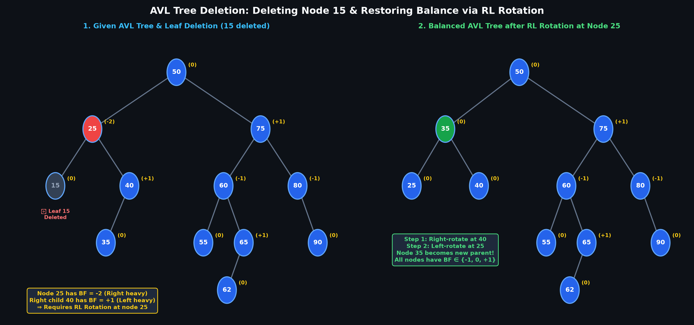
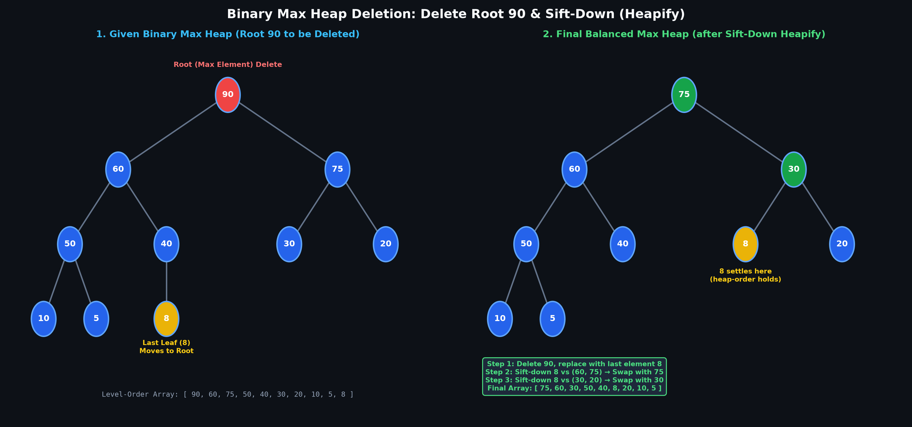

# UNIT II — Balanced Trees and Heaps

> **Course:** Advanced Data Structures & Algorithm Analysis (`2501CS10`) | Aditya University  
> **Exam Priority:** Priority 3 (Mechanical Tree Tracing) · **Unit Difficulty:** Medium (5/10)  
> **Source:** *Unit-wise Important Questions — Answers | Aditya University*

---

## Part A: 2-Mark Questions

### Q1: What condition must be satisfied by every node in an AVL tree?

#### Mandatory Conditions
Every node $x$ in an AVL tree must satisfy two conditions simultaneously:
1. **Binary Search Tree Property:** All keys in the left subtree $< key(x) <$ all keys in the right subtree.
2. **Balance Factor Condition:** The difference in height between its left and right subtrees must not exceed 1:
   $$\text{Balance Factor } BF(x) = \text{height}(\text{left}) - \text{height}(\text{right}) \in \{-1, 0, +1\}$$

---

### Q2: What is the purpose of balance factor in an AVL tree?

#### Definition
$$\text{Balance Factor (BF)} = \text{height}(\text{left subtree}) - \text{height}(\text{right subtree})$$

#### Key Points
- Permissible values: $-1, 0, +1$.
- When an insertion or deletion causes $BF = \pm 2$, an imbalance is detected and immediately corrected via rotations ($LL, RR, LR, RL$).
- Guarantees worst-case tree height of $O(\log n)$, preventing degenerate $O(n)$ skewed trees.

```text
      30 (-1)
     /      \
  20 (0)   40 (-1)
              \
             50 (0)
```

---

### Q3: Define the order of a B-Tree.

#### Definition
The **order $m$** of a B-Tree is the maximum number of children any internal node can possess.

#### Structural Bounds
- **Maximum keys per node:** $m - 1$
- **Minimum keys (non-root):** $\lceil m / 2 \rceil - 1$
- **Minimum children (non-root internal):** $\lceil m / 2 \rceil$
- All leaf nodes exist strictly at the same depth.

---

### Q4: What are the applications of B-Trees?

#### Key Applications
1. **Database Indexing:** Primary and secondary indexing in relational databases (MySQL InnoDB, PostgreSQL, Oracle).
2. **File Systems:** Directory and block indexing in modern file systems (NTFS, ext4, Btrfs, HFS+).
3. **Massive Storage Systems:** Minimizes expensive disk I/O reads by packing hundreds of keys into a single disk-block node.

---

### Q5: Define binary heap.

#### Definition
A binary heap is a complete binary tree stored compactly in an array that satisfies the **heap-order property**:
- **Completeness:** Every level is fully filled, except possibly the last level, which is filled from left to right.
- **Array Representation:** For element at index $i$:
  - Parent: $\lfloor (i - 1) / 2 \rfloor$
  - Left Child: $2i + 1$, Right Child: $2i + 2$

---

### Q6: Define Max-Heap and Min-Heap.

#### Comparison
| Property | Max-Heap | Min-Heap |
|---|---|---|
| **Heap-Order Condition** | $key(\text{parent}) \ge key(\text{child})$ | $key(\text{parent}) \le key(\text{child})$ |
| **Root Element** | Always contains the maximum key | Always contains the minimum key |
| **Common Use** | Heapsort (ascending), Max-priority queue | Dijkstra's, Prim's, Min-priority queue |

---

### Q7: Define Priority Queue.

#### Definition
An abstract data type (ADT) where each element has an associated numerical priority. Elements are dequeued strictly by priority rather than arrival order (FIFO).

#### Core Operations & Complexities (Binary Heap)
- `insert(x)`: $O(\log n)$
- `extractMax()` / `extractMin()`: $O(\log n)$
- `peek()` / `getMax()`: $O(1)$

---

### Q8: What is the time complexity of the heapify operation?

#### Complexity Bounds
- **Single-node sink down (`Heapify(i)` on tree of size $n$):** $O(\log n)$ — traverses the height of the tree.
- **Building an entire heap from an unordered array (`Build-Heap`):** $O(n)$ linear time — mathematically bounded by $\sum_{h=0}^{\lfloor\log n\rfloor} \frac{n}{2^{h+1}} O(h) = O(n)$.

---

## Part B: 8-Mark Questions

### 1. Construct an AVL Tree by Step-by-Step Insertion

**Q1. Construct an AVL tree by inserting the keys `50, 25, 12, 80, 90, 37, 45, 18, 19, 6`. Show the required rotations.**

An AVL tree keeps the balance factor ($\text{height of left subtree} - \text{height of right subtree}$) of every node in $\{-1, 0, +1\}$.

| Step | Insert | Result / problem | Rotation |
|---:|---:|---|---|
| 1 | 50 | `50` | none |
| 2 | 25 | `50` (left `25`) | none |
| 3 | 12 | `12` under `25` under `50`: node `50` has balance $+2$ (LL case) | Right rotation at `50` → `25 (12, 50)` |
| 4 | 80 | `80` right of `50` | none |
| 5 | 90 | `90` right of `80`: node `50` has balance $-2$ (RR case) | Left rotation at `50` → `25 (12, 80 (50, 90))` |
| 6 | 37 | `37` left of `50`: node `25` has balance $-2$, right child `80` is left-heavy (RL case) | Right rotation at `80`, then left rotation at `25` → `50 (25 (12, 37), 80 (–, 90))` |
| 7 | 45 | `45` right of `37` | none (all balanced) |
| 8 | 18 | `18` right of `12` | none |
| 9 | 19 | `19` right of `18`: node `12` has balance $-2$ (RR case) | Left rotation at `12` → `18 (12, 19)` |
| 10 | 6 | `6` left of `12`: node `50` has balance $+2$, left child `25` is left-heavy (LL case) | Right rotation at `50` |

#### Final AVL tree

```text
          25
        /    \
      18      50
     /  \    /  \
   12   19  37   80
   /         \     \
  6          45    90
```

Height $= 4$, all balance factors are in $\{-1, 0, +1\}$. Rotations used: 2 single-right (LL), 2 single-left (RR), 1 double (RL).

---

### 2. Four Types of AVL Tree Rotations and Applications

**Q2. Explain the four types of AVL tree rotations with suitable examples. Discuss the applications of AVL trees.**

Let $z$ be the lowest unbalanced node, $y$ its taller child, and $x$ the taller child of $y$.

#### 1. LL Rotation (Right rotation) — insertion into left subtree of left child

```text
      z (+2)          y
     /               / \
    y       ->      x   z
   /
  x
```

- *Example:* insert `30, 20, 10` $\to$ root `20 (10, 30)`.

#### 2. RR Rotation (Left rotation) — insertion into right subtree of right child

```text
  z (-2)              y
   \                 / \
    y       ->      z   x
     \
      x
```

- *Example:* insert `10, 20, 30` $\to$ root `20 (10, 30)`.

#### 3. LR Rotation (Left–Right) — insertion into right subtree of left child

Left rotation at $y$, then right rotation at $z$.

```text
    z            z            x
   /            /            / \
  y     ->     x     ->     y   z
   \          /
    x        y
```

- *Example:* insert `30, 10, 20` $\to$ root `20 (10, 30)`.

#### 4. RL Rotation (Right–Left) — insertion into left subtree of right child

Right rotation at $y$, then left rotation at $z$.

```text
  z            z              x
   \            \            / \
    y   ->       x   ->     z   y
   /              \
  x                y
```

- *Example:* insert `10, 30, 20` $\to$ root `20 (10, 30)`.

| Case | Imbalance | Fix |
|---|---|---|
| LL | Left-Left | Single right rotation |
| RR | Right-Right | Single left rotation |
| LR | Left-Right | Left then right (double) |
| RL | Right-Left | Right then left (double) |

#### Applications of AVL trees

- **Database Indexing:** Used in database systems to speed up search, insert, and delete operations where lookups dominate.
- **File Systems:** AVL trees maintain directory structures and symbol tables for fast file access.
- **Compilers & Interpreters:** Used in compiler symbol tables to store identifiers (variables, function names) in sorted order.
- **Memory Management:** Used by operating systems to allocate and deallocate free memory blocks efficiently.
- **Network Routing:** IP address lookup tables and network prefix matching.
- **Dictionaries & Spell Checkers:** Rapid word lookup and autocomplete.
- **Range Queries:** Efficient retrieval of all keys between $K_1$ and $K_2$.
- **Real-Time Systems:** Guarantees strict $O(\log n)$ worst-case execution time, essential for mission-critical predictability.

---

### 3. Deletion Procedure in AVL Tree (Delete 15)

**Q3. Explain the deletion procedure in an AVL tree. Show the balancing operations after deletion of `15` from the given AVL tree.**

#### Deletion Procedure (Step-by-Step)

1. **BST Deletion:** Perform standard BST deletion:
   - If node is a **leaf**, remove it directly.
   - If node has **one child**, replace node with its child.
   - If node has **two children**, replace node with its inorder successor (smallest in right subtree) or inorder predecessor, and delete that successor/predecessor node.
2. **Update Heights & Balance Factors:** Trace upward from the parent of the physically deleted node toward the root, updating each ancestor's height and balance factor:
   $$BF(\text{node}) = \text{height}(\text{left}) - \text{height}(\text{right})$$
3. **Check Balance:** If $BF \in \{-1, 0, +1\}$, the node is balanced. Move to its parent.
4. **Rebalance via Rotations:** If $BF = \pm 2$, an imbalance is detected:
   - Identify the rotation case ($LL, RR, LR, RL$) based on the balance factor of the taller child.
   - Apply rotation to restore balance.
5. **Propagate Upward:** Unlike insertion (which needs at most one rotation), deletion can decrease subtree height and cause further imbalances up to the root. Continue until root is balanced.

---

#### Worked Example: Deleting Node 15 from Given AVL Tree



##### Step 1: Remove Leaf Node 15
- Node `15` is a leaf child of `25`. Remove `15` directly.

##### Step 2: Trace Ancestor Balance Factors
Trace upwards starting from parent `25`:

| Node | Height (Left) | Height (Right) | Balance Factor ($BF = L - R$) | Status |
| :---: | :---: | :---: | :---: | :---: |
| **25** | 0 | 2 | **$-2$** | **Unbalanced (Needs Rotation)** |
| **40** | 1 | 0 | $+1$ | Balanced |
| **50** | 3 | 3 | 0 | Balanced |
| **75** | 3 | 2 | $+1$ | Balanced |
| **60** | 1 | 2 | $-1$ | Balanced |
| **80** | 0 | 1 | $-1$ | Balanced |
| **65** | 0 | 1 | $-1$ | Balanced |
| **35, 55, 62, 90** | 0 | 0 | 0 | Balanced (Leaves) |

##### Step 3: Identify Imbalance & Apply RL Rotation
- At node `25`: $BF(25) = -2$ (Right heavy).
- Right child `40`: $BF(40) = +1$ (Left heavy).
- **Condition:** Right-Left (RL) Case $\implies$ Requires **Double RL Rotation** at node `25`:
  - **Sub-step 3.1 (Right Rotation at 40):** Right-rotate at node `40`. Node `35` moves up and becomes right child of `25`, with `40` as right child of `35`.
  - **Sub-step 3.2 (Left Rotation at 25):** Left-rotate at node `25`. Node `35` rises to become the new root of the subtree, with `25` as its left child and `40` as its right child!

##### Step 4: Final Verification
- The restructured subtree rooted at `35 (25, 40)` has height 2.
- At root `50`: left subtree height = 3 (via path `50 → 35 → 25` is height 3), right subtree height = 3 (via `50 → 75 → 60 → 65 → 62`).
- Balance factor at root $50 = 3 - 3 = 0$.
- **All nodes satisfy $BF \in \{-1, 0, +1\}$.** Tree is a valid balanced AVL tree.

---

### 4. Construct a B-Tree of Order 4

**Q4. Construct a B-Tree of order 4 by inserting the keys `5, 3, 21, 9, 1, 13, 2, 7, 10, 12, 4, 8`.**

#### Structural Rules (Order $m = 4$)
- **Maximum children per node:** $m = 4$
- **Maximum keys per node:** $m - 1 = 3$
- **Minimum children (non-root internal):** $\lceil m / 2 \rceil = 2$
- **Minimum keys (non-root):** $\lceil m / 2 \rceil - 1 = 1$
- **Overflow & Splitting:** When a node reaches 4 keys, it splits. The median key (2nd key) is promoted up to its parent.

---

#### Step-by-Step Construction Tracing

##### Step 1: Insert 5, 3, 21
Keys fit into the root node in sorted order:
```text
[ 3  5  21 ]
```

---

##### Step 2: Insert 9 (Root Overflows & Splits)
- Inserting `9` produces `[ 3  5  9  21 ]` (4 keys $\implies$ Overflow!).
- Split at median key `5`. Key `5` moves up to form the new root:
```text
        [ 5 ]
       /     \
    [ 3 ]   [ 9  21 ]
```

---

##### Step 3: Insert 1, 13, 2
- `1` and `2` are $< 5$, inserted into left leaf `[ 3 ]` $\to `[ 1  2  3 ]`.
- `13` is $> 5$, inserted into right leaf `[ 9  21 ]` $\to `[ 9  13  21 ]`.
```text
          [ 5 ]
         /     \
    [ 1  2  3 ]   [ 9  13  21 ]
```

---

##### Step 4: Insert 7 (Right Leaf Overflows & Splits)
- `7` is $> 5$, goes into right leaf $\to `[ 7  9  13  21 ]` (Overflow!).
- Split at median `9`. Key `9` moves up to the root:
```text
          [ 5   9 ]
         /    |    \
   [ 1 2 3 ] [ 7 ] [ 13 21 ]
```

---

##### Step 5: Insert 10, 12 (Rightmost Leaf Overflows & Splits)
- `10` is $> 9$, goes into `[ 13  21 ]` $\to `[ 10  13  21 ]`.
- `12` is $> 9$, goes into `[ 10  13  21 ]` $\to `[ 10  12  13  21 ]` (Overflow!).
- Split at median `12`. Key `12` moves up to the root:
```text
           [ 5   9   12 ]
          /    |   \     \
    [ 1 2 3 ] [ 7 ] [ 10 ] [ 13 21 ]
```

---

##### Step 6: Insert 4 (Double Split: Leaf & Root Overflow)
- `4` is $< 5$, goes into left leaf `[ 1  2  3 ]` $\to `[ 1  2  3  4 ]` (Overflow!).
- **Leaf Split:** Split at median `2`. Key `2` moves up to parent root.
- **Root Overflow:** Root now contains `[ 2  5  9  12 ]` (4 keys $\implies$ Overflows!).
- **Root Split:** Split at median `5`. Key `5` becomes the new root; tree height increases:
```text
                 [ 5 ]
                /     \
            [ 2 ]     [ 9   12 ]
           /     \    /   |    \
        [ 1 ]  [ 3 4 ] [ 7 ] [ 10 ] [ 13 21 ]
```

---

##### Step 7: Insert 8 (Final Insertion)
- `8` falls between `5` and `9`, so it enters leaf `[ 7 ]` to become `[ 7  8 ]` (fits without overflow):

```text
                 [ 5 ]
                /     \
            [ 2 ]     [ 9   12 ]
           /     \    /   |    \
        [ 1 ]  [ 3 4 ] [ 7 8 ] [ 10 ] [ 13 21 ]
```

- **Height:** 3 levels (Root + 1 internal level + Leaves).
- **All B-tree properties hold:** every non-root has 1–3 keys, all leaves are at the exact same depth.

---

### 5. Deletion Operation in a B-Tree and Applications

**Q5. Explain the deletion operation in a B-Tree with a suitable example, and the applications of B-Trees.**

#### Deletion Rules (Order $m = 4$, Minimum Keys $= 1$)
1. **Case 1 (Leaf with $\ge 2$ keys):** Simply remove the key. No rebalancing needed.
2. **Case 2 (Leaf with minimum 1 key — Underflow):**
   - **Case 2A (Borrow from Sibling):** If an immediate sibling has $\ge 2$ keys, borrow a key via rotation through the parent.
   - **Case 2B (Merge with Sibling):** If both immediate siblings have only 1 key, merge the node with a sibling and pull down the separating key from the parent.
3. **Case 3 (Internal Node):** Replace the key with its inorder predecessor (largest in left subtree) or inorder successor (smallest in right subtree), then delete that key from the leaf.
4. **Case 4 (Shrinking Height):** If root loses all keys during a merge, its sole child becomes the new root.

---

#### Step-by-Step Deletion Example (Starting from Q4 Final Tree)

**Initial B-Tree:**
```text
                 [ 5 ]
                /     \
            [ 2 ]     [ 9   12 ]
           /     \    /   |    \
        [ 1 ]  [ 3 4 ] [ 7 8 ] [ 10 ] [ 13 21 ]
```

---

##### Step 1: Delete 4 (Case 1: Leaf with Extra Keys)
- Node `[ 3  4 ]` has 2 keys (minimum required is 1).
- Simply delete `4`. The node retains `[ 3 ]` with no underflow:
```text
                 [ 5 ]
                /     \
            [ 2 ]     [ 9   12 ]
           /     \    /   |    \
        [ 1 ]   [ 3 ]  [ 7 8 ] [ 10 ] [ 13 21 ]
```

---

##### Step 2: Delete 10 (Case 2A: Underflow $\to$ Borrow from Left Sibling)
- Delete `10` from leaf `[ 10 ]` $\implies$ node becomes empty `[ ]` (Underflow!).
- Look at left sibling `[ 7  8 ]`: it has 2 keys (can spare key `8`).
- **Borrow via parent `[ 9  12 ]`:**
  - Sibling's largest key `8` moves up to parent.
  - Parent separator key `9` moves down into the empty leaf:
```text
                 [ 5 ]
                /     \
            [ 2 ]     [ 8   12 ]
           /     \    /   |    \
        [ 1 ]   [ 3 ]  [ 7 ]  [ 9 ] [ 13 21 ]
```

---

##### Step 3: Delete 1 (Case 2B & Case 4: Merge Siblings & Parent Borrow)
- Delete `1` from leaf `[ 1 ]` $\implies$ node becomes empty `[ ]` (Underflow!).
- Sibling `[ 3 ]` has only 1 key (cannot lend).
- **Action 3.1: Merge Leaves & Parent Key:**
  - Merge empty leaf + parent key `2` + sibling `[ 3 ]` into leaf `[ 2  3 ]`.
  - Parent node `[ 2 ]` loses key `2` and becomes empty `[ ]` (Underflow at parent level!).
- **Action 3.2: Resolve Parent Underflow:**
  - Parent's sibling `[ 8  12 ]` has 2 keys (can spare key `8`).
  - Borrow via root `[ 5 ]`:
    - Root key `5` moves down to left internal node.
    - Sibling's first key `8` moves up to become the new root.
    - Sibling's child `[ 7 ]` moves across to become right child of `[ 5 ]`.

**Final Tree After Deletions:**
```text
            [ 8 ]
           /     \
       [ 5 ]     [ 12 ]
       /   \     /    \
    [ 2 3 ] [ 7 ] [ 9 ] [ 13 21 ]
```

---

#### Real-World Applications of B-Trees
1. **Database Indexing:** Powers primary and secondary B-tree indexes in relational databases (MySQL InnoDB, PostgreSQL, Oracle).
2. **File Systems:** Manages directory hierarchies and file allocation blocks in modern file systems (NTFS, ext4, HFS+, Btrfs).
3. **Minimizing Disk I/O:** Designed specifically for block storage; a single disk block holds a large node, keeping tree height extremely low ($O(\log_m n)$).
4. **Multilevel Indexing:** Ideal for massive datasets that do not fit into RAM.
5. **Guaranteed Efficiency:** Search, insert, and delete operations all complete in $O(\log n)$ worst-case time.

---

### 6. Construct a Min Heap and Max Heap

**Q6. Construct a Min/Max Heap by inserting the elements `40, 15, 30, 10, 12, 6, 25, 18`. Show all intermediate steps.**

#### Max Heap ($\text{parent} \ge \text{children}$)

Insert at the end, then sift up while larger than the parent.

| Insert | Array representation after insertion | Action |
|---:|---|---|
| 40 | `[40]` | root |
| 15 | `[40, 15]` | $15 < 40$, stays |
| 30 | `[40, 15, 30]` | $30 < 40$, stays |
| 10 | `[40, 15, 30, 10]` | $10 < 15$, stays |
| 12 | `[40, 15, 30, 10, 12]` | $12 < 15$, stays |
| 6 | `[40, 15, 30, 10, 12, 6]` | $6 < 30$, stays |
| 25 | `[40, 15, 30, 10, 12, 6, 25]` | $25 < 30$, stays |
| 18 | `[40, 18, 30, 15, 12, 6, 25, 10]` | $18 > 10$ swap; $18 > 15$ swap; $18 < 40$ stop |

##### Final Max Heap

```text
          40
        /    \
      18      30
     /  \    /  \
   15   12  6   25
   /
 10
```

#### Min Heap ($\text{parent} \le \text{children}$)

Sift up while smaller than the parent.

| Insert | Array after insertion | Action |
|---:|---|---|
| 40 | `[40]` | root |
| 15 | `[15, 40]` | $15 < 40$ swap |
| 30 | `[15, 40, 30]` | $30 > 15$, stays |
| 10 | `[10, 15, 30, 40]` | $10 < 40$ swap; $10 < 15$ swap (becomes root) |
| 12 | `[10, 12, 30, 40, 15]` | $12 < 15$ swap; $12 > 10$ stop |
| 6 | `[6, 12, 10, 40, 15, 30]` | $6 < 30$ swap; $6 < 10$ swap; root |
| 25 | `[6, 12, 10, 40, 15, 30, 25]` | $25 > 10$, stays |
| 18 | `[6, 12, 10, 18, 15, 30, 25, 40]` | $18 < 40$ swap; $18 > 12$ stop |

##### Final Min Heap

```text
          6
        /   \
      12     10
     /  \   /  \
   18   15 30  25
   /
 40
```

---

### 7. Deletion Operation on Given Max Heap

**Q7. Perform one deletion operation on given Max Heap and show the step-by-step process for final Max Heap.**



#### Given Max Heap
- **Tree Structure:** Complete binary tree with root `90`.
- **Level-Order Array Representation (1-based / 0-based):**
  - Indices 0 to 9: `[ 90, 60, 75, 50, 40, 30, 20, 10, 5, 8 ]`

#### Deletion Procedure (Step-by-Step Tracing)

1. **Step 1: Extract Maximum Element (Root):**
   - The root element `90` is removed (saved as the output of `deleteMax()`).
   - The **last leaf element in level-order**, which is `8` (at index 9), is moved to replace the root.
   - Array size shrinks to 9:
     ```text
     Array: [ 8, 60, 75, 50, 40, 30, 20, 10, 5 ]
     ```
2. **Step 2: Sift-Down (Heapify at Root Index 0):**
   - Compare node `8` with its left child `60` (index 1) and right child `75` (index 2).
   - Find the maximum among parent and children: $\max(8, 60, 75) = 75$.
   - Since child `75 > 8`, swap `8` with `75`:
     ```text
     Array: [ 75, 60, 8, 50, 40, 30, 20, 10, 5 ]
     ```
3. **Step 3: Continue Sift-Down (Heapify at Index 2):**
   - Node `8` is now at index 2.
   - Its left child is at index $2(2) + 1 = 5$ (value `30`) and right child at index $2(2) + 2 = 6$ (value `20`).
   - Find maximum among parent and children: $\max(8, 30, 20) = 30$.
   - Since child `30 > 8`, swap `8` with `30`:
     ```text
     Array: [ 75, 60, 30, 50, 40, 8, 20, 10, 5 ]
     ```
4. **Step 4: Termination:**
   - Node `8` is now at index 5. Its left child would be at $2(5) + 1 = 11$, which exceeds array bounds (length 9).
   - Node `8` is now a leaf. The heapify process terminates.

#### Final Verification & Time Complexity
- **Final Level-Order Array:** `[ 75, 60, 30, 50, 40, 8, 20, 10, 5 ]`
- **Heap Property Check:**
  - `75 ≥ 60, 30` (holds)
  - `60 ≥ 50, 40` (holds)
  - `30 ≥ 8, 20` (holds)
  - `50 ≥ 10, 5` (holds)
- **Time Complexity:** $O(\log n)$ (traverses down the tree height $h = \lfloor \log_2 10 \rfloor = 3$).
- **Space Complexity:** $O(1)$ auxiliary space (in-place array swaps).

---

### 8. Basic Operations of a Binary Heap and Applications of Priority Queues

**Q8. Explain the basic operations of a Binary Heap with their time complexities and discuss the applications of priority queues.**

A binary heap is a complete binary tree stored in an array that satisfies the heap property (max-heap: $\text{parent} \ge \text{children}$; min-heap: $\text{parent} \le \text{children}$). For index $i$ (0-based): $\text{parent} = \lfloor(i-1)/2\rfloor$, $\text{left child} = 2i+1$, $\text{right child} = 2i+2$.

| Operation | Description | Time |
|---|---|---|
| Insert | Add at the end, sift up | $O(\log n)$ |
| Delete-max / Delete-min (extract) | Replace root with last element, sift down | $O(\log n)$ |
| Get-max / Get-min (peek) | Return the root | $O(1)$ |
| Heapify | Restore the heap property at a node | $O(\log n)$ |
| Build-heap | Heapify all non-leaf nodes bottom-up | $O(n)$ |
| Increase/Decrease key | Change the key and sift up/down | $O(\log n)$ |
| Heap sort | Build-heap + $n$ extractions | $O(n \log n)$ |

#### Applications of priority queues (implemented with heaps)

1. Dijkstra's shortest path and Prim's MST algorithms.
2. Huffman coding (data compression).
3. Heap sort.
4. CPU/process scheduling in operating systems.
5. Event-driven simulation and load balancing.
6. Finding the $k$-th largest/smallest element; median maintenance.
7. $\text{A}^*$ search in AI and network routing/bandwidth management.
