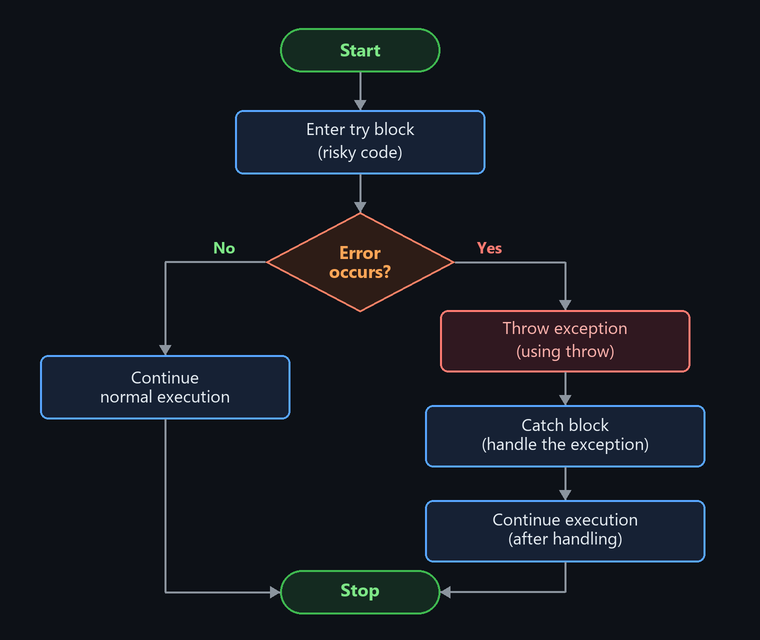

# Object Oriented Programming through C++ — Unit 5 Answers (`unit 5 answers.md`)

> **Raw Source PDFs:**
> - [`CPP/raw/cpp 5.pdf`](raw/cpp%205.pdf) *(Typed Unit 5 Answers)*
> - [`CPP/raw/Unit_5_Handwritten_Answers (1).pdf`](raw/Unit_5_Handwritten_Answers%20(1).pdf) *(Handwritten Unit 5 Answers)*
>
> **Questions File:** [`questions.md` — UNIT 5](questions.md#unit-5)

---

## Q1. Explain the principles of exception handling in C++ with a simple flow example.

### Explanation
**Exception handling** is a mechanism in C++ used to detect and handle run-time errors without abnormally crashing or terminating the program.

### Four Principles of Exception Handling
1. **`try` block:** Encloses code that may potentially throw an exception.
2. **`throw` statement:** Signals the occurrence of an error by throwing an exception value/object.
3. **`catch` block:** Intercepts and handles the thrown exception based on matching data type.
4. **Resumption:** After handling the exception, program execution continues normally past the catch block.

### Flowchart


### Example Program
```cpp
#include <iostream>
using namespace std;

int main() {
    int a = 10, b = 0;

    try {
        if (b == 0)
            throw "Division by zero error!";
        cout << "Result = " << (a / b) << endl;
    }
    catch (const char* msg) {
        cout << "Caught Exception: " << msg << endl;
    }

    cout << "Program continues execution smoothly..." << endl;
    return 0;
}
```

### Output
```text
Caught Exception: Division by zero error!
Program continues execution smoothly...
```

---

## Q2. What are multiple catch statements? Explain with an example.

### Explanation
**Multiple catch statements** occur when a single `try` block is associated with two or more `catch` blocks, each designed to handle a distinct exception type (e.g., `int`, `double`, `const char*`).

When an exception is thrown:
- C++ checks the catch blocks in top-to-bottom order.
- Only the **first matching** catch block is executed.
- If no match is found, the program terminates (or enters a catch-all block `catch(...)`).

### Syntax
```cpp
try {
    // risky code
}
catch (int e) {
    // handles integer exception
}
catch (double e) {
    // handles double exception
}
catch (const char* e) {
    // handles string/character exception
}
```

### Example Program
```cpp
#include <iostream>
using namespace std;

void test(int choice) {
    try {
        if (choice == 1)
            throw 10;          // int exception
        else if (choice == 2)
            throw 3.14;        // double exception
        else
            throw "Error!";    // string exception
    }
    catch (int e) {
        cout << "Caught Integer Exception: " << e << endl;
    }
    catch (double e) {
        cout << "Caught Double Exception : " << e << endl;
    }
    catch (const char* e) {
        cout << "Caught String Exception : " << e << endl;
    }
}

int main() {
    test(1);
    test(2);
    test(3);
    return 0;
}
```

### Output
```text
Caught Integer Exception: 10
Caught Double Exception : 3.14
Caught String Exception : Error!
```

---

## Q3. Describe the role of try, throw, and catch in exception handling with syntax.

### Roles and Syntax

### 1. `try`
- **Role:** Encloses the block of code that is monitored for exceptions. If an error occurs inside this block, execution of the block stops and transfers to the catch block.
- **Syntax:**
  ```cpp
  try {
      // code that may produce an exception
  }
  ```

### 2. `throw`
- **Role:** Triggers an exception and passes an error value (int, string, object) to the exception-handling mechanism.
- **Syntax:**
  ```cpp
  throw exception_value;
  ```

### 3. `catch`
- **Role:** Receives the thrown exception and contains recovery code to resolve or report the error.
- **Syntax:**
  ```cpp
  catch (data_type variable) {
      // exception handling code
  }
  ```

### Example Program
```cpp
#include <iostream>
using namespace std;

int main() {
    int age = 15;

    try {
        if (age < 18)
            throw age; // throw integer exception
        cout << "Eligible to vote" << endl;
    }
    catch (int x) {
        cout << "Not eligible to vote. Age provided: " << x << endl;
    }

    return 0;
}
```

### Output
```text
Not eligible to vote. Age provided: 15
```

---

## Q4. Explain the steps to open, write, read, and close a file in C++ with sample code.

### Overview
File handling in C++ is provided by the `<fstream>` library:
- `ofstream`: Stream class to write on files.
- `ifstream`: Stream class to read from files.
- `fstream`: Stream class to both read and write files.

### Four Steps
1. **Include header:** `#include <fstream>`
2. **Open file:** Open a file using a constructor or `.open()` with appropriate mode.
3. **Read / Write data:** Use insertion operator `<<` to write, or extraction operator `>>` / `getline()` to read.
4. **Close file:** Call `.close()` to flush streams and release file resources.

### Example Program
```cpp
#include <iostream>
#include <fstream>
#include <string>
using namespace std;

int main() {
    // 1. Open and Write to File
    ofstream fout("sample.txt");
    fout << "Hello C++ File Handling";
    fout.close();

    // 2. Open and Read from File
    ifstream fin("sample.txt");
    string content;
    getline(fin, content);
    fin.close();

    // 3. Display read content
    cout << "Content read from file: " << content << endl;

    return 0;
}
```

### Output
```text
Content read from file: Hello C++ File Handling
```

---

## Q5. What is STL? Explain its components and programming model.

### Definition
The **Standard Template Library (STL)** is a powerful collection of generic C++ class and function templates that provide ready-to-use data structures and algorithms.

### Four Core Components
1. **Containers:** Data structures used to store and organize collections of objects (e.g., `vector`, `list`, `map`, `set`).
2. **Algorithms:** Predefined function templates that perform common operations on containers (e.g., `sort()`, `find()`, `reverse()`, `count()`).
3. **Iterators:** Pointer-like objects that act as the bridge connecting algorithms to containers, traversing container elements.
4. **Function Objects (Functors):** Objects that can be invoked like functions (overloading `operator()`).

### STL Programming Model
```text
[ Container ]  <--->  [ Iterator ]  <--->  [ Algorithm ]  ===>  Output Result
```

### Example Program
```cpp
#include <iostream>
#include <vector>
#include <algorithm>
using namespace std;

int main() {
    // Container
    vector<int> v = {30, 10, 50, 20, 40};

    // Algorithm working via Iterators
    sort(v.begin(), v.end());

    cout << "Sorted vector: ";
    for (int x : v)
        cout << x << " ";
    cout << endl;

    return 0;
}
```

### Output
```text
Sorted vector: 10 20 30 40 50 
```

---

## Q6. What are iterators in STL? Explain their types and usage.

### Explanation
An **iterator** is a generalized pointer-like object used to navigate and access the elements of an STL container. It decouples algorithms from the underlying storage details of the container.

### 5 Common Types of Iterators

| Iterator Type | Movement | Access Mode | Typical Container |
| :--- | :--- | :--- | :--- |
| **Input Iterator** | Forward only (`++`) | Read-only | `istream` |
| **Output Iterator** | Forward only (`++`) | Write-only | `ostream` |
| **Forward Iterator** | Forward only (`++`) | Read & Write | `forward_list` |
| **Bidirectional Iterator** | Both directions (`++`, `--`) | Read & Write | `list`, `map`, `set` |
| **Random Access Iterator** | Direct jump (`+n`, `-n`, `[]`) | Read & Write | `vector`, `deque`, arrays |

### Example Program
```cpp
#include <iostream>
#include <vector>
using namespace std;

int main() {
    vector<int> v = {10, 20, 30, 40};

    // Iterator declaration
    vector<int>::iterator it;

    cout << "Traversing vector using iterator: ";
    for (it = v.begin(); it != v.end(); ++it) {
        cout << *it << " "; // dereferencing iterator
    }
    cout << endl;

    return 0;
}
```

### Output
```text
Traversing vector using iterator: 10 20 30 40 
```

---

## Q7. Explain vectors, Lists, and maps in STL with syntax and suitable example.

### Overview
C++ STL provides various container types:
- **`vector`:** A dynamic contiguous array. Allows fast random access ($O(1)$) and fast insertion/deletion at the end.
- **`list`:** A doubly linked list. Allows efficient insertion/deletion anywhere ($O(1)$) with sequential access.
- **`map`:** An associative container storing unique key-value pairs sorted by keys (usually a Red-Black tree, $O(\log n)$ search).

### Comparison

| Container | Internal Structure | Access Speed | Best For |
| :--- | :--- | :--- | :--- |
| **Vector** | Dynamic contiguous array | Random access ($O(1)$) | Frequent lookups, append at end |
| **List** | Doubly linked list | Sequential only ($O(n)$) | Frequent insertions/deletions anywhere |
| **Map** | Balanced binary search tree | Key search ($O(\log n)$) | Key-value mapping and dictionary lookups |

### Example Program
```cpp
#include <iostream>
#include <vector>
#include <list>
#include <map>
#include <string>
using namespace std;

int main() {
    // 1. Vector
    vector<int> v = {10, 20, 30};
    v.push_back(40);

    cout << "Vector elements : ";
    for (int x : v) cout << x << " ";
    cout << endl;

    // 2. List
    list<int> l = {10, 20, 30};
    l.push_front(5);
    l.push_back(40);

    cout << "List elements   : ";
    for (int x : l) cout << x << " ";
    cout << endl;

    // 3. Map
    map<int, string> m;
    m[1] = "C++";
    m[2] = "Python";
    m[3] = "Java";

    cout << "Map (Key:Value) : ";
    for (auto p : m)
        cout << "[" << p.first << ":" << p.second << "] ";
    cout << endl;

    return 0;
}
```

### Output
```text
Vector elements : 10 20 30 40 
List elements   : 5 10 20 30 40 
Map (Key:Value) : [1:C++] [2:Python] [3:Java] 
```
