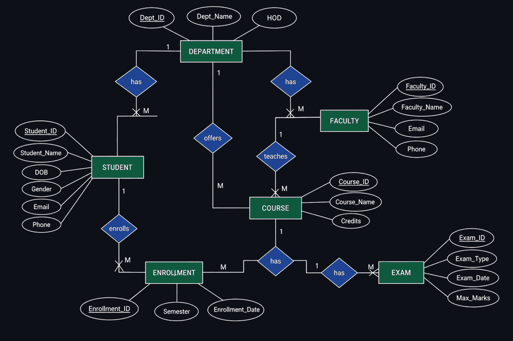
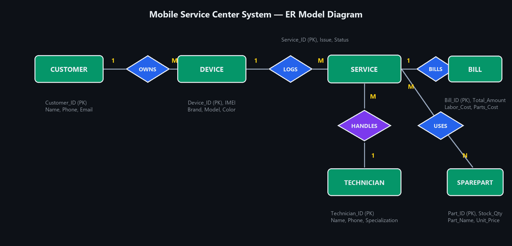

# Database Design Challenge — Problem Statements & Worked Solutions

---

## 1. Overview & Assessment Rubric

The **Database Design Challenge** tests end-to-end relational database modeling skills: translating real-world operational domains into formal conceptual Entity–Relationship (ER) models and converting them into normalized relational schemas.

### Assessment Rubric (5 Marks Total)

| Component | Marks | Evaluation Criteria |
| :--- | :---: | :--- |
| **1. Identify Entities** | **1** | Identify a minimum of **6 core entities** covering the system scope. |
| **2. Identify Attributes** | **1** | Specify comprehensive descriptive and state attributes for all entities. |
| **3. Define Keys & Constraints** | **1** | Define explicit **Primary Keys (PK)**, **Foreign Keys (FK)**, and integrity constraints. |
| **4. Draw ER Diagram** | **1** | Produce a neat ER diagram displaying entity sets, attributes, relationships, and cardinalities ($1:1, 1:N, M:N$). |
| **5. Convert to Relational Schema** | **1** | Map the ER model to normalized relational tables with clear PK/FK notations. |
| **Total** | **5 Marks** | |

---

## 2. Topic Directory (20 Problem Domains)

| No. | System Topic | Expected Core Entities |
| :---: | :--- | :--- |
| **1** | 🏫 **University Academic Management System** | `Student`, `Faculty`, `Course`, `Department`, `Enrollment`, `Exam` |
| **2** | 🏥 **Hospital Management System** | `Patient`, `Doctor`, `Appointment`, `Treatment`, `Prescription`, `Bill` |
| **3** | 📚 **Library Management System** | `Book`, `Member`, `Author`, `Publisher`, `Issue`, `Return` |
| **4** | 🛒 **E-Commerce Order Management** | `Customer`, `Product`, `Order`, `Payment`, `Delivery`, `Review` |
| **5** | 🏦 **Bank Account Management System** | `Customer`, `Account`, `Branch`, `Transaction`, `Loan`, `Employee` |
| **6** | 🍽️ **Restaurant Management System** | `Customer`, `Menu`, `Order`, `Staff`, `Table`, `Payment` |
| **7** | 🏨 **Hotel Reservation System** | `Guest`, `Room`, `Booking`, `Payment`, `Staff`, `Service` |
| **8** | 🚗 **Vehicle Rental System** | `Customer`, `Vehicle`, `Rental`, `Payment`, `Branch`, `Maintenance` |
| **9** | 🎓 **Student Placement Management System** | `Student`, `Company`, `Job`, `Application`, `Interview`, `Offer` |
| **10** | 🚌 **College Transportation Management** | `Student`, `Bus`, `Driver`, `Route`, `Stop`, `Allocation` |
| **11** | 💊 **Pharmacy Management System** | `Medicine`, `Supplier`, `Customer`, `Purchase`, `Sale`, `Prescription` |
| **12** | 🎬 **Movie Ticket Booking System** | `Movie`, `Theatre`, `Screen`, `Show`, `Customer`, `Ticket` |
| **13** | ✈️ **Airline Reservation System** | `Passenger`, `Flight`, `Airport`, `Ticket`, `Payment`, `Seat` |
| **14** | 🏋️ **Gym Management System** | `Member`, `Trainer`, `Membership`, `Payment`, `Workout`, `Equipment` |
| **15** | 📦 **Inventory Management System** | `Product`, `Supplier`, `Warehouse`, `Purchase`, `Stock`, `Sale` |
| **16** | 📱 **Mobile Service Center System** | `Customer`, `Device`, `Technician`, `Service`, `SparePart`, `Bill` |
| **17** | 🏢 **Employee Leave & Payroll System** | `Employee`, `Department`, `Attendance`, `Leave`, `Salary`, `Role` |
| **18** | 🚦 **Smart Traffic Management System** | `Vehicle`, `Road`, `Junction`, `Sensor`, `TrafficEvent`, `Signal` |
| **19** | 🏠 **Apartment Management System** | `Resident`, `Flat`, `Owner`, `Maintenance`, `Payment`, `Visitor` |
| **20** | ⚽ **Sports Tournament Management System** | `Team`, `Player`, `Match`, `Venue`, `Referee`, `Score` |

---

## 3. Worked Solution 1: University Academic Management System

### System Description
Design a centralized relational database for a university managing departments, students, faculty members, academic courses, student enrollments, and examinations.

### 1. Entities and Attributes

| Entity | Attributes | Primary Key (PK) | Foreign Keys (FK) |
| :--- | :--- | :---: | :--- |
| **`DEPARTMENT`** | `Dept_ID`, `Dept_Name`, `HOD` | `Dept_ID` | — |
| **`STUDENT`** | `Student_ID`, `Student_Name`, `DOB`, `Gender`, `Email`, `Phone`, `Dept_ID` | `Student_ID` | `Dept_ID` $\rightarrow$ `DEPARTMENT` |
| **`FACULTY`** | `Faculty_ID`, `Faculty_Name`, `Email`, `Phone`, `Dept_ID` | `Faculty_ID` | `Dept_ID` $\rightarrow$ `DEPARTMENT` |
| **`COURSE`** | `Course_ID`, `Course_Name`, `Credits`, `Dept_ID`, `Faculty_ID` | `Course_ID` | `Dept_ID`, `Faculty_ID` |
| **`ENROLLMENT`** | `Enrollment_ID`, `Student_ID`, `Course_ID`, `Semester`, `Enrollment_Date` | `Enrollment_ID` | `Student_ID`, `Course_ID` |
| **`EXAM`** | `Exam_ID`, `Course_ID`, `Exam_Type`, `Exam_Date`, `Max_Marks` | `Exam_ID` | `Course_ID` $\rightarrow$ `COURSE` |

### 2. Relationships and Cardinalities

| Relationship | Cardinality | Business Rule |
| :--- | :---: | :--- |
| **`DEPARTMENT` $\rightarrow$ `STUDENT`** | $1 : M$ | One department enrolls many students. |
| **`DEPARTMENT` $\rightarrow$ `FACULTY`** | $1 : M$ | One department employs many faculty members. |
| **`DEPARTMENT` $\rightarrow$ `COURSE`** | $1 : M$ | One department offers multiple academic courses. |
| **`FACULTY` $\rightarrow$ `COURSE`** | $1 : M$ | One faculty member teaches one or more courses. |
| **`STUDENT` $\rightarrow$ `ENROLLMENT`** | $1 : M$ | One student can register for multiple course enrollments. |
| **`COURSE` $\rightarrow$ `ENROLLMENT`** | $1 : M$ | One course has multiple student enrollments. |
| **`COURSE` $\rightarrow$ `EXAM`** | $1 : M$ | One course conducts multiple examinations (e.g., Mid-1, Mid-2, SEE). |

### 3. ER Diagram (Dark Mode)



### 4. Normalized Relational Schema
```sql
DEPARTMENT (
    Dept_ID INT PRIMARY KEY,
    Dept_Name VARCHAR(50) NOT NULL,
    HOD VARCHAR(50)
);

STUDENT (
    Student_ID INT PRIMARY KEY,
    Student_Name VARCHAR(50) NOT NULL,
    DOB DATE,
    Gender VARCHAR(10),
    Email VARCHAR(100) UNIQUE,
    Phone VARCHAR(15),
    Dept_ID INT,
    FOREIGN KEY (Dept_ID) REFERENCES DEPARTMENT(Dept_ID)
);

FACULTY (
    Faculty_ID INT PRIMARY KEY,
    Faculty_Name VARCHAR(50) NOT NULL,
    Email VARCHAR(100) UNIQUE,
    Phone VARCHAR(15),
    Dept_ID INT,
    FOREIGN KEY (Dept_ID) REFERENCES DEPARTMENT(Dept_ID)
);

COURSE (
    Course_ID INT PRIMARY KEY,
    Course_Name VARCHAR(50) NOT NULL,
    Credits INT CHECK (Credits > 0),
    Dept_ID INT,
    Faculty_ID INT,
    FOREIGN KEY (Dept_ID) REFERENCES DEPARTMENT(Dept_ID),
    FOREIGN KEY (Faculty_ID) REFERENCES FACULTY(Faculty_ID)
);

ENROLLMENT (
    Enrollment_ID INT PRIMARY KEY,
    Student_ID INT NOT NULL,
    Course_ID INT NOT NULL,
    Semester VARCHAR(10),
    Enrollment_Date DATE,
    FOREIGN KEY (Student_ID) REFERENCES STUDENT(Student_ID),
    FOREIGN KEY (Course_ID) REFERENCES COURSE(Course_ID)
);

EXAM (
    Exam_ID INT PRIMARY KEY,
    Course_ID INT NOT NULL,
    Exam_Type VARCHAR(20),
    Exam_Date DATE,
    Max_Marks INT,
    FOREIGN KEY (Course_ID) REFERENCES COURSE(Course_ID)
);
```

---

## 4. Worked Solution 2: Mobile Service Center System (Case Study #16)

### System Description
A centralized relational database for a mobile phone repair center that manages customers, devices registered for repair, assigned technicians, repair service jobs, spare parts inventory, and final billing.

### Problem Addressed
1. **Manual Tracking:** Paper registers and isolated spreadsheets cause lost device history and repair delays.
2. **Missing Inventory Links:** Spare parts usage is not linked to specific service jobs, causing stock mismatches.
3. **Billing Inconsistencies:** Separation of labour charges and parts replacement costs leads to billing disputes.
4. **Technician Workload Tracking:** Managers cannot monitor pending vs. completed service jobs per technician.

---

### 1. Six Core Entities & Key Attributes

| Entity | Description | Attributes | Primary Key |
| :--- | :--- | :--- | :---: |
| **`CUSTOMER`** | Person submitting device for repair | `Customer_ID`, `Name`, `Phone`, `Email`, `Address` | `Customer_ID` |
| **`DEVICE`** | Mobile phone / tablet registered | `Device_ID`, `Customer_ID`, `Brand`, `Model`, `IMEI`, `Color` | `Device_ID` |
| **`TECHNICIAN`** | Service staff performing repair | `Technician_ID`, `Name`, `Phone`, `Specialization`, `Status` | `Technician_ID` |
| **`SERVICE`** | Repair / diagnostic job | `Service_ID`, `Device_ID`, `Technician_ID`, `Issue`, `Status`, `Start_Date`, `End_Date` | `Service_ID` |
| **`SPAREPART`** | Replacement component in stock | `Part_ID`, `Part_Name`, `Brand`, `Stock_Qty`, `Unit_Price` | `Part_ID` |
| **`BILL`** | Final invoice for labour and parts | `Bill_ID`, `Service_ID`, `Labor_Cost`, `Parts_Cost`, `Total_Amount`, `Bill_Date`, `Payment_Status` | `Bill_ID` |

---

### 2. Entity Relationships & Cardinalities

| Relationship | Cardinality | Business Meaning |
| :--- | :---: | :--- |
| **`CUSTOMER` $\rightarrow$ `DEVICE`** | $1 : M$ | One customer can own and register multiple devices. |
| **`DEVICE` $\rightarrow$ `SERVICE`** | $1 : M$ | One device can undergo multiple service jobs over its lifetime. |
| **`TECHNICIAN` $\rightarrow$ `SERVICE`** | $1 : M$ | One technician can handle multiple repair service jobs. |
| **`SERVICE` $\rightarrow$ `BILL`** | $1 : 1$ | Each completed repair service job generates exactly one bill. |
| **`SERVICE` $\leftrightarrow$ `SPAREPART`** | $M : N$ | A service job can use multiple spare parts; a spare part model can be used across multiple jobs. Mapped via bridge relation **`SERVICE_PART`**. |

---

### 3. ER Diagram (Dark Mode)



---

### 4. Normalized Relational Schema
```sql
CREATE TABLE Customer (
    Customer_ID INT PRIMARY KEY,
    Name VARCHAR(50) NOT NULL,
    Phone VARCHAR(15) NOT NULL,
    Email VARCHAR(100),
    Address VARCHAR(150)
);

CREATE TABLE Device (
    Device_ID INT PRIMARY KEY,
    Customer_ID INT NOT NULL,
    Brand VARCHAR(30) NOT NULL,
    Model VARCHAR(50) NOT NULL,
    IMEI VARCHAR(20) UNIQUE NOT NULL,
    Color VARCHAR(20),
    FOREIGN KEY (Customer_ID) REFERENCES Customer(Customer_ID)
);

CREATE TABLE Technician (
    Technician_ID INT PRIMARY KEY,
    Name VARCHAR(50) NOT NULL,
    Phone VARCHAR(15),
    Specialization VARCHAR(50),
    Status VARCHAR(20) CHECK (Status IN ('Active', 'On-Leave', 'Busy'))
);

CREATE TABLE Service (
    Service_ID INT PRIMARY KEY,
    Device_ID INT NOT NULL,
    Technician_ID INT NOT NULL,
    Issue VARCHAR(200) NOT NULL,
    Status VARCHAR(20) CHECK (Status IN ('Pending', 'In-Progress', 'Completed', 'Delivered')),
    Start_Date DATE,
    End_Date DATE,
    FOREIGN KEY (Device_ID) REFERENCES Device(Device_ID),
    FOREIGN KEY (Technician_ID) REFERENCES Technician(Technician_ID)
);

CREATE TABLE SparePart (
    Part_ID INT PRIMARY KEY,
    Part_Name VARCHAR(50) NOT NULL,
    Brand VARCHAR(30),
    Stock_Qty INT CHECK (Stock_Qty >= 0),
    Unit_Price DECIMAL(10, 2) CHECK (Unit_Price >= 0)
);

-- Bridge table resolving M:N relationship between SERVICE and SPAREPART
CREATE TABLE Service_Part (
    Service_ID INT,
    Part_ID INT,
    Quantity INT CHECK (Quantity > 0),
    PRIMARY KEY (Service_ID, Part_ID),
    FOREIGN KEY (Service_ID) REFERENCES Service(Service_ID),
    FOREIGN KEY (Part_ID) REFERENCES SparePart(Part_ID)
);

CREATE TABLE Bill (
    Bill_ID INT PRIMARY KEY,
    Service_ID INT UNIQUE NOT NULL,
    Labor_Cost DECIMAL(10, 2) NOT NULL,
    Parts_Cost DECIMAL(10, 2) NOT NULL,
    Total_Amount DECIMAL(10, 2) NOT NULL,
    Bill_Date DATE,
    Payment_Status VARCHAR(20) CHECK (Payment_Status IN ('Paid', 'Pending')),
    FOREIGN KEY (Service_ID) REFERENCES Service(Service_ID)
);
```

### Design Strengths
1. **Referential Integrity:** Complete foreign key coverage ensures no orphan devices, services, or bills.
2. **Normalized to 3NF/BCNF:** Redundant customer and technician details are not duplicated inside service or bill records.
3. **Bridge Table for Parts:** `Service_Part` accurately tracks quantities of spare parts consumed per repair, keeping inventory synchronized.
4. **Independent Billing Verification:** `Total_Amount = Labor_Cost + Parts_Cost` ensures auditable accounting.
