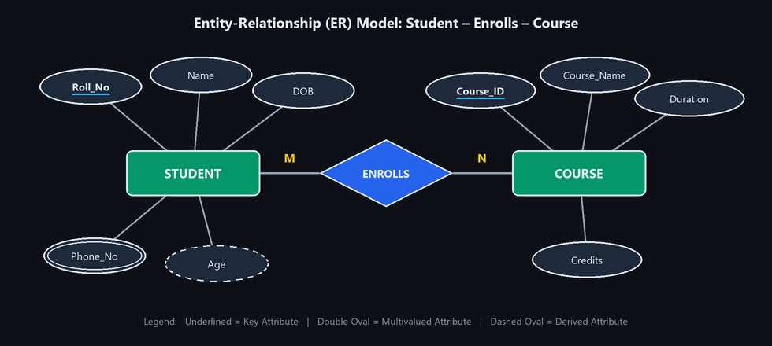
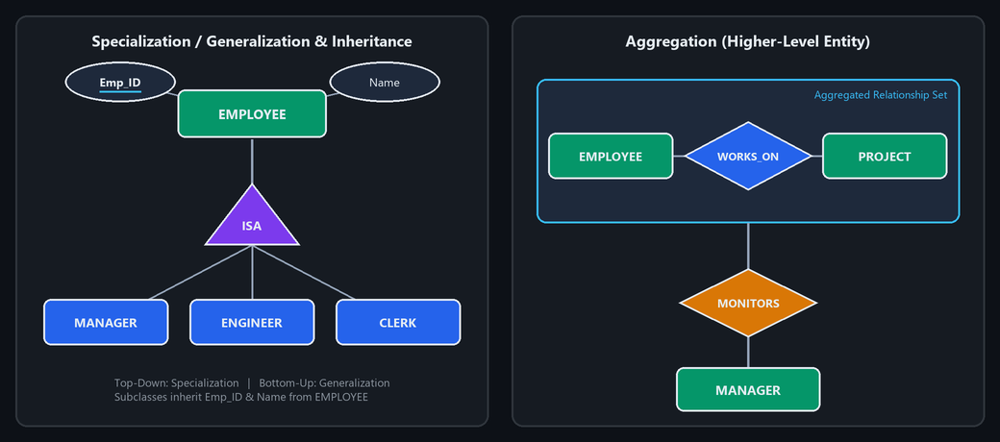
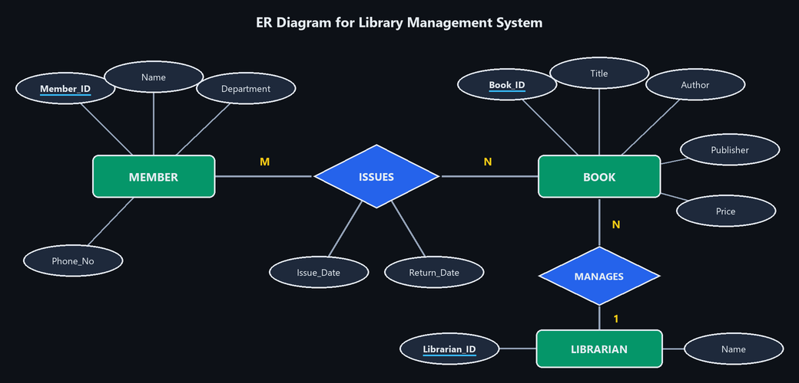
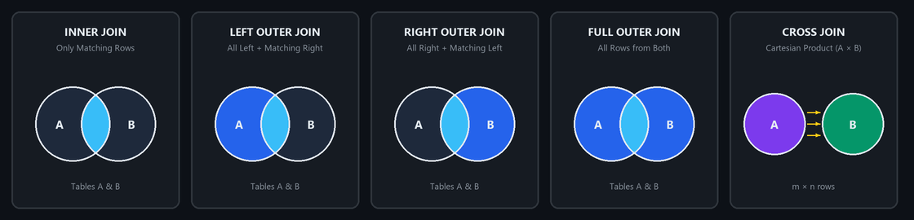

# UNIT 3 — Entity-Relationship Model, Constraints, Subqueries, Joins & Views

---

## 1. Explain the ER Model with neat diagrams.

### Definition
The **Entity–Relationship (ER) Model** is a high-level conceptual data model that represents real-world objects (**entities**), their properties (**attributes**), and associations among them (**relationships**) as a graphical diagram before creating database tables.

### Core Components
1. **Entity:** A real-world object distinguishable from other objects (e.g., `STUDENT`, `COURSE`).
   - **Strong Entity:** Has a primary key of its own.
   - **Weak Entity:** Lacks a primary key; depends on a strong entity for identification.
2. **Attribute:** A characteristic that describes an entity (e.g., `Roll_No`, `Name`, `DOB`).
3. **Relationship:** An association between two or more entities (e.g., `STUDENT` *enrolls in* `COURSE`).

### Standard ER Notations

| Symbol | Shape | Meaning |
| :--- | :--- | :--- |
| **Rectangle** | `[ Entity ]` | Strong Entity Set |
| **Double Rectangle** | `[[ Weak Entity ]]` | Weak Entity Set |
| **Ellipse / Oval** | `( Attribute )` | Simple / Single-Valued Attribute |
| **Underlined Oval** | `(`<u>`Key_Attribute`</u>`)` | Primary / Key Attribute |
| **Double Oval** | `(( Multivalued ))` | Multi-Valued Attribute (e.g., `Phone_No`) |
| **Dashed Oval** | `(- - Derived - -)` | Derived Attribute (e.g., `Age` from `DOB`) |
| **Diamond** | `<> Relationship <>` | Relationship Set |
| **Double Diamond** | `<< Identifying >>` | Identifying Relationship for Weak Entity |
| **Line** | `───────` | Connects attributes to entities and entities to relationships |

### ER Diagram: Student – Enrolls – Course



### Explanation of Diagram
- **Entities:** `STUDENT` and `COURSE` are represented by rectangles.
- **Attributes:**
  - `Roll_No` (underlined) is the primary key of `STUDENT`; `Name` and `DOB` are simple attributes; `Phone_No` (double oval) is multivalued; `Age` (dashed oval) is derived from `DOB`.
  - `Course_ID` (underlined) is the primary key of `COURSE`, with `Course_Name`, `Duration`, and `Credits`.
- **Relationship:** `ENROLLS` (diamond) links `STUDENT` and `COURSE`. The **$M : N$** mapping indicates that many students can enroll in many courses.

### Advantages of ER Model
1. Simple and visually easy to understand.
2. Provides a clear conceptual blueprint before table creation.
3. Maps directly to relational schemas (tables, PKs, FKs).
4. Eliminates design errors and unnecessary redundancy early.

---

## 2. Explain different types of attributes and relationships in the ER Model.

### 1. Types of Attributes

| Attribute Type | Definition | Example & ER Symbol |
| :--- | :--- | :--- |
| **1. Simple (Atomic)** | Cannot be divided into smaller sub-parts. | `Age`, `Gender`<br>*(Standard Oval)* |
| **2. Composite** | Can be divided into smaller sub-attributes. | `Name` $\rightarrow$ (`First_Name`, `Last_Name`)<br>`Address` $\rightarrow$ (`Street`, `City`, `State`, `Pincode`) |
| **3. Single-Valued** | Holds only a single value for each entity instance. | `Roll_No`, `DOB`<br>*(Standard Oval)* |
| **4. Multi-Valued** | Can hold multiple values for a single entity. | `Phone_No`, `Skills`<br>*(Double Oval)* |
| **5. Derived** | Dynamically calculated from another attribute. | `Age` (derived from `DOB`)<br>*(Dashed Oval)* |
| **6. Key Attribute** | Uniquely identifies each entity in an entity set. | `Student_ID`, `Roll_No`<br>*(Underlined text in Oval)* |

### 2. Types of Relationships (Mapping Cardinalities)

#### (a) One-to-One ($1 : 1$)
One entity in $A$ is associated with at most one entity in $B$, and vice versa.
```text
[ Person ] ──── 1 ──── < Has > ──── 1 ──── [ Passport ]
```

#### (b) One-to-Many ($1 : N$)
One entity in $A$ is associated with many entities in $B$, but each entity in $B$ relates to at most one in $A$.
```text
[ Department ] ──── 1 ──── < Has > ──── N ──── [ Employee ]
```

#### (c) Many-to-One ($M : 1$)
Many entities in $A$ relate to one entity in $B$.
```text
[ Book ] ──── M ──── < Published_By > ──── 1 ──── [ Publisher ]
```

#### (d) Many-to-Many ($M : N$)
Many entities in $A$ can relate to many entities in $B$.
```text
[ Student ] ──── M ──── < Enrolls > ──── N ──── [ Course ]
```

---

## 3. Explain Specialization, Generalization, Aggregation and Inheritance with examples.

These are Enhanced ER (EER) concepts used to model complex real-world hierarchies.



### 1. Specialization (Top-Down Approach)
- **Concept:** A higher-level entity (superclass) is broken down into specialized lower-level sub-entities (subclasses) based on distinguishing features.
- **Example:** `EMPLOYEE` is specialized into `MANAGER`, `ENGINEER`, and `CLERK`.

### 2. Generalization (Bottom-Up Approach)
- **Concept:** Multiple lower-level entities with common properties are combined upward into a single generalized superclass.
- **Example:** `CAR` and `TRUCK` are generalized into `VEHICLE`.

### 3. Aggregation
- **Concept:** Treats a relationship and its participating entities as a single higher-level entity so it can participate in another relationship (since ER diagrams cannot link relationships directly to relationships).
- **Example:** An `EMPLOYEE` `WORKS_ON` a `PROJECT`. That entire work assignment is aggregated and linked to `MONITORS` by a `MANAGER`.

### 4. Inheritance
- **Concept:** Subclasses connected via an `ISA` triangle automatically inherit all attributes and relationships of their superclass while adding their own specific attributes.
- **Example:** `PG_STUDENT` inherits `Roll_No` and `Name` from `STUDENT`, and adds `Thesis_Topic`.

### Quick Summary

| Concept | Direction | Action | Example |
| :--- | :---: | :--- | :--- |
| **Specialization** | Top-Down ($\downarrow$) | Splits one entity into specialized sub-entities | `EMPLOYEE` $\rightarrow$ `MANAGER`, `ENGINEER`, `CLERK` |
| **Generalization** | Bottom-Up ($\uparrow$) | Combines multiple entities into a common superclass | `CAR` + `TRUCK` $\rightarrow$ `VEHICLE` |
| **Aggregation** | Box Abstraction | Treats a relationship as a higher-level entity | `(EMPLOYEE WORKS_ON PROJECT)` $\rightarrow$ `MONITORS` $\rightarrow$ `MANAGER` |
| **Inheritance** | Super $\rightarrow$ Sub | Subclass automatically reuses superclass attributes | `PG_STUDENT` inherits `Roll_No`, `Name` from `STUDENT` |

---

## 4. Draw an ER diagram for a Library/Hospital/Banking System.

### ER Diagram: Library Management System

#### Core Entities & Attributes
1. **`MEMBER`:** `<u>Member_ID</u>`, `Name`, `Department`, `Phone_No`
2. **`BOOK`:** `<u>Book_ID</u>`, `Title`, `Author`, `Publisher`, `Price`
3. **`LIBRARIAN`:** `<u>Librarian_ID</u>`, `Name`
4. **`ISSUES` (Relationship):** `Issue_Date`, `Return_Date`



#### Relationships and Cardinalities
- **`MEMBER` — `ISSUES` — `BOOK` ($M : N$):** A member can borrow multiple books; a book can be borrowed by multiple members over time. Attributes: `Issue_Date`, `Return_Date`.
- **`LIBRARIAN` — `MANAGES` — `BOOK` ($1 : N$):** One librarian catalogs and manages multiple books.

#### Relational Schema Mapping
- `MEMBER` (`<u>Member_ID</u>`, `Name`, `Department`, `Phone_No`)
- `BOOK` (`<u>Book_ID</u>`, `Title`, `Author`, `Publisher`, `Price`, `Librarian_ID (FK)`)
- `LIBRARIAN` (`<u>Librarian_ID</u>`, `Name`)
- `BOOK_ISSUE` (`<u>Member_ID (FK)</u>`, `<u>Book_ID (FK)</u>`, `<u>Issue_Date</u>`, `Return_Date`)

*(Note: Hospital and Banking systems follow the same pattern: Hospital uses `PATIENT`, `DOCTOR`, `APPOINTMENT`; Banking uses `CUSTOMER`, `ACCOUNT`, `BRANCH`, `TRANSACTION`).*

---

## 5. Explain the implementation of Primary Key, Foreign Key, UNIQUE, NOT NULL, and CHECK constraints in SQL with suitable examples.

**Constraints** are rules enforced on table columns to prevent invalid data from entering the database.

### 1. `PRIMARY KEY`
- Uniquely identifies each record in a table.
- Cannot contain duplicate values or `NULL` values. Only **one** PK per table.
```sql
CREATE TABLE Students (
    Student_ID INT PRIMARY KEY,
    Name VARCHAR(50),
    Age INT
);
```

### 2. `FOREIGN KEY`
- Links a column in a child table to the `PRIMARY KEY` of a parent table to enforce referential integrity.
- Prevents orphan records.
```sql
CREATE TABLE Orders (
    Order_ID INT PRIMARY KEY,
    Student_ID INT,
    Order_Date DATE,
    FOREIGN KEY (Student_ID) REFERENCES Students(Student_ID)
);
```

### 3. `UNIQUE`
- Ensures all values in a column are distinct.
- Unlike `PRIMARY KEY`, it allows `NULL` values, and a table can have **multiple** `UNIQUE` columns.
```sql
CREATE TABLE Employees (
    Emp_ID INT PRIMARY KEY,
    Email VARCHAR(100) UNIQUE,
    Name VARCHAR(50)
);
```

### 4. `NOT NULL`
- Ensures that a column must always have a value (cannot be left empty / `NULL`).
```sql
CREATE TABLE Products (
    Product_ID INT PRIMARY KEY,
    Name VARCHAR(50) NOT NULL,
    Price DECIMAL(10, 2) NOT NULL
);
```

### 5. `CHECK`
- Enforces a boolean condition on column values; values that evaluate to `FALSE` are rejected.
```sql
CREATE TABLE Workers (
    Emp_ID INT PRIMARY KEY,
    Age INT CHECK (Age >= 18),
    Price DECIMAL(10, 2) CHECK (Price > 0)
);
```

### Summary Comparison

| Constraint | Prevents Duplicates? | Allows `NULL`? | Max per Table | Main Purpose |
| :--- | :---: | :---: | :---: | :--- |
| **`PRIMARY KEY`** | Yes | No | 1 | Uniquely identifies each row |
| **`FOREIGN KEY`** | No | Yes | Unlimited | Preserves parent–child links |
| **`UNIQUE`** | Yes | Yes | Unlimited | Guarantees uniqueness for non-PK columns |
| **`NOT NULL`** | No | No | Unlimited | Enforces mandatory field entry |
| **`CHECK`** | No | Yes | Unlimited | Restricts allowable domain range |

---

## 6. What are integrity constraints? Explain Entity Integrity, Referential Integrity, and Domain Integrity constraints with suitable SQL examples.

**Integrity Constraints** are rules enforced by the DBMS to guarantee that data remains accurate, valid, and consistent across operations.

### 1. Entity Integrity Constraint
- **Rule:** Every table must have a Primary Key, and **no primary key value can be `NULL` or duplicated**.
- **Reason:** Every tuple in a relation must be uniquely identifiable.
```sql
CREATE TABLE Student (
    Roll_No INT PRIMARY KEY,
    Name VARCHAR(50),
    Age INT
);
-- Inserting (NULL, 'Ravi', 20) or duplicate Roll_No is rejected.
```

### 2. Referential Integrity Constraint
- **Rule:** A Foreign Key value in a child table must either **match an existing Primary Key value** in the referenced parent table, or be **`NULL`**.
- **Reason:** Prevents orphan records (e.g., an order referencing a non-existent student).
```sql
CREATE TABLE Department (
    Dept_ID INT PRIMARY KEY,
    Dept_Name VARCHAR(50)
);

CREATE TABLE Employee (
    Emp_ID INT PRIMARY KEY,
    Emp_Name VARCHAR(50),
    Dept_ID INT,
    FOREIGN KEY (Dept_ID) REFERENCES Department(Dept_ID)
);
-- Inserting Dept_ID = 99 (not in Department) is rejected.
```

### 3. Domain Integrity Constraint
- **Rule:** Every attribute must contain valid, atomic values conforming to its defined **data type, length, nullability, and allowable range**.
- **Reason:** Prevents invalid data (e.g., negative age, non-matching gender).
```sql
CREATE TABLE Person (
    Person_ID INT PRIMARY KEY,
    Name VARCHAR(50) NOT NULL,
    Age INT CHECK (Age BETWEEN 18 AND 60),
    Gender VARCHAR(10) CHECK (Gender IN ('Male', 'Female'))
);
```

### Summary

| Integrity Type | Target | Core Rule | Enforced By |
| :--- | :--- | :--- | :--- |
| **Entity Integrity** | Primary Key | Cannot be `NULL` or duplicate | `PRIMARY KEY` |
| **Referential Integrity** | Foreign Key | Must match a valid parent PK or be `NULL` | `FOREIGN KEY ... REFERENCES` |
| **Domain Integrity** | Column Values | Must follow data type, format, and range rules | Data Types, `CHECK`, `NOT NULL` |

---

## 7. Explain Nested and Correlated Subqueries with examples.

A **Subquery** is a `SELECT` statement embedded inside another SQL query (enclosed in parentheses).

### 1. Nested Subquery (Independent)
- **Concept:** The inner query is completely **independent** of the outer query.
- **Execution:** The inner query executes **first, only once**. Its result is passed to the outer query.
- **Example:** Find the name of the student who scored the highest marks:
```sql
SELECT Name
FROM Student
WHERE Marks = (SELECT MAX(Marks) FROM Student);
```
*(The inner query computes `MAX(Marks)` once, say `95`, then the outer query fetches students with `Marks = 95`).*

### 2. Correlated Subquery (Dependent)
- **Concept:** The inner query **references a column from the outer query** in its `WHERE` clause.
- **Execution:** The inner query runs **repeatedly (once for every row)** evaluated by the outer query.
- **Example:** Find employees whose salary is greater than the average salary of their own department:
```sql
SELECT E1.Emp_Name, E1.Salary
FROM Employee E1
WHERE E1.Salary > (
    SELECT AVG(E2.Salary)
    FROM Employee E2
    WHERE E2.Dept_ID = E1.Dept_ID
);
```
*(For each employee in `E1`, the inner query computes the average salary of `E1.Dept_ID`, then filters `E1`).*

### Comparison: Nested vs. Correlated Subquery

| Feature | Nested Subquery | Correlated Subquery |
| :--- | :--- | :--- |
| **Dependency** | Independent of outer query | Depends on outer query column |
| **Execution Order** | Inner runs first $\rightarrow$ Outer runs second | Evaluated row-by-row for each outer row |
| **Execution Count** | Executes **only once** | Executes **$N$ times** (once per outer row) |
| **Performance** | Fast ($O(1)$ subquery execution) | Slower on large tables |
| **Use Case** | Global aggregates (`MAX`, `AVG`, `IN`) | Group-relative comparisons, `EXISTS` |

---

## 8. Explain different types of SQL Joins with suitable examples.

An **SQL Join** combines rows from two or more tables based on a related column.



### Sample Tables
- **`Employee`:** `(1, 'Ratan', 10)`, `(2, 'Vivek', 20)`, `(3, 'Lochan', 10)`, `(4, 'Teja', 40)`
- **`Department`:** `(10, 'CSE')`, `(20, 'IT')`, `(30, 'AIML')`

---

### 1. `INNER JOIN`
Returns **only matching rows** from both tables. Unmatched rows are excluded.
```sql
SELECT E.EmpName, D.DeptName
FROM Employee E
INNER JOIN Department D ON E.DeptID = D.DeptID;
```
**Result:** `(Ratan, CSE)`, `(Vivek, IT)`, `(Lochan, CSE)`.

### 2. `LEFT JOIN` (`LEFT OUTER JOIN`)
Returns **all rows from the left table**, plus matched rows from the right table. Right side is `NULL` if no match.
```sql
SELECT E.EmpName, D.DeptName
FROM Employee E
LEFT JOIN Department D ON E.DeptID = D.DeptID;
```
**Result:** Includes `(Teja, NULL)` because Teja is in the left table.

### 3. `RIGHT JOIN` (`RIGHT OUTER JOIN`)
Returns **all rows from the right table**, plus matched rows from the left table. Left side is `NULL` if no match.
```sql
SELECT E.EmpName, D.DeptName
FROM Employee E
RIGHT JOIN Department D ON E.DeptID = D.DeptID;
```
**Result:** Includes `(NULL, AIML)` because AIML is in the right table.

### 4. `FULL JOIN` (`FULL OUTER JOIN`)
Returns **all rows** when there is a match in either table. Missing sides are filled with `NULL`.
```sql
SELECT E.EmpName, D.DeptName
FROM Employee E
FULL OUTER JOIN Department D ON E.DeptID = D.DeptID;
```
**Result:** Includes `(Teja, NULL)` and `(NULL, AIML)`.

### 5. `CROSS JOIN`
Returns the **Cartesian product** ($m \times n$ combinations). No `ON` condition.
```sql
SELECT E.EmpName, D.DeptName
FROM Employee E CROSS JOIN Department D;
```
**Result:** $4 \times 3 = 12$ rows.

### 6. `SELF JOIN`
A table joined with itself using aliases (used for hierarchical data like employee–manager).
```sql
SELECT A.EmpName AS Employee, B.EmpName AS Manager
FROM Employee A
LEFT JOIN Employee B ON A.ManagerID = B.EmpID;
```

---

## 9. Explain SQL Views. Differentiate updatable and non-updatable views with examples.

### 1. SQL Views
A **View** is a virtual table based on the result of an SQL `SELECT` query. It does not store physical data itself (except in *Materialized Views*), but dynamically pulls data from underlying base tables.
- **Benefits:** Security (hides sensitive columns), simplifies complex queries, provides logical data independence.
```sql
CREATE VIEW StudentView AS
SELECT Name, Marks FROM Students;

SELECT * FROM StudentView;
```

### 2. Updatable Views vs. Non-Updatable Views

#### Updatable Views
- Allows `INSERT`, `UPDATE`, and `DELETE` statements; changes are automatically applied to the underlying table.
- **Requirements:** Derived from a **single table**, includes the table's Primary Key, and contains **no** `GROUP BY`, `HAVING`, `DISTINCT`, or aggregate functions.
```sql
CREATE VIEW Emp_View AS
SELECT EmpID, EmpName, DeptID FROM Employee;

UPDATE Emp_View SET DeptID = 20 WHERE EmpID = 1; -- Valid!
```

#### Non-Updatable Views
- **Read-only view**. Does not allow data modification because the DBMS cannot map updates back to a single unique row.
- **Reasons:** Derived from multiple joined tables, or contains `GROUP BY`, `DISTINCT`, or aggregate functions (`SUM`, `AVG`).
```sql
CREATE VIEW Dept_Summary AS
SELECT DeptID, COUNT(*) AS Total, AVG(Salary) AS AvgSal
FROM Employee GROUP BY DeptID;

UPDATE Dept_Summary SET AvgSal = 60000; -- Fails! ORA-01732
```

### Comparison Table

| Feature | Updatable View | Non-Updatable View |
| :--- | :--- | :--- |
| **Data Modification** | Allows `INSERT`, `UPDATE`, `DELETE` | Read-only; modifications rejected |
| **Base Tables** | Created from a **single** table | Created using `JOIN`s, multiple tables |
| **Clauses Used** | Simple `SELECT` with `WHERE` | Contains `GROUP BY`, `HAVING`, `DISTINCT`, aggregates |
| **Primary Key** | Must contain the base table's PK | PK not required |
| **Main Purpose** | Row-level data updates & access control | Reports, summary statistics, joined displays |

*(Note: A **Materialized View** physically caches query results on disk and refreshes them periodically, e.g., `DBMS_MVIEW.REFRESH`).*

---

## 10. Explain Relational Set Operations with suitable examples.

### Condition: Union Compatibility
For set operations (`UNION`, `INTERSECT`, `MINUS`), two relations $R$ and $S$ must be **union-compatible**:
1. Both relations must have the **same number of attributes (degree)**.
2. Corresponding attributes must have **compatible data types**.

---

### Sample Data
- **$R$ (`CSE_Students`):** `{(101, 'Ravi'), (102, 'Sita')}`
- **$S$ (`ECE_Students`):** `{(102, 'Sita'), (103, 'Hari')}`

---

### 1. UNION ($R \cup S$)
Returns all distinct tuples present in **either $R$, or $S$, or both** (eliminates duplicates).
- **SQL:** `SELECT * FROM R UNION SELECT * FROM S;`
- **Result:** `{(101, 'Ravi'), (102, 'Sita'), (103, 'Hari')}`

### 2. INTERSECTION ($R \cap S$)
Returns only tuples that appear in **both $R$ and $S$**.
- **SQL:** `SELECT * FROM R INTERSECT SELECT * FROM S;`
- **Result:** `{(102, 'Sita')}`

### 3. SET DIFFERENCE ($R - S$)
Returns tuples that are present in **$R$ but NOT in $S$**.
- **SQL:** `SELECT * FROM R MINUS SELECT * FROM S;` (Oracle) or `EXCEPT` (PostgreSQL/SQL Server)
- **Result:** `{(101, 'Ravi')}`

### 4. CARTESIAN PRODUCT ($R \times S$)
Combines **every tuple of $R$ with every tuple of $S$** ($m \times n$ tuples).
- **SQL:** `SELECT * FROM R CROSS JOIN S;`
- **Result:** $2 \times 2 = 4$ combined tuples.

### 5. COMPLEMENT ($R^c$)
Given a Universal Set $U$, $R^c = U - R$ contains all valid tuples in $U$ that are not in $R$.
- **Example:** If $U = \{1, 2, 3, 4, 5\}$ and $R = \{1, 2, 3\}$, then $R^c = \{4, 5\}$.
