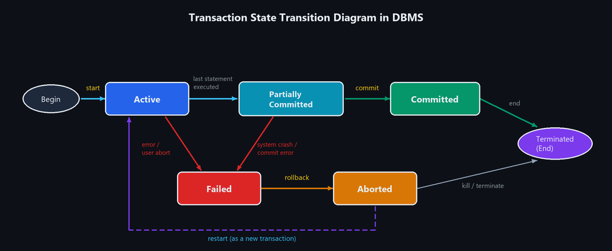
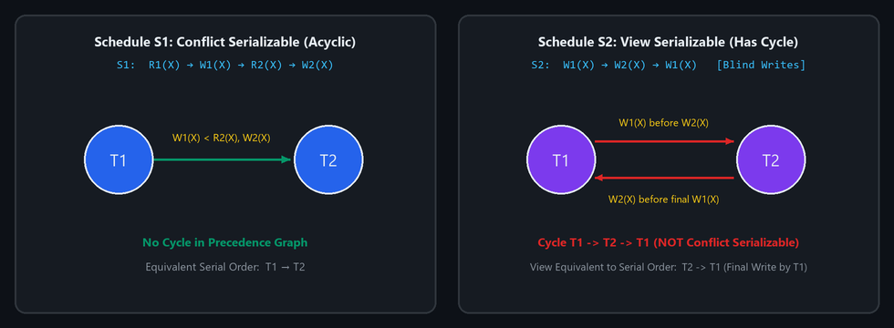

# UNIT 4 — Normalization, Functional Dependencies, Transactions, Serializability & Recovery

---

## 1. Explain the purpose of Normalization and discuss 1NF, 2NF with suitable examples.

### 1. Purpose of Normalization
**Normalization** is the systematic process of organizing data into well-structured tables to **minimize data redundancy** and **eliminate update anomalies**:
1. **Insertion Anomaly:** Inability to add a record without adding unrelated attributes.
2. **Deletion Anomaly:** Unintentionally losing vital information when deleting a record.
3. **Update Anomaly:** Inconsistent data when duplicate copies are not all updated together.

---

### 2. First Normal Form (1NF)
- **Rule:** A relation is in **1NF** if all attribute values are **atomic** (single-valued), and there are **no repeating groups**.

#### Example
**Table Not in 1NF (Multi-valued `Subjects`):**

| `RollNo` | `Name` | `Subjects` |
| :---: | :--- | :--- |
| `101` | Ravi | `DS, DBMS` |
| `102` | Sita | `OS, CN` |

**Converted to 1NF (Atomic rows):**

| `RollNo` | `Name` | `Subject` |
| :---: | :--- | :--- |
| `101` | Ravi | `DS` |
| `101` | Ravi | `DBMS` |
| `102` | Sita | `OS` |
| `102` | Sita | `CN` |

---

### 3. Second Normal Form (2NF)
- **Rule:** A relation is in **2NF** if:
  1. It is already in **1NF**, and
  2. It has **no partial dependency** — every non-key attribute must be **fully dependent on the whole candidate key**.

#### Example
Consider $\text{Orders}(\underline{\text{OrderID}}, \underline{\text{ProductID}}, \text{ProductName}, \text{Quantity})$ with composite key $(\text{OrderID}, \text{ProductID})$.
- $\text{ProductID} \rightarrow \text{ProductName}$ is a **partial dependency** (depends only on part of the key).

**Converted to 2NF (Split into two tables):**
1. **`Product` (`<u>ProductID</u>`, `ProductName`)**
2. **`Order_Details` (`<u>OrderID</u>`, `<u>ProductID</u>`, `Quantity`)**

---

## 2. Explain 4NF, and 5NF with suitable examples.

### 1. Fourth Normal Form (4NF)
- **Rule:** A relation is in **4NF** if:
  1. It is already in **BCNF**, and
  2. It has **no non-trivial Multi-Valued Dependencies (MVDs)** ($X \twoheadrightarrow Y$).
- **What is MVD?** Occurs when one key independently determines two or more independent multivalued attributes.

#### Example
Consider `Student_Skills(StudentID, Skill, Hobby)` where a student has multiple independent skills and hobbies:

| `StudentID` | `Skill` | `Hobby` |
| :---: | :--- | :--- |
| `101` | Python | Cricket |
| `101` | Python | Music |
| `101` | Java | Cricket |
| `101` | Java | Music |

*(Every skill must be redundantly paired with every hobby).*

**Decomposition into 4NF:**
1. **`Student_Skill` (`<u>StudentID</u>`, `<u>Skill</u>`)**
2. **`Student_Hobby` (`<u>StudentID</u>`, `<u>Hobby</u>`)**

---

### 2. Fifth Normal Form (5NF / Project-Join Normal Form)
- **Rule:** A relation is in **5NF** if:
  1. It is already in **4NF**, and
  2. It has **no non-trivial Join Dependencies (JDs)**.
- **What is Join Dependency?** A table cannot be split into two tables without spurious tuples, but can be split into **three or more smaller projections** and losslessly reconstructed by joining all three.

#### Example
Consider ternary relation $\text{SUPPLIER\_PART\_PROJECT}(\text{Supplier}, \text{Part}, \text{Project})$:
- **5NF Decomposition (3 binary tables):**
  1. `SP(Supplier, Part)`
  2. `PJ(Part, Project)`
  3. `SJ(Supplier, Project)`
- Joining all three recovers the original relation losslessly: $\text{SP} \bowtie \text{PJ} \bowtie \text{SJ} = \text{Original}$.

---

## 3. Explain Functional Dependency and different types of dependencies with examples.

### Definition
A **Functional Dependency (FD)** $X \rightarrow Y$ states that attribute set $X$ (**Determinant**) uniquely determines attribute set $Y$ (**Dependent**). If two tuples agree on $X$, they must agree on $Y$.

---

### Types of Dependencies

| Type | Condition | Example |
| :--- | :--- | :--- |
| **1. Trivial FD** | $Y \subseteq X$ | $\{\text{RollNo}, \text{Name}\} \rightarrow \text{Name}$ |
| **2. Non-Trivial FD** | $Y \not\subseteq X$ | $\text{RollNo} \rightarrow \text{Name}$ |
| **3. Completely Non-Trivial** | $X \cap Y = \emptyset$ | $\text{RollNo} \rightarrow \text{Dept\_ID}$ |
| **4. Full FD** | $Y$ depends on entire composite key, not any subset | $(\text{StudentID}, \text{CourseID}) \rightarrow \text{Marks}$ |
| **5. Partial FD** | $Y$ depends on a proper subset of a composite key | $(\text{StudentID}, \text{CourseID}) \rightarrow \text{StudentName}$ *(Removed in 2NF)* |
| **6. Transitive FD** | $X \rightarrow Y$ and $Y \rightarrow Z \implies X \rightarrow Z$ | $\text{RollNo} \rightarrow \text{DeptID}$ and $\text{DeptID} \rightarrow \text{DeptName}$ *(Removed in 3NF)* |
| **7. Multi-Valued (MVD)** | $X \twoheadrightarrow Y$ (independent multiple values) | $\text{StudentID} \twoheadrightarrow \text{Skill}$ *(Removed in 4NF)* |
| **8. Join Dependency** | $R = R_1 \bowtie R_2 \bowtie \dots \bowtie R_n$ | Project-Join equivalence *(Removed in 5NF)* |

---

## 4. Compare 3NF and BCNF with suitable examples.

### 1. Third Normal Form (3NF)
- **Rule:** A relation is in 3NF if for every non-trivial FD $X \rightarrow A$, **either:**
  1. $X$ is a **Super Key**, **OR**
  2. $A$ is a **Prime Attribute** (part of some candidate key).
- **Removes:** Transitive dependencies of non-prime attributes.

### 2. Boyce–Codd Normal Form (BCNF)
- **Rule:** A relation is in BCNF if for every non-trivial FD $X \rightarrow A$, **$X$ MUST be a Super Key** (no exception for prime attributes).
- **Stricter:** Eliminates all anomalies from functional dependencies.

---

### Worked Example: In 3NF but NOT in BCNF
Consider $R(\text{Student}, \text{Course}, \text{Instructor})$:
- $(\text{Student}, \text{Course}) \rightarrow \text{Instructor}$
- $\text{Instructor} \rightarrow \text{Course}$

1. **Candidate Key:** $(\text{Student}, \text{Course})$ $\implies$ Prime attributes: `Student`, `Course`.
2. In $\text{Instructor} \rightarrow \text{Course}$, `Course` is a **prime attribute**, so the relation is **in 3NF**.
3. But `Instructor` is **NOT a Super Key**, so it **violates BCNF**.
- **BCNF Decomposition:**
  1. $R_1(\underline{\text{Instructor}}, \text{Course})$
  2. $R_2(\underline{\text{Student}}, \underline{\text{Instructor}})$

---

### Comparison Table: 3NF vs. BCNF

| Feature | 3NF | BCNF |
| :--- | :--- | :--- |
| **Condition ($X \rightarrow A$)** | $X$ is super key **OR** $A$ is prime | $X$ **must** be a super key |
| **Strictness** | Less strict | Stricter (stronger form of 3NF) |
| **Dependency Preservation** | **Always** preserved | May not always be preserved |
| **Lossless Join** | Always achievable | Always achievable |
| **Redundancy** | Minor redundancy may remain | Zero FD-based redundancy |

---

## 5. Explain Lossless Join and Dependency Preserving Decomposition.

When decomposing relation $R$ into $R_1$ and $R_2$, two properties are evaluated:

### 1. Lossless Join Decomposition
- **Definition:** The original table can be **reconstructed exactly** by natural joining the decomposed tables without losing data or producing spurious tuples:
  $$R_1 \bowtie R_2 = R$$
- **Condition:** Common attribute must be a Super Key in at least one table:
  $$(R_1 \cap R_2) \rightarrow R_1 \quad \text{OR} \quad (R_1 \cap R_2) \rightarrow R_2$$
- **Example:** Decompose $\text{EMP}(\text{EmpID}, \text{Name}, \text{DeptID}, \text{DeptName})$ into:
  - $R_1(\text{EmpID}, \text{Name}, \text{DeptID})$
  - $R_2(\text{DeptID}, \text{DeptName})$
  - Common attribute `DeptID` is the primary key of $R_2$ $\implies$ **Lossless!**

---

### 2. Dependency Preserving Decomposition
- **Definition:** All original functional dependencies $F$ can be enforced inside the individual decomposed tables **without needing a `JOIN` at runtime**:
  $$(F_1 \cup F_2 \cup \dots \cup F_n)^+ = F^+$$
- **Example:** In the decomposition above:
  - $\text{EmpID} \rightarrow \text{Name}, \text{DeptID}$ is checked in $R_1$.
  - $\text{DeptID} \rightarrow \text{DeptName}$ is checked in $R_2$.
  - All original FDs are preserved locally $\implies$ **Dependency Preserving!**

### Comparison

| Feature | Lossless Join | Dependency Preserving |
| :--- | :--- | :--- |
| **Goal** | Reconstruct original table without false tuples | Check constraints locally without joins |
| **Formula** | $(R_1 \cap R_2) \rightarrow R_1$ or $R_2$ | $(F_1 \cup F_2)^+ = F^+$ |
| **Importance** | **Mandatory** in all designs | **Desirable** for fast constraint checking |

---

## 6. Explain Transaction Management and ACID properties with examples.

### 1. Transaction
A **Transaction** is a single **logical unit of work** containing one or more database operations (`READ`, `WRITE`). Either all operations execute completely, or none take effect.

#### Core Operations
1. `BEGIN TRANSACTION`: Starts execution.
2. `READ(X)` / `WRITE(X)`: Reads or updates data item $X$.
3. `COMMIT`: Saves changes permanently to disk.
4. `ROLLBACK`: Discards all changes if an error occurs.

#### Example: Bank Transfer ($₹1000$ from $A$ to $B$)
```text
1. read(A)
2. A = A - 1000
3. write(A)
4. read(B)
5. B = B + 1000
6. write(B)
7. COMMIT
```

---

### 2. ACID Properties

#### 1. Atomicity ("All-or-Nothing")
- Either all operations of a transaction execute completely, or all are rolled back.
- **Example:** If the system crashes after debiting Account $A$ but before crediting $B$, the debit is undone so money is not lost.

#### 2. Consistency (Correctness Preservation)
- The transaction transforms the database from one valid state to another, preserving all integrity constraints.
- **Example:** The sum of balances $(A + B)$ before and after the transfer must remain constant ($₹5000$).

#### 3. Isolation (Concurrency Independence)
- Concurrently running transactions execute independently without seeing each other's uncommitted intermediate states.
- **Example:** A concurrent transaction calculating total bank balances will not see the intermediate state where $₹1000$ has left $A$ but not yet entered $B$.

#### 4. Durability (Permanence)
- Once a transaction executes `COMMIT`, its updates are permanently recorded on disk and survive future crashes or power cuts.
- **Example:** Once a transfer confirmation is issued, the new balances are permanently saved even if the server immediately loses power.

---

## 7. Explain Transaction States with a neat state transition diagram.

A transaction passes through several states during its lifecycle.



### The 6 Transaction States
1. **Active:** The initial state while operations (`READ`, `WRITE`) are actively executing.
2. **Partially Committed:** Entered immediately after the final statement has executed, before data is flushed to disk.
3. **Committed:** Entered after all changes and log records are permanently written to disk (`COMMIT` succeeds).
4. **Failed:** Entered when normal execution cannot proceed due to hardware/software errors or aborts.
5. **Aborted:** Entered after the system rolls back (`ROLLBACK`) all changes made by the failed transaction.
6. **Terminated:** The transaction leaves the system and releases all resources.

### Transitions
- $\text{Active} \rightarrow \text{Partially Committed} \rightarrow \text{Committed} \rightarrow \text{Terminated}$ (Successful path).
- $\text{Active / Partially Committed} \rightarrow \text{Failed} \rightarrow \text{Aborted} \rightarrow \text{Restart or Terminate}$ (Failure path).

---

## 8. Discuss conflict serializability and view serializability with suitable examples.

A concurrent schedule is **serializable** if its final outcome is equivalent to executing the transactions serially (one after another).



### 1. Conflict Serializability
- **Concept:** A schedule is conflict serializable if it can be transformed into a serial schedule by swapping **non-conflicting** adjacent instructions.
- **Conflicting Operations:** Two operations conflict if they belong to different transactions, access the same item $X$, and **at least one is a `WRITE(X)`**:
  - Read–Write ($\text{RW}$)
  - Write–Read ($\text{WR}$)
  - Write–Write ($\text{WW}$)
- **Testing via Precedence Graph:**
  - Create node for each transaction. Add edge $T_i \rightarrow T_j$ if an operation in $T_i$ conflicts with and executes before an operation in $T_j$.
  - **Rule:** The schedule is **Conflict Serializable if and only if the graph has NO cycle (is acyclic)**.

### 2. View Serializability
- **Concept:** A schedule is view serializable if it is **view equivalent** to some serial schedule:
  1. Same initial reads for each data item.
  2. Same read-from relations (who reads whose write).
  3. Same final write for each data item.
- **Blind Writes:** A schedule with blind writes (writes without reading) can be **view serializable even if it has a cycle in its precedence graph**.

### Comparison Table

| Feature | Conflict Serializability | View Serializability |
| :--- | :--- | :--- |
| **Basis** | Order of conflicting operations (RW, WR, WW) | View equivalence (reads, writes, final write) |
| **Testing** | Easy via Precedence Graph (Acyclic = Valid) | Complex (NP-Complete problem) |
| **Scope** | Stricter; subset of view serializability | Broader; includes blind-write schedules |

---

## 9. Explain Recoverability and Recovery Algorithms in DBMS.

### 1. Recoverability of Schedules
A schedule is **Recoverable** if a transaction $T_j$ that reads a value written by $T_i$ commits **only after $T_i$ has committed**.
- Prevents reading uncommitted data from a transaction that later aborts (dirty read).
- **Cascadeless Schedule:** Transaction reads data only after the writer has committed (avoids cascading rollbacks).

---

### 2. Recovery Algorithms

#### (a) Log-Based Recovery (Write-Ahead Logging — WAL)
- Every transaction action is written to a sequential log on stable storage before modifying the database.
- **`UNDO(Ti)`:** Restores old values for incomplete transactions.
- **`REDO(Ti)`:** Re-applies new values for committed transactions.

#### (b) Deferred Update (No-Undo / Redo)
- Database disk writes are postponed until `COMMIT`.
- If a crash occurs before commit, nothing was written to disk $\implies$ **No `UNDO` needed**, only `REDO`.

#### (c) Immediate Update (Undo / Redo)
- Disk blocks can be modified while active.
- Requires both **`UNDO`** for uncommitted transactions and **`REDO`** for committed transactions after a crash.

#### (d) Checkpointing
- Periodically flushes dirty blocks to disk and writes a `<CHECKPOINT>` record to the log.
- Recovery only needs to scan back to the latest checkpoint, saving recovery time.

#### (e) Shadow Paging
- Maintains two page tables: **Current** (copy-on-write) and **Shadow** (unmodified).
- On abort, the current table is discarded and the shadow table is restored $\implies$ No undo/redo needed.

---

## 10. Explain Concurrent Execution and Serializability with examples.

### 1. Concurrent Execution
Running multiple transactions simultaneously by interleaving their operations in time.
- **Advantages:** Higher system throughput, reduced waiting time, better CPU and disk utilization.
- **Anomalies if uncontrolled:** Lost update, dirty read, unrepeatable read.

### 2. Serializability Example
Suppose $X = 50$:
- $T_1$: `read(X); X = X + 10; write(X);`
- $T_2$: `read(X); X = X - 5; write(X);`

**Interleaved Schedule:**
1. $T_1: \text{read}(X) \rightarrow 50$
2. $T_1: \text{write}(X) \rightarrow 60$
3. $T_2: \text{read}(X) \rightarrow 60$
4. $T_2: \text{write}(X) \rightarrow 55$

The final result $X = 55$ is identical to serial order $T_1 \rightarrow T_2$. Hence, the schedule is **Serializable**.
