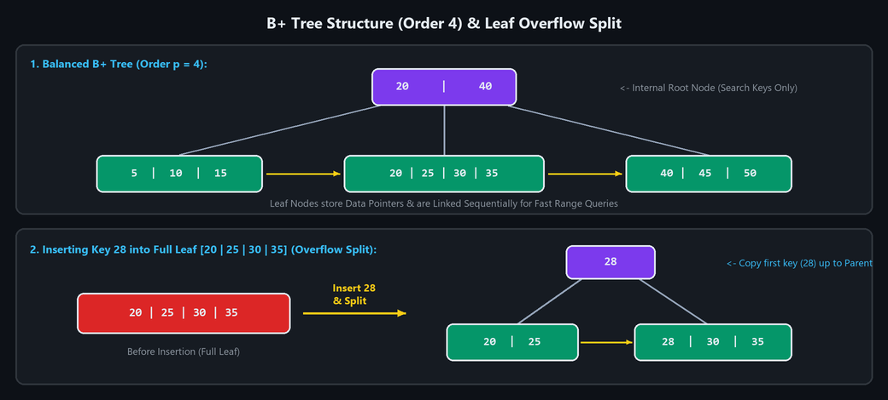
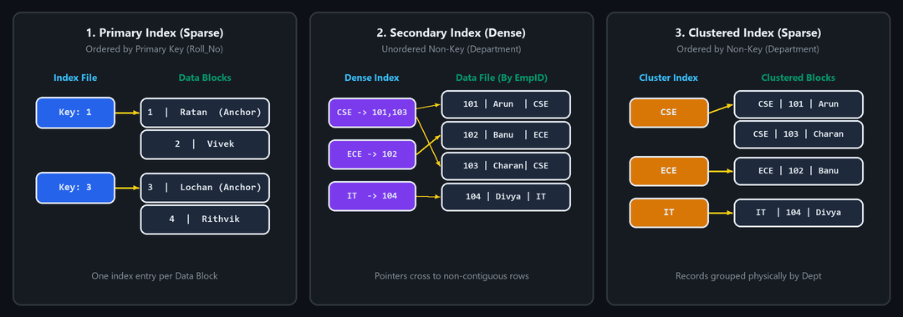
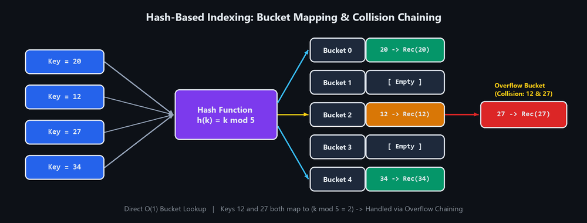
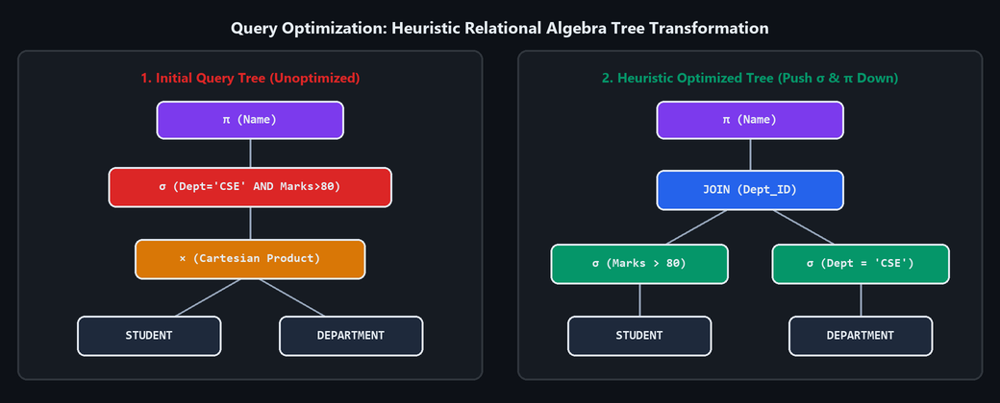

# UNIT 5 — Indexing ($B^+$ Trees, Primary/Secondary/Clustered, Hashing), Query Optimization & Backup/Recovery

---

## 1. Explain $B^+$ Tree and discuss search, insertion, and deletion algorithms with neat diagrams.

### 1. Introduction to $B^+$ Tree
A **$B^+$ Tree** is a self-balancing, multi-level dynamic search tree structure widely used for indexing in modern relational database management systems (DBMS) and file systems.
- Unlike a standard $B$-Tree (which stores data pointers in both internal and leaf nodes), a **$B^+$ Tree stores all actual data records (or data record pointers) exclusively in the leaf nodes**.
- Internal (non-leaf) nodes store **only search keys (routing keys) and child node pointers** to guide the search down to the leaves.
- All **leaf nodes are linked together sequentially** as a doubly/singly linked list to support fast sequential and range queries.

---

### 2. Properties of a $B^+$ Tree (of Order $p$)
1. **Height-Balanced:** Every leaf node appears at the **exact same depth (level)** from the root.
2. **Internal Nodes (Routing Nodes):**
   - Store up to $p - 1$ search keys and $p$ child pointers.
   - Contain **no data record pointers**, allowing higher fan-out and smaller tree height.
3. **Leaf Nodes (Data Nodes):**
   - Store search keys along with pointers to the actual data records on disk.
   - Each leaf node holds between $\lceil (p-1)/2 \rceil$ and $p - 1$ keys.
4. **Sequential Leaf Linking:** Each leaf node has a sibling pointer (`next`) pointing to the next leaf node in sorted key order.
5. **Logarithmic Complexity:** Search, insertion, and deletion all execute in **$O(\log_p N)$** disk block accesses.

---

### 3. Neat $B^+$ Tree Structure & Overflow Split Diagram



---

### 4. Search Algorithm in a $B^+$ Tree

#### Step-by-Step Algorithm (`SEARCH(Root, k)`)
1. Start at the **root node**.
2. While the current node is an **internal (non-leaf) node**:
   - Compare the search key $k$ with the keys $K_1, K_2, \dots, K_m$ stored in the current node.
   - If $k < K_1$, follow the leftmost child pointer $P_0$.
   - If $K_i \le k < K_{i+1}$, follow the child pointer $P_i$.
   - If $k \ge K_m$, follow the rightmost child pointer $P_m$.
3. Repeat Step 2 until a **leaf node** is reached.
4. Search for key $k$ inside the leaf node (using binary/linear search):
   - If $k$ is found, return its associated data record pointer.
   - Otherwise, report **`KEY NOT FOUND`**.

#### Worked Search Example
To search for key **`25`** in the Order-4 $B^+$ Tree `[20 | 40]`:
1. Start at root `[20 | 40]`. Since $20 \le 25 < 40$, follow the **middle child pointer**.
2. Reach leaf node `[20 | 25 | 30 | 35]`.
3. Scan leaf keys and locate **`25`** at position 2 $\rightarrow$ Return record pointer for `25`.

---

### 5. Insertion Algorithm in a $B^+$ Tree

#### Step-by-Step Algorithm (`INSERT(Root, k, record_ptr)`)
1. Traverse from the root down to the appropriate **leaf node $L$** where key $k$ belongs.
2. Insert $(k, \text{record\_ptr})$ into leaf $L$ in sorted key order.
3. **Case 1 (No Overflow):** If leaf $L$ has space ($\le p - 1$ keys), the insertion is complete!
4. **Case 2 (Leaf Overflow):** If leaf $L$ overflows ($p$ keys):
   - **Split** leaf $L$ into two leaf nodes $L_1$ and $L_2$:
     - Keep the first $\lceil p/2 \rceil$ keys in left leaf $L_1$.
     - Move the remaining keys to new right leaf $L_2$ and update the leaf linked-list pointers.
   - **Copy (duplicate) the smallest key of $L_2$ up** into the parent internal node along with a pointer to $L_2$.
5. **Internal Node Overflow Propagation:** If the parent internal node also overflows, split the internal node and **push (move) the middle key up** to its parent. Continue upward; if the root splits, a new root is created and tree height increases by 1.

#### Worked Insertion Example (Insert `28` into `[20 | 25 | 30 | 35]`)
- Before insertion, leaf `[20 | 25 | 30 | 35]` is full (4 keys).
- Inserting **`28`** causes overflow (`20, 25, 28, 30, 35`):
  - Left leaf becomes **`[20 | 25]`**.
  - Right leaf becomes **`[28 | 30 | 35]`**.
  - The first key of the new right leaf (**`28`**) is **copied up** to the parent internal node!

```text
Before Insertion (Overflow):        After Splitting Leaf on Insert 28:
                                                 [ 28 ]  <-- Copied up to parent
                                                /      \
[ 20 | 25 | 30 | 35 ]  --Insert 28-->   [ 20 | 25 ] -> [ 28 | 30 | 35 ]
```

---

### 6. Deletion Algorithm in a $B^+$ Tree

#### Step-by-Step Algorithm (`DELETE(Root, k)`)
1. Start at the root and locate the **leaf node $L$** containing key $k$.
2. Remove key $k$ and its data pointer from leaf $L$.
3. **Case 1 (No Underflow):** If leaf $L$ still holds at least the minimum required keys ($\ge \lceil (p-1)/2 \rceil$), deletion stops (update parent routing key if needed).
4. **Case 2 (Underflow — Redistribution / Borrow):** If leaf $L$ falls below the minimum occupancy, check an adjacent sibling leaf $S$:
   - If $S$ has extra keys, **redistribute (borrow)** a key from $S$ into $L$ and update the separator key in their parent node.
5. **Case 3 (Underflow — Merge / Coalesce):** If neither sibling can spare a key:
   - **Merge** leaf $L$ and sibling $S$ into a single leaf node.
   - Delete the separating routing key and child pointer from the parent internal node.
6. If the parent internal node underflows as a result, propagate borrowing/merging upward to the root.

#### Worked Deletion Example (Delete `45` from Leaf `[40 | 45 | 50]`)
```text
[ 40 | 45 | 50 ]  --- Delete 45 --->  [ 40 | 50 ]  (No underflow; still has >= 2 keys)
```
*(If a further deletion causes underflow, the leaf borrows a key from sibling `[20 | 25 | 30 | 35]` or merges with it.)*

---

### 7. Advantages of $B^+$ Tree
1. **Extremely Fast Point Lookups:** High internal fan-out keeps tree height very small (typically 3–4 levels for millions of rows).
2. **Efficient Range & Sequential Queries:** Linked leaf nodes allow range scans (`WHERE Marks BETWEEN 20 AND 45`) without climbing back up the tree.
3. **Self-Balancing:** Guarantees uniform disk I/O cost for all records.

**Conclusion:** The $B^+$ Tree is the gold-standard dynamic indexing structure in DBMS, combining balanced logarithmic tree traversal with linked leaf nodes for optimal point and range queries.

---

## 2. Explain Primary, Secondary, and Clustered Indexes with suitable examples.

### Introduction
An **Index** in a DBMS is an auxiliary data structure $( \text{Search-Key}, \text{Data-Pointer} )$ designed to speed up the retrieval of records from a database table without scanning every disk block (**Full Table Scan**). Based on whether the data file is physically sorted on the search key and whether the search key is unique, ordered indexes are classified into:
1. **Primary Index**
2. **Secondary Index**
3. **Clustered (Clustering) Index**



---

### 1. Primary Index
- **Definition:** A **Primary Index** is an ordered index file built on the **ordering Primary Key** of a sequentially ordered data file.
- **Characteristics:**
  - The physical data records on disk are **sorted in ascending order of the Primary Key**.
  - It is typically a **Sparse Index**: instead of storing an index entry for every single row, it stores only **one index entry per disk block** — namely the primary key of the **first record (Block Anchor)** of each block.

#### Worked Example (`STUDENT` Table Ordered by `Roll_No`)

**Data File (`STUDENT` — Physically Ordered by Primary Key `Roll_No`):**

| Block | `Roll_No` (PK) | `Name` | Role |
| :---: | :---: | :--- | :--- |
| **Block 1** | `1` | Ratan | *Block 1 Anchor* |
| **Block 1** | `2` | Vivek | |
| **Block 2** | `3` | Lochan | *Block 2 Anchor* |
| **Block 2** | `4` | Rithvik | |

**Primary Index (Sparse Index on `Roll_No`):**

| Index Key (`Roll_No`) | Block Pointer |
| :---: | :--- |
| `1` | $\rightarrow$ Block 1 |
| `3` | $\rightarrow$ Block 2 |

---

### 2. Secondary Index
- **Definition:** A **Secondary Index** is an index created on a **non-ordering attribute** (either a candidate key or a non-key attribute) where the physical data file is **not sorted** on that attribute.
- **Characteristics:**
  - Because records with similar secondary key values are scattered across different disk blocks, a Secondary Index **must be a Dense Index** — it contains an index entry (or bucket of pointers) for **every single record** in the data file.
  - A table can have **multiple** secondary indexes.

#### Worked Example (`EMPLOYEE` Table Ordered by `Emp_ID`, Secondary Index on `Department`)

**Data File (`EMPLOYEE` — Ordered by `Emp_ID`, Unordered on `Department`):**

| `Emp_ID` (PK) | `Name` | `Department` |
| :---: | :--- | :---: |
| `101` | Arun | `CSE` |
| `102` | Banu | `ECE` |
| `103` | Charan | `CSE` |
| `104` | Divya | `IT` |

**Secondary Index on `Department` (Dense Index):**

| Search Key (`Department`) | Record Pointers (`Emp_ID`s) |
| :---: | :--- |
| `CSE` | $\rightarrow$ `101, 103` |
| `ECE` | $\rightarrow$ `102` |
| `IT` | $\rightarrow$ `104` |

---

### 3. Clustered (Clustering) Index
- **Definition:** A **Clustered Index** is an ordered index defined on a **non-key ordering attribute** of a data file — meaning the data file is **physically sorted on a non-unique column** (called the *clustering field*) that allows duplicate values.
- **Characteristics:**
  - All records sharing the same value of the clustering attribute are **grouped (clustered) together contiguously** on disk.
  - It is a **Sparse Index** with one index entry per **distinct value** of the clustering field, pointing to the first block containing records with that value.
  - A table can have **at most one** clustered/primary physical ordering because rows can be physically sorted on disk in only one way.

#### Worked Example (`EMPLOYEE` Table Physically Sorted by `Department`)

**Data File (`EMPLOYEE` — Physically Grouped by Non-Key `Department`):**

| `Department` (Clustering Field) | `Emp_ID` | `Name` |
| :---: | :---: | :--- |
| `CSE` | `101` | Arun |
| `CSE` | `103` | Charan |
| `ECE` | `102` | Banu |
| `IT` | `104` | Divya |

**Clustered Index on `Department` (Sparse):**

| Clustering Key (`Department`) | Block Pointer |
| :---: | :--- |
| `CSE` | $\rightarrow$ First block of `CSE` records |
| `ECE` | $\rightarrow$ First block of `ECE` records |
| `IT` | $\rightarrow$ First block of `IT` records |

---

### 4. Comparison: Primary vs. Secondary vs. Clustered Index

| Point of Comparison | Primary Index | Secondary Index | Clustered Index |
| :--- | :--- | :--- | :--- |
| **1. Built On** | **Ordering Primary Key** | **Non-ordering attribute** (Candidate Key or Non-Key) | **Ordering Non-Key attribute** (Clustering field) |
| **2. Physical File Order** | Sorted on the index key (PK). | **Not sorted** on the index key. | Sorted/grouped on the clustering field. |
| **3. Key Uniqueness** | Always **Unique** (Primary Key). | May be **Unique or Non-Unique**. | **Non-Unique** (duplicate values grouped together). |
| **4. Index Density** | Usually **Sparse** (1 entry per block). | Always **Dense** (1 entry per record). | Usually **Sparse** (1 entry per distinct value). |
| **5. Max per Table** | At most **1** | **Multiple** allowed | At most **1** |
| **6. Main Use Case** | Fast lookup & range scan on Primary Key. | Fast lookup on alternate/non-ordering attributes. | Fast group/category retrieval (e.g., all employees in `'CSE'`). |

**Conclusion:** Primary, Secondary, and Clustered indexes drastically reduce disk I/O during query execution, each tailored to whether the search attribute is unique and whether the table is physically sorted on that attribute.

---

## 3. Compare Tree-Based Indexing and Hash-Based Indexing.

### Introduction
DBMS indexing mechanisms fall into two major architectural families:
1. **Tree-Based Indexing** (e.g., $B$-Tree and $B^+$ Tree)
2. **Hash-Based Indexing** (e.g., Static Hashing and Extendible/Linear Dynamic Hashing)

---

### 1. Tree-Based Indexing
- **Concept:** Organizes search keys in a hierarchical, height-balanced search tree ($B$-Tree or $B^+$ Tree) where keys are maintained in **sorted order**.
- **Working:** Searching starts at the root node and follows key-comparison pointers down to the target leaf node in $O(\log_p N)$ steps.
- **Strength:** Supports **both equality searches** (`WHERE Roll_No = 25`) **and range queries** (`WHERE Marks BETWEEN 20 AND 40`), as well as `ORDER BY` and prefix searches (`LIKE 'abc%'`).

```text
                [   30   ]        <-- Root
               /          \
       [ 10 | 20 ]  -->  [ 30 | 40 | 50 ]   <-- Sorted Linked Leaves
```

---

### 2. Hash-Based Indexing
- **Concept:** Uses a mathematical **Hash Function $h(k)$** to compute the exact disk **bucket address** directly from the search key $k$.
- **Working:** Given search key $k$, the DBMS evaluates $h(k)$ and jumps directly to bucket $h(k)$ in **$O(1)$ constant time** (typically 1 disk I/O if no overflow chain exists).
- **Limitation:** Because the hash function scatters keys randomly across buckets, records are **not stored in sorted order**. Thus, hash indexes **cannot efficiently support range queries** (`WHERE k BETWEEN 20 AND 40`).

```text
[ Search Key = 25 ] ---> [ Hash Function h(k) ] ---> [ Bucket 2 ]
```

---

### 3. Detailed Comparison: Tree-Based Indexing vs. Hash-Based Indexing

| Point of Comparison | Tree-Based Indexing | Hash-Based Indexing |
| :--- | :--- | :--- |
| **1. Underlying Structure** | Balanced multi-way search tree (**$B$-Tree / $B^+$ Tree**). | Array of **Hash Buckets** addressed via a hash function $h(k)$ (**Static / Dynamic Hashing**). |
| **2. Ordering of Keys** | Keys are stored in **sorted (ascending/descending) order**. | Keys are **not stored in sorted order** (scattered across buckets). |
| **3. Best Suited For** | Both **Range Queries** (`<, >, BETWEEN`) and **Exact-Match Queries** (`=`). | Strictly **Exact-Match (Equality) Queries** (`WHERE ID = 25`). |
| **4. Range Query Support** | **Highly efficient** via linked leaf nodes in $B^+$ Trees. | **Inefficient / Not supported** (requires full scan of all buckets). |
| **5. Search Mechanism & Cost** | Top-down root-to-leaf tree traversal in **$O(\log_p N)$** time. | Direct mathematical computation $h(k)$ in **$O(1)$** average time. |
| **6. Sequential / Ordered Access** | **Directly supported** (`ORDER BY`, `GROUP BY`, `MIN`, `MAX`). | **Not possible** without an explicit post-query sort. |
| **7. Handling Growth** | Handles insertions dynamically via **node splits** while staying balanced. | Static hashing suffers from bucket overflows; requires **Dynamic Hashing** (Extendible/Linear) to grow smoothly. |

---

### 4. Summary of Advantages

| Advantages of Tree-Based Indexing | Advantages of Hash-Based Indexing |
| :--- | :--- |
| - Excellent for range queries (`BETWEEN`, `<`, `>`).<br>- Supports ordered traversal without sorting.<br>- Self-balancing dynamic structure ($B^+$ Tree). | - Fastest $O(1)$ lookup for exact equality matches.<br>- Direct single-hop access to the target disk bucket.<br>- Simple computation without multi-level index traversal. |

**Conclusion:** Tree-based indexing ($B^+$ Tree) is the versatile default choice in DBMS because it supports both equality and range queries efficiently, whereas hash-based indexing is specialized for ultra-fast $O(1)$ exact-match lookups.

---

## 4. Explain Hash-Based Indexing.

### 1. Definition and Overview
**Hash-Based Indexing** is a fast data-access technique in DBMS that uses a mathematical **Hash Function $h(k)$** to map a search-key value $k$ directly to the address of a **Bucket** (typically one disk block/page) where the corresponding data record (or a pointer to the record) is stored.
- It provides **$O(1)$ constant-time lookup** for exact-match equality queries (`WHERE Emp_ID = 25`).

---

### 2. Step-by-Step Working of Hash-Based Indexing
1. **Input Search Key:** The user queries a record with search key $k$.
2. **Apply Hash Function:** The DBMS computes bucket address $B = h(k)$ (for example, $h(k) = k \bmod N$, where $N$ is the total number of buckets).
3. **Locate Bucket:** The disk manager directly reads Bucket $B$ into memory.
4. **Search Inside Bucket:** The DBMS scans the entries inside Bucket $B$ to find key $k$ and follows its record pointer.
5. **Collision Resolution:** If multiple distinct keys map to the same bucket ($h(k_1) = h(k_2)$) and the bucket becomes full, a **collision handling mechanism** (such as overflow chaining) is used.

---

### 3. Neat Diagram & Worked Modulo Example



#### Worked Example ($N = 5 \text{ Buckets}, \quad h(k) = k \bmod 5$)
Suppose a hash index has $5$ buckets numbered `Bucket 0` through `Bucket 4`, each holding 1 record per primary page, and we insert the search keys **`20, 12, 27, 34`** using $h(k) = k \bmod 5$:
- $\text{Key } 20 \implies h(20) = 20 \bmod 5 = \mathbf{0} \longrightarrow \text{Stored in }\mathbf{Bucket\ 0}$
- $\text{Key } 12 \implies h(12) = 12 \bmod 5 = \mathbf{2} \longrightarrow \text{Stored in }\mathbf{Bucket\ 2}$
- $\text{Key } 27 \implies h(27) = 27 \bmod 5 = \mathbf{2} \longrightarrow \text{Maps to }\mathbf{Bucket\ 2}\text{ (Collision with 12!)}$
- $\text{Key } 34 \implies h(34) = 34 \bmod 5 = \mathbf{4} \longrightarrow \text{Stored in }\mathbf{Bucket\ 4}$

Because keys `12` and `27` both hash to `Bucket 2`, a **collision** occurs and key `27` is placed in an **Overflow Bucket** linked to `Bucket 2`.

---

### 4. Collision Handling Methods
When $h(k_1) = h(k_2)$ and the target bucket is full (**Bucket Overflow**), two standard resolution strategies are used:
1. **Overflow Chaining (Closed Addressing / Separate Chaining):**
   - Allocates a new **overflow bucket** and links it to the primary bucket via a pointer chain.
   - Most widely used method in disk-based DBMS hash indexes.
2. **Open Addressing (Linear / Quadratic Probing, Double Hashing):**
   - Searches for the next available free slot in the bucket array (e.g., $(h(k) + i) \bmod N$).

---

### 5. Types of Hashing in DBMS
1. **Static Hashing:**
   - The number of primary buckets $N$ is **fixed permanently** at creation time.
   - *Drawback:* If the database grows large, long overflow chains form and degrade search performance; if the database shrinks, space is wasted.
2. **Dynamic Hashing (Extendible Hashing & Linear Hashing):**
   - The number of buckets **grows and shrinks dynamically** as data is inserted or deleted (by splitting individual buckets and doubling a directory of pointers when needed), avoiding long overflow chains.

---

### 6. Advantages and Limitations of Hash-Based Indexing

| Advantages | Limitations |
| :--- | :--- |
| 1. **Ultra-Fast Equality Search:** $O(1)$ direct bucket lookup without traversing tree levels.<br>2. **Direct Disk Access:** Usually requires only a single disk block I/O.<br>3. **Simple Computation:** Hash evaluation $h(k)$ is CPU-light and fast. | 1. **No Range Queries:** Cannot efficiently evaluate `WHERE k BETWEEN 10 AND 50` or `<, >`.<br>2. **No Sorted Order:** Cannot assist `ORDER BY` clauses.<br>3. **Collision Degradation:** Poor hash functions or skewed data cause bucket overflows and slow chains. |

**Conclusion:** Hash-based indexing is an ideal indexing method for high-speed exact-match (`=`) lookups in DBMS, though $B^+$ Trees are preferred whenever range queries or ordered traversals are needed.

---

## 5. What is Query Optimization? Explain the various Query Optimization Algorithms in detail with suitable examples.

### 1. Definition of Query Optimization
**Query Optimization** is the phase of DBMS query processing that selects the **most efficient Query Execution Plan (QEP)** from among many equivalent candidate execution plans for a given SQL query.
- Its goal is to **minimize total query execution cost** — specifically **Disk Block I/O accesses**, **CPU time**, **memory buffer usage**, and **network communication cost** — while returning the exact same result set.

---

### 2. Objectives of Query Optimization
1. Minimize overall query response time and disk I/O operations.
2. Select the best **access path** (e.g., $B^+$ Tree Index Scan vs. Hash Lookup vs. Full Table Scan).
3. Determine the optimal **Join Order** and **Join Algorithm** (Nested-Loop Join, Sort-Merge Join, Hash Join).
4. Reduce the size of intermediate tables as early as possible.

---

### 3. Basic Steps in Query Processing & Optimization
```text
[ SQL Query ]
      │
      ▼
1. Parser & Translator ──► Checks syntax/semantics & builds Relational Algebra Query Tree
      │
      ▼
2. Query Optimizer     ──► Applies Equivalence Rules + Cost Estimation (Catalog Statistics)
      │
      ▼
3. Execution Plan (QEP)──► Evaluates the chosen lowest-cost physical plan & returns output
```

1. **Parsing and Translation:** Parses the SQL query, checks schema/syntax validity, and translates it into an internal **Relational Algebra Expression / Canonical Query Tree**.
2. **Logical Plan Generation:** Applies relational algebra equivalence rules to generate alternative logical query trees.
3. **Physical Plan & Cost Estimation:** Attaches physical operators (Index Scan, Hash Join) and estimates the cost of each candidate plan using system catalog statistics.
4. **Plan Selection:** Chooses the execution plan with the **minimum estimated cost**.

---

### 4. Various Query Optimization Algorithms / Techniques



#### (a) Heuristic (Rule-Based) Query Optimization
- **Concept:** Transforms the initial canonical relational algebra query tree into a much more efficient tree using a fixed set of **heuristic equivalence rules**, without computing detailed physical I/O costs for every permutation.
- **Core Heuristic Rules:**
  1. **Perform Selection ($\sigma$) as Early as Possible (*Push Selections Down the Tree*):** Reduces the number of rows flowing into subsequent joins.
  2. **Perform Projection ($\pi$) as Early as Possible (*Push Projections Down the Tree*):** Eliminates unnecessary columns early, shrinking tuple width.
  3. **Replace Cartesian Product ($\times$) Followed by Selection ($\sigma$) with a Join ($\bowtie$):** Avoids materializing huge $m \times n$ intermediate tables:
     $$\sigma_{R.A = S.B}(R \times S) \equiv R \bowtie_{R.A = S.B} S$$
  4. **Execute the Most Restrictive Selection and Join First:** Reorder joins so the sub-expression producing the **smallest intermediate result** runs first.

- **Worked Example:**
  ```sql
  SELECT Name
  FROM STUDENT S, DEPARTMENT D
  WHERE S.Dept_ID = D.Dept_ID
    AND D.Dept = 'CSE'
    AND S.Marks > 80;
  ```
  - *Unoptimized Algebra:* $\pi_{\text{Name}}(\sigma_{\text{Dept='CSE'} \land \text{Marks}>80}(\text{STUDENT} \times \text{DEPARTMENT}))$
  - *Heuristic Optimized Algebra:*
    $$\pi_{\text{Name}}\Big( (\sigma_{\text{Marks}>80}(\text{STUDENT})) \bowtie_{\text{Dept\_ID}} (\sigma_{\text{Dept='CSE'}}(\text{DEPARTMENT})) \Big)$$
  - By filtering `Marks > 80` on `STUDENT` and `Dept = 'CSE'` on `DEPARTMENT` **before** joining, the join processes only a tiny fraction of rows!

---

#### (b) Cost-Based Query Optimization (CBO)
- **Concept:** The optimizer enumerates multiple candidate physical plans and estimates a numeric cost for each plan using **System Catalog Statistics**:
  - $n_r$: Number of tuples in relation $r$.
  - $b_r$: Number of disk blocks occupied by relation $r$.
  - $V(A, r)$: Number of distinct values for attribute $A$ in $r$ (used to estimate **selectivity**).
  - Index availability, height, and clustering properties.
- **Example:** For `WHERE Roll_No = 10`, CBO compares the cost of a **Full Table Scan** ($b_r = 10{,}000$ blocks) against a **$B^+$ Tree Index Scan** ($\text{height} + 1 = 4$ blocks) and picks the Index Scan. Conversely, if a condition matches $85\%$ of the table, CBO chooses a Sequential Full Table Scan over random index I/O.

---

#### (c) Dynamic Programming Join-Order Optimization (System-R Style)
- **Concept:** Joining $n$ relations $R_1 \bowtie R_2 \bowtie \dots \bowtie R_n$ has $\frac{(2(n-1))!}{(n-1)!}$ possible join trees. Dynamic programming finds the **globally optimal join order** bottom-up:
  1. Find the cheapest access path for each single relation $\{R_i\}$.
  2. Find the cheapest way to join every pair $\{R_i, R_j\}$ and store only the lowest-cost plan for each subset.
  3. Build up to subsets of size $3, 4, \dots, n$ by reusing stored optimal subplans ( often restricted to **Left-Deep Join Trees** to support pipelining).
- **Example:** For $R \bowtie S \bowtie T$, it computes and compares the cost of $(R \bowtie S) \bowtie T$ versus $R \bowtie (S \bowtie T)$ (and $(R \bowtie T) \bowtie S$) and picks the cheapest overall tree.

---

#### (d) Greedy Query Optimization
- **Concept:** When the number of relations in a query is very large (e.g., $> 10$ tables), exhaustive dynamic programming becomes too expensive. A **Greedy Optimizer** makes a locally optimal choice at each step — repeatedly picking the pair of relations whose join produces the **smallest immediate cost / intermediate size** — without exploring the entire search space.
- **Example:** Among candidate joins $R \bowtie T$, $S \bowtie T$, and $R \bowtie S$, it immediately executes whichever pair has the lowest estimated cost first, then joins the result with the remaining relation.

---

#### (e) Semantic Query Optimization
- **Concept:** Uses **schema integrity constraints** (`CHECK` constraints, `UNIQUE` keys, `FOREIGN KEY`s, functional dependencies) and domain rules to rewrite or eliminate redundant parts of a query before execution.
- **Example:** If the `EMPLOYEE` table has an enforced constraint `CHECK (Age >= 18)`, and a user runs:
  ```sql
  SELECT Emp_Name FROM EMPLOYEE WHERE Age > 15;
  ```
  Semantic optimization recognizes that `Age > 15` is **always true** for every row in `EMPLOYEE` and eliminates the `WHERE` predicate check completely.

---

### 5. Advantages of Query Optimization
1. Drastically reduces query execution time from minutes/hours to milliseconds.
2. Minimizes disk I/O bottleneck and CPU/memory consumption.
3. Allows users to write declarative SQL (*what* data they want) while the DBMS automatically figures out *how* to fetch it fastest.

**Conclusion:** Query optimization is the brain of a relational DBMS engine. By combining heuristic tree transformations, catalog-driven cost estimation, dynamic programming join ordering, greedy search, and semantic simplification, it guarantees rapid execution of complex SQL queries.

---

## 6. What is Database Backup and Recovery? Explain the various Backup and Recovery Techniques in detail with suitable examples.

### 1. Definitions: Database Backup and Recovery
- **Database Backup:** The proactive process of creating and storing **one or more copies of database data and log files** on separate storage media so that the database can be reconstructed if the primary data is lost, corrupted, or destroyed.
- **Database Recovery:** The corrective process of **restoring the database to a correct, consistent, and operational state** after a failure (such as a transaction abort, OS crash, power outage, or disk head crash) by using backups and transaction logs.

---

### 2. Need for Database Backup and Recovery
1. **Hardware & Media Failures:** Disk crashes, storage controller failures, or corrupted sectors.
2. **System & Power Failures:** Sudden power outages or operating system crashes during active transactions.
3. **Human & Software Errors:** Accidental `DROP TABLE` / `DELETE` statements or application bugs.
4. **Natural Disasters & Cyberattacks:** Fire, flooding, or ransomware encryption at the primary data center.
5. **Business Continuity & ACID Compliance:** Ensures **Atomicity** and **Durability** with minimal downtime.

---

### 3. Types of Database Backup Techniques

```text
Weekly Backup Schedule Example (Sunday to Wednesday):
[ Sunday: FULL BACKUP ] ──► Copies 100% of Database
   ├── Incremental (Mon, Tue, Wed): Copies ONLY changes since the PREVIOUS backup (any type)
   └── Differential (Mon, Tue, Wed): Copies ALL changes cumulative since Sunday's FULL backup
```

#### (a) Full (Complete) Backup
- **Definition:** Creates a complete, standalone copy of the **entire database** at a specific point in time.
- **Pros & Cons:** Fastest and simplest to restore (requires only the single full backup file), but takes the longest time to create and consumes the most storage space.
- **Example:** Every **Sunday at midnight**, copy the entire `UNIVERSITY` database to backup storage.

#### (b) Incremental Backup
- **Definition:** Copies **only the data blocks that have changed since the most recent backup of ANY type** (whether that previous backup was a Full backup or an earlier Incremental backup).
- **Pros & Cons:** Fastest backup speed and uses the **minimum storage space**, but **slower to restore** because recovery must apply the last Full Backup **plus every single Incremental Backup in sequence**.
- **Example:**
  - *Sunday:* Full Backup.
  - *Monday:* Incremental Backup 1 (stores only Monday's changes).
  - *Tuesday:* Incremental Backup 2 (stores **only Tuesday's changes**).
  - *To restore on Tuesday night:* Restore `Sunday Full` + `Monday Incremental` + `Tuesday Incremental`.

#### (c) Differential (Cumulative) Backup
- **Definition:** Copies **all data changed since the last FULL backup**.
- **Pros & Cons:** Takes slightly more space than an incremental backup as the week progresses, but is **much faster to restore** because recovery requires **at most two files**: the last Full Backup + the latest Differential Backup.
- **Example:**
  - *Sunday:* Full Backup.
  - *Wednesday:* Differential Backup (contains all cumulative changes from **Monday through Wednesday**).
  - *To restore on Wednesday night:* Restore `Sunday Full` + `Wednesday Differential`.

#### (d) Mirror / Duplicate (Hot Standby) Backup
- **Definition:** Maintains an **exact, real-time live replica (mirror)** of the primary database on a secondary disk array or remote standby server.
- **Pros & Cons:** Provides **instant failover** and near-zero downtime for mission-critical systems (banking, airlines), though hardware cost is doubled.

#### Quick Comparison of Backup Types

| Backup Type | What is Copied? | Backup Speed | Storage Used | Restore Speed |
| :--- | :--- | :---: | :---: | :---: |
| **Full Backup** | Entire database | Slowest | Highest | **Fastest** (1 file) |
| **Incremental Backup** | Changes since **last backup (any)** | **Fastest** | **Lowest** | Slowest (Full + all Incrementals) |
| **Differential Backup** | Changes since **last Full backup** | Moderate | Moderate | **Fast** (Full + latest Differential) |
| **Mirror Backup** | Real-time continuous replica | Continuous | High ($2\times$) | **Instant failover** |

---

### 4. Database Recovery Techniques in DBMS

#### (a) Log-Based Recovery (Write-Ahead Logging — WAL)
- The DBMS records every change in a sequential **Transaction Log** on stable storage before modifying the database (`<Ti, START>`, `<Ti, X, old_val, new_val>`, `<Ti, COMMIT>`).
- During crash recovery:
  - **`UNDO`:** Rolls back incomplete transactions (restoring `old_val`).
  - **`REDO`:** Re-applies committed transactions (writing `new_val`).
- **Example:**
  ```text
  <T1, START>
  <T1, Balance_A, 5000, 4500>
  <T1, COMMIT>
  ```
  If a crash occurs right after `COMMIT`, the recovery manager executes **`REDO(T1)`** to ensure `Balance_A = 4500` is permanently written.

#### (b) Deferred Update Recovery (No-Undo / Redo)
- Database disk blocks are **not updated while a transaction is active**; all updates are buffered in the log until `COMMIT`.
- **Recovery:** If a transaction crashes before `COMMIT`, nothing was written to the database, so **no `UNDO` is needed**. Only committed transactions are **redone (`REDO`)**.

#### (c) Immediate Update Recovery (Undo / Redo)
- Database disk blocks **can be updated immediately** before `COMMIT` (after writing the WAL record).
- **Recovery:** Requires **`UNDO`** for uncommitted transactions and **`REDO`** for committed transactions after a crash.

#### (d) Checkpointing
- Periodically flushes all dirty memory buffers to disk and writes a `<CHECKPOINT>` marker in the log.
- **Example:** If a checkpoint is taken at `10:00 AM` and a crash occurs at `10:30 AM`, recovery only scans log records from `10:00 AM` to `10:30 AM`, avoiding a full historical log scan.

#### (e) Shadow Paging
- Maintains a **Shadow Page Table** (pointing to unmodified disk blocks) and a **Current Page Table** (pointing to new copy-on-write blocks).
- **Example:** If Page $P_1$ is modified, the new version is written to a free disk block while the original $P_1$ remains untouched as the shadow page. On failure, the system simply reverts to the Shadow Page Table.

---

### 5. End-to-End Real-World Example of Backup + Recovery
Suppose a bank database takes a **Full Backup every Sunday** and maintains an archive of **Write-Ahead Transaction Logs** throughout the week:
1. On **Wednesday at 2:00 PM**, a catastrophic disk crash destroys the primary database drive.
2. The DBA loads **Sunday's Full Backup** onto a replacement drive (restoring the database to Sunday's state).
3. The Recovery Manager replays the **archived transaction logs from Sunday to Wednesday 2:00 PM**:
   - It performs **`REDO`** on all transactions that committed before 2:00 PM.
   - It performs **`UNDO`** on any transaction that was mid-flight at 2:00 PM.
4. The bank database is restored to complete consistency with zero lost committed transactions!

---

### 6. Comparison Between Database Backup and Database Recovery

| Point of Comparison | Database Backup | Database Recovery |
| :--- | :--- | :--- |
| **1. Core Meaning** | Creating and storing a copy of database data. | Restoring the database to a consistent state after failure. |
| **2. Primary Purpose** | Prevent permanent data loss (**Preparation**). | Resume normal database operation (**Restoration**). |
| **3. When Performed** | Performed **proactively before** any failure occurs (scheduled). | Performed **reactively after** a crash or failure occurs. |
| **4. Output** | Backup files (`.bak`, snapshots, mirror disks). | A live, consistent, operational database state. |

**Conclusion:** Database backup and recovery work hand in hand: backup techniques (*Full, Incremental, Differential, Mirror*) preserve safe copies of data, while recovery algorithms (*WAL Log-Based, Deferred/Immediate Update, Checkpointing, and Shadow Paging*) restore full ACID consistency after any failure.
