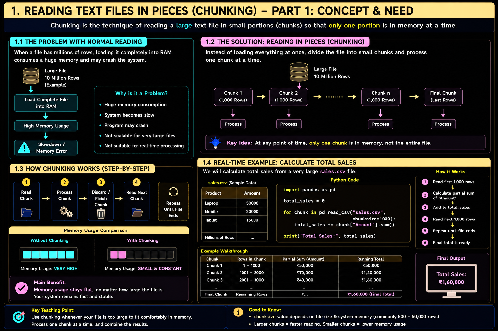

# Fundamentals of Data Science — Unit 3 Answers (`unit 3 answers.md`)

> **Course:** `2501CS34` — Fundamentals of Data Science (FDS)  
> **Unit:** UNIT III – Data Loading, Storage and File Formats  
> **Source Documents in [`raw/`](../raw/):**
> - [`raw/FDS 8M Sem Imp Questions.pdf`](../raw/FDS%208M%20Sem%20Imp%20Questions.pdf) *(8-Mark Important Questions)*
> - [`raw/FDS 2M Sem Imp  Questions.pdf`](../raw/FDS%202M%20Sem%20Imp%20%20Questions.pdf) *(2-Mark Short Questions)*
> - [`raw/III Sem FDS_Model Question Paper.pdf`](../raw/III%20Sem%20FDS_Model%20Question%20Paper.pdf) *(Model Question Paper — Unit III Section)*
> - [`raw/UNIT 3 FDS PPT.pptx`](../raw/UNIT%203%20FDS%20PPT.pptx) *(Classroom Presentation Slides)*
> - [`raw/Basic_HTML_Tags_with_Examples (1).docx`](../raw/Basic_HTML_Tags_with_Examples%20(1).docx) *(HTML Reference for Web Scraping)*
>
> **Questions Index:** [`questions.md` — UNIT III](questions.md#unit-iii--data-loading-storage-and-file-formats)

---

## Table of Contents

### 8-Mark Descriptive Questions
1. [8M-Q1: Methods Used to Read and Write Data in Text Files](#8m-q1-describe-the-methods-used-to-read-and-write-data-in-text-files)
2. [8M-Q2: Reading Large Text Files in Pieces (Chunking)](#8m-q2-explain-how-a-large-text-file-can-be-read-in-pieces)
3. [8M-Q3: Working with Delimited Data Formats](#8m-q3-demonstrate-how-to-work-with-delimited-data-formats-using-a-suitable-example)
4. [8M-Q4: Structure and Uses of JSON Data Format](#8m-q4-describe-the-structure-and-uses-of-json-data-format-with-a-suitable-example)
5. [8M-Q5: Main Features of HTML and XML Formats](#8m-q5-classify-the-main-features-of-html-and-xml-data-format-with-suitable-examples)
6. [8M-Q6: Collecting Data from Web Pages Using Web Scraping](#8m-q6-demonstrate-the-process-of-collecting-data-from-a-web-page-using-web-scraping)
7. [8M-Q7: Binary Data Formats (HDF5) vs. Traditional File Formats](#8m-q7-distinguish-between-binary-data-formats-such-as-hdf5-and-traditional-file-formats-indicate-their-advantages-and-suitable-use-cases)
8. [8M-Q8: NoSQL MongoDB CRUD Operations](#8m-q8-apply-nosql-mongo-db-crud-operations-to-store-and-retrieve-by-taking-suitable-data-as-an-example)

### 2-Mark Short Questions & Answers
- [2M-Q1: Two Operations Performed on Text Files](#2m-q1-mention-any-two-operations-performed-on-text-files)
- [2M-Q2: Purpose of Reading Text Files in Pieces](#2m-q2-state-the-purpose-of-reading-text-files-in-pieces)
- [2M-Q3: Differentiate between JSON, XML and HTML Formats](#2m-q3-differentiate-between-json-xml-and-html-data-formats)
- [2M-Q4: Summarize the Concept of Web Scraping](#2m-q4-summarize-the-concept-of-web-scraping)
- [2M-Q5: Purpose of Binary and HDF5 File Formats](#2m-q5-mention-the-purpose-of-binary-and-hdf5-file-formats)
- [2M-Q6: Uses of Excel Files, Databases and MongoDB in Data Science](#2m-q6-identify-the-uses-of-excel-files-databases-and-mongo-db-in-data-science)

---

## 8M-Q1. Describe the methods used to read and write data in text files.

### 1. Overview of Text Format I/O
In Data Science, text files (such as `.txt`, `.csv`, `.tsv`) represent the most ubiquitous medium for storing and exchanging tabular and raw unformatted records. In Python, file input/output can be categorized into two paradigms:
1. **Built-in Python Standard File Handling** (`open()`, `read()`, `write()`, `close()`).
2. **Pandas Parser Functions** (`pd.read_csv()`, `pd.read_table()`, `df.to_csv()`).

---

### 2. Built-in Python File Handling Methods

Python provides native file stream methods using the `open(filename, mode)` function. Modes include `'r'` (read), `'w'` (write/overwrite), `'a'` (append), and `'r+'` (read and write).

#### A. Reading Methods
* **`read(size)`:** Reads the whole file or up to `size` bytes into a single string.
* **`readline()`:** Reads a single line ending with newline character `\n`.
* **`readlines()`:** Reads all remaining lines into a Python list of strings.

```python
# Reading using standard context manager
with open("students.txt", "r") as file:
    content = file.readlines()
    for line in content:
        print(line.strip())
```

#### B. Writing Methods
* **`write(string)`:** Writes a specific string to the file stream.
* **`writelines(list_of_strings)`:** Writes a sequence of strings without automatically appending line breaks.

```python
# Writing to a text file
records = ["ID,Name,Branch\n", "101,Aarav,DS\n", "102,Bhavya,AI\n"]
with open("students.txt", "w") as file:
    file.writelines(records)
```

---

### 3. High-Performance Pandas Text File I/O
Pandas is optimized for large-scale data ingestion and converts text directly into 2D tabular `DataFrame` structures in RAM.

#### Core Parsing Functions:
| Function | Default Delimiter | Primary Use Case |
| :--- | :---: | :--- |
| `pd.read_csv(filepath)` | Comma (`,`) | Reading standard comma-separated text files |
| `pd.read_table(filepath)` | Tab (`\t`) | Reading general tabular delimited text files |
| `DataFrame.to_csv(filepath)` | Comma (`,`) | Writing DataFrames out to persistent storage |

#### Key Parsing Parameters in `pd.read_csv()`:
* `sep` / `delimiter`: Specifies custom field separator (e.g., `,`, `\t`, `|`, `\s+`).
* `header`: Identifies the row index containing column names (default `0`; set `None` if no header exists).
* `names`: List of custom column names to assign when `header=None`.
* `index_col`: Column number or name to use as row label index.
* `skiprows`: Skips specific metadata lines or comments at file header.
* `na_values`: Sequence of strings to recognize as `NaN` (e.g., `['NA', 'NULL', '-']`).

```python
import pandas as pd

# 1. Reading text file into a DataFrame
df = pd.read_csv(
    "dataset.csv",
    sep=",",
    header=0,
    names=["RollNo", "Name", "Score"],
    skiprows=[1],             # Skip first data row (comment/metadata)
    na_values=["missing", "?"]
)
print(df.head())

# 2. Writing DataFrame out to text format
# index=False avoids writing default numeric row index integers (0, 1, 2...)
df.to_csv("cleaned_dataset.csv", index=False, sep=",", encoding="utf-8")
```

---

## 8M-Q2. Explain how a large text file can be read in pieces.

### 1. Concept and Need for Chunking
When processing massive datasets (e.g., 10 GB log files or transaction dumps) on machines with limited RAM (e.g., 8 GB or 16 GB), loading the entire file via `pd.read_csv()` causes memory exhaustion, triggering an `OutOfMemoryError` (OOM) or massive OS swap thrashing.

**Chunking** is the systematic technique of loading a large file sequentially in fixed-size portions (chunks) so that only a small, predictable block of data resides in memory at any single moment.



---

### 2. Implementation Using Pandas `chunksize`
In Pandas, specifying the `chunksize` parameter converts `read_csv()` from an immediate reader into an iterable **`TextFileReader`** object. Each iteration yields a standard Pandas `DataFrame` containing at most `chunksize` rows.

```python
import pandas as pd

file_path = "large_transactions.csv"
chunk_size = 10000  # Number of rows per block

# TextFileReader iterator
chunk_iterator = pd.read_csv(file_path, chunksize=chunk_size)

total_revenue = 0.0
total_rows = 0

for i, chunk in enumerate(chunk_iterator):
    # Process only the active chunk in memory
    total_rows += len(chunk)
    total_revenue += chunk["Amount"].sum()
    print(f"Processed Chunk {i+1}: {len(chunk)} rows loaded.")

print(f"Final Summary: {total_rows} total rows processed.")
print(f"Aggregated Total Revenue: ${total_revenue:,.2f}")
```

---

### 3. Native Python Line-by-Line Generator Approach
For extremely constrained environments, Python's native file pointer acts as a lazy stream generator without reading the full file:

```python
def stream_large_file(filename, batch_size=5000):
    batch = []
    with open(filename, "r", encoding="utf-8") as f:
        header = f.readline()  # extract column names
        for line in f:
            batch.append(line.strip().split(","))
            if len(batch) >= batch_size:
                yield batch
                batch = []
        if batch:
            yield batch

# Usage
for batch_idx, batch_data in enumerate(stream_large_file("huge_log.txt")):
    print(f"Batch {batch_idx + 1} with {len(batch_data)} records processed.")
```

---

## 8M-Q3. Demonstrate how to work with delimited data formats using a suitable example.

### 1. Definition of Delimited Data Formats
A **delimited text file** is a plain-text tabular file where each line represents a record, and adjacent field values within that record are separated by a designated character known as a **delimiter** or separator.

Common delimited types:
1. **CSV (Comma-Separated Values):** Uses `,` as delimiter.
2. **TSV (Tab-Separated Values):** Uses `\t` as delimiter.
3. **Custom Delimited:** Uses characters like pipe (`|`), semicolon (`;`), or multiple spaces (`\s+`).

---

### 2. Manual Processing with Python's Built-in `csv` Module
While string methods (`split(',')`) fail when fields contain quoted commas (e.g., `"Hyderabad, Telangana"`), Python's built-in `csv` module handles dialect rules, quoting, and escapes cleanly.

```python
import csv

data_to_write = [
    ["EmpID", "EmpName", "Department", "Salary"],
    [101, "Aarav Sharma", "Data Science", 85000],
    [102, "Kavya Reddy", "Machine Learning", 92000],
    [103, "Rohan Verma", "Data Engineering", 78000]
]

# Writing custom delimited file (Pipe-separated)
with open("employees.psv", "w", newline="", encoding="utf-8") as file:
    writer = csv.writer(file, delimiter="|")
    writer.writerows(data_to_write)

# Reading delimited file with csv.reader
with open("employees.psv", "r", encoding="utf-8") as file:
    reader = csv.reader(file, delimiter="|")
    for row in reader:
        print(f"Record: {row}")
```

---

### 3. Parsing Delimited Formats with Pandas
Pandas automatically parses custom delimiters using the `sep` argument:

```python
import pandas as pd

# Reading pipe-separated values
df = pd.read_csv("employees.psv", sep="|")

# Inspecting dataset
print(df.info())
print(df.describe())

# Converting and exporting to standard Tab-Separated Values (.tsv)
df.to_csv("employees.tsv", sep="\t", index=False)
```

---

## 8M-Q4. Describe the structure and uses of JSON data format with a suitable example.

### 1. JSON Structure and Data Types
**JSON (JavaScript Object Notation)** is an open, lightweight, text-based data interchange format based on key-value pairs and ordered lists. It is semi-structured, language-independent, and the de facto standard for web APIs, NoSQL storage, and microservices.

#### Core JSON Data Types:
* **Object:** Key-value pairs enclosed in curly braces `{ "key": value }`.
* **Array:** Ordered list of values enclosed in square brackets `[ "val1", "val2" ]`.
* **Primitives:** String (`"text"`), Number (`42`, `3.14`), Boolean (`true` / `false`), `null`.

```json
{
  "university": "Aditya University",
  "department": "CSE (Data Science)",
  "semester": 3,
  "students": [
    {
      "roll_no": "25B11DS001",
      "name": "N. Prasanna",
      "courses": ["FDS", "DBMS", "ADSA"],
      "gpa": 8.9,
      "is_active": true
    },
    {
      "roll_no": "25B11DS002",
      "name": "P. Vivek",
      "courses": ["FDS", "CPP", "P&S"],
      "gpa": 9.1,
      "is_active": true
    }
  ]
}
```

---

### 2. Processing JSON in Python with `json` Module
Python maps JSON directly to native dictionaries and lists:
* `json.loads(string)`: Deserializes JSON string to Python dictionary.
* `json.dumps(dict)`: Serializes Python dictionary to JSON string.
* `json.load(file_pointer)`: Reads JSON directly from an open file.
* `json.dump(dict, file_pointer)`: Writes Python dictionary directly to an open JSON file.

```python
import json

student_dict = {
    "roll_no": "25B11DS010",
    "name": "Kiran",
    "marks": {"FDS": 92, "DBMS": 88}
}

# Serialize to JSON string
json_str = json.dumps(student_dict, indent=4)
print(json_str)

# Write to file
with open("student.json", "w") as f:
    json.dump(student_dict, f, indent=4)

# Read back from file
with open("student.json", "r") as f:
    loaded_data = json.load(f)
    print(f"Loaded Student: {loaded_data['name']}, FDS Mark: {loaded_data['marks']['FDS']}")
```

---

### 3. Parsing Nested JSON into Pandas DataFrames
Pandas provides `pd.read_json()` and `pd.json_normalize()` to flatten nested structures into 2D tables:

```python
import pandas as pd

# Flattening nested JSON records into rows and columns
records = [
    {"id": 1, "name": "Aditya", "details": {"dept": "DS", "city": "Surampalem"}},
    {"id": 2, "name": "Bhavya", "details": {"dept": "AI", "city": "Kakinada"}}
]

df = pd.json_normalize(records)
print(df)
# Output:
#    id    name details.dept details.city
# 0   1  Aditya           DS  Surampalem
# 1   2  Bhavya           AI     Kakinada
```

---

## 8M-Q5. Classify the main features of HTML and XML data format with suitable examples.

### 1. Comparison: HTML vs. XML
Both **HTML (HyperText Markup Language)** and **XML (eXtensible Markup Language)** originate from SGML (Standard Generalized Markup Language) and use tags enclosed in angle brackets `<tag>`. However, their design goals and structural rules are fundamentally different.

| Feature | HTML | XML |
| :--- | :--- | :--- |
| **Primary Purpose** | Displaying and formatting data on web browsers | Storing and transporting data independently |
| **Tag Definition** | Pre-defined, fixed tags (`<p>`, `<h1>`, `<table>`) | User-defined, custom tags (`<student>`, `<roll_no>`) |
| **Syntax Strictness** | Lenient (often forgiving with unclosed tags) | Extremely strict (must be well-formed, all tags closed) |
| **Case Sensitivity** | Case-insensitive (`<DIV>` == `<div>`) | Case-sensitive (`<Price>` != `<price>`) |
| **Closing Tags** | Optional for some void elements (``, `<br>`) | Mandatory for every tag (`<tag>...</tag>` or `<tag/>`) |
| **Data Nature** | Presentation-oriented (content + styling) | Data-oriented (pure content + semantic structure) |

---

### 2. XML Representation and Parsing
XML uses hierarchical node trees consisting of a root element, child elements, and attributes.

#### XML Example (`courses.xml`):
```xml
<?xml version="1.0" encoding="UTF-8"?>
<curriculum semester="3">
    <course code="2501CS34">
        <name>Fundamentals of Data Science</name>
        <credits>3</credits>
    </course>
    <course code="2501IT05">
        <name>Database Management Systems</name>
        <credits>4</credits>
    </course>
</curriculum>
```

#### Parsing XML in Python with `xml.etree.ElementTree`:
```python
import xml.etree.ElementTree as ET

tree = ET.parse("courses.xml")
root = tree.getroot()

print(f"Curriculum Semester: {root.attrib['semester']}")
for course in root.findall("course"):
    code = course.attrib["code"]
    name = course.find("name").text
    credits = course.find("credits").text
    print(f"Code: {code} | Course: {name} | Credits: {credits}")
```

---

### 3. HTML Representation and Parsing
HTML documents represent web pages structured with DOM nodes. In Data Science, tables (`<table>`, `<tr>`, `<td>`) are parsed directly into DataFrames.

```python
import pandas as pd

# pd.read_html extracts all <table> elements from an HTML file or URL into a list of DataFrames
html_snippet = """
<table>
    <tr><th>RollNo</th><th>Name</th><th>Grade</th></tr>
    <tr><td>101</td><td>Rajesh</td><td>A</td></tr>
    <tr><td>102</td><td>Sita</td><td>A+</td></tr>
</table>
"""
tables = pd.read_html(html_snippet)
print(tables[0])
```

---

## 8M-Q6. Demonstrate the process of collecting data from a web page using web scraping.

### 1. Web Scraping Lifecycle in Data Science
**Web Scraping** is the automated extraction of semi-structured or unstructured data from websites and conversion into structured tabular formats (e.g., CSV, SQL, Pandas DataFrame).

The 4-stage scraping workflow:
1. **HTTP Request:** Send a GET request to the target URL using `requests`.
2. **HTML Parsing:** Parse the downloaded HTML DOM tree using `BeautifulSoup`.
3. **Data Extraction:** Navigate tags and CSS classes (`find()`, `find_all()`, `select()`).
4. **Data Structuring:** Clean and load extracted text into Pandas and save to CSV.

---

### 2. Implementation Using `requests` and `BeautifulSoup`

```python
import requests
from bs4 import BeautifulSoup
import pandas as pd

# Step 1: Send HTTP GET request
target_url = "https://example.com/books"
headers = {"User-Agent": "Mozilla/5.0 (Windows NT 10.0; Win64; x64)"}

response = requests.get(target_url, headers=headers)

if response.status_code == 200:
    # Step 2: Parse HTML content with BeautifulSoup
    soup = BeautifulSoup(response.content, "html.parser")
    
    books_data = []
    
    # Step 3: Extract elements using HTML tag hierarchy
    book_cards = soup.find_all("div", class_="book-card")
    for card in book_cards:
        title = card.find("h3", class_="title").text.strip()
        price_raw = card.find("span", class_="price").text.strip()
        price = float(price_raw.replace("$", ""))
        rating = card.find("span", class_="rating")["data-score"]
        
        books_data.append({
            "Title": title,
            "Price": price,
            "Rating": rating
        })
        
    # Step 4: Load into DataFrame and persist
    df = pd.DataFrame(books_data)
    print(df.head())
    df.to_csv("scraped_books.csv", index=False)
else:
    print(f"Failed to fetch page. HTTP Status Code: {response.status_code}")
```

#### Best Practices for Web Scraping:
* **Inspect `robots.txt`:** Always obey the target website's crawling permissions.
* **Rate Limiting:** Use `time.sleep()` to prevent server overload or IP blacklisting.
* **Header Spoofing:** Always pass a valid `User-Agent` string.

---

## 8M-Q7. Distinguish between Binary data formats such as HDF5 and traditional file formats. Indicate their advantages and suitable use cases.

### 1. Architectural Comparison

| Parameter | Traditional Formats (CSV / TSV / JSON) | Binary Data Formats (HDF5 / Feather / Parquet) |
| :--- | :--- | :--- |
| **Storage Structure** | Plain Human-Readable ASCII/UTF-8 Text | Serialized Binary Bitstream (Binary on Disk) |
| **File Size / Footprint** | Large (redundant delimiter and text overhead) | Highly compressed, small storage footprint |
| **Read / Write Speed** | Slow (requires CPU parsing of every string/line) | Extremely fast (zero-copy memory mapping) |
| **Data Types** | Implicit (all numbers stored as characters) | Explicit native types (stores `int32`, `float64`, arrays) |
| **Random Slicing** | Must parse file sequentially from byte 0 | Direct random access to sub-arrays without loading whole file |
| **Hierarchical Storage** | Flat (one table per file) | Tree-like hierarchy (groups, datasets like a filesystem) |

---

### 2. Deep-Dive: Hierarchical Data Format (HDF5)
**HDF5** is a file format designed to store and organize large amounts of numerical and scientific data. It contains two primary objects:
1. **Groups:** Folder-like containers that hold datasets and other groups.
2. **Datasets:** Multidimensional arrays of homogeneous data types (analogous to NumPy arrays).

#### Working with HDF5 in Python via `h5py` and Pandas:
```python
import numpy as np
import pandas as pd

# Creating sample large scientific dataset
df_features = pd.DataFrame(np.random.randn(100000, 4), columns=["A", "B", "C", "D"])

# Writing to HDF5 using Pandas HDFStore (requires PyTables)
with pd.HDFStore("scientific_data.h5", mode="w") as store:
    # Storing DataFrame under a specific group key
    store.put("experiment1/sensor_data", df_features, format="table")

# Slicing from HDF5 without loading entire file into memory
with pd.HDFStore("scientific_data.h5", mode="r") as store:
    # Query only rows where column A > 2.0 directly from disk
    sub_df = store.select("experiment1/sensor_data", where="A > 2.0")
    print(f"Filtered Rows: {len(sub_df)}")
```

---

### 3. Suitable Use Cases
* **When to use CSV/JSON:**
  * Small datasets (< 100 MB).
  * Configurations and cross-platform human review.
  * Web API transmission.
* **When to use HDF5/Binary:**
  * Massive scientific datasets (astronomy, genomics, climate models).
  * Deep learning tensors and image arrays (saving model weights, training checkpoints).
  * High-frequency financial time series requiring microsecond retrieval.

---

## 8M-Q8. Apply NoSQL MongoDB CRUD operations to store and retrieve by taking suitable data as an example.

### 1. Overview of MongoDB
**MongoDB** is a leading document-oriented NoSQL database. Rather than storing records in rigid rows and columns like relational databases, MongoDB stores records as **BSON documents** (Binary JSON) within **Collections**.

Key advantages:
* **Dynamic / Flexible Schema:** Documents within the same collection do not need identical fields.
* **Horizontal Scalability:** Native support for sharding across server clusters.
* **Rich Query Language:** High-performance indexing and aggregation pipelines.

---

### 2. Demonstrating CRUD Operations with Python (`pymongo`)

#### Step 1: Connecting and Database Setup
```python
from pymongo import MongoClient

# Connect to local or cloud MongoDB instance
client = MongoClient("mongodb://localhost:27017/")

# Select database and collection
db = client["university_db"]
students_collection = db["students"]
```

#### Step 2: **Create (Insert)**
```python
# 1. Insert Single Document
single_student = {
    "roll_no": "25B11DS014",
    "name": "Nagendra",
    "branch": "CSE-DS",
    "semester": 3,
    "cgpa": 8.75,
    "skills": ["Python", "Pandas", "SQL"]
}
insert_result = students_collection.insert_one(single_student)
print(f"Inserted document ID: {insert_result.inserted_id}")

# 2. Insert Multiple Documents
batch_students = [
    {"roll_no": "25B11DS015", "name": "Mohan", "branch": "CSE-DS", "cgpa": 8.4, "skills": ["Python", "Neo4j"]},
    {"roll_no": "25B11DS016", "name": "Vivek", "branch": "CSE-DS", "cgpa": 9.2, "skills": ["Python", "NLTK", "MongoDB"]}
]
students_collection.insert_many(batch_students)
```

#### Step 3: **Read (Query / Retrieve)**
```python
# 1. Find single document
doc = students_collection.find_one({"roll_no": "25B11DS014"})
print(f"Found Student: {doc['name']} | CGPA: {doc['cgpa']}")

# 2. Find multiple documents with filter and projection
query = {"cgpa": {"$gte": 8.5}}
projection = {"_id": 0, "roll_no": 1, "name": 1, "cgpa": 1}

high_achievers = students_collection.find(query, projection)
for student in high_achievers:
    print(student)
```

#### Step 4: **Update**
```python
# Update Mohan's CGPA and append a new skill
filter_criteria = {"roll_no": "25B11DS015"}
update_query = {
    "$set": {"cgpa": 8.65},
    "$push": {"skills": "Cypher"}
}
update_result = students_collection.update_one(filter_criteria, update_query)
print(f"Matched: {update_result.matched_count}, Modified: {update_result.modified_count}")
```

#### Step 5: **Delete**
```python
# Delete document matching roll_no
delete_result = students_collection.delete_one({"roll_no": "25B11DS014"})
print(f"Deleted count: {delete_result.deleted_count}")
```

---

## Unit III — 2-Mark Short Questions & Answers

### 2M-Q1. Mention any two operations performed on text files.
1. **Reading Data (`read()` / `pd.read_csv()`):** Extracting characters, lines, or tabular columns from persistent disk storage into system memory for analysis.
2. **Writing Data (`write()` / `DataFrame.to_csv()`):** Persisting transformed in-memory data structures out to a physical text file on disk.

---

### 2M-Q2. State the purpose of reading text files in pieces.
The purpose of reading text files in pieces (**chunking**) is to **prevent memory exhaustion (`OutOfMemoryError`)** when loading datasets larger than available system RAM. It allows sequential, batch-wise processing where only a fixed subset of rows is kept in memory at any instant.

---

### 2M-Q3. Differentiate between JSON, XML and HTML data formats.
* **JSON:** Lightweight, key-value and array-based format optimized for speed and API data exchange.
* **XML:** Strict, user-defined tag-based hierarchical markup format designed for platform-independent data storage and transport.
* **HTML:** Presentation-oriented markup language with predefined tags designed for rendering web pages in browsers.

---

### 2M-Q4. Summarize the concept of web scraping.
**Web scraping** is the automated programmatic technique of fetching HTML web pages via HTTP requests and extracting targeted data fields from the HTML DOM tree (using tools like BeautifulSoup) into structured formats like CSV, JSON, or databases.

---

### 2M-Q5. Mention the purpose of Binary and HDF5 file formats.
* **Binary formats:** Eliminate textual parsing overhead, preserving native data types directly on disk with fast read/write speeds.
* **HDF5:** Provides a high-performance hierarchical container designed to store multidimensional arrays and gigabyte/terabyte-scale scientific datasets with support for fast random slicing.

---

### 2M-Q6. Identify the uses of Excel files, databases and Mongo DB in Data Science.
1. **Excel Files (`.xlsx`):** Widely used by business analysts and non-technical stakeholders for manual data entry, pivot tables, and sharing spreadsheet reports.
2. **Relational Databases (SQL):** Store structured, ACID-compliant enterprise transaction data with primary/foreign key relationships.
3. **MongoDB (NoSQL):** Stores semi-structured, schema-less BSON documents, making it ideal for rapid prototyping, real-time logging, and evolving unstructured datasets.
