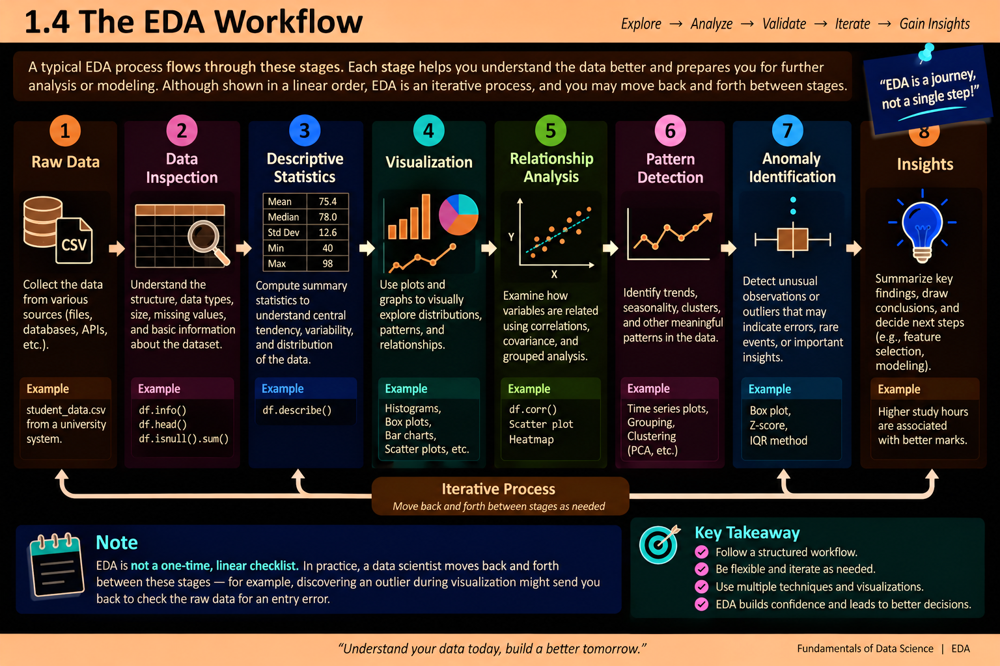
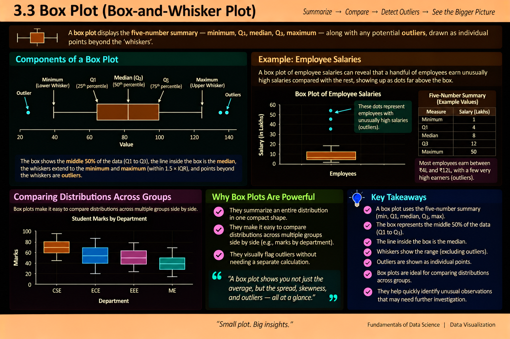
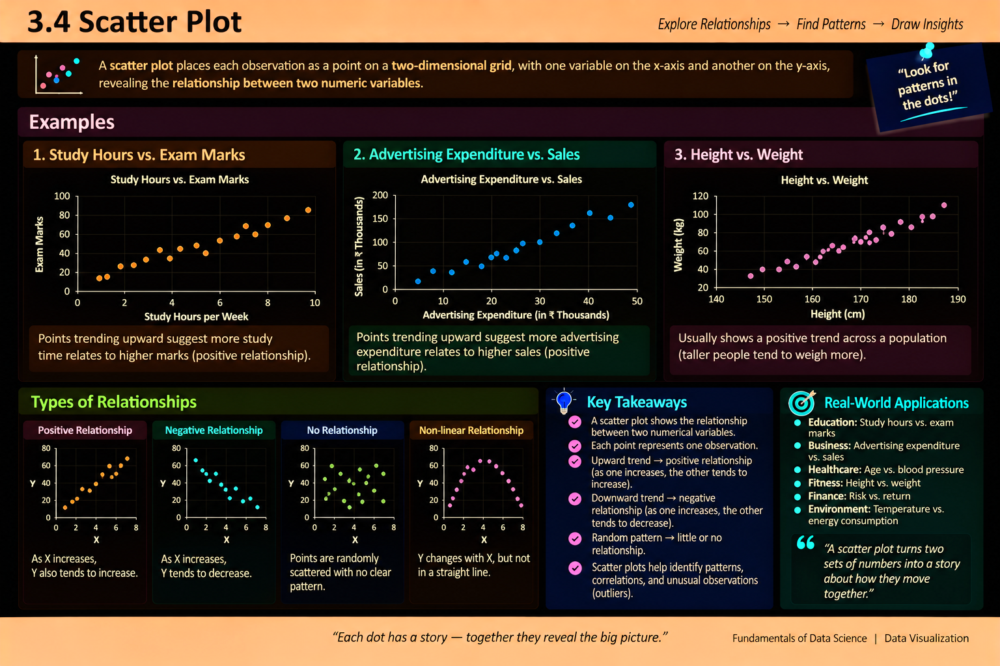
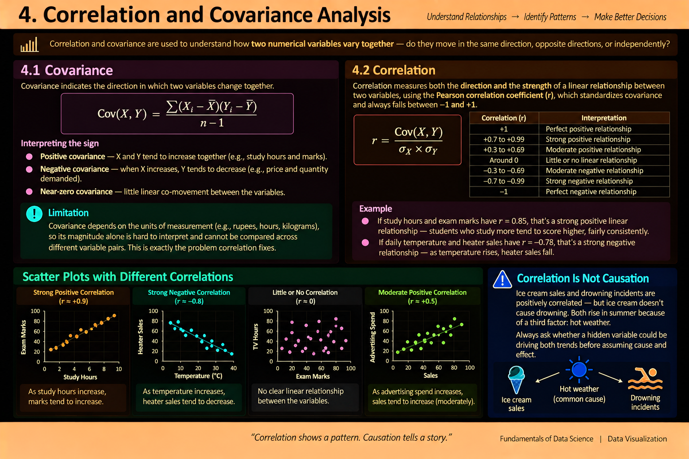
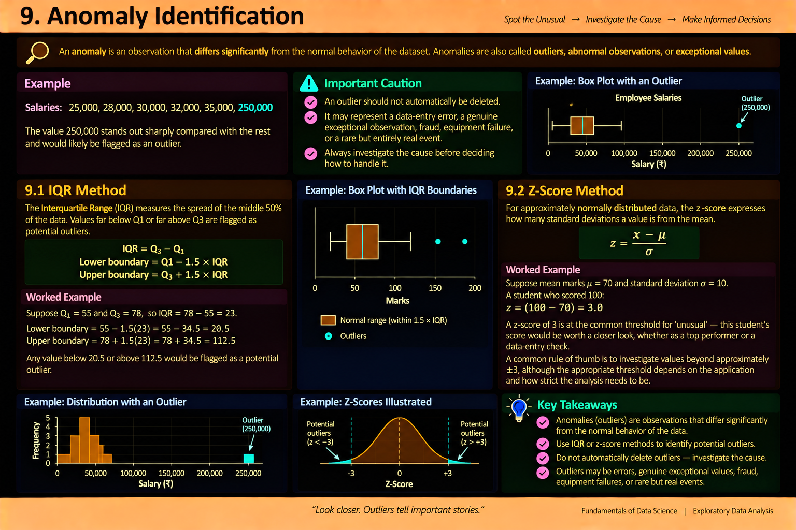
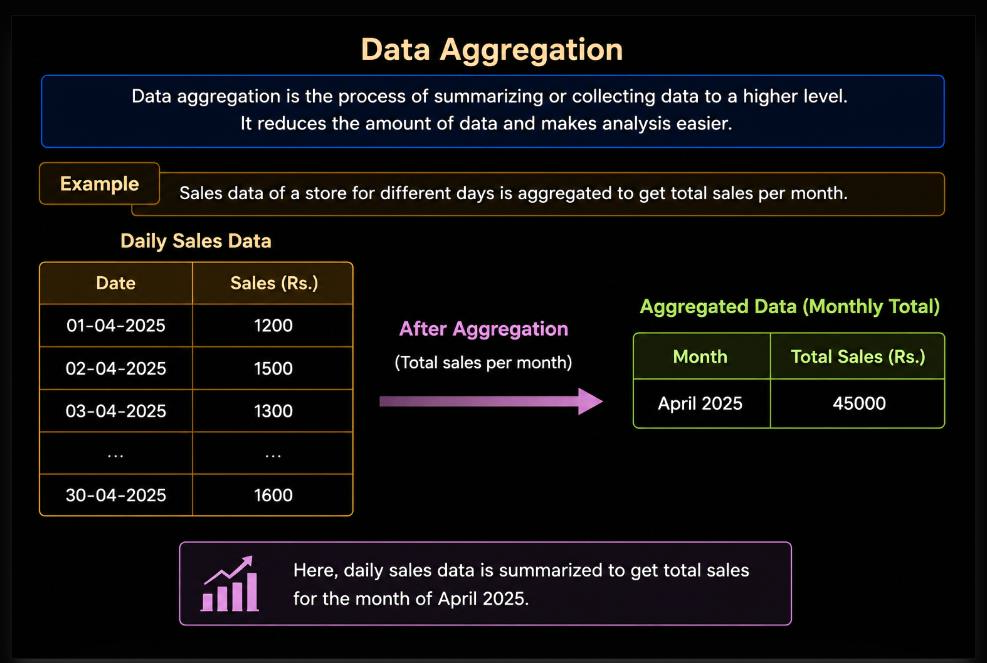

# Fundamentals of Data Science — Unit 4 Answers (`unit 4 answers.md`)

> **Course:** `2501CS34` — Fundamentals of Data Science (FDS)  
> **Unit:** UNIT IV – Exploratory Data Analysis (EDA)  
> **Source Documents in [`raw/`](raw/):**
> - [`raw/FDS 8M Sem Imp Questions.pdf`](raw/FDS%208M%20Sem%20Imp%20Questions.pdf) *(8-Mark Important Questions)*
> - [`raw/FDS 2M Sem Imp  Questions.pdf`](raw/FDS%202M%20Sem%20Imp%20%20Questions.pdf) *(2-Mark Short Questions)*
> - [`raw/III Sem FDS_Model Question Paper.pdf`](raw/III%20Sem%20FDS_Model%20Question%20Paper.pdf) *(Model Question Paper — Unit IV Section)*
> - [`raw/FDS_UNIT_IV.pptx`](raw/FDS_UNIT_IV.pptx) *(Classroom Presentation Slides on EDA)*
>
> **Questions Index:** [`questions.md` — UNIT IV](questions.md#unit-iv--exploratory-data-analysis-eda)

---

## Table of Contents

### 8-Mark Descriptive Questions
1. [8M-Q1: Commonly Used Measures of Descriptive Statistics](#8m-q1-describe-the-commonly-used-measures-of-descriptive-statistics-with-suitable-examples)
2. [8M-Q2: Data Visualization Techniques in Exploratory Data Analysis](#8m-q2-demonstrate-different-data-visualization-techniques-used-in-exploratory-data-analysis-with-suitable-examples)
3. [8M-Q3: Correlation and Covariance Analysis](#8m-q3-analyze-the-correlation-and-covariance-techniques-by-using-suitable-example)
4. [8M-Q4: Univariate, Bivariate, and Multivariate Analysis](#8m-q4-differentiate-between-univariate-bivariate-and-multivariate-analysis-with-suitable-examples)
5. [8M-Q5: Analyzing a Dataset to Identify Anomalies and Pattern Detection](#8m-q5-analyze-a-dataset-to-identify-possible-anomalies-and-pattern-detection)

### 2-Mark Short Questions & Answers
- [2M-Q1: Define Exploratory Data Analysis (EDA)](#2m-q1-define-exploratory-data-analysis-eda)
- [2M-Q2: Mention Any Four Descriptive Statistical Measures](#2m-q2-mention-any-four-descriptive-statistical-measures)
- [2M-Q3: List Any Four Data Visualization Techniques](#2m-q3-list-any-four-data-visualization-techniques)
- [2M-Q4: Differentiate Between Correlation and Covariance](#2m-q4-differentiate-between-correlation-and-covariance)
- [2M-Q5: Classify EDA into Univariate, Bivariate, and Multivariate Analysis](#2m-q5-classify-eda-into-univariate-bivariate-and-multivariate-analysis)
- [2M-Q6: Summarize Pattern Detection and Anomaly Identification](#2m-q6-summarize-pattern-detection-and-anomaly-identification)

---

## 8M-Q1. Describe the commonly used measures of descriptive statistics with suitable examples.

### 1. Overview of Descriptive Statistics
**Descriptive Statistics** quantitatively summarize and describe the main features of a collection of information. Rather than using data to learn about the population (which is inferential statistics), descriptive statistics aim to summarize the sample itself.



Descriptive statistics are primarily partitioned into three dimensions:
1. **Measures of Central Tendency:** Point estimates indicating the center of the distribution.
2. **Measures of Dispersion (Spread):** Quantify the degree of spread, variability, or dispersion of observations around the center.
3. **Measures of Shape:** Describe the asymmetry (**Skewness**) and tail thickness (**Kurtosis**) of the distribution.

---

### 2. Measures of Central Tendency

| Measure | Definition | Formula | Key Characteristics & Behavior |
| :--- | :--- | :---: | :--- |
| **Mean** ($\bar{x}$) | Arithmetic average of all data points | $\bar{x} = \frac{\sum_{i=1}^n x_i}{n}$ | Highly sensitive to extreme values (outliers). |
| **Median** ($\tilde{x}$) | Middle observation in an ordered dataset | $\frac{n+1}{2}^{\text{th}}$ position | **Robust** to outliers; ideal for skewed distributions (e.g., salaries). |
| **Mode** | Value that appears most frequently | $\text{argmax}_{x} f(x)$ | Can be multimodal; applicable to numerical and categorical data. |

#### Numerical Demonstration:
Dataset of student marks: $[10, 20, 20, 30, 40, 50, 100]$ ($n = 7$).
* **Mean:** $\frac{10 + 20 + 20 + 30 + 40 + 50 + 100}{7} = \frac{270}{7} \approx 38.57$.
* **Median:** Array is sorted; $4^{\text{th}}$ element = $30$.
* **Mode:** $20$ (occurs twice).

---

### 3. Measures of Dispersion (Spread)

#### A. Range
The absolute difference between the maximum and minimum observations:
$$\text{Range} = x_{\text{max}} - x_{\text{min}} = 100 - 10 = 90$$

#### B. Interquartile Range (IQR)
Measures the spread of the middle 50% of values, defined as the difference between the third quartile ($Q_3$ / $75^{\text{th}}$ percentile) and the first quartile ($Q_1$ / $25^{\text{th}}$ percentile):
$$\text{IQR} = Q_3 - Q_1$$
*IQR is completely robust to extreme outliers.*

#### C. Variance ($s^2$ or $\sigma^2$)
The average of the squared deviations from the arithmetic mean:
$$s^2 = \frac{\sum_{i=1}^n (x_i - \bar{x})^2}{n - 1} \quad \text{(Sample Variance)}$$

#### D. Standard Deviation ($s$ or $\sigma$)
The square root of the variance, restoring units of measurement identical to the original variable:
$$s = \sqrt{s^2} = \sqrt{\frac{\sum_{i=1}^n (x_i - \bar{x})^2}{n - 1}}$$

---

### 4. Implementation in Python (Pandas & SciPy)

```python
import numpy as np
import pandas as pd
from scipy import stats

data = [10, 20, 20, 30, 40, 50, 100]
s = pd.Series(data)

summary = {
    "Count": s.count(),
    "Mean": s.mean(),
    "Median": s.median(),
    "Mode": s.mode().iloc[0],
    "Std Dev": s.std(),
    "Variance": s.var(),
    "Range": s.max() - s.min(),
    "IQR": s.quantile(0.75) - s.quantile(0.25),
    "Skewness": s.skew(),
    "Kurtosis": s.kurtosis()
}

for metric, val in summary.items():
    print(f"{metric:<12}: {val:.3f}")
```

---

## 8M-Q2. Demonstrate different data visualization techniques used in Exploratory Data Analysis with suitable examples.

### 1. The Role of Data Visualization in EDA
Data visualization translates complex numerical relationships into graphical visual representations. As demonstrated by Anscombe's Quartet, datasets with identical descriptive statistics can display radically different distributions that only visual plots reveal.

---

### 2. Primary Visualization Techniques

| Plot Type | Primary Purpose | Best Used For |
| :--- | :--- | :--- |
| **Histogram** | Visualizing distribution and frequency density | Continuous single numerical variable |
| **Box Plot** | Visualizing five-number summary and detecting outliers | Comparing distributions across categories |
| **Scatter Plot** | Visualizing bivariate relationship, clustering, and correlation | Two continuous numerical variables |
| **Line Chart** | Displaying continuous trends over time | Sequential / time-series data |
| **Heatmap** | Displaying 2D correlation matrix or cross-tabulation density | Multiple continuous variables |



---

### 3. Box-and-Whisker Plot Details
A Box Plot visually encodes the **Five-Number Summary**:
1. **Minimum:** $\text{Lower Whisker} = \max(\min(x), Q_1 - 1.5 \times \text{IQR})$.
2. **First Quartile ($Q_1$):** Lower edge of the box (25% mark).
3. **Median ($Q_2$):** Line dividing the box (50% mark).
4. **Third Quartile ($Q_3$):** Upper edge of the box (75% mark).
5. **Maximum:** $\text{Upper Whisker} = \min(\max(x), Q_3 + 1.5 \times \text{IQR})$.
*Points outside the whiskers are flagged as **outliers**.*



---

### 4. Implementation in Python (Matplotlib & Seaborn)

```python
import matplotlib.pyplot as plt
import seaborn as sns
import numpy as np
import pandas as pd

# Creating representative dataset
np.random.seed(42)
df = pd.DataFrame({
    "Study_Hours": np.random.uniform(1, 10, 100),
    "Exam_Score": np.random.uniform(1, 10, 100) * 8 + np.random.normal(15, 5, 100),
    "Attendance": np.random.choice(["High", "Medium", "Low"], 100)
})

fig, axes = plt.subplots(2, 2, figsize=(12, 10))

# 1. Histogram with KDE
sns.histplot(df["Exam_Score"], kde=True, ax=axes[0, 0], color="#58a6ff")
axes[0, 0].set_title("Distribution of Exam Scores (Histogram)")

# 2. Box Plot by Category
sns.boxplot(x="Attendance", y="Exam_Score", data=df, ax=axes[0, 1], palette="dark")
axes[0, 1].set_title("Exam Scores by Attendance Level (Box Plot)")

# 3. Scatter Plot with Regression Fit
sns.regplot(x="Study_Hours", y="Exam_Score", data=df, ax=axes[1, 0], color="#3fb950")
axes[1, 0].set_title("Study Hours vs. Exam Score (Scatter Plot)")

# 4. Correlation Heatmap
sns.heatmap(df[["Study_Hours", "Exam_Score"]].corr(), annot=True, cmap="coolwarm", ax=axes[1, 2-1])
axes[1, 1].set_title("Correlation Heatmap")

plt.tight_layout()
plt.savefig("eda_visualizations.png")
plt.show()
```

---

## 8M-Q3. Analyze the correlation and covariance techniques by using suitable example.

### 1. Conceptual Foundations: Covariance vs. Correlation
Both **covariance** and **correlation** measure the linear association between two continuous numerical random variables $X$ and $Y$.



#### A. Covariance
**Covariance** measures the direction of the joint linear variability of two variables:
$$\text{Cov}(X, Y) = \frac{\sum_{i=1}^n (x_i - \bar{x})(y_i - \bar{y})}{n - 1}$$
* **Positive Covariance ($>0$):** As $X$ increases, $Y$ tends to increase.
* **Negative Covariance ($<0$):** As $X$ increases, $Y$ tends to decrease.
* **Limitation:** Covariance is scale-dependent. Its numerical value depends on the units of measurement (e.g., measuring height in meters vs. millimeters yields drastically different values), making it impossible to determine the strength of the relationship.

#### B. Karl Pearson's Correlation Coefficient ($r$)
**Correlation** normalizes covariance by dividing by the product of individual standard deviations, yielding a dimensionless, standardized index:
$$r = \frac{\text{Cov}(X, Y)}{s_X \cdot s_Y} = \frac{\sum_{i=1}^n (x_i - \bar{x})(y_i - \bar{y})}{\sqrt{\sum_{i=1}^n (x_i - \bar{x})^2} \cdot \sqrt{\sum_{i=1}^n (y_i - \bar{y})^2}}$$
* **Range:** Strictly bounded: $-1 \le r \le +1$.
  * $r = +1$: Perfect positive linear correlation.
  * $r = 0$: No linear relationship.
  * $r = -1$: Perfect negative linear correlation.

---

### 2. Comprehensive Comparison Table

| Metric | Covariance | Pearson Correlation Coefficient ($r$) |
| :--- | :--- | :--- |
| **Definition** | Unstandardized measure of linear co-movement | Standardized measure of linear strength & direction |
| **Scale / Units** | Product of variable units ($X \times Y$) | Unitless (dimensionless pure number) |
| **Range** | $(-\infty, +\infty)$ | $[-1, +1]$ |
| **Sensitivity to Scale** | Highly sensitive to unit changes | Invariant to linear scale and shift transformations |
| **Interpreting Strength** | Cannot determine strength from magnitude | Direct interpretation ($|r| > 0.8$ strong, $|r| < 0.3$ weak) |

---

### 3. Step-by-Step Calculation Example
Let $X = [2, 4, 6]$ (Study Hours) and $Y = [40, 60, 80]$ (Marks).
* Means: $\bar{x} = 4$, $\bar{y} = 60$.
* Deviations $(x_i - \bar{x}) = [-2, 0, 2]$.
* Deviations $(y_i - \bar{y}) = [-20, 0, 20]$.
* Product of deviations: $(-2)(-20) + (0)(0) + (2)(20) = 40 + 0 + 40 = 80$.
* **Covariance:** $\text{Cov}(X, Y) = \frac{80}{3 - 1} = 40.0$.
* Variances:
  * $s_X^2 = \frac{(-2)^2 + 0^2 + 2^2}{2} = 4 \implies s_X = 2$.
  * $s_Y^2 = \frac{(-20)^2 + 0^2 + 20^2}{2} = 400 \implies s_Y = 20$.
* **Correlation:** $r = \frac{40.0}{2 \times 20} = \frac{40}{40} = 1.0$ (Perfect positive linear correlation).

```python
import numpy as np
import pandas as pd

X = [2, 4, 6]
Y = [40, 60, 80]
df = pd.DataFrame({"Hours": X, "Marks": Y})

print("Covariance Matrix:")
print(df.cov())
print("\nCorrelation Matrix:")
print(df.corr())
```

---

## 8M-Q4. Differentiate between Univariate, Bivariate and Multivariate analysis with suitable examples.

### 1. Classification by Dimension

```
                            Exploratory Data Analysis
                                        │
        ┌───────────────────────────────┼───────────────────────────────┐
        ▼                               ▼                               ▼
Univariate Analysis             Bivariate Analysis             Multivariate Analysis
(1 variable in isolation)       (2 variables jointly)          (3+ variables simultaneously)
```

---

### 2. Detailed Comparison Matrix

| Aspect | Univariate Analysis | Bivariate Analysis | Multivariate Analysis |
| :--- | :--- | :--- | :--- |
| **Number of Variables** | Exactly **one** variable | Exactly **two** variables | **Three or more** variables |
| **Primary Objective** | Understand distribution, central tendency, dispersion, frequency | Discover relationships, dependency, correlation, causality | Discover complex interactions, confounding effects, clustering |
| **Common Statistical Tools** | Mean, Median, Mode, Variance, IQR, Skewness | Covariance, Pearson's $r$, Spearman's $\rho$, Chi-Square test | Multiple Regression, PCA, MANOVA, Factor Analysis, Clustering |
| **Visual Plots** | Histogram, Density plot (KDE), Box Plot, Bar Chart | Scatter Plot, Line Chart, Grouped Box Plot, Stacked Bar Chart | Pairplot, 3D Scatter, Parallel Coordinates, Correlation Heatmap |
| **Real-World Example** | Analyzing the age distribution of hospital patients | Investigating the relationship between patient Age and Blood Pressure | Predicting Hospital Readmission using Age, BP, Blood Sugar, and BMI together |

---

### 3. Implementation Example in Python

```python
import seaborn as sns
import matplotlib.pyplot as plt
import pandas as pd

# Using famous Iris dataset
iris = sns.load_dataset("iris")

# 1. Univariate Analysis: Distribution of Sepal Length
plt.figure()
sns.histplot(iris["sepal_length"], kde=True)
plt.title("Univariate: Sepal Length Distribution")

# 2. Bivariate Analysis: Sepal Length vs. Petal Length
plt.figure()
sns.scatterplot(x="sepal_length", y="petal_length", hue="species", data=iris)
plt.title("Bivariate: Sepal Length vs. Petal Length")

# 3. Multivariate Analysis: Pairplot of all numerical variables by species
sns.pairplot(iris, hue="species")
plt.suptitle("Multivariate Analysis: Pairplot", y=1.02)
plt.show()
```

---

## 8M-Q5. Analyze a dataset to identify possible Anomalies and Pattern Detection.

### 1. Concepts: Patterns vs. Anomalies
* **Pattern Detection:** The systematic identification of underlying structures, trends, periodic cycles, or groupings within data that are not immediately evident from single summary statistics.
* **Anomaly Identification:** Detecting observations (outliers) that deviate so significantly from the remaining data as to arouse suspicion that they were generated by a different mechanism (e.g., fraud, sensor error, rare medical event).



---

### 2. Methodologies for Anomaly / Outlier Detection

#### Method 1: The IQR (Tukey's Fences) Method (Non-parametric)
* Compute $Q_1$ ($25^{\text{th}}$ percentile) and $Q_3$ ($75^{\text{th}}$ percentile).
* Compute $\text{IQR} = Q_3 - Q_1$.
* Define bounds:
  $$\text{Lower Bound} = Q_1 - 1.5 \times \text{IQR}$$
  $$\text{Upper Bound} = Q_3 + 1.5 \times \text{IQR}$$
* Any data point $x < \text{Lower Bound}$ or $x > \text{Upper Bound}$ is flagged as an outlier.



#### Method 2: Z-Score Method (Parametric — assumes Gaussian distribution)
* Compute $z = \frac{x - \mu}{\sigma}$.
* Data points with $|z| > 3.0$ fall beyond 3 standard deviations (covering 99.73% of normal data) and are flagged as anomalous.

---

### 3. Complete Python Demonstration

```python
import numpy as np
import pandas as pd

# Creating dataset containing normal values and intentional anomalies
data = [12, 13, 14, 15, 14, 16, 15, 13, 14, 15, 16, 14, 15, 85, 2]
df = pd.DataFrame({"Sensor_Reading": data})

# 1. IQR Method
Q1 = df["Sensor_Reading"].quantile(0.25)
Q3 = df["Sensor_Reading"].quantile(0.75)
IQR = Q3 - Q1
lower_fence = Q1 - 1.5 * IQR
upper_fence = Q3 + 1.5 * IQR

iqr_anomalies = df[(df["Sensor_Reading"] < lower_fence) | (df["Sensor_Reading"] > upper_fence)]
print(f"IQR Fences: [{lower_fence:.2f}, {upper_fence:.2f}]")
print(f"IQR Outliers Detected:\n{iqr_anomalies}")

# 2. Z-Score Method
mean_val = df["Sensor_Reading"].mean()
std_val = df["Sensor_Reading"].std()
df["Z_Score"] = (df["Sensor_Reading"] - mean_val) / std_val

z_anomalies = df[df["Z_Score"].abs() > 2.5]
print(f"\nZ-Score Outliers (|z| > 2.5):\n{z_anomalies}")

# 3. Handling Outliers: Capping (Winsorization) or Trimming
df_cleaned = df[(df["Sensor_Reading"] >= lower_fence) & (df["Sensor_Reading"] <= upper_fence)].copy()
print(f"\nCleaned dataset row count: {len(df_cleaned)} (from {len(df)})")
```

---

## Unit IV — 2-Mark Short Questions & Answers

### 2M-Q1. Define Exploratory Data Analysis (EDA).
**Exploratory Data Analysis (EDA)** is an analytical approach pioneered by John Tukey that uses statistical summaries and graphical visualizations to explore data characteristics, discover patterns, detect anomalies/outliers, and test hypotheses without assuming a prior statistical model.

---

### 2M-Q2. Mention any four descriptive statistical measures.
1. **Mean:** The arithmetic average of all observations.
2. **Median:** The middle value of an ordered dataset.
3. **Standard Deviation:** A measure of the dispersion or spread of values around the mean.
4. **Interquartile Range (IQR):** The difference between the $75^{\text{th}}$ and $25^{\text{th}}$ percentiles ($Q_3 - Q_1$).

---

### 2M-Q3. List any four data visualization techniques.
1. **Histogram:** Visualizes frequency distributions of continuous variables.
2. **Box Plot:** Displays the five-number summary and identifies outliers.
3. **Scatter Plot:** Visualizes bivariate relationships and correlations between two numerical variables.
4. **Heatmap:** Displays 2D color-encoded matrices such as correlation coefficients.

---

### 2M-Q4. Differentiate between correlation and covariance.
* **Covariance:** Measures the direction of linear association between two variables and is expressed in product units ($-\infty$ to $+\infty$), making it scale-dependent.
* **Correlation:** A normalized, unitless measure of both direction and strength bounded strictly between $-1$ and $+1$, making it scale-invariant.

---

### 2M-Q5. Classify EDA into univariate, bivariate and multivariate analysis.
1. **Univariate Analysis:** Analyzes a single variable in isolation to examine its frequency distribution and central tendency.
2. **Bivariate Analysis:** Analyzes two variables simultaneously to detect associations, correlation, or dependency.
3. **Multivariate Analysis:** Analyzes three or more variables together to uncover complex multidimensional interactions and clustering.

---

### 2M-Q6. Summarize pattern detection and anomaly identification.
* **Pattern Detection:** Uncovering recurring structures, trends, cycles, or cluster formations in data to generate meaningful predictive insights.
* **Anomaly Identification:** Identifying data points (outliers) that deviate significantly from standard expected behavior due to errors, fraud, or exceptional events.
