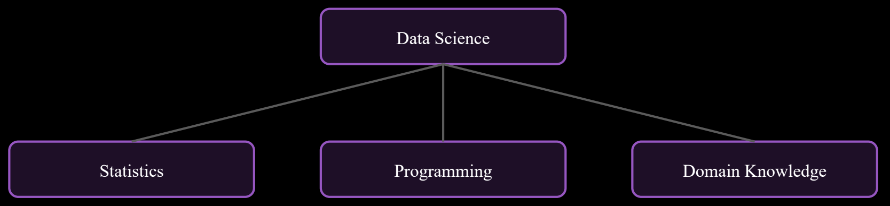
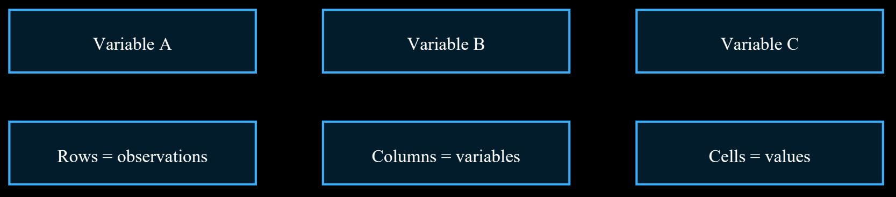

# Unit I: Introduction to Data Science

> **Course Code:** `2501CS34` — Fundamentals of Data Science (FDS) | Aditya University  
> **Source PDF:** [`raw/FDS Complete 8-Mark Exam Notes.pdf`](raw/FDS%20Complete%208-Mark%20Exam%20Notes.pdf)  
> **Questions File:** [questions.md — Unit I](questions.md#unit-i-introduction-to-data-science)

---

## 1. Define Data Science. Explain its scope and importance in various fields.

**Definition:** Data Science is an interdisciplinary field that uses scientific methods, statistics, programming and domain knowledge to collect, process, analyse and interpret data. Its purpose is to discover useful patterns and support better decisions.

**Simple example:** An online shopping company studies customers' past purchases to recommend products they may like.

### Main components of Data Science
* **Data:** Raw facts such as numbers, text, images and videos.
* **Statistics and mathematics:** Help measure patterns, relationships and uncertainty.
* **Programming:** Python and R are used to clean, analyse and model data.
* **Domain knowledge:** Understanding the field, such as banking, health or education.
* **Communication:** Charts and reports explain findings to decision-makers.

Data Science connects several subjects. Statistics helps understand data, computer science provides tools to process it, and domain knowledge gives meaning to the results.

### Scope and applications
* **Healthcare:** Study patient records, support diagnosis and plan hospital resources.
* **Banking:** Identify unusual transactions, assess credit risk and understand customer behaviour.
* **Education:** Analyse student performance and identify topics where learners need support.
* **Agriculture:** Use weather and soil data to support crop planning.
* **Transport:** Predict traffic and improve route planning.
* **Business and marketing:** Forecast sales, group customers and recommend products.
* **Government:** Analyse population, public services and resource needs.

**Importance:** It converts large amounts of raw data into useful information; improves the speed and quality of decisions; helps predict future trends; reduces waste and cost; and supports innovation. Results must be checked for accuracy, privacy and fairness.



**Conclusion:** Data Science is important because almost every field creates data. Correct analysis turns that data into knowledge and practical action.

---

## 2. Explain the history and evolution of Data Science.

**Definition:** The evolution of Data Science refers to the gradual development of methods and technologies used to collect, store, process and analyse data, from traditional statistics to modern artificial intelligence.

### Stages in its development
* **Early statistics:** Data was collected mainly through surveys, censuses and experiments. Statistical methods were used to summarize information.
* **Growth of computers:** Computers made calculations faster and allowed larger datasets to be processed.
* **Database era:** Relational databases and SQL made it easier to store, organize and retrieve structured data.
* **Internet and web era:** Websites, online shopping and social media produced large amounts of digital data.
* **Big Data era:** Distributed systems and cloud platforms helped store and process very large and varied datasets.
* **Machine learning era:** Algorithms learned patterns from data and supported prediction and classification.
* **Modern AI era:** Deep learning, natural language processing and generative AI expanded applications to text, images, audio and complex tasks.

The field developed because the volume, speed and variety of data increased. Better storage, faster computers, programming languages and algorithms made more advanced analysis possible.

### Important characteristics of modern Data Science
* Works with structured, semi-structured and unstructured data.
* Uses automation and machine learning for pattern discovery.
* Combines multiple data sources.
* Uses visualization to communicate findings.
* Requires privacy, security and responsible use.

**Example:** Earlier, a shop might calculate monthly sales manually. Today, it can combine online orders, customer feedback and inventory records to forecast demand and recommend stock levels.


**Conclusion:** Data Science has evolved from traditional statistical analysis into a broad field combining computing, analytics and AI.

---

## 3. Explain the major applications of Data Science.

**Definition:** Applications of Data Science are the real-world areas where data analysis is used to understand situations, solve problems and make predictions.

### Major applications
* **Healthcare:** Analysing medical records, supporting early risk identification and managing hospital resources.
* **Banking and finance:** Detecting unusual transactions, evaluating loan risk and forecasting financial trends.
* **Retail and e-commerce:** Product recommendations, customer segmentation, sales forecasting and inventory planning.
* **Education:** Analysing attendance, marks and learning progress to provide academic support.
* **Agriculture:** Analysing soil, rainfall and crop information to assist farming decisions.
* **Transportation:** Traffic prediction, route optimization and demand planning.
* **Weather and environment:** Studying climate patterns, pollution and rainfall data.
* **Sports:** Analysing player performance, team strategy and fitness-related statistics.
* **Social media:** Studying trends, public feedback and content engagement.

**How an application works:** First, relevant data is collected. Next, it is cleaned and analysed. A model or statistical method may be applied. Finally, results are shown through reports, charts or recommendations.

### Advantages
* Supports evidence-based decisions.
* Finds patterns that may not be obvious manually.
* Can improve efficiency and reduce cost.
* Helps forecast demand and future outcomes.
* Allows services to be adapted to user needs.

**Limitations to remember:** Poor-quality data can produce incorrect results. Personal data must be protected. Models should be checked for bias and should not replace expert judgment in high-impact decisions.


**Conclusion:** Data Science is useful in many sectors because it helps turn information into practical decisions.

---

## 4. Explain the Data Science Lifecycle with a neat diagram and describe each stage.

**Definition:** The Data Science Lifecycle is a sequence of stages followed to solve a problem using data, from understanding the problem to communicating and maintaining the solution.

### Stages of the lifecycle
1. **Problem understanding:** Define the question, goal, users and success criteria. Example: predict monthly sales.
2. **Data collection:** Gather relevant data from files, databases, surveys, sensors or websites.
3. **Data understanding:** Examine columns, data types, size, patterns and quality.
4. **Data cleaning and preparation:** Handle missing values, duplicates, inconsistent formats and incorrect records.
5. **Exploratory Data Analysis (EDA):** Use summaries and graphs to understand distributions, relationships and unusual values.
6. **Feature engineering:** Create or select useful input variables for analysis or modelling.
7. **Model building:** Select a suitable statistical or machine-learning method and train it.
8. **Evaluation:** Check performance using suitable measures and compare it with the project goal.
9. **Deployment and communication:** Present results or make the model available to users.
10. **Monitoring:** Check whether the solution continues to work as data and conditions change.

**Example:** For a student-performance project, the problem may be to identify factors related to marks. Data such as attendance and assignment scores is collected, cleaned and explored. A suitable model may then be evaluated and its findings presented to teachers.

### Importance
* Provides an organized and repeatable process.
* Reduces the chance of missing important steps.
* Connects technical analysis with the actual problem.
* Allows results to be evaluated and improved.
* Supports documentation and teamwork.

The lifecycle is iterative. If evaluation shows poor results, the data, features or model may need to be reviewed and improved.


**Conclusion:** Following the lifecycle helps a Data Science project move systematically from a question to a useful, monitored solution.

---

## 5. Compare arrays, lists, matrices, and Data Frames with suitable examples.

**Definition:** Arrays, lists, matrices and Data Frames are data structures used to store and organize information in programming and data analysis.

### Comparison
* **Array:** Stores elements, usually of the same data type, in an indexed structure. It is useful for numerical operations. Example: `[10, 20, 30]`.
* **List:** An ordered, changeable collection. A Python list can contain different data types. Example: `[10, 'Asha', 8.5]`.
* **Matrix:** A two-dimensional arrangement of values in rows and columns, commonly containing one data type. Example: `[[1, 2], [3, 4]]`.
* **Data Frame:** A two-dimensional tabular structure with labelled rows and columns. Different columns can have different data types. Example: columns `Name`, `Age` and `Marks`.

### Example in Python
```python
import numpy as np
a = np.array([10, 20, 30])
m = np.array([[1, 2], [3, 4]])
items = [10, "Asha", 8.5]

import pandas as pd
df = pd.DataFrame({"Name":["Asha","Ravi"], "Marks":[85, 78]})
```

### Key differences
* Arrays are efficient for numerical operations and commonly hold one data type.
* Lists are flexible and can store mixed types, but numerical operations may be less efficient.
* Matrices represent two-dimensional numerical data and support mathematical operations.
* Data Frames are best for real-world tabular datasets because they provide named columns, indexing and data-cleaning functions.

**Uses:** Arrays are used in numerical computing; lists are used for general collections; matrices are used in linear algebra; Data Frames are used in data analysis, reporting and machine learning preparation.



**Conclusion:** The correct structure depends on the type of data and the operations required.

---

## 6. Explain the important tools and technologies used in Data Science.

**Definition:** Data Science tools and technologies are software, programming languages, libraries and platforms used to collect, store, clean, analyse, visualize and model data.

### Important tools
* **Python:** A popular programming language. Libraries include NumPy for numerical work, Pandas for tabular data, Matplotlib and Seaborn for visualization, and Scikit-learn for machine learning.
* **R:** A language widely used for statistics, data analysis and visualization.
* **SQL:** Used to query and manage data stored in relational databases.
* **Jupyter Notebook:** An interactive environment that combines code, output and explanations.
* **Excel:** Useful for small datasets, formulas, sorting, filtering and charts.
* **Tableau and Power BI:** Tools for interactive dashboards and business reports.
* **Apache Hadoop and Spark:** Technologies for distributed storage and processing of large datasets.
* **MongoDB:** A document-oriented NoSQL database for flexible JSON-like records.
* **Cloud platforms:** Provide storage, computing and managed analytics services.

**Typical workflow:** SQL or a database can provide the data; Python or R can clean and analyse it; visualization tools can present results; cloud or distributed platforms can support large-scale processing.

### Benefits of using tools
* Save time through automation.
* Handle different types and sizes of data.
* Support accurate calculations and repeatable analysis.
* Make patterns easier to understand through charts.
* Help teams share code, reports and results.

**Choosing a tool:** Consider dataset size, data type, cost, ease of use, security, compatibility and the skills of the team.


**Conclusion:** No single tool performs every task. Data Science projects combine tools according to their requirements.
