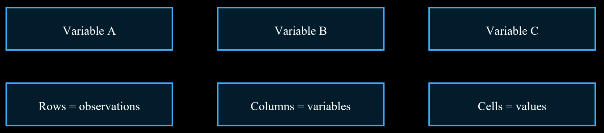

# Unit III: Data Loading, Storage and File Formats

> **Course Code:** `2501CS34` — Fundamentals of Data Science (FDS) | Aditya University  
> **Source PDF:** [`raw/FDS Complete 8-Mark Exam Notes.pdf`](raw/FDS%20Complete%208-Mark%20Exam%20Notes.pdf)  
> **Questions File:** [questions.md — Unit III](questions.md#unit-iii-data-loading-storage-and-file-formats)

---

## 1. Describe the methods used to read and write data in text files.

**Definition:** Text files store information as readable characters. Common examples include TXT, CSV and log files. Reading loads file contents into a program; writing saves program output to a file.

### Common methods in Python
* **`open()`:** Opens a file. Common modes are `'r'` for reading, `'w'` for writing (overwrites), `'a'` for appending and `'x'` for creating a new file.
* **`read()`:** Reads the full file or a specified number of characters.
* **`readline()`:** Reads one line at a time.
* **`readlines()`:** Returns lines as a list.
* **`write()`:** Writes a string to a file.
* **`writelines()`:** Writes a sequence of strings.

### Example
```python
# Reading a file
with open("notes.txt", "r", encoding="utf-8") as f:
    content = f.read()

# Writing a file
with open("output.txt", "w", encoding="utf-8") as f:
    f.write("Data Science")

# Appending
with open("output.txt", "a", encoding="utf-8") as f:
    f.write("\nNew line")
```

### Good practices
* Use `with open()` so the file closes automatically.
* Choose the correct file path and mode.
* Specify encoding such as UTF-8 for text.
* Handle possible errors such as missing files or permission problems.
* Avoid mode `'w'` when existing contents must be preserved.

**Applications:** Reading configuration files, processing logs, storing reports and exchanging simple data between programs.


**Conclusion:** Python file methods make it easy to read, create and update text files. The correct mode and safe file handling are important.

---

## 2. Explain how a large text file can be read in pieces.

**Definition:** Reading a large text file in pieces means processing a file in smaller parts instead of loading the entire file into memory at once.

### Methods
* **Line-by-line reading:** Loop through the file object. Each line is read when needed, which is memory efficient.
* **Fixed-size chunks:** Use `read(size)` to read a specified number of characters or bytes at a time.
* **Chunked data loading:** For tabular CSV data, Pandas `read_csv()` supports `chunksize` to return smaller portions.

### Python examples
```python
# Read one line at a time
with open("large.txt", "r", encoding="utf-8") as f:
    for line in f:
        process(line)

# Read fixed-size chunks
with open("large.txt", "r", encoding="utf-8") as f:
    while True:
        chunk = f.read(4096)
        if not chunk:
            break
        process(chunk)
```

### Pandas CSV example
```python
import pandas as pd
for part in pd.read_csv('large.csv', chunksize=1000):
    process(part)
```
Here, the file is processed in groups of 1,000 rows rather than being loaded all at once.

**Advantages:** Uses less memory, can handle files larger than available memory, and allows processing to begin before the full file is read.


**Conclusion:** Line-by-line, fixed-size and chunk-based reading are useful methods for handling large files efficiently.

---

## 3. Demonstrate how to work with delimited data formats using a suitable example.

**Definition:** A delimited file stores values separated by a special character called a delimiter. CSV commonly uses commas; TSV uses tabs. Other delimiters include semicolons and pipes.

### Structure and features
* Each line usually represents one record.
* The delimiter separates fields or columns.
* The first row may contain column headings.
* Text values containing delimiters may be enclosed in quotation marks.
* The format is simple and widely supported, but data types may need to be inferred or specified.

### CSV example
```text
RollNo,Name,Marks
101,Asha,85
102,Ravi,78
```

### Read using Python csv module
```python
import csv
with open("students.csv", newline="") as f:
    reader = csv.DictReader(f)
    for row in reader:
        print(row["Name"], row["Marks"])
```

### Using Pandas
```python
import pandas as pd
df = pd.read_csv('students.csv')
df.to_csv('result.csv', index=False)

# For tab-separated data
df_tsv = pd.read_csv('data.tsv', sep='\t')

# For a pipe delimiter
df_pipe = pd.read_csv('data.txt', sep='|')
```

**Advantages and limitations:** Delimited formats are portable, readable and easy to exchange. However, they may not preserve complex data types or nested structures, and delimiters/quoting must be handled correctly.



**Conclusion:** CSV and other delimited formats are useful for exchanging tabular data between applications.

---

## 4. Describe the structure and uses of JSON data format with a suitable example.

**Definition:** JSON (JavaScript Object Notation) is a lightweight text-based data format used to store and exchange structured information. It is language-independent and widely used in web applications and APIs.

### JSON structure
* **Object:** A collection of key-value pairs enclosed in curly brackets `{ }`.
* **Array:** An ordered list of values enclosed in square brackets `[ ]`.
* **Values:** Can be strings, numbers, objects, arrays, true, false or null.
* **Keys:** Are strings and are written in double quotation marks.

### Example JSON
```json
{
  "student_id": 101,
  "name": "Asha",
  "marks": 85,
  "subjects": ["FDS", "DBMS"],
  "passed": true
}
```

### Reading and writing JSON in Python
```python
import json

# Reading from a JSON file
with open('student.json', 'r') as f:
    data = json.load(f)

# Writing to a JSON file
with open('new.json', 'w') as f:
    json.dump(data, f, indent=4)

# String serialization/deserialization
# json.loads(text) converts a JSON string to a Python object
# json.dumps(data) converts a Python object to a JSON string
```

**Uses:** Web APIs, application configuration, data exchange between services, storing nested records and transferring information between different programming languages.

**Advantages:** Human-readable, compact, supports nested structures and is widely supported.  
**Limitation:** It is text-based and may be less efficient than binary formats for some large or complex datasets.


**Conclusion:** JSON is a common format for exchanging structured data, especially in web and API-based systems.

---

## 5. Classify the main features of HTML and XML data format with suitable examples.

**Overview:** HTML (HyperText Markup Language) is used to structure and display content on web pages. XML (Extensible Markup Language) is used to store and transport structured data with user-defined tags.

### HTML features
* Uses predefined tags such as `<html>`, `<head>`, `<body>`, `<p>` and `<a>`.
* Describes the structure of a web page, including headings, paragraphs, links, images and tables.
* Browsers interpret HTML to display content.
* HTML focuses on presentation and page structure.

#### HTML example
```html
<html>
<body>
<h1>Student Details</h1>
<p>Name: Asha</p>
</body>
</html>
```

### XML features
* Allows users to define meaningful tags.
* Stores data in a hierarchical, tree-like structure.
* Tags must be properly nested and closed.
* XML is case-sensitive and designed to describe and transport data.
* Attributes can provide additional information about elements.

#### XML example
```xml
<student>
    <id>101</id>
    <name>Asha</name>
    <marks>85</marks>
</student>
```

**Difference:** HTML uses a standard set of tags and focuses on displaying content. XML allows custom tags and focuses on describing and transporting data. HTML is generally used for web pages; XML is used for structured data exchange and configuration.

**Conclusion:** HTML presents information to users, while XML describes structured information for storage and exchange.

---

## 6. Demonstrate the process of collecting data from a web page using web scraping.

**Definition:** Web scraping is the process of extracting information from web pages and converting it into a structured form for analysis. It should be performed only where permitted and in accordance with the website's terms and access rules.

### Steps involved
1. **Identify the page:** Select a page that publicly provides the required information and permits automated access.
2. **Check rules:** Review the website terms, `robots.txt` guidance, rate limits and applicable privacy requirements.
3. **Send a request:** A program may request the page using an HTTP library.
4. **Parse HTML:** Use an HTML parser such as BeautifulSoup to examine the page structure.
5. **Extract fields:** Select required text, links or table values using appropriate tags or selectors.
6. **Clean and store:** Remove unwanted spaces, validate fields and save results as CSV or JSON.

### Illustrative Python example
```python
import requests
from bs4 import BeautifulSoup

url = "https://example.com"
response = requests.get(url, timeout=10)
response.raise_for_status()

soup = BeautifulSoup(response.text, "html.parser")
title = soup.title.get_text(strip=True)
print(title)
```
*This example reads a page title from a permitted example page; it does not bypass access controls.*

### Uses and advantages
* Collecting public product descriptions or public notices where permitted.
* Monitoring publicly available information within allowed limits.
* Creating datasets for research and text analysis.
* Reduces repetitive manual copying.

**Limitations and precautions:** Websites may change their structure, block automated requests or restrict reuse. Do not collect private or personal information without a valid basis. Use reasonable request rates and prefer official APIs when available.


**Conclusion:** Web scraping turns permitted web content into structured data through requesting, parsing, extraction, cleaning and storage.

---

## 7. Distinguish between Binary data formats such as HDF5 and traditional file formats. Indicate their advantages and suitable use cases.

**Definition:** A binary data format stores information as bytes in a structured machine-readable representation. HDF5 (Hierarchical Data Format version 5) is a binary format designed to store and organize large and complex scientific datasets.

### HDF5 features
* Stores datasets and groups in a hierarchical structure, similar to folders and files.
* Can store large numerical arrays and metadata.
* Supports compression and chunked storage.
* Allows selected portions of a dataset to be accessed without reading everything.
* Can organize related datasets in one file.

**Traditional formats:** CSV and plain text are human-readable and easy to exchange. JSON and XML are text-based formats that can represent structured or nested data. These formats are often convenient for small and medium datasets and interoperability.

### Comparison
* **Readability:** CSV/text can be opened in a text editor; HDF5 is binary and usually needs a suitable library or viewer.
* **Structure:** CSV is mainly tabular; HDF5 supports groups, datasets and metadata.
* **Performance:** HDF5 can efficiently handle large numerical data and partial access; performance depends on layout and workload.
* **Portability:** CSV and JSON are widely readable; HDF5 requires compatible software.
* **Size:** HDF5 may reduce storage through compression, while text formats can be larger for numerical data.

**Suitable use cases:** Use CSV for simple tables and data exchange; JSON for API messages and nested records; HDF5 for large scientific arrays, simulations, sensor measurements and research datasets.


**Conclusion:** Text formats prioritize readability and exchange, while HDF5 provides structured and efficient storage for large, complex datasets.

---

## 8. Apply NoSQL MongoDB CRUD operations to store and retrieve by taking suitable data as an example.

**Definition:** MongoDB is a NoSQL, document-oriented database. It stores records as BSON documents (a binary representation similar to JSON) inside collections. CRUD means Create, Read, Update and Delete.

### Example collection
Assume a collection named `students`. A document may contain:
```json
{
  "rollNo": 101,
  "name": "Asha",
  "marks": 85
}
```

### Operations
* **Create:** Insert a new document using `insertOne()` or multiple documents using `insertMany()`.
* **Read:** Retrieve documents using `find()` or one document using `findOne()`.
* **Update:** Change fields using `updateOne()` or `updateMany()`, commonly with `$set`.
* **Delete:** Remove a document using `deleteOne()` or multiple documents using `deleteMany()`.

### MongoDB commands
```javascript
use college

// CREATE
db.students.insertOne({rollNo: 101, name: "Asha", marks: 85})

// READ
db.students.find({rollNo: 101})

// UPDATE
db.students.updateOne(
  {rollNo: 101},
  {$set: {marks: 90}}
)

// DELETE
db.students.deleteOne({rollNo: 101})
```

### Advantages
* Flexible document structure supports records with different fields.
* Documents can represent nested objects and arrays.
* CRUD operations are straightforward.
* Can be suitable for applications with changing data structures.

**Important points:** Use appropriate filters to avoid updating or deleting unintended documents. Add indexes for frequently searched fields when needed. Plan validation and access control for reliable database use.


**Conclusion:** MongoDB CRUD operations allow users to insert, retrieve, modify and remove documents in a collection.
