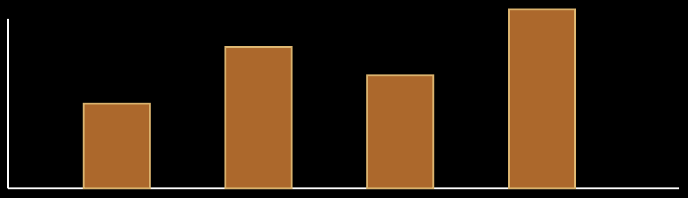

# Unit IV: Exploratory Data Analysis

> **Course Code:** `2501CS34` — Fundamentals of Data Science (FDS) | Aditya University  
> **Source PDF:** [`raw/FDS Complete 8-Mark Exam Notes.pdf`](raw/FDS%20Complete%208-Mark%20Exam%20Notes.pdf)  
> **Questions File:** [questions.md — Unit IV](questions.md#unit-iv-exploratory-data-analysis)

---

## 1. Describe the commonly used measures of descriptive statistics with suitable examples.

**Definition:** Descriptive statistics are numerical methods used to summarize and describe the main features of a dataset. They help explain the centre, spread and shape of data.

### Measures of central tendency
* **Mean:** Sum of all values divided by the number of values.  
  $$\text{Mean} = \frac{\sum x}{n}$$  
  *Example:* for 2, 4, 6, $\text{mean} = 12/3 = 4$.
* **Median:** Middle value after arranging data in order. For 2, 4, 6, $\text{median} = 4$. For an even number of values, it is the average of the two middle values.
* **Mode:** Most frequently occurring value. *Example:* 2, 3, 3, 5 has mode 3.

### Measures of dispersion
* **Range:** $\text{Maximum} - \text{Minimum}$. For 2, 4, 6, $\text{range} = 4$.
* **Variance:** Measures average squared deviation from the mean.  
  $$\text{Population variance: } \sigma^2 = \frac{\sum (x - \mu)^2}{N}$$
* **Standard deviation:** The square root of variance: $\sigma = \sqrt{\sigma^2}$.
* **Interquartile range (IQR):** $\text{IQR} = Q_3 - Q_1$; it measures the spread of the middle 50% of values.

### Other useful measures
* **Quartiles:** Divide ordered data into four parts.
* **Percentiles:** Indicate the value below which a specified percentage of observations falls.
* **Skewness:** Describes asymmetry in a distribution.
* **Count and frequency:** Show how many observations or occurrences are present.

**Example:** For marks 2, 4, 4, 6, 9: $\text{mean} = 5$, $\text{median} = 4$, $\text{mode} = 4$ and $\text{range} = 9 - 2 = 7$. These measures describe different aspects of the same dataset.



**Conclusion:** Central tendency describes a typical value, while dispersion describes variation. Using several measures gives a clearer summary than using only the mean.

---

## 2. Demonstrate different data visualization techniques used in Exploratory Data Analysis with suitable examples.

**Definition:** Data visualization is the graphical representation of information. In Exploratory Data Analysis (EDA), charts help identify distributions, comparisons, relationships, trends and unusual observations.

### Common visualization techniques
* **Bar chart:** Compares values across categories. *Example:* number of students in each department.
* **Histogram:** Shows the distribution of numerical data using intervals or bins. *Example:* distribution of exam marks.
* **Line chart:** Shows changes over time. *Example:* monthly sales.
* **Pie chart:** Shows parts of a whole when there are a small number of categories. *Example:* share of expenses by category.
* **Scatter plot:** Shows the relationship between two numerical variables. *Example:* study hours and marks.
* **Box plot:** Displays median, quartiles, spread and possible outliers. *Example:* comparing marks across classes.
* **Heatmap:** Uses colour intensity to show values in a matrix. *Example:* correlation between numerical features.

### Example using Python
```python
import matplotlib.pyplot as plt

months = ["Jan", "Feb", "Mar"]
sales = [20, 30, 25]

plt.plot(months, sales)
plt.xlabel("Month")
plt.ylabel("Sales")
plt.title("Monthly Sales")
plt.show()
```

### Benefits and good practices
* Makes large amounts of data easier to understand.
* Helps detect trends, clusters and unusual values.
* Supports comparison between groups.
* Use clear titles, axis labels and units.
* Choose a chart that matches the data; avoid misleading scales and unnecessary decoration.


**Conclusion:** Different charts answer different questions. Selecting the correct visualization is an important part of effective EDA.

---

## 3. Analyze the correlation and covariance techniques by using suitable example.

**Definition:** Covariance and correlation are statistical measures used to describe how two numerical variables change together.

### Covariance
* Indicates the direction of joint variation between two variables.
* Positive covariance means the variables tend to move in the same direction.
* Negative covariance means one tends to increase when the other decreases.
* A value near zero indicates little linear co-variation, though a non-linear relationship may still exist.
* **Population covariance formula:**
  $$\text{Cov}(X, Y) = \frac{\sum (x_i - \mu_x)(y_i - \mu_y)}{N}$$

### Correlation
Pearson correlation standardizes covariance to a value between $-1$ and $+1$.
* **Formula:**
  $$r = \frac{\text{Cov}(X, Y)}{\sigma_x \times \sigma_y}$$
* $r = +1$ indicates perfect positive linear relationship.
* $r = -1$ indicates perfect negative linear relationship.
* $r$ near $0$ indicates weak or no linear relationship.

### Example and interpretation
* Suppose study hours and marks are recorded for students. If students who study more generally obtain higher marks, the variables may show positive covariance and positive correlation.
* If outdoor temperature rises while heater usage falls, the variables may show negative correlation.
* Correlation describes association; it does not prove that one variable causes the other.

**Difference:** Covariance depends on the units and scale of the variables, so its size is difficult to compare across datasets. Correlation is unit-free and always lies between $-1$ and $+1$, making it easier to interpret.

**Applications:** Feature analysis, finance, scientific research, quality monitoring and identifying related variables. Check scatter plots and possible outliers before interpreting correlation.


**Conclusion:** Covariance shows the direction of joint movement; correlation gives a standardized measure of the strength and direction of a linear relationship.

---

## 4. Differentiate between Univariate, Bivariate and Multivariate analysis with suitable examples.

**Definition:** Statistical analysis can be classified by the number of variables studied at one time: univariate uses one variable, bivariate uses two variables and multivariate uses more than two variables.

### Univariate analysis
* Studies one variable at a time.
* **Purpose:** describe its distribution, centre and spread.
* **Methods:** frequency table, mean, median, mode, histogram and box plot.
* **Example:** analysing only the marks of students in one subject.

### Bivariate analysis
Studies two variables to understand whether they are related or how they differ together. Methods include scatter plots, correlation, cross-tabulation and grouped comparisons.  
*Example:* study hours and exam marks.

### Multivariate analysis
* Studies three or more variables together.
* Helps understand combined relationships and complex patterns.
* Methods may include multiple regression, principal component analysis and clustering.
* *Example:* studying marks using attendance, study hours, assignment scores and sleep duration together.

### Comparison table
| Analysis Type | Number of Variables | Primary Objective | Example |
| :--- | :---: | :--- | :--- |
| **Univariate** | 1 | Describes one feature in isolation | Age distribution |
| **Bivariate** | 2 | Examines association or comparison | Age and income |
| **Multivariate** | 3 or more | Examines combined patterns and interactions | Income, age, education, and spending |

**Importance:** Univariate analysis is a useful first step; bivariate analysis explores relationships; multivariate analysis considers several factors at once. The choice depends on the question and data.


**Conclusion:** The main difference is the number of variables analysed and the type of question being answered.

---

## 5. Analyze a dataset to identify possible Anomalies and Pattern Detection.

**Definition:** An anomaly is an observation that differs noticeably from the general behaviour of the data. Pattern detection is the process of finding repeated trends, relationships, groups or structures in a dataset.

### Steps to identify anomalies and patterns
1. **Understand the data:** Check the meaning of columns, units, data types and expected ranges.
2. **Clean the data:** Correct obvious errors and handle missing or duplicate records.
3. **Summarize:** Calculate mean, median, standard deviation, quartiles and frequencies.
4. **Visualize:** Use histograms, box plots, scatter plots and line charts to inspect distributions and trends.
5. **Apply detection methods:** Use IQR, Z-scores or suitable clustering/anomaly-detection methods.
6. **Investigate:** Check whether unusual observations are errors, rare valid events or important changes.
7. **Report:** Explain the detected patterns and limitations.

**IQR method:**
$$\text{IQR} = Q_3 - Q_1$$
A common rule flags values below $Q_1 - 1.5 \times \text{IQR}$ or above $Q_3 + 1.5 \times \text{IQR}$ as possible outliers. These are flags for investigation, not automatic proof of error.

### Pattern detection examples
* **Trend:** Sales increase over several months.
* **Seasonality:** Ice-cream sales rise during hotter months.
* **Association:** Two variables tend to change together.
* **Clusters:** Customers form groups with similar purchase behaviour.
* **Repeated behaviour:** A machine shows a similar usage pattern every day.

**Example:** In daily electricity readings, most values may lie within a normal range. A sudden unusually high reading can be flagged. It may indicate a faulty sensor, a special event or a genuine increase in usage, so it should be checked before any conclusion.

**Applications:** Fraud monitoring, equipment maintenance, quality control, network monitoring, sales analysis and scientific research.  
**Precaution:** An unusual value is not necessarily wrong; domain knowledge is essential.


**Conclusion:** Visualization and statistical methods help reveal anomalies and patterns, while careful investigation gives them meaning.
