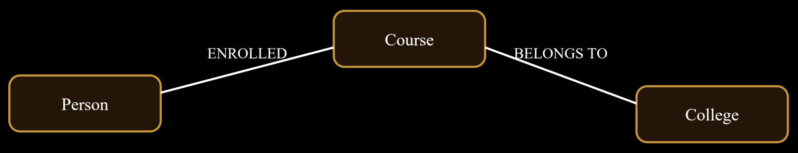
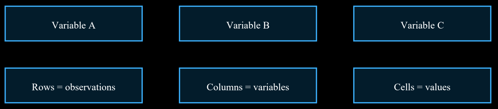

# Unit V: Data Science Tools

> **Course Code:** `2501CS34` — Fundamentals of Data Science (FDS) | Aditya University  
> **Source PDF:** [`raw/FDS Complete 8-Mark Exam Notes.pdf`](raw/FDS%20Complete%208-Mark%20Exam%20Notes.pdf)  
> **Questions File:** [questions.md — Unit V](questions.md#unit-v-data-science-tools)

---

## 1. Describe Neo4j and its basic features as a graph database.

**Definition:** Neo4j is a graph database that stores information as nodes, relationships and properties. It is designed for data where connections between entities are important.

### Basic components
* **Nodes:** Represent entities such as Person, Student, Course or Company.
* **Relationships:** Connect nodes and describe how they are related. They have a type and direction, such as `ENROLLED_IN` or `FRIEND_OF`.
* **Properties:** Key-value information stored on nodes or relationships, such as name, age or since-year.
* **Labels:** Identify the type or category of a node, such as `:Student` or `:Course`.

**Example:** A student node can be connected to a course node through an `ENROLLED_IN` relationship. The student node may have properties such as name and roll number.

### Features and advantages
* Stores relationships directly, making connected-data queries natural.
* Uses the property graph model of nodes, relationships and properties.
* Supports the Cypher query language.
* Useful for traversing multi-step relationships.
* Can represent connected data such as social networks, recommendation systems and fraud links.

**Applications:** Social networks, recommendation engines, identity and access management, knowledge graphs, network analysis and fraud investigation.


**Conclusion:** Neo4j is suitable when relationships are central to the problem and users need to explore connections between entities.

---

## 2. Demonstrate basic Cypher queries with suitable examples.

**Definition:** Cypher is the declarative query language used with Neo4j to create, find, update and delete graph data. It describes patterns of nodes and relationships.

### Basic commands
* **`CREATE`:** Creates nodes and relationships.
* **`MATCH`:** Finds graph patterns that match the given condition.
* **`RETURN`:** Displays selected results.
* **`WHERE`:** Filters results using a condition.
* **`SET`:** Adds or changes properties.
* **`DELETE` / `DETACH DELETE`:** Deletes relationships or nodes; `DETACH DELETE` also removes relationships attached to the node.
* **`MERGE`:** Matches an existing pattern or creates it if it does not exist.

### Example queries
```cypher
// Create a student node
CREATE (s:Student {name: 'Asha', rollNo: 101})

// Create a course node and relationship
CREATE (c:Course {name: 'FDS'})
CREATE (s)-[:ENROLLED_IN]->(c)

// Find all students
MATCH (s:Student) 
RETURN s

// Filter students
MATCH (s:Student)
WHERE s.rollNo = 101
RETURN s.name

// Update a property
MATCH (s:Student {rollNo: 101})
SET s.marks = 90
RETURN s

// Delete a selected node and its relationships
MATCH (s:Student {rollNo: 101})
DETACH DELETE s
```

### Understanding pattern symbols
* `(s:Student)` represents a node with variable `s` and label `Student`.
* `-[:ENROLLED_IN]->` represents a directed relationship.
* `{name: 'Asha'}` represents node properties.

**Advantages:** Queries are readable, graph patterns are expressive, and connected records can be explored directly.  
**Precaution:** Always use appropriate `MATCH` conditions before changing or deleting data.



**Conclusion:** Cypher provides a simple pattern-based way to work with Neo4j graph data.

---

## 3. Describe the role of NLTK in text mining and analytics with suitable examples.

**Definition:** NLTK (Natural Language Toolkit) is a Python library that provides tools for processing and analysing human language text. It is commonly used in natural language processing (NLP) and text mining.

### Important NLTK tasks
* **Tokenization:** Splits text into sentences or words. *Example:* `'Data is useful'` becomes `['Data', 'is', 'useful']`.
* **Stop-word removal:** Removes common words such as `'the'`, `'is'` and `'and'` when they are not useful for a task.
* **Stemming:** Reduces words to a stem, often by removing endings. *Example:* `'playing'` may become `'play'`.
* **Lemmatization:** Converts words to a dictionary base form using linguistic information.
* **Part-of-speech tagging:** Identifies grammatical roles such as noun, verb and adjective.
* **Named entity recognition:** Identifies names of people, places and organizations, using suitable NLTK components or models.
* **Frequency analysis:** Counts how often words occur in a document.

### Python example
```python
import nltk
from nltk.tokenize import word_tokenize
from nltk.corpus import stopwords

text = "Data science is useful for analysis"
words = word_tokenize(text)

stop = set(stopwords.words("english"))
filtered = [w for w in words if w.lower() not in stop]

print(filtered)
```
*The example tokenizes a sentence and removes common English stop words. Required NLTK datasets may need to be downloaded separately (`nltk.download('punkt')`, `nltk.download('stopwords')`).*

### Applications
* Sentiment analysis of product reviews.
* Text classification, such as sorting messages by topic.
* Keyword and frequency analysis.
* Preparing text for machine-learning models.
* Studying language patterns in documents.

**Advantages and limitations:** NLTK is open-source, educational and offers many NLP tools. Some modern tasks may require additional libraries and trained models. Text cleaning choices depend on language and task.


**Conclusion:** NLTK helps convert raw text into a form that can be explored, summarized and used for text analytics.

---

## 4. Analyze the differences between Neo4j and SQLite based on their data models and uses.

**Definition:** Neo4j is a graph database that stores connected entities as nodes and relationships. SQLite is a lightweight relational database that stores data in tables with rows and columns.

### Comparison
* **Data model:** Neo4j uses nodes, relationships and properties; SQLite uses tables, rows, columns and relational keys.
* **Relationships:** Neo4j stores relationships as first-class graph elements; SQLite represents relationships using primary and foreign keys and joins.
* **Query language:** Neo4j commonly uses Cypher; SQLite uses SQL.
* **Best suited for:** Neo4j is useful for highly connected data; SQLite is useful for structured tabular data and embedded applications.
* **Typical uses:**
  * **Neo4j:** social networks, recommendations and network analysis.
  * **SQLite:** mobile apps, desktop software, small databases and local storage.
* **Deployment:** SQLite is serverless and stores a database in a file; Neo4j is a graph database platform commonly run as a database service or managed instance.

**Example:** A social network that frequently explores friend-of-friend connections may benefit from Neo4j. A student marks application with tables for Students, Subjects and Marks can use SQLite.

### Advantages
* Neo4j makes multi-hop relationship queries natural.
* SQLite is simple to set up, lightweight and does not require a separate database server.
* Both can store persistent data and support queries, but their structures suit different needs.

**Selection:** Choose based on the data model, query patterns, scale, deployment needs, team skills and maintenance requirements. They are not direct replacements for every use case.




**Conclusion:** Neo4j focuses on relationships in graph data, while SQLite focuses on structured relational tables.

---

## 5. Apply different tools used for text analytics and review the use of SQLite in managing text-based data.

**Definition:** Text analytics is the process of extracting useful information, patterns and insights from text. SQLite is a lightweight relational database that can store and manage text records in tables.

### Tools used for text analytics
* **NLTK:** Supports tokenization, stop-word removal, stemming, lemmatization and linguistic analysis.
* **spaCy:** Provides efficient NLP tools such as tokenization, part-of-speech tagging and named entity recognition.
* **TextBlob:** Offers simple interfaces for basic text processing and sentiment-related tasks.
* **Scikit-learn:** Supports text feature extraction such as CountVectorizer and TF-IDF, and machine-learning classification.
* **Pandas:** Helps load, clean, filter and summarize text datasets.

**Typical text analytics process:** Collect text, clean it, tokenize it, remove or normalize selected terms, convert text into numerical features, analyse or classify it, and interpret the results.

### Role of SQLite
* Stores text in columns with the `TEXT` data type.
* Organizes records in tables and supports SQL queries.
* Can filter, search, sort and group text records.
* Supports transactions and indexes for suitable workloads.
* Useful for local applications and small-to-medium text collections.

### SQLite example
```sql
CREATE TABLE reviews (
    id INTEGER PRIMARY KEY,
    review_text TEXT,
    rating INTEGER
);

INSERT INTO reviews (review_text, rating)
VALUES ('Good service', 5);

SELECT review_text, rating
FROM reviews
WHERE rating >= 4;
```

**Advantages and limitations:** SQLite is easy to use, portable and serverless. It is useful for storing text records and metadata, but advanced NLP analysis is usually performed with Python libraries. Large multi-user or distributed systems may require a different database design.


**Conclusion:** Text analytics tools process and analyse language, while SQLite can reliably organize and retrieve the text records used in that workflow.
