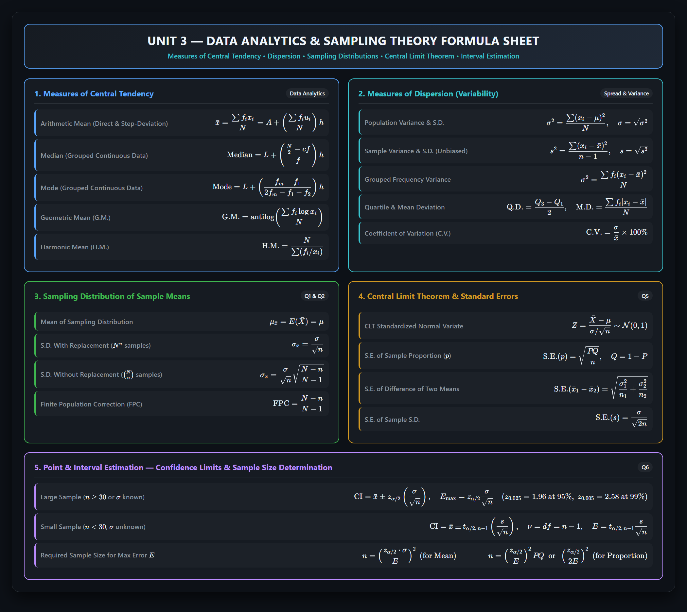
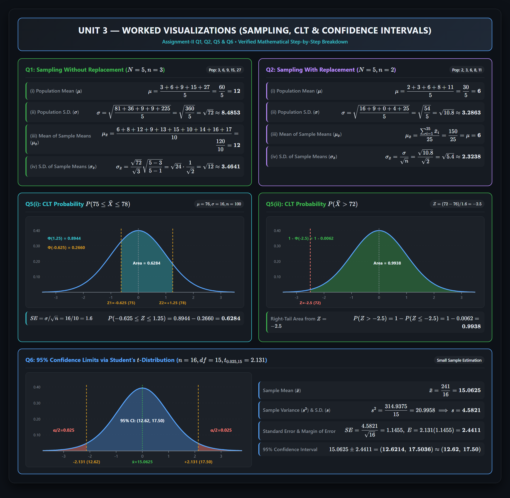

# Unit 3 — Data Analytics and Sampling Theory

Complete exam-ready questions and worked solutions for **Unit-III** of Probability & Statistics (Aditya University / JNTU curriculum).

---

## Visual Formula Sheet & Cheatsheet



---

## Visual Worked Solutions (Sampling, CLT & Estimation)



---

## Quick Navigation / Table of Contents

| Section | Topic | Question Source | Key Result |
|:---|:---|:---|:---|
| [**Question 1**](#question-1--sampling-distribution-without-replacement) | Sampling Distribution without Replacement ($N=5, n=3$) | Assignment-II Q1 | $\mu=12, \sigma \approx 8.49, \mu_{\bar{x}}=12, \sigma_{\bar{x}} \approx 3.46$ |
| [**Question 2**](#question-2--sampling-distribution-with-replacement) | Sampling Distribution with Replacement ($N=5, n=2$) | Assignment-II Q2 | $\mu=6, \sigma \approx 3.29, \mu_{\bar{x}}=6, \sigma_{\bar{x}} \approx 2.32$ |
| [**Question 3**](#question-3--median-for-grouped-frequency-distribution) | Median for Grouped Frequency Table ($N=44$) | Assignment-II Q3 | $\text{Median} = 64.5$ |
| [**Question 4**](#question-4--types-of-data-and-methods-of-collection) | Types of Data & Methods of Data Collection | Assignment-II Q4 | Primary vs. Secondary, Qualitative vs. Quantitative |
| [**Question 5**](#question-5--central-limit-theorem-probabilities) | Central Limit Theorem Probabilities ($n=100, \mu=76, \sigma=16$) | Assignment-II Q5 | $P(75 < \bar{X} < 78) = 0.6284, P(\bar{X} > 72) = 0.9938$ |
| [**Question 6**](#question-6--95-confidence-limits-for-population-mean) | 95% Confidence Limits for Mean ($n=16$, Small Sample $t$) | Assignment-II Q6 | $95\% \text{ CI} = (12.62, 17.50)$ |
| [**Supplementary Section**](#supplementary-unit-3-core-topics-measures-of-central-tendency--dispersion) | Central Tendency & Dispersion Review | Core Topics | Formulae, Geometric & Harmonic Mean |

---

## Question 1 — Sampling Distribution Without Replacement

**Question:** A population consists of five numbers $3, 6, 9, 15$, and $27$. Consider all possible samples of size $3$ that can be drawn without replacement from this population. Find:
1. The population mean ($\mu$)
2. The population standard deviation ($\sigma$)
3. The mean of the sampling distribution of sample means ($\mu_{\bar{x}}$)
4. The standard deviation of the sampling distribution of sample means ($\sigma_{\bar{x}}$)

---

### Step-by-Step Solution

#### 1. Population Mean ($\mu$)
Given population values: $X = \{3, 6, 9, 15, 27\}$, population size $N = 5$.

$$\sum_{i=1}^{5} x_i = 3 + 6 + 9 + 15 + 27 = 60$$

$$\mu = \frac{\sum x_i}{N} = \frac{60}{5} = \mathbf{12}$$

#### 2. Population Standard Deviation ($\sigma$)
Deviation of each population element from $\mu = 12$:

| $x_i$ | $(x_i - \mu)$ | $(x_i - \mu)^2$ |
|:---:|:---:|:---:|
| 3 | $3 - 12 = -9$ | 81 |
| 6 | $6 - 12 = -6$ | 36 |
| 9 | $9 - 12 = -3$ | 9 |
| 15 | $15 - 12 = +3$ | 9 |
| 27 | $27 - 12 = +15$ | 225 |
| **Total** | **0** | **360** |

$$\sigma^2 = \frac{\sum (x_i - \mu)^2}{N} = \frac{360}{5} = 72$$

$$\sigma = \sqrt{72} = 6\sqrt{2} \approx \mathbf{8.4853} \quad (\approx 8.49)$$

#### 3. All Possible Samples of Size $n = 3$ Without Replacement
Number of possible samples drawn without replacement:

$$\binom{N}{n} = \binom{5}{3} = \frac{5!}{3! \, 2!} = \frac{5 \times 4}{2 \times 1} = 10 \text{ samples}$$

The 10 possible samples and their sample means ($\bar{x}$):

| Sample No. | Sample Elements | Sum ($\sum x$) | Sample Mean $\bar{x} = \frac{\sum x}{3}$ |
|:---:|:---:|:---:|:---:|
| 1 | $(3, 6, 9)$ | 18 | $\mathbf{6.0}$ |
| 2 | $(3, 6, 15)$ | 24 | $\mathbf{8.0}$ |
| 3 | $(3, 6, 27)$ | 36 | $\mathbf{12.0}$ |
| 4 | $(3, 9, 15)$ | 27 | $\mathbf{9.0}$ |
| 5 | $(3, 9, 27)$ | 39 | $\mathbf{13.0}$ |
| 6 | $(3, 15, 27)$ | 45 | $\mathbf{15.0}$ |
| 7 | $(6, 9, 15)$ | 30 | $\mathbf{10.0}$ |
| 8 | $(6, 9, 27)$ | 42 | $\mathbf{14.0}$ |
| 9 | $(6, 15, 27)$ | 48 | $\mathbf{16.0}$ |
| 10 | $(9, 15, 27)$ | 51 | $\mathbf{17.0}$ |
| **Total** | | | **120.0** |

Mean of the sampling distribution of means ($\mu_{\bar{x}}$):

$$\mu_{\bar{x}} = \frac{\sum_{i=1}^{10} \bar{x}_i}{10} = \frac{6 + 8 + 12 + 9 + 13 + 15 + 10 + 14 + 16 + 17}{10} = \frac{120}{10} = \mathbf{12}$$

This confirms the statistical theorem: $\mu_{\bar{x}} = \mu = 12$.

#### 4. Standard Deviation of the Sampling Distribution ($\sigma_{\bar{x}}$)

Using the standard formula for sampling without replacement (with Finite Population Correction):

$$\sigma_{\bar{x}} = \frac{\sigma}{\sqrt{n}} \sqrt{\frac{N - n}{N - 1}}$$

Substituting $\sigma = \sqrt{72}$, $n = 3$, and $N = 5$:

$$\sigma_{\bar{x}} = \frac{\sqrt{72}}{\sqrt{3}} \sqrt{\frac{5 - 3}{5 - 1}} = \sqrt{\frac{72}{3}} \sqrt{\frac{2}{4}} = \sqrt{24 \times \frac{1}{2}} = \sqrt{12} = 2\sqrt{3} \approx \mathbf{3.4641} \quad (\approx \mathbf{3.46})$$

> [!NOTE]
> **Correction Note:** In some lecture slides, the sum of squared deviations was miscalculated as $133$ ($\sigma_{\bar{x}} = 3.65$). The correct value is $\sigma_{\bar{x}} = \sqrt{12} \approx 3.46$.

---

## Question 2 — Sampling Distribution With Replacement

**Question:** A population consists of the numbers $2, 3, 6, 8$, and $11$. Consider all possible samples of size $2$ that can be drawn with replacement from this population. Find:
1. The population mean ($\mu$)
2. The population standard deviation ($\sigma$)
3. The mean of the sampling distribution of the means ($\mu_{\bar{x}}$)
4. The standard deviation of the sampling distribution of the means ($\sigma_{\bar{x}}$)

---

### Step-by-Step Solution

#### 1. Population Mean ($\mu$)
Given population values: $X = \{2, 3, 6, 8, 11\}$, population size $N = 5$.

$$\sum x_i = 2 + 3 + 6 + 8 + 11 = 30$$

$$\mu = \frac{30}{5} = \mathbf{6}$$

#### 2. Population Standard Deviation ($\sigma$)

$$\sum (x_i - \mu)^2 = (2-6)^2 + (3-6)^2 + (6-6)^2 + (8-6)^2 + (11-6)^2$$

$$= (-4)^2 + (-3)^2 + 0^2 + 2^2 + 5^2 = 16 + 9 + 0 + 4 + 25 = \mathbf{54}$$

$$\sigma^2 = \frac{54}{5} = \mathbf{10.8}$$

$$\sigma = \sqrt{10.8} \approx \mathbf{3.2863}$$

#### 3. All Possible Samples of Size $n = 2$ With Replacement
When sampling with replacement, the total number of possible ordered samples is:

$$N^n = 5^2 = 25 \text{ samples}$$

The 25 sample means $\bar{x} = \frac{x_1 + x_2}{2}$ can be represented in a $5 \times 5$ matrix:

| First Draw ($x_1$) \ Second Draw ($x_2$) | 2 | 3 | 6 | 8 | 11 | Row Sum |
|:---:|:---:|:---:|:---:|:---:|:---:|:---:|
| **2** | 2.0 | 2.5 | 4.0 | 5.0 | 6.5 | 20.0 |
| **3** | 2.5 | 3.0 | 4.5 | 5.5 | 7.0 | 22.5 |
| **6** | 4.0 | 4.5 | 6.0 | 7.0 | 8.5 | 30.0 |
| **8** | 5.0 | 5.5 | 7.0 | 8.0 | 9.5 | 35.0 |
| **11** | 6.5 | 7.0 | 8.5 | 9.5 | 11.0 | 42.5 |
| **Grand Total** | | | | | | **150.0** |

Mean of the sampling distribution of means:

$$\mu_{\bar{x}} = \frac{\sum_{i=1}^{25} \bar{x}_i}{25} = \frac{150}{25} = \mathbf{6}$$

Matches population mean $\mu = 6$.

#### 4. Standard Deviation of the Sampling Distribution ($\sigma_{\bar{x}}$)

Using the standard theoretical sampling formula for sampling with replacement:

$$\sigma_{\bar{x}} = \frac{\sigma}{\sqrt{n}}$$

Substituting $\sigma = \sqrt{10.8}$ and $n = 2$:

$$\sigma_{\bar{x}} = \frac{\sqrt{10.8}}{\sqrt{2}} = \sqrt{\frac{10.8}{2}} = \sqrt{5.4} \approx \mathbf{2.3238} \quad (\approx \mathbf{2.32})$$

---

## Question 3 — Median for Grouped Frequency Distribution

**Question:** Find the median for the following table:

| Group | 50–54 | 55–59 | 60–64 | 65–69 | 70–74 | 75–79 |
|:---|:---:|:---:|:---:|:---:|:---:|:---:|
| **Frequency ($f$)** | 4 | 8 | 10 | 9 | 7 | 6 |

---

### Step-by-Step Solution

#### 1. Convert to Continuous (Exclusive) Class Boundaries
The given intervals are discrete / inclusive (`50-54, 55-59, ...`).
The gap between upper limit of one class and lower limit of next class is $55 - 54 = 1$.
Half-gap correction factor $= \frac{1}{2} = 0.5$.
Subtract $0.5$ from lower limits and add $0.5$ to upper limits:

| Original Group | Continuous Class Boundary | Frequency ($f$) | Cumulative Frequency ($cf$) |
|:---:|:---:|:---:|:---:|
| 50–54 | 49.5 – 54.5 | 4 | 4 |
| 55–59 | 54.5 – 59.5 | 8 | 12 |
| **60–64** | **59.5 – 64.5** | **10** | **22** *(Median boundary)* |
| 65–69 | 64.5 – 69.5 | 9 | 31 |
| 70–74 | 69.5 – 74.5 | 7 | 38 |
| 75–79 | 74.5 – 79.5 | 6 | 44 ($N$) |

#### 2. Locate Median Class

$$\frac{N}{2} = \frac{44}{2} = 22$$

Looking at the cumulative frequency column:
The cumulative frequency reaches **exactly 22** at the end of class **$59.5 - 64.5$**.
Therefore, the median position falls precisely at the boundary $64.5$.

#### 3. Formula Application
Using the standard continuous median formula:

$$\text{Median} = L + \left[\frac{\frac{N}{2} - cf}{f}\right] \times h$$

Taking the class $59.5 - 64.5$:
- Lower boundary $L = 59.5$
- Preceding cumulative frequency $cf = 12$
- Class frequency $f = 10$
- Class width $h = 64.5 - 59.5 = 5$

$$\text{Median} = 59.5 + \left[\frac{22 - 12}{10}\right] \times 5 = 59.5 + \left[\frac{10}{10}\right] \times 5 = 59.5 + 5 = \mathbf{64.5}$$

*(Note: Applying the next class $64.5 - 69.5$ with $L = 64.5, cf = 22, f = 9$: $\text{Median} = 64.5 + \left[\frac{22 - 22}{9}\right] \times 5 = \mathbf{64.5}$. Both perspectives agree perfectly).*

---

## Question 4 — Types of Data and Methods of Collection

**Question:** What are the types of data? Explain the methods of collection of data.

---

### Comprehensive Theoretical Answer

### Part 1: Types of Data

In statistics, data represents observed facts, figures, and measurements collected for analysis and decision making.

```
                         DATA CLASSIFICATION
                       /                     \
       By Nature of Values                 By Source of Collection
       /                 \                 /                     \
  Quantitative       Qualitative       Primary Data          Secondary Data
  (Numerical)       (Categorical)     (Direct Firsthand)    (Pre-existing/Published)
   /        \        /         \
Discrete Continuous Nominal  Ordinal
```

#### A. Classification by Nature (Quantitative vs. Qualitative)
1. **Quantitative (Numerical) Data:** Data measured on a numeric scale representing quantities.
   - **Discrete Data:** Can only take specific, separate, countable values (whole numbers).
     - *Examples:* Number of defective items in a batch, number of students in a classroom ($n = 45$), number of phone calls per minute.
   - **Continuous Data:** Can take any value within a given continuous range, including fractions and decimals.
     - *Examples:* Student height ($172.5\text{ cm}$), weight ($68.4\text{ kg}$), temperature ($37.2^\circ\text{C}$), failure time of a component.
2. **Qualitative (Categorical) Data:** Data that describes qualities, characteristics, or attributes that cannot be measured directly with numbers.
   - **Nominal Data:** Categories with names or labels that have no natural ordering.
     - *Examples:* Gender (Male/Female), Blood Group (A, B, AB, O), Eye Color (Blue, Brown, Green).
   - **Ordinal Data:** Categories that possess a natural, meaningful rank or order, though differences between ranks cannot be quantified.
     - *Examples:* Customer satisfaction (Poor, Good, Excellent), Exam grade (Pass, Second Class, First Class, Distinction).

#### B. Classification by Experimental Role
- **Independent Variable ($X$):** The variable manipulated or controlled to test its effect on another variable.
- **Dependent Variable ($Y$):** The response variable observed or measured to see the outcome of the manipulation.
- **Controlled Variables:** Factors held constant throughout the experiment to prevent extraneous confounding effects.

#### C. Classification by Source
- **Primary Data:** Original data collected firsthand directly from respondents or natural phenomena specifically for the ongoing investigation.
- **Secondary Data:** Data that has already been collected, compiled, processed, or published by another agency or researcher for a prior purpose.

---

### Part 2: Methods of Data Collection

#### A. Methods of Collecting Primary Data
1. **Direct Personal Investigation (Personal Interviews):**
   - The investigator meets respondents face-to-face and records answers directly.
   - *Advantages:* Highest response rate, superior data accuracy, ability to clarify ambiguous questions.
   - *Demerits:* Costly, highly time-consuming, restricted to small geographical coverage, risk of interviewer bias.
2. **Indirect Oral Investigation:**
   - The investigator interviews third parties (witnesses, colleagues, community leaders) who possess knowledge about the subject.
   - *Use:* Utilized when direct respondents are uncooperative, illiterate, deceased, or reluctant to disclose information (e.g., crime inquiries, accident investigations).
3. **Information from Local Correspondents / Agents:**
   - Local agents or correspondents are appointed in various regions to gather and supply periodic information according to their local observation.
   - *Use:* Widely used by newspapers, television channels, agricultural forecasting boards, and commodity market reporters.
4. **Mailed Questionnaire / Digital Survey Method (Google Forms):**
   - A structured questionnaire containing clear, objective questions is distributed via postal mail, email, or web links (Google Forms, SurveyMonkey).
   - *Advantages:* Economical, covers wide geographical areas, eliminates interviewer bias, preserves respondent anonymity.
   - *Demerits:* Low response rate, lack of clarification on ambiguous questions, limited to literate populations.
5. **Schedules Sent Through Enumerators:**
   - Enumerators are specially trained personnel who carry questionnaire schedules, physically visit respondents, ask the questions, and record responses themselves.
   - *Use:* Used in National Population Censuses, government economic surveys, and large-scale industrial surveys.
6. **Direct Observation Method:**
   - Data is recorded by systematically viewing, monitoring, and noting behavioral events, physical interactions, or operational workflows without actively questioning subjects.
   - *Use:* Traffic flow analysis at intersections, wildlife behavioral tracking, retail store shopper foot-traffic studies.
7. **Experimental Method:**
   - Controlled laboratory or field trials where independent variables are manipulated and effects on dependent variables are recorded (e.g., clinical drug trials, agricultural fertilizer yield tests).

#### B. Sources of Secondary Data
1. **Published Sources:**
   - Official publications of central and state governments (Reserve Bank of India Bulletins, Census reports, National Sample Survey reports).
   - International publications (WHO, World Bank, UNESCO, IMF).
   - Trade association journals, academic peer-reviewed research papers, financial reports of registered companies.
2. **Unpublished Sources:**
   - Internal business records (sales ledgers, customer transaction histories, warranty logbooks), unpublished university dissertations, hospital case records, private survey firm archives.

---

### Comparison: Primary Data vs. Secondary Data

| Basis | Primary Data | Secondary Data |
|:---|:---|:---|
| **Originality** | Highly original; gathered directly from the source. | Not original; borrowed from pre-existing records. |
| **Cost & Time** | Expensive, resource-intensive, and time-consuming. | Economical, rapid, and easily accessible. |
| **Reliability & Accuracy** | High; investigator controls measurement precision and definitions. | Variable; dependent on original collector's methodology and bias. |
| **Form of Data** | Raw, unorganized, crude format needing cleaning and aggregation. | Structured, refined, tabulated, and summarized. |

---

## Question 5 — Central Limit Theorem Probabilities

**Question:** A random sample of size $100$ is taken from an infinite population having the mean $\mu = 76$ and the variance $\sigma^2 = 256$. Find the probability that the sample mean ($\bar{X}$) will:
1. Lie between $75$ and $78$
2. Be more than $72$

---

### Step-by-Step Solution

#### 1. Given Parameters
- Population mean: $\mu = 76$
- Population variance: $\sigma^2 = 256 \implies \text{Population S.D. } \sigma = \sqrt{256} = 16$
- Sample size: $n = 100$ ($n \ge 30$, large sample)

By the **Central Limit Theorem (CLT)**, the sampling distribution of the sample mean $\bar{X}$ is approximately normal with:
- Mean: $\mu_{\bar{x}} = \mu = 76$
- Standard Error: 

$$\sigma_{\bar{x}} = \frac{\sigma}{\sqrt{n}} = \frac{16}{\sqrt{100}} = \frac{16}{10} = \mathbf{1.6}$$

Standardized normal score transformation:

$$Z = \frac{\bar{X} - \mu}{\sigma_{\bar{x}}} = \frac{\bar{X} - 76}{1.6}$$

---

#### 2. Part (i): Probability that $\bar{X}$ lies between $75$ and $78$

For $\bar{x}_1 = 75$:

$$Z_1 = \frac{75 - 76}{1.6} = \frac{-1}{1.6} = \mathbf{-0.625}$$

For $\bar{x}_2 = 78$:

$$Z_2 = \frac{78 - 76}{1.6} = \frac{2}{1.6} = \mathbf{+1.25}$$

We seek:

$$P(75 \le \bar{X} \le 78) = P(-0.625 \le Z \le 1.25)$$

Using standard cumulative normal distribution $\Phi(z) = P(Z \le z)$:

$$P(-0.625 \le Z \le 1.25) = \Phi(1.25) - \Phi(-0.625)$$

From Standard Normal Tables:
- $\Phi(1.25) = 0.89435 \approx \mathbf{0.8944}$
- $\Phi(-0.625) = 1 - \Phi(0.625) = 1 - 0.73401 \approx \mathbf{0.2660}$

*(Equivalently, using central areas from 0: $P(0 \le Z \le 1.25) = 0.3944$, $P(0 \le Z \le 0.625) = 0.2340$, Total Area $= 0.3944 + 0.2340 = 0.6284$)*

$$P(75 \le \bar{X} \le 78) = 0.8944 - 0.2660 = \mathbf{0.6284} \quad (62.84\%)$$

---

#### 3. Part (ii): Probability that $\bar{X}$ is more than $72$

For $\bar{x} = 72$:

$$Z = \frac{72 - 76}{1.6} = \frac{-4}{1.6} = \mathbf{-2.50}$$

We seek:

$$P(\bar{X} > 72) = P(Z > -2.50)$$

Using cumulative area:

$$P(Z > -2.50) = 1 - P(Z \le -2.50) = 1 - \Phi(-2.50)$$

From Standard Normal Tables:
- $\Phi(-2.50) = 0.0062$
- $P(Z > -2.50) = 1 - 0.0062 = \mathbf{0.9938} \quad (99.38\%)$

*(Equivalently, $P(-2.50 < Z < 0) + P(Z \ge 0) = 0.4938 + 0.5000 = 0.9938$)*

---

## Question 6 — 95% Confidence Limits for Population Mean

**Question:** Find $95\%$ confidence limits for the mean of a normally distributed population from which the following sample was taken:
$$15, 17, 10, 18, 16, 9, 7, 11, 13, 14, 20, 13, 19, 25, 18, 16$$

---

### Step-by-Step Solution

#### 1. Sample Size and Mean ($\bar{x}$)
Given sample data ($n = 16$ observations):

$$\sum_{i=1}^{16} x_i = 15 + 17 + 10 + 18 + 16 + 9 + 7 + 11 + 13 + 14 + 20 + 13 + 19 + 25 + 18 + 16 = \mathbf{241}$$

$$\bar{x} = \frac{\sum x_i}{n} = \frac{241}{16} = \mathbf{15.0625}$$

#### 2. Sample Variance ($s^2$) and Sample Standard Deviation ($s$)
Compute deviations $(x_i - \bar{x})$ where $\bar{x} = 15.0625$:

| $i$ | $x_i$ | $(x_i - \bar{x})$ | $(x_i - \bar{x})^2$ |
|:---:|:---:|:---:|:---:|
| 1 | 15 | $-0.0625$ | 0.00390625 |
| 2 | 17 | $+1.9375$ | 3.75390625 |
| 3 | 10 | $-5.0625$ | 25.62890625 |
| 4 | 18 | $+2.9375$ | 8.62890625 |
| 5 | 16 | $+0.9375$ | 0.87890625 |
| 6 | 9 | $-6.0625$ | 36.75390625 |
| 7 | 7 | $-8.0625$ | 65.00390625 |
| 8 | 11 | $-4.0625$ | 16.50390625 |
| 9 | 13 | $-2.0625$ | 4.25390625 |
| 10 | 14 | $-1.0625$ | 1.12890625 |
| 11 | 20 | $+4.9375$ | 24.37890625 |
| 12 | 13 | $-2.0625$ | 4.25390625 |
| 13 | 19 | $+3.9375$ | 15.50390625 |
| 14 | 25 | $+9.9375$ | 98.75390625 |
| 15 | 18 | $+2.9375$ | 8.62890625 |
| 16 | 16 | $+0.9375$ | 0.87890625 |
| **Sum** | **241** | **0.0000** | **314.9375** |

Unbiased sample variance:

$$s^2 = \frac{\sum (x_i - \bar{x})^2}{n - 1} = \frac{314.9375}{16 - 1} = \frac{314.9375}{15} \approx \mathbf{20.9958}$$

Unbiased sample standard deviation:

$$s = \sqrt{20.9958} \approx \mathbf{4.5821}$$

#### 3. Standard Error of the Mean ($SE$)

$$SE = \frac{s}{\sqrt{n}} = \frac{4.5821}{\sqrt{16}} = \frac{4.5821}{4} \approx \mathbf{1.1455}$$

#### 4. Critical Value from Student's $t$-Distribution
Since population $\sigma$ is unknown and sample size $n = 16 < 30$ (small sample from normal population), we use **Student's $t$-distribution** with:

$$\nu = df = n - 1 = 16 - 1 = 15 \text{ degrees of freedom}$$

For a $95\%$ two-sided confidence interval ($\alpha = 0.05, \alpha/2 = 0.025$):

$$t_{\alpha/2,\, 15} = t_{0.025,\, 15} = \mathbf{2.131} \quad (\text{exact } 2.1314)$$

#### 5. Maximum Error of Estimate ($E$)

$$E = t_{\alpha/2,\, n-1} \times \frac{s}{\sqrt{n}} = 2.131 \times 1.1455 \approx \mathbf{2.4411}$$

#### 6. 95% Confidence Interval Limits

$$\text{Confidence Limits} = \bar{x} \pm E = 15.0625 \pm 2.4411$$

$$\text{Lower Limit} = 15.0625 - 2.4411 = \mathbf{12.6214} \quad (\approx 12.62)$$

$$\text{Upper Limit} = 15.0625 + 2.4411 = \mathbf{17.5036} \quad (\approx 17.50)$$

$$\mathbf{95\% \text{ Confidence Interval: } (12.62, \; 17.50)}$$

---

## Supplementary Unit 3 Core Topics & Notes Verification

This section audits and corrects other handwritten notes and slide problems in the `P&S` folder related to Unit 3 (Measures of Central Tendency, Measures of Dispersion, and Sampling Theory).

### 1. Audit of `Mean,Median,Mode and S.D Notes .pdf`

#### Error 1: Page 1 Syllabus Classification
- The handwritten document is titled `UNIT-I: BASIC MATHEMATICAL & STATISTICAL TECHNIQUES`.
- **Correction:** In Aditya University's official P&S curriculum, Measures of Central Tendency (Mean, Median, Mode, G.M., H.M.) and Dispersion (Range, Q.D., Variance, S.D., C.V.) are part of **Unit 3 (Data Analytics)**, whereas Unit 1 is Classical & Axiomatic Probability.

#### Error 2: Page 10 — Geometric Mean Mixing Logarithm Bases
- In Page 10, the notes compute G.M. for discrete data ($x=[2,4,6,8], f=[5,9,7,11], N=32$):
  - Column uses natural $\ln(x_i)$ (`0.69, 1.38, 1.79, 2.079`), yielding $\frac{\sum f_i \ln x_i}{N} = \frac{51.214}{32} \approx 1.6004$.
  - The author originally wrote $10^{1.6} = 39.8107$ by mistakenly using base-10 antilog, then crossed it out and wrote $e^{1.6} = 4.9530$.
  - **Correction:** If using common logarithms ($\log_{10}$), $\sum f_i \log_{10} x_i = 22.242 \implies \frac{22.242}{32} = 0.6951 \implies 10^{0.6951} \approx \mathbf{4.955}$. If using natural logarithms, $e^{1.6004} \approx \mathbf{4.955}$. Exact G.M. from raw product is $\mathbf{4.978}$.

#### Error 3: Page 11 — Severe Harmonic Mean Calculation Error
- On Page 11, the notes solve: *"Calculate H.M. for the following data: 4, 9, 5, 7, 12"*.
- The notes write:

$$H.M. = \frac{1}{\frac{1}{n} \sum \frac{1}{x_i}} = \frac{1}{\frac{1}{5}\left[\frac{1}{4} + \frac{1}{9} + \frac{1}{5} + \frac{1}{7} + \frac{1}{12}\right]} = \mathbf{0.135} \quad \text{\textbf{[FATAL ERROR]}}$$

- **Why this is wrong:**
  1. Arithmetic: $\frac{1}{4} + \frac{1}{9} + \frac{1}{5} + \frac{1}{7} + \frac{1}{12} = 0.25 + 0.1111 + 0.20 + 0.1429 + 0.0833 = 0.7873$.
  2. The author multiplied $\frac{0.7873}{5} \approx 0.1575$ and wrote $0.135$.
  3. **Crucially, the author forgot to take the reciprocal!** The Harmonic Mean of numbers between $4$ and $12$ can **never** be $0.135$.
- **Correct Solution:**

$$\text{H.M.} = \frac{n}{\sum \frac{1}{x_i}} = \frac{5}{\frac{1}{4} + \frac{1}{9} + \frac{1}{5} + \frac{1}{7} + \frac{1}{12}} = \frac{5}{0.7873} = \mathbf{6.3508}$$

---

### 2. Audit of `P&S-Unit-3(Data Analytics and Sampling Theory).pdf` Slides

#### Error 1: Slide 137 (Problem 2)
- Text says *"A population consists of five numbers 4, 8, 12, 16, 20, 24"* (actually lists **6** numbers).
- Calculates variance $\sigma^2 = 46.67$, but then writes $\sigma = \mathbf{3.29}$!
- **Correction:** $\sqrt{46.67} = \mathbf{6.8315}$. (The value $3.29$ was accidentally copied from Problem 1 on Slide 132).

#### Error 2: Slide 160–161 (Problem 3 — CLT Probability)
- Given $\mu = \sigma/8, n = 36$, standardized score is:

$$Z = \frac{\bar{X} - \mu}{\sigma / \sqrt{36}} = \frac{\bar{X} - \frac{\sigma}{8}}{\frac{\sigma}{6}} = \frac{6\bar{X}}{\sigma} - 0.75$$

- To find $P(\bar{X} < 0)$, setting $\bar{X} < 0$ gives $Z < -0.75$.
- Slide 161 writes: *"If $z < 0.75$ then only $\bar{x}$ will be negative"* (dropped the negative sign!) and evaluates $P(Z < 0.75) = 0.5 + 0.2734 = \mathbf{0.7734}$ **[WRONG]**.
- **Correct Solution:**

$$P(\bar{X} < 0) = P(Z < -0.75) = 0.5 - P(0 \le Z \le 0.75) = 0.5 - 0.2734 = \mathbf{0.2266} \quad (22.66\%)$$

#### Error 3: Slides 182–183 (Problem 9 — Small Sample Confidence Limits)
- Given sample $n = 10 < 30$ (`15, 17, 10, 18, 16, 9, 7, 11, 13, 14`), $\sigma$ unknown.
- Slides 182–183 use the normal critical value $z_{\alpha/2} = 1.96$.
- **Correction:** For a small sample ($n < 30$) with unknown $\sigma$, **Student's $t$-distribution** must be used:
  $$t_{0.025,\, 9} = \mathbf{2.262}$$
  Using $z = 1.96$ produces an artificially narrow interval that violates statistical theory.
