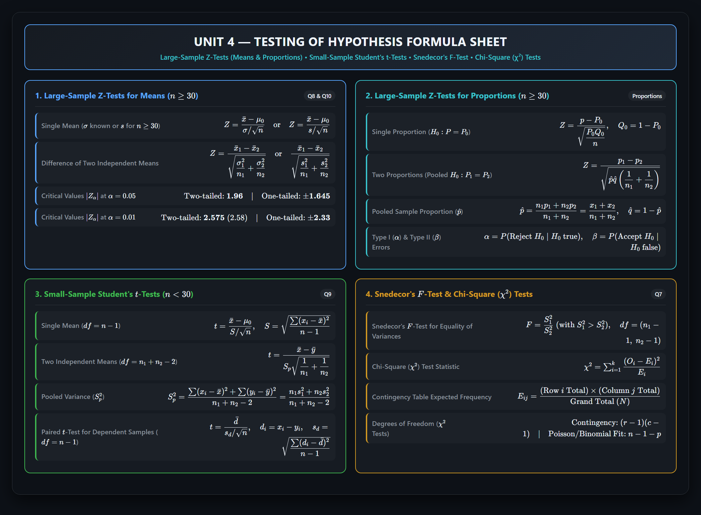
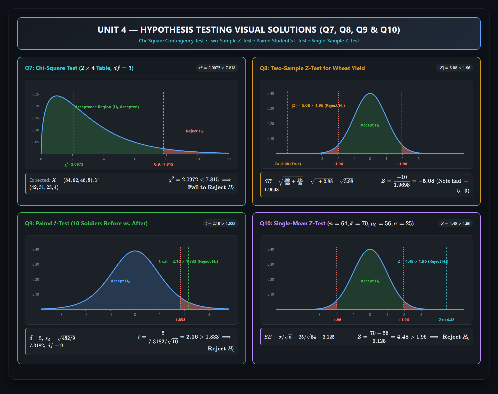

# Unit 4 — Testing of Hypothesis

Complete exam-ready questions, worked solutions, and handwritten notes verification for **Unit-IV** of Probability & Statistics (Aditya University / JNTU curriculum).

---

## Visual Formula Sheet & Cheatsheet

---

## Visual Worked Solutions (Hypothesis Tests Q7 to Q10)

---

## Quick Navigation / Table of Contents

| Section | Topic | Question Source | Status & Verification |
|:---|:---|:---|:---|
| [**Question 7**](#question-7--chi-square-test-for-independence-of-sampling-techniques) | Chi-Square Test of Independence ($2 \times 4$ Table, $N=300$) | Assignment-II Q7 | **Verified & Corrected** (Fixed fatal $H_1$ error in notes) |
| [**Question 8**](#question-8--two-sample-large-sample-z-test-for-means) | Two-Sample Large-Sample $Z$-Test (Wheat Yields) | Assignment-II Q8 | **Verified & Corrected** (Fixed arithmetic error $144/50 = 2.8$ in notes) |
| [**Question 9**](#question-9--paired-students-t-test-soldiers-training) | Paired Student's $t$-Test (10 Soldiers Before/After) | Assignment-II Q9 | **Verified Correct** ($t = 2.16 > 1.833$) |
| [**Question 10**](#question-10--single-sample-large-sample-z-test-for-mean) | Single-Sample Large-Sample $Z$-Test ($n=64$) | Assignment-II Q10 | **Verified Correct** ($Z = 4.48 > 1.96$) |
| [**Supplementary Section**](#supplementary-unit-4-core-topics--notes-verification) | Proportions, Two-Sample $t$, Snedecor's $F$ & $\chi^2$ Audit | Notes & Slide Sets | **Audited & Corrected** (Fixed independent vs paired $t$-test in BP data) |

---

## Question 7 — Chi-Square Test for Independence of Sampling Techniques

**Question:** Two researchers adopted different sampling techniques while investigating the same group of students to find the number of students falling in different intelligence levels. The results are as follows:

| Researcher | Below Average | Average | Above Average | Genius | Total |
|:---:|:---:|:---:|:---:|:---:|:---:|
| **X** | 86 | 60 | 44 | 10 | 200 |
| **Y** | 40 | 33 | 25 | 2 | 100 |
| **Total** | 126 | 93 | 69 | 12 | 300 |

Would you say that the sampling techniques adopted by the two researchers are significantly different? (Use $\alpha = 0.05$).

---

### Step-by-Step Solution

#### Step 1: Formulate the Hypotheses
- **Null Hypothesis ($H_0$):** There is **no significant difference** between the sampling techniques adopted by the two researchers (i.e., the intelligence level classification is independent of the researcher / sampling technique).
- **Alternative Hypothesis ($H_1$):** There **is a significant difference** between the sampling techniques adopted by the two researchers (the two distributions differ significantly).

#### Step 2: Level of Significance & Critical Value
- Significance level: $\alpha = 0.05$ (5%).
- Degrees of freedom for an $r \times c$ contingency table:

$$\nu = df = (r - 1)(c - 1) = (2 - 1)(4 - 1) = 1 \times 3 = \mathbf{3}$$

From the Chi-Square Distribution Table at $\alpha = 0.05$ with $3$ degrees of freedom:

$$\chi^2_{0.05,\, 3} = \mathbf{7.815}$$

#### Step 3: Compute Expected Frequencies ($E_{ij}$)
Formula for each cell:

$$E_{ij} = \frac{(\text{Row } i \text{ Total}) \times (\text{Column } j \text{ Total})}{\text{Grand Total } (N = 300)}$$

For Researcher X (Row Total $= 200$):
- Below Average: $E_{11} = \frac{200 \times 126}{300} = \mathbf{84.0}$
- Average: $E_{12} = \frac{200 \times 93}{300} = \mathbf{62.0}$
- Above Average: $E_{13} = \frac{200 \times 69}{300} = \mathbf{46.0}$
- Genius: $E_{14} = \frac{200 \times 12}{300} = \mathbf{8.0}$

For Researcher Y (Row Total $= 100$):
- Below Average: $E_{21} = \frac{100 \times 126}{300} = \mathbf{42.0}$
- Average: $E_{22} = \frac{100 \times 93}{300} = \mathbf{31.0}$
- Above Average: $E_{23} = \frac{100 \times 69}{300} = \mathbf{23.0}$
- Genius: $E_{24} = \frac{100 \times 12}{300} = \mathbf{4.0}$

#### Step 4: Chi-Square ($\chi^2$) Test Statistic Calculation
Formula:

$$\chi^2 = \sum \frac{(O_{ij} - E_{ij})^2}{E_{ij}}$$

| Category | Observed ($O$) | Expected ($E$) | $(O - E)$ | $(O - E)^2$ | $\dfrac{(O - E)^2}{E}$ |
|:---|:---:|:---:|:---:|:---:|:---:|
| **X: Below Average** | 86 | 84.0 | $+2$ | 4 | $\frac{4}{84} \approx \mathbf{0.0476}$ |
| **X: Average** | 60 | 62.0 | $-2$ | 4 | $\frac{4}{62} \approx \mathbf{0.0645}$ |
| **X: Above Average** | 44 | 46.0 | $-2$ | 4 | $\frac{4}{46} \approx \mathbf{0.0870}$ |
| **X: Genius** | 10 | 8.0 | $+2$ | 4 | $\frac{4}{8} = \mathbf{0.5000}$ |
| **Y: Below Average** | 40 | 42.0 | $-2$ | 4 | $\frac{4}{42} \approx \mathbf{0.0952}$ |
| **Y: Average** | 33 | 31.0 | $+2$ | 4 | $\frac{4}{31} \approx \mathbf{0.1290}$ |
| **Y: Above Average** | 25 | 23.0 | $+2$ | 4 | $\frac{4}{23} \approx \mathbf{0.1739}$ |
| **Y: Genius** | 2 | 4.0 | $-2$ | 4 | $\frac{4}{4} = \mathbf{1.0000}$ |
| **Total** | **300** | **300.0** | **0** | | $\chi^2_{\mathrm{cal}} \approx \mathbf{2.0972}$ |

$$\chi^2_{\mathrm{cal}} = 0.0476 + 0.0645 + 0.0870 + 0.5000 + 0.0952 + 0.1290 + 0.1739 + 1.0000 = \mathbf{2.0972} \quad (\approx 2.10)$$

#### Step 5: Statistical Decision & Conclusion

$$\chi^2_{\mathrm{cal}} = 2.0972 < \chi^2_{0.05,\, 3} = 7.815$$

Since the calculated value of $\chi^2$ ($2.0972$) is significantly less than the critical table value ($7.815$), we **fail to reject (accept) the null hypothesis $H_0$**.

**Conclusion:** There is **no significant difference** between the sampling techniques adopted by the two researchers. Both techniques yield consistent proportions across the intelligence levels.

---

### Handwritten Notes Verification for Q7

> [!WARNING]
> **Fatal Hypothesis Error in Handwritten Notes:**
> - In `MId_2_answers.pdf` (Page 9), the student wrote:
>   - $H_0$: *"There is no significant difference between the sampling techniques adopted by the two researchers."*
>   - $H_1$: *"There is **no** significant diff between the sampling techniques adopted by the two researchers."* **[FATAL ERROR]**
>   - The student mistakenly wrote *"no"* in both $H_0$ and $H_1$. $H_1$ must always contradict $H_0$ and state: *"There **is** a significant difference..."*.
> - **Arithmetic Typo in Notes:**
>   - In `MId_2_answers.pdf` Page 9, the expected table's bottom total under `Below Avg` is written as `123` instead of `126` ($84 + 42 = 126$).
>   - In the calculation of $X_{\text{expected}}$ for `Above Avg`, the denominator is written as `30` instead of `300` ($\frac{200 \times 69}{30} = 46$), though the resulting number `46` was correct.
> - `Probability_Statistics_Assignment_II_Handwritten_Q1-Q16_updated (1).pdf` (Page 7) correctly stated both $H_0$ and $H_1$ and evaluated $\chi^2 = 2.10$.

---

## Question 8 — Two-Sample Large-Sample $Z$-Test for Means

**Question:** The mean yield of wheat from a district was $210\text{ pounds}$ with S.D. $10\text{ pounds}$ per acre from a sample of $100\text{ plots}$. In another district the mean yield was $220\text{ pounds}$ with S.D. $12\text{ pounds}$ from a sample of $50\text{ plots}$. Test whether there is any significant difference between the mean yields of crops in the two districts. (Use $\alpha = 0.05$).

---

### Step-by-Step Solution

#### Step 1: Given Data
- **District 1 (Sample 1):** Size $n_1 = 100$ ($\ge 30$, large sample), Sample mean $\bar{x}_1 = 210\text{ lbs}$, Sample S.D. $s_1 = 10\text{ lbs}$.
- **District 2 (Sample 2):** Size $n_2 = 50$ ($\ge 30$, large sample), Sample mean $\bar{x}_2 = 220\text{ lbs}$, Sample S.D. $s_2 = 12\text{ lbs}$.

#### Step 2: Formulate Hypotheses
- **Null Hypothesis ($H_0$):** $\mu_1 = \mu_2$ (There is **no significant difference** between the mean wheat yields of the two districts).
- **Alternative Hypothesis ($H_1$):** $\mu_1 \neq \mu_2$ (There is a significant difference between the mean wheat yields — **two-tailed test**).

#### Step 3: Level of Significance & Critical Value
- $\alpha = 0.05$ (5% level of significance).
- Critical value for a two-tailed $Z$-test:

$$|Z_{\alpha/2}| = |Z_{0.025}| = \mathbf{1.96}$$

Rejection criterion: Reject $H_0$ if $|Z_{\mathrm{cal}}| > 1.96$.

#### Step 4: Test Statistic Calculation
Since $n_1, n_2 \ge 30$, sample variances $s_1^2, s_2^2$ are unbiased estimates of population variances $\sigma_1^2, \sigma_2^2$:

$$\text{Standard Error } SE = \sqrt{\frac{s_1^2}{n_1} + \frac{s_2^2}{n_2}} = \sqrt{\frac{10^2}{100} + \frac{12^2}{50}} = \sqrt{\frac{100}{100} + \frac{144}{50}}$$

$$\frac{100}{100} = 1.0, \qquad \frac{144}{50} = \mathbf{2.88}$$

$$SE = \sqrt{1.0 + 2.88} = \sqrt{3.88} \approx \mathbf{1.96977}$$

$$Z = \frac{\bar{x}_1 - \bar{x}_2}{\sqrt{\dfrac{s_1^2}{n_1} + \dfrac{s_2^2}{n_2}}} = \frac{210 - 220}{1.96977} = \frac{-10}{1.96977} \approx \mathbf{-5.0767} \quad (\approx \mathbf{-5.08})$$

Taking the absolute value:

$$|Z_{\mathrm{cal}}| = \mathbf{5.08}$$

#### Step 5: Statistical Decision & Conclusion

$$|Z_{\mathrm{cal}}| = 5.08 \gg Z_{\alpha/2} = 1.96$$

Since $|Z_{\mathrm{cal}}| = 5.08$ is far greater than the critical value $1.96$, the sample difference is highly significant ($p < 0.00001$). We **reject the null hypothesis $H_0$**.

**Conclusion:** There is a **highly significant difference** between the mean yields of crops in the two districts. Specifically, the mean yield in District 2 ($220\text{ lbs}$) is significantly higher than that in District 1 ($210\text{ lbs}$).

---

### Handwritten Notes Verification for Q8

> [!CAUTION]
> **Calculation Error in `MId_2_answers.pdf`:**
> - In `MId_2_answers.pdf` (Page 11), the student wrote:
>   $$\sqrt{\frac{100}{100} + \frac{144}{50}} = \sqrt{1 + 2.8} = \sqrt{3.8} \approx 1.949 \quad \text{\textbf{[ARITHMETIC ERROR]}}$$
>   The student evaluated $\frac{144}{50}$ as **`2.8`** instead of **`2.88`**!
>   As a result, they computed:
>   $$Z = \frac{-10}{1.949} = \mathbf{-5.13} \quad \text{[INCORRECT VALUE]}$$
> - **The True Value is:**
>   $$\sqrt{1 + 2.88} = \sqrt{3.88} = 1.9698 \implies Z = \frac{-10}{1.9698} = \mathbf{-5.08}$$
> - `Probability_Statistics_Assignment_II_Handwritten_Q1-Q16_updated (1).pdf` (Page 8) correctly computed $\frac{144}{50} = 2.88$, $\sqrt{3.88} = 1.9698$, and $Z = -5.08$.
> - Additionally, `MId_2_answers.pdf` forgot to explicitly state $H_0$ and $H_1$ at the beginning of Question 8.

---

## Question 9 — Paired Student's $t$-Test (Soldiers' Training)

**Question:** Ten soldiers participated in a shooting competition in the first week. After intensive training they participated in the competition in the second week. Their scores before and after training are given as follows:

| Soldier | 1 | 2 | 3 | 4 | 5 | 6 | 7 | 8 | 9 | 10 |
|:---|:---:|:---:|:---:|:---:|:---:|:---:|:---:|:---:|:---:|:---:|
| **Scores Before ($x_i$)** | 67 | 24 | 57 | 55 | 63 | 54 | 56 | 68 | 33 | 43 |
| **Scores After ($y_i$)** | 70 | 38 | 58 | 58 | 56 | 67 | 68 | 75 | 42 | 38 |

Do the data indicate that the soldiers have been benefited by the training? (Test at $\alpha = 0.05$).

---

### Step-by-Step Solution

#### Step 1: Formulate Hypotheses
Because the same $10$ soldiers are measured before and after training, the two sets of observations are **dependent (paired)**.
Let $d_i = y_i - x_i = \text{Score After} - \text{Score Before}$.
- **Null Hypothesis ($H_0$):** $\mu_d = 0$ (Training has not produced any increase in shooting scores; soldiers have not benefited).
- **Alternative Hypothesis ($H_1$):** $\mu_d > 0$ (Training has increased shooting scores; soldiers have benefited — **one-tailed right-tail test**).

#### Step 2: Level of Significance & Critical Value
- Significance level: $\alpha = 0.05$.
- Degrees of freedom: $\nu = df = n - 1 = 10 - 1 = \mathbf{9}$.
- From Student's $t$-table for a one-tailed test with $df = 9$ at $\alpha = 0.05$:

$$t_{\alpha,\, 9} = t_{0.05,\, 9} = \mathbf{1.833}$$

Rejection criterion: Reject $H_0$ if $t_{\mathrm{cal}} > 1.833$.

#### Step 3: Compute Differences ($d_i$) and Sample Standard Deviation ($s_d$)

| Soldier | Before ($x_i$) | After ($y_i$) | $d_i = y_i - x_i$ | $(d_i - \bar{d}) = (d_i - 5)$ | $(d_i - \bar{d})^2$ |
|:---:|:---:|:---:|:---:|:---:|:---:|
| 1 | 67 | 70 | $+3$ | $-2$ | 4 |
| 2 | 24 | 38 | $+14$ | $+9$ | 81 |
| 3 | 57 | 58 | $+1$ | $-4$ | 16 |
| 4 | 55 | 58 | $+3$ | $-2$ | 4 |
| 5 | 63 | 56 | $-7$ | $-12$ | 144 |
| 6 | 54 | 67 | $+13$ | $+8$ | 64 |
| 7 | 56 | 68 | $+12$ | $+7$ | 49 |
| 8 | 68 | 75 | $+7$ | $+2$ | 4 |
| 9 | 33 | 42 | $+9$ | $+4$ | 16 |
| 10 | 43 | 38 | $-5$ | $-10$ | 100 |
| **Total** | | | **50** | **0** | **482** |

Mean difference:

$$\bar{d} = \frac{\sum d_i}{n} = \frac{50}{10} = \mathbf{5.0}$$

Sample variance of differences ($s_d^2$):

$$s_d^2 = \frac{\sum (d_i - \bar{d})^2}{n - 1} = \frac{482}{10 - 1} = \frac{482}{9} \approx \mathbf{53.5556}$$

Sample standard deviation of differences ($s_d$):

$$s_d = \sqrt{\frac{482}{9}} = \frac{\sqrt{482}}{3} \approx \mathbf{7.3182}$$

#### Step 4: Paired $t$-Test Statistic

$$t = \frac{\bar{d}}{s_d / \sqrt{n}} = \frac{5}{7.3182 / \sqrt{10}} = \frac{5}{7.3182 / 3.16228} = \frac{5}{2.31422} \approx \mathbf{2.1606} \quad (\approx \mathbf{2.16})$$

#### Step 5: Statistical Decision & Conclusion

$$t_{\mathrm{cal}} = 2.1606 > t_{0.05,\, 9} = 1.833$$

Since the calculated $t$-statistic ($2.16$) exceeds the critical value ($1.833$), the test statistic falls in the rejection region ($p = 0.0297 < 0.05$). We **reject the null hypothesis $H_0$**.

**Conclusion:** Yes, the data indicates that the soldiers have **significantly benefited from the intensive training** at the $5\%$ level of significance.

---

### Handwritten Notes Verification for Q9

> [!NOTE]
> **Verification Verdict:**
> - `MId_2_answers.pdf` (Pages 12–13) and `Probability_Statistics_Assignment_II_Handwritten_Q1-Q16_updated (1).pdf` (Page 9) correctly evaluated:
>   - $\sum d_i = 50 \implies \bar{d} = 5$
>   - $\sum (d_i - \bar{d})^2 = 482 \implies s_d = \sqrt{482/9} \approx 7.318$
>   - $t_{\mathrm{cal}} = \frac{5}{7.318/\sqrt{10}} = 2.16$
>   - Comparison: $2.16 > 1.833 \implies \text{Reject } H_0$.
> - Both handwritten solutions are **100% mathematically correct**. (Note: `MId_2_answers.pdf` omitted stating $H_0$ and $H_1$ explicitly at the top of the question, which has been completed above).

---

## Question 10 — Single-Sample Large-Sample $Z$-Test for Mean

**Question:** A sample of $64\text{ students}$ has a mean weight of $70\text{ kgs}$. Can this be regarded as a sample from a population with mean weight $56\text{ kgs}$ and standard deviation $25\text{ kgs}$? (Test at $\alpha = 0.05$).

---

### Step-by-Step Solution

#### Step 1: Given Data
- Sample size: $n = 64$ ($\ge 30$, large sample)
- Sample mean: $\bar{x} = 70\text{ kgs}$
- Hypothesized population mean: $\mu_0 = 56\text{ kgs}$
- Known population standard deviation: $\sigma = 25\text{ kgs}$

#### Step 2: Formulate Hypotheses
- **Null Hypothesis ($H_0$):** $\mu = 56\text{ kgs}$ (The sample comes from a population with mean weight $56\text{ kgs}$; the difference between $\bar{x} = 70$ and $\mu_0 = 56$ is due to chance).
- **Alternative Hypothesis ($H_1$):** $\mu \neq 56\text{ kgs}$ (The sample does not come from this population — **two-tailed test**).

#### Step 3: Level of Significance & Critical Value
- $\alpha = 0.05$ (5% significance level).
- Critical value for two-tailed test:

$$|Z_{\alpha/2}| = |Z_{0.025}| = \mathbf{1.96}$$

Rejection criterion: Reject $H_0$ if $|Z_{\mathrm{cal}}| > 1.96$.

#### Step 4: Test Statistic Calculation

$$\text{Standard Error } SE = \frac{\sigma}{\sqrt{n}} = \frac{25}{\sqrt{64}} = \frac{25}{8} = \mathbf{3.125}$$

$$Z = \frac{\bar{x} - \mu_0}{\sigma / \sqrt{n}} = \frac{70 - 56}{3.125} = \frac{14}{3.125} = \mathbf{+4.48}$$

Taking absolute value:

$$|Z_{\mathrm{cal}}| = \mathbf{4.48}$$

#### Step 5: Statistical Decision & Conclusion

$$|Z_{\mathrm{cal}}| = 4.48 \gg 1.96$$

Since $|Z_{\mathrm{cal}}| = 4.48$ is far greater than the critical value $1.96$, the difference between the sample mean ($70\text{ kgs}$) and the population mean ($56\text{ kgs}$) is highly significant ($p < 0.00001$). We **reject the null hypothesis $H_0$**.

**Conclusion:** No, this sample **cannot be regarded as drawn from a population** with mean weight $56\text{ kgs}$ and standard deviation $25\text{ kgs}$.

---

### Handwritten Notes Verification for Q10

> [!NOTE]
> **Verification Verdict:**
> - `MId_2_answers.pdf` (Pages 13–14) and `Probability_Statistics_Assignment_II_Handwritten_Q1-Q16_updated (1).pdf` (Page 10) correctly computed $Z = \frac{14}{3.125} = 4.48 > 1.96$ and rejected $H_0$.
> - **Minor Terminology Note:** `MId_2_answers.pdf` listed $\sigma = 25\text{ kgs}$ under the label *"Sample standard deviation ($s$) = 25 kgs"*. The problem prompt explicitly states *"a population with mean weight 56 kgs and standard deviation 25 kgs"*, so $25$ is the **population** parameter $\sigma$. The numerical calculation remains identical.

---

## Supplementary Unit 4 Core Topics & Notes Verification

This section audits additional topics, worked examples, and handwritten notes from `P&S_Unit-IV_Notes_AUS - Copy-1.pdf` and `testing of Hypothesis.pdf`.

### 1. Large-Sample Tests for Proportions

#### Single Proportion Example (Manufacturer Specification Claim)
- Problem: Manufacturer claims at least $95\%$ of equipment conforms to specification. A sample of $n = 200$ pieces reveals $18$ faulty (so $x = 182$ conform, $p = \frac{182}{200} = 0.91$). Test at $\alpha = 0.05$.
- Hypotheses: $H_0: P = 0.95$, $H_1: P < 0.95$ (left-tailed).
- Standard Error: $SE = \sqrt{\frac{P_0 Q_0}{n}} = \sqrt{\frac{0.95 \times 0.05}{200}} = \sqrt{0.0002375} \approx 0.01541$.
- Test Statistic: $Z = \frac{0.91 - 0.95}{0.01541} = \mathbf{-2.595} \approx \mathbf{-2.59}$.
- Critical value: For a one-tailed test at $5\%$, $Z_{0.05} = -1.645$.
- Conclusion: Since $Z = -2.59 < -1.645$, **Reject $H_0$**. The manufacturer's claim is refuted.

---

### 2. Snedecor's $F$-Test for Equality of Two Variances

#### Worked Example: Tobacco Nicotine Contents (Handwritten in `P&S_Unit-IV_Notes_AUS` Pages 17–19)
- **Sample A ($n_1 = 5$):** $24, 27, 26, 21, 25 \implies \bar{x} = 24.6, \sum(x_i - \bar{x})^2 = 21.2$.
  $$S_1^2 = \frac{21.2}{5 - 1} = \frac{21.2}{4} = \mathbf{5.30}$$
- **Sample B ($n_2 = 6$):** $27, 30, 28, 31, 22, 36 \implies \bar{y} = 29.0, \sum(y_i - \bar{y})^2 = 108.0$.
  $$S_2^2 = \frac{108.0}{6 - 1} = \frac{108.0}{5} = \mathbf{21.60}$$
- **$F$-Test Statistic:** Since $S_2^2 > S_1^2$:
  $$F = \frac{S_2^2}{S_1^2} = \frac{21.60}{5.30} \approx \mathbf{4.0755}$$
  Degrees of freedom: $\nu_1 = n_2 - 1 = 5$, $\nu_2 = n_1 - 1 = 4$.
  Critical value from $F$-table: $F_{0.05}(5, 4) = \mathbf{6.26}$ (or $F(4, 5) = 5.19$).
  Decision: $F_{\mathrm{cal}} = 4.075 < 5.19 \implies$ **Accept $H_0$** (variances do not differ significantly).
- **Subsequent $t$-Test for Difference of Means:**
  $$S_p^2 = \frac{21.2 + 108.0}{5 + 6 - 2} = \frac{129.2}{9} \approx 14.3556 \implies S_p \approx 3.7889$$
  $$t = \frac{24.6 - 29.0}{3.7889 \sqrt{\frac{1}{5} + \frac{1}{6}}} = \frac{-4.4}{3.7889 \times 0.6055} = \frac{-4.4}{2.294} \approx \mathbf{-1.918}$$
  $|t| = 1.918 < t_{0.025,\, 9} = 2.262 \implies$ **Accept $H_0$** (both samples can be regarded as drawn from the same normal population).

---

### 3. Critical Conceptual Correction in `testing of Hypothesis.pdf`

> [!WARNING]
> **Conceptual Error in `testing of Hypothesis.pdf` (Page 20–21, Problem 3):**
> - The problem presents the blood pressure of women before and after intake of a drug:
>   - Before: `110, 120, 125, 132`
>   - After: `120, 118, 125, 136`
> - In `testing of Hypothesis.pdf` Page 21, the author wrongly applied an **independent two-sample $t$-test** ($S_p^2 = 8.67, t = 0.49$)!
> - **Statistical Rule:** Because measurements are taken on the **same individual women before and after treatment**, the samples are **paired/correlated**, NOT independent. A **paired Student's $t$-test** on differences $d = \text{After} - \text{Before}$ ($+10, -2, 0, +4$) must be applied.
