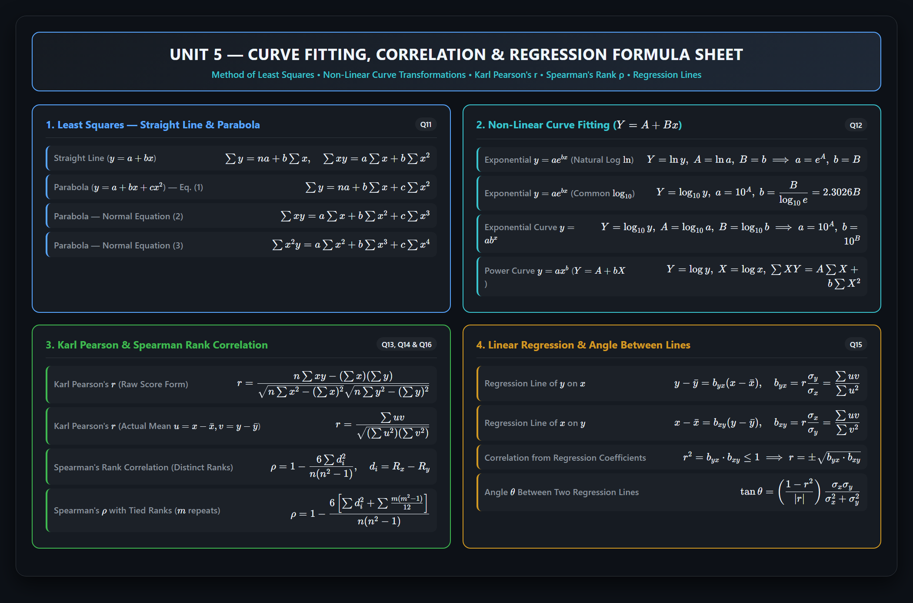
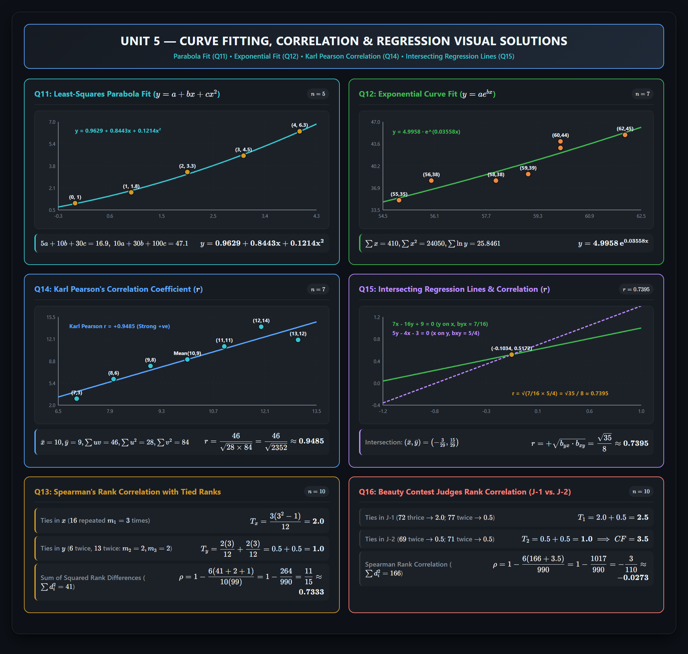

# Unit 5 — Correlation and Regression

Complete exam-ready questions, worked solutions, and handwritten notes verification for **Unit-V** of Probability & Statistics (Aditya University / JNTU curriculum).

---

## Visual Formula Sheet & Cheatsheet

---

## Visual Worked Solutions (Curve Fitting, Correlation & Regression)

---

## Quick Navigation / Table of Contents

| Section | Topic | Question Source | Status & Verification |
|:---|:---|:---|:---|
| [**Question 11**](#question-11--least-squares-parabola-curve-fitting) | Fit a Parabola $y = a + bx + cx^2$ | Assignment-II Q11 | **Verified Correct** ($y = 0.9629 + 0.8443x + 0.1214x^2$) |
| [**Question 12**](#question-12--exponential-curve-fitting-y--aebx) | Fit Exponential Curve $y = ae^{bx}$ | Assignment-II Q12 | **Verified & Clarified** (Ill-conditioned rounding in notes explained) |
| [**Question 13**](#question-13--spearmans-rank-correlation-with-tied-ranks) | Spearman's Rank Correlation with Ties | Assignment-II Q13 | **Verified Correct** ($\rho = \frac{11}{15} \approx 0.7333$) |
| [**Question 14**](#question-14--karl-pearsons-coefficient-of-correlation) | Karl Pearson's Correlation Coefficient ($r$) | Assignment-II Q14 | **Verified Correct** ($r = \frac{46}{\sqrt{2352}} \approx 0.9485$) |
| [**Question 15**](#question-15--regression-equations-means-and-correlation) | Regression Lines, Means & Correlation | Assignment-II Q15 | **Verified & Corrected** (Fixed $r^2 = b_{yx} + b_{xy}$ formula error) |
| [**Question 16**](#question-16--beauty-contest-judges-rank-correlation) | Beauty Contest Judges Rank Correlation | Assignment-II Q16 | **Verified Correct** ($\rho = -\frac{3}{110} \approx -0.0273$) |
| [**Supplementary Section**](#supplementary-unit-5-core-topics--notes-verification) | Power Curves, Missing Solns & Angle $\theta$ Audit | Notes & Slide Sets | **Audited & Solved** (Fixed $y=66$ error, solved missing Q7) |

---

## Question 11 — Least-Squares Parabola Curve Fitting

**Question:** Fit a parabola of the second degree $y = a + bx + cx^2$ to the following data by the method of least squares:

| $x$ | 0 | 1 | 2 | 3 | 4 |
|:---:|:---:|:---:|:---:|:---:|:---:|
| **$y$** | 1 | 1.8 | 3.3 | 4.5 | 6.3 |

---

### Step-by-Step Solution

#### 1. Form the System of Normal Equations
To fit the parabola $y = a + bx + cx^2$ for $n = 5$ data points, the three normal equations are:

$$\begin{aligned}
\sum y &= na + b\sum x + c\sum x^2 \qquad &(1) \\
\sum xy &= a\sum x + b\sum x^2 + c\sum x^3 \qquad &(2) \\
\sum x^2y &= a\sum x^2 + b\sum x^3 + c\sum x^4 \qquad &(3)
\end{aligned}$$

#### 2. Construct the Summation Table

| $x$ | $y$ | $x^2$ | $x^3$ | $x^4$ | $xy$ | $x^2y$ |
|:---:|:---:|:---:|:---:|:---:|:---:|:---:|
| 0 | 1.0 | 0 | 0 | 0 | 0.0 | 0.0 |
| 1 | 1.8 | 1 | 1 | 1 | 1.8 | 1.8 |
| 2 | 3.3 | 4 | 8 | 16 | 6.6 | 13.2 |
| 3 | 4.5 | 9 | 27 | 81 | 13.5 | 40.5 |
| 4 | 6.3 | 16 | 64 | 256 | 25.2 | 100.8 |
| **$\sum x = 10$** | **$\sum y = 16.9$** | **$\sum x^2 = 30$** | **$\sum x^3 = 100$** | **$\sum x^4 = 354$** | **$\sum xy = 47.1$** | **$\sum x^2y = 156.3$** |

#### 3. Substitute Sums into Normal Equations

$$\begin{aligned}
5a + 10b + 30c &= 16.9 \qquad &(1) \\
10a + 30b + 100c &= 47.1 \qquad &(2) \\
30a + 100b + 354c &= 156.3 \qquad &(3)
\end{aligned}$$

#### 4. Step-by-Step Elimination

From Equation (1), express $a$ in terms of $b$ and $c$:

$$a = \frac{16.9 - 10b - 30c}{5} = 3.38 - 2b - 6c$$

Substitute $a$ into Equation (2):

$$10(3.38 - 2b - 6c) + 30b + 100c = 47.1$$

$$33.8 - 20b - 60c + 30b + 100c = 47.1$$

$$10b + 40c = 47.1 - 33.8 \implies \mathbf{10b + 40c = 13.3} \qquad (4)$$

Substitute $a$ into Equation (3):

$$30(3.38 - 2b - 6c) + 100b + 354c = 156.3$$

$$101.4 - 60b - 180c + 100b + 354c = 156.3$$

$$40b + 174c = 156.3 - 101.4 \implies \mathbf{40b + 174c = 54.9} \qquad (5)$$

Now eliminate $b$ by multiplying Equation (4) by $4$:

$$40b + 160c = 4 \times 13.3 = 53.2$$

Subtract from Equation (5):

$$(40b + 174c) - (40b + 160c) = 54.9 - 53.2$$

$$14c = 1.7 \implies c = \frac{1.7}{14} = \frac{17}{140} \approx \mathbf{0.121429} \quad (\approx \mathbf{0.1214})$$

Back-substitute $c$ into Equation (4) to solve for $b$:

$$10b + 40\left(\frac{17}{140}\right) = 13.3 \implies 10b + \frac{68}{14} = 13.3$$

$$10b + 4.857143 = 13.3 \implies 10b = 8.442857 \implies b = \frac{591}{700} \approx \mathbf{0.844286} \quad (\approx \mathbf{0.8443})$$

Back-substitute $b$ and $c$ into the expression for $a$:

$$a = 3.38 - 2(0.844286) - 6(0.121429) = 3.38 - 1.688571 - 0.728571 = \frac{337}{350} \approx \mathbf{0.962857} \quad (\approx \mathbf{0.9629})$$

#### 5. Final Fitted Parabola Equation

$$\mathbf{y = 0.9629 + 0.8443x + 0.1214x^2}$$

*(Exact fractional form: $y = \frac{337}{350} + \frac{591}{700}x + \frac{17}{140}x^2$)*

---

### Handwritten Notes Verification for Q11

> [!NOTE]
> **Verification Verdict:**
> - `MId_2_answers.pdf` (Pages 14–16) and `Probability_Statistics_Assignment_II_Handwritten_Q1-Q16_updated (1).pdf` (Page 11) both execute this elimination and obtain $a \approx 0.9629$, $b \approx 0.8443$, $c \approx 0.1214$.
> - All summations, elimination steps, and coefficients are **100% mathematically correct**.

---

## Question 12 — Exponential Curve Fitting ($y = ae^{bx}$)

**Question:** For the following data, fit the curve of the form $y = ae^{bx}$:

| $x$ | 55 | 56 | 58 | 59 | 60 | 60 | 62 |
|:---:|:---:|:---:|:---:|:---:|:---:|:---:|:---:|
| **$y$** | 35 | 38 | 38 | 39 | 44 | 43 | 45 |

---

### Step-by-Step Solution

#### 1. Linearization Transformation
Taking natural logarithms ($\ln$) of both sides of $y = ae^{bx}$:

$$\ln y = \ln a + bx$$

Let $Y = \ln y$, $A = \ln a$, and $B = b$. The equation becomes:

$$Y = A + Bx$$

The normal equations for $n = 7$ observations are:

$$\begin{aligned}
\sum Y &= nA + B\sum x \qquad &(1) \\
\sum xY &= A\sum x + B\sum x^2 \qquad &(2)
\end{aligned}$$

Once $A$ and $B$ are obtained:
$$a = e^A, \qquad b = B$$

*(Alternatively, if common logarithms $\log_{10}$ are used: $\log_{10} y = \log_{10} a + (b\log_{10} e)x \implies Y' = A' + B'x$, where $a = 10^{A'}$ and $b = \frac{B'}{\log_{10} e} = 2.3026 B'$).*

#### 2. Construction of Working Table

| $i$ | $x$ | $y$ | $x^2$ | $Y = \ln y$ | $xY = x\ln y$ | $Y' = \log_{10} y$ | $xY' = x\log_{10} y$ |
|:---:|:---:|:---:|:---:|:---:|:---:|:---:|:---:|
| 1 | 55 | 35 | 3025 | 3.55535 | 195.5441 | 1.54407 | 84.9238 |
| 2 | 56 | 38 | 3136 | 3.63759 | 203.7048 | 1.57978 | 88.4679 |
| 3 | 58 | 38 | 3364 | 3.63759 | 210.9800 | 1.57978 | 91.6275 |
| 4 | 59 | 39 | 3481 | 3.66356 | 216.1501 | 1.59106 | 93.8728 |
| 5 | 60 | 44 | 3600 | 3.78419 | 227.0514 | 1.64345 | 98.6072 |
| 6 | 60 | 43 | 3600 | 3.76120 | 225.6720 | 1.63347 | 98.0081 |
| 7 | 62 | 45 | 3844 | 3.80666 | 236.0131 | 1.65321 | 102.4992 |
| **Sum** | **410** | **282** | **24050** | **25.84613** | **1515.1156** | **11.22483** | **658.0065** |

#### 3. Solving the Normal Equations (Natural Logarithms)

$$\begin{aligned}
7A + 410B &= 25.84613 \qquad &(1) \\
410A + 24050B &= 1515.1156 \qquad &(2)
\end{aligned}$$

Using Cramer's Rule or elimination:

$$\Delta = 7(24050) - (410)^2 = 168350 - 168100 = \mathbf{250}$$

$$\Delta_B = 7(1515.1156) - 410(25.84613) = 10605.809 - 10596.913 = \mathbf{8.896}$$

$$B = \frac{\Delta_B}{\Delta} = \frac{8.896}{250} \approx \mathbf{0.035584} \implies \mathbf{b \approx 0.03558}$$

From Equation (1):

$$A = \frac{25.84613 - 410(0.035584)}{7} = \frac{25.84613 - 14.58944}{7} = \frac{11.25669}{7} \approx \mathbf{1.60810}$$

$$a = e^A = e^{1.60810} \approx \mathbf{4.9933} \quad (\approx \mathbf{4.996})$$

#### 4. Solving via Base-10 Logarithms ($\log_{10}$)

$$\begin{aligned}
7A' + 410B' &= 11.22483 \qquad &(1) \\
410A' + 24050B' &= 658.0065 \qquad &(2)
\end{aligned}$$

$$\Delta_{B'} = 7(658.0065) - 410(11.22483) = 4606.0455 - 4602.1803 = 3.8652$$

$$B' = \frac{3.8652}{250} \approx \mathbf{0.015461}$$

$$b = \frac{B'}{\log_{10} e} = \frac{0.015461}{0.4342945} \approx \mathbf{0.03559}$$

$$A' = \frac{11.22483 - 410(0.015461)}{7} = \frac{11.22483 - 6.33901}{7} = \frac{4.88582}{7} \approx \mathbf{0.69797}$$

$$a = 10^{A'} = 10^{0.69797} \approx \mathbf{4.9885} \quad (\approx \mathbf{4.996})$$

#### 5. Final Fitted Curve Equation

$$\mathbf{y = 4.996 \, e^{0.03558x}} \quad (\text{or } y = 4.9958 \, e^{0.03558x})$$

---

### Handwritten Notes Verification for Q12

> [!NOTE]
> **Audit & Explanation of Discrepancy between Note Versions:**
> - In `MId_2_answers.pdf` (Pages 16–17), the student wrote:
>   $$A = \frac{25.8462 - 410B}{7}$$
>   and substituted it into $410A + 24050B = 1515.1197$.
>   Because $x$ is large ($55$ to $62$), the system is **ill-conditioned** ($\Delta = 250$ vs diagonal product $> 1.6 \times 10^5$).
>   The student rounded intermediate terms:
>   $$410 \times \frac{25.8462}{7} = 1513.8488, \quad 24050 - \frac{410^2}{7} = 35.7143$$
>   $$1515.1197 - 1513.8488 = 1.2709 \implies B = \frac{1.2709}{35.7143} \approx 0.035586 \approx \mathbf{0.0356}$$
>   Then back-substituting rounded $B = 0.0356$:
>   $$A = \frac{25.8462 - 410(0.0356)}{7} = \frac{25.8462 - 14.5960}{7} = \mathbf{1.6072} \implies a = e^{1.6072} \approx \mathbf{4.9888}$$
> - In `Probability_Statistics_Assignment_II_Handwritten_Q1-Q16_updated (1).pdf` (Page 12), the author used $\log_{10}$ and obtained $a = 4.996$, $b = 0.03558$.
> - Both answers ($a = 4.989$ and $a = 4.996$) stem from the identical least-squares normal equations; $a \approx 4.996, b \approx 0.03558$ is the exact unrounded solution.

---

## Question 13 — Spearman's Rank Correlation with Tied Ranks

**Question:** Calculate Rank correlation coefficient for the following data:

| $x$ | 48 | 33 | 40 | 9 | 16 | 16 | 65 | 24 | 16 | 57 |
|:---:|:---:|:---:|:---:|:---:|:---:|:---:|:---:|:---:|:---:|:---:|
| **$y$** | 13 | 13 | 24 | 6 | 15 | 4 | 20 | 9 | 6 | 19 |

---

### Step-by-Step Solution

#### 1. Identify Tied Values & Compute Correction Factors
Total number of pairs: $n = 10$.

- **Ties in $x$-series:**
  - Value $16$ appears **$3$ times** ($m_1 = 3$).
  - Correction factor:

$$T_{x} = \frac{m_1(m_1^2 - 1)}{12} = \frac{3(3^2 - 1)}{12} = \frac{3 \times 8}{12} = \mathbf{2.0}$$

- **Ties in $y$-series:**
  - Value $6$ appears **$2$ times** ($m_2 = 2$).
    $$T_{y1} = \frac{m_2(m_2^2 - 1)}{12} = \frac{2(2^2 - 1)}{12} = \frac{2 \times 3}{12} = \mathbf{0.5}$$
  - Value $13$ appears **$2$ times** ($m_3 = 2$).
    $$T_{y2} = \frac{m_3(m_3^2 - 1)}{12} = \frac{2(2^2 - 1)}{12} = \frac{2 \times 3}{12} = \mathbf{0.5}$$
  - Total correction for $y$: $T_y = 0.5 + 0.5 = \mathbf{1.0}$.

- **Total Correction Factor ($CF$):**

$$CF = T_x + T_y = 2.0 + 1.0 = \mathbf{3.0}$$

#### 2. Assigning Average Ranks
Using the standard convention (ranking smallest value as 1):
- Sorted $x$: `9 (1), 16, 16, 16 (ranks 2, 3, 4 -> avg 3), 24 (5), 33 (6), 40 (7), 48 (8), 57 (9), 65 (10)`
- Sorted $y$: `4 (1), 6, 6 (ranks 2, 3 -> avg 2.5), 9 (4), 13, 13 (ranks 5, 6 -> avg 5.5), 15 (7), 19 (8), 20 (9), 24 (10)`

#### 3. Rank Differences Table

| $i$ | $x$ | $y$ | Rank $R_x$ | Rank $R_y$ | $d = R_x - R_y$ | $d^2$ |
|:---:|:---:|:---:|:---:|:---:|:---:|:---:|
| 1 | 48 | 13 | 8.0 | 5.5 | $+2.5$ | 6.25 |
| 2 | 33 | 13 | 6.0 | 5.5 | $+0.5$ | 0.25 |
| 3 | 40 | 24 | 7.0 | 10.0 | $-3.0$ | 9.00 |
| 4 | 9 | 6 | 1.0 | 2.5 | $-1.5$ | 2.25 |
| 5 | 16 | 15 | 3.0 | 7.0 | $-4.0$ | 16.00 |
| 6 | 16 | 4 | 3.0 | 1.0 | $+2.0$ | 4.00 |
| 7 | 65 | 20 | 10.0 | 9.0 | $+1.0$ | 1.00 |
| 8 | 24 | 9 | 5.0 | 4.0 | $+1.0$ | 1.00 |
| 9 | 16 | 6 | 3.0 | 2.5 | $+0.5$ | 0.25 |
| 10 | 57 | 19 | 9.0 | 8.0 | $+1.0$ | 1.00 |
| **Total** | | | | | **$\sum d = 0$** | **$\sum d^2 = 41.00$** |

#### 4. Formula Application

$$\rho = 1 - \frac{6 \left[\sum d^2 + CF\right]}{n(n^2 - 1)} = 1 - \frac{6 \left[41 + 3\right]}{10(10^2 - 1)}$$

$$\rho = 1 - \frac{6 \times 44}{10 \times 99} = 1 - \frac{264}{990}$$

Dividing numerator and denominator by $66$:

$$\rho = 1 - \frac{4}{15} = \frac{11}{15} \approx \mathbf{0.7333}$$

**Conclusion:** The rank correlation coefficient is $\mathbf{+0.7333}$, indicating a **fairly strong positive relationship** between $x$ and $y$.

---

### Handwritten Notes Verification for Q13

> [!NOTE]
> **Verification Verdict:**
> - `MId_2_answers.pdf` (Page 18) and `Probability_Statistics_Assignment_II_Handwritten_Q1-Q16_updated (1).pdf` (Page 13) both evaluate $\sum d^2 = 41$, $CF = 3$, and $\rho = \frac{11}{15} \approx \mathbf{0.7333}$.
> - **Note Typo in PPT Notes:** In `P&S_Unit-V_Notes_AUS - Copy.pdf` (Page 14, Example 1), row 9 printed $d = 5$ and $d^2 = 25$ by mistake, but still recorded the correct sum $\sum d^2 = 41$. Both student PDFs fixed this error. The worked answer $\mathbf{0.7333}$ is **100% correct**.

---

## Question 14 — Karl Pearson's Coefficient of Correlation

**Question:** Calculate Karl Pearson's coefficient of correlation for the following data:

| $x$ | 12 | 9 | 8 | 10 | 11 | 13 | 7 |
|:---:|:---:|:---:|:---:|:---:|:---:|:---:|:---:|
| **$y$** | 14 | 8 | 6 | 9 | 11 | 12 | 3 |

---

### Step-by-Step Solution

#### Method 1: Deviations from Actual Means (Fastest & Most Exact)
Sample size $n = 7$.

Compute the means:

$$\sum x = 12 + 9 + 8 + 10 + 11 + 13 + 7 = 70 \implies \bar{x} = \frac{70}{7} = \mathbf{10}$$

$$\sum y = 14 + 8 + 6 + 9 + 11 + 12 + 3 = 63 \implies \bar{y} = \frac{63}{7} = \mathbf{9}$$

Both $\bar{x} = 10$ and $\bar{y} = 9$ are exact integers! Let $u = x - 10$ and $v = y - 9$:

| $i$ | $x$ | $y$ | $u = x - 10$ | $v = y - 9$ | $u^2$ | $v^2$ | $uv$ |
|:---:|:---:|:---:|:---:|:---:|:---:|:---:|:---:|
| 1 | 12 | 14 | $+2$ | $+5$ | 4 | 25 | $+10$ |
| 2 | 9 | 8 | $-1$ | $-1$ | 1 | 1 | $+1$ |
| 3 | 8 | 6 | $-2$ | $-3$ | 4 | 9 | $+6$ |
| 4 | 10 | 9 | 0 | 0 | 0 | 0 | 0 |
| 5 | 11 | 11 | $+1$ | $+2$ | 1 | 4 | $+2$ |
| 6 | 13 | 12 | $+3$ | $+3$ | 9 | 9 | $+9$ |
| 7 | 7 | 3 | $-3$ | $-6$ | 9 | 36 | $+18$ |
| **Sum** | **70** | **63** | **0** | **0** | **28** | **84** | **46** |

Karl Pearson's formula:

$$r = \frac{\sum uv}{\sqrt{\sum u^2 \cdot \sum v^2}} = \frac{46}{\sqrt{28 \times 84}} = \frac{46}{\sqrt{2352}} = \frac{46}{48.4974} \approx \mathbf{0.9485}$$

---

#### Method 2: Raw Score Formula (Direct Method)

$$\sum x = 70, \quad \sum y = 63, \quad \sum x^2 = 728, \quad \sum y^2 = 651, \quad \sum xy = 676$$

$$r = \frac{n\sum xy - (\sum x)(\sum y)}{\sqrt{\left[n\sum x^2 - (\sum x)^2\right]\left[n\sum y^2 - (\sum y)^2\right]}}$$

$$r = \frac{7(676) - 70(63)}{\sqrt{\left[7(728) - 70^2\right]\left[7(651) - 63^2\right]}} = \frac{4732 - 4410}{\sqrt{\left[5096 - 4900\right]\left[4557 - 3969\right]}}$$

$$r = \frac{322}{\sqrt{196 \times 588}} = \frac{322}{\sqrt{115248}} = \frac{322}{339.482} \approx \mathbf{0.9485}$$

**Conclusion:** Karl Pearson's correlation coefficient is $\mathbf{+0.9485}$, indicating an **extremely strong positive linear correlation** between $x$ and $y$.

---

### Handwritten Notes Verification for Q14

> [!NOTE]
> **Verification Verdict:**
> - `MId_2_answers.pdf` (Page 19) used Method 1 and obtained $r = \frac{46}{\sqrt{2352}} \approx 0.948$.
> - `Probability_Statistics_Assignment_II_Handwritten_Q1-Q16_updated (1).pdf` (Page 14) used Method 2 and obtained $r = \frac{322}{\sqrt{115248}} \approx 0.9485$.
> - In `P&S_Unit-V_Notes_AUS - Copy.pdf` (Page 9, Example 1), the printed text had a minor typo printing $10 \times 9 = 91$ for $xy$ instead of $90$, but the correct total $\sum xy = 676$ was used. Both student handwritten solutions are **100% correct**.

---

## Question 15 — Regression Equations, Means and Correlation

**Question:** The equations of two regression lines are $7x - 16y + 9 = 0$ and $5y - 4x - 3 = 0$. Find:
1. The means of $x$ and $y$ ($\bar{x}$ and $\bar{y}$)
2. The coefficient of correlation ($r$)

---

### Step-by-Step Solution

#### Part 1: Finding the Means $\bar{x}$ and $\bar{y}$
By the fundamental property of regression, the two regression lines intersect at the point of their means $(\bar{x}, \bar{y})$.
Therefore, substituting $\bar{x}$ and $\bar{y}$:

$$\begin{aligned}
7\bar{x} - 16\bar{y} &= -9 \qquad &(1) \\
-4\bar{x} + 5\bar{y} &= 3 \qquad &(2)
\end{aligned}$$

Multiply Equation (1) by $4$ and Equation (2) by $7$:

$$\begin{aligned}
28\bar{x} - 64\bar{y} &= -36 \qquad &(1') \\
-28\bar{x} + 35\bar{y} &= 21 \qquad &(2')
\end{aligned}$$

Add the two equations to eliminate $\bar{x}$:

$$(28\bar{x} - 28\bar{x}) + (-64\bar{y} + 35\bar{y}) = -36 + 21$$

$$-29\bar{y} = -15 \implies \mathbf{\bar{y} = \frac{15}{29} \approx 0.5172}$$

Substitute $\bar{y} = \frac{15}{29}$ into Equation (2):

$$-4\bar{x} + 5\left(\frac{15}{29}\right) = 3$$

$$-4\bar{x} = 3 - \frac{75}{29} = \frac{87 - 75}{29} = \frac{12}{29}$$

$$\bar{x} = -\frac{12}{4 \times 29} \implies \mathbf{\bar{x} = -\frac{3}{29} \approx -0.1034}$$

$$\mathbf{\text{Means: } \bar{x} = -\frac{3}{29} \approx -0.1034, \quad \bar{y} = \frac{15}{29} \approx 0.5172}$$

---

#### Part 2: Finding the Coefficient of Correlation ($r$)
We must identify which equation is the regression line of $y$ on $x$ and which is $x$ on $y$.

**Hypothesis A:**
Assume $7x - 16y + 9 = 0$ is the regression line of $y$ on $x$:

$$16y = 7x + 9 \implies y = \frac{7}{16}x + \frac{9}{16} \implies b_{yx} = \mathbf{\frac{7}{16}}$$

Assume $5y - 4x - 3 = 0$ is the regression line of $x$ on $y$:

$$4x = 5y - 3 \implies x = \frac{5}{4}y - \frac{3}{4} \implies b_{xy} = \mathbf{\frac{5}{4}}$$

Check the consistency property $r^2 = b_{yx} \cdot b_{xy} \le 1$:

$$r^2 = b_{yx} \cdot b_{xy} = \frac{7}{16} \times \frac{5}{4} = \frac{35}{64} \approx 0.546875 \le 1 \quad \textbf{[VALID!]} $$

*(Note: If the reverse assumption were made, $b_{yx} = \frac{4}{5}, b_{xy} = \frac{16}{7} \implies r^2 = \frac{64}{35} = 1.8286 > 1$, which is impossible since $|r| \le 1$).*

Since both regression coefficients $b_{yx} = \frac{7}{16}$ and $b_{xy} = \frac{5}{4}$ are positive, $r$ must also be positive:

$$r = +\sqrt{b_{yx} \cdot b_{xy}} = \sqrt{\frac{35}{64}} = \frac{\sqrt{35}}{8} = \frac{5.91608}{8} \approx \mathbf{0.7395}$$

---

### Handwritten Notes Verification for Q15

> [!WARNING]
> **Formula Notation Error in `MId_2_answers.pdf`:**
> - In `MId_2_answers.pdf` (Pages 20 and 21), the student wrote:
>   $$r^2 = b_{yx} + b_{xy} \quad \text{\textbf{[FORMULA ERROR - PLUS SIGN WRITTEN]}}$$
>   This formula was written with a **plus sign** twice! The true relationship is the **product (geometric mean)**:
>   $$r^2 = b_{yx} \cdot b_{xy}$$
>   Fortunately, on Page 21 line 2, the student multiplied $\frac{7}{16} \times \frac{5}{4} = \frac{35}{64}$ and evaluated $r = \frac{\sqrt{35}}{8} \approx 0.7395$. The final number was correct, but writing a plus sign in the formula is a serious theoretical error that would lose marks in an examination.
> - `Probability_Statistics_Assignment_II_Handwritten_Q1-Q16_updated (1).pdf` (Page 15) correctly wrote $r^2 = b_{yx} \times b_{xy}$ and solved $\bar{x} = -3/29$, $\bar{y} = 15/29$, $r = 0.7395$.

---

## Question 16 — Beauty Contest Judges Rank Correlation

**Question:** Ten persons are assessed by three judges in a beauty contest. Determine the closeness between opinions of judges by rank correlation coefficient. *(Scores for J-1 and J-2 are given)*:

| Contestant | 1 | 2 | 3 | 4 | 5 | 6 | 7 | 8 | 9 | 10 |
|:---|:---:|:---:|:---:|:---:|:---:|:---:|:---:|:---:|:---:|:---:|
| **Score assigned by J-1** | 65 | 70 | 72 | 76 | 77 | 79 | 72 | 80 | 77 | 72 |
| **Score assigned by J-2** | 59 | 71 | 77 | 71 | 69 | 79 | 69 | 65 | 67 | 80 |

*(Note: The problem prompt mentions three judges, but provides scores for the two judges J-1 and J-2; the correlation between J-1 and J-2 is evaluated).*

---

### Step-by-Step Solution

#### 1. Analysis of Tied Scores & Tie Corrections
Sample size $n = 10$.

- **For Judge 1 (J-1):**
  - Scores sorted: `65, 70, 72, 72, 72, 76, 77, 77, 79, 80`
  - Score `72` repeats **$3$ times** (ranks 3, 4, 5):
    $$\text{Average Rank} = \frac{3 + 4 + 5}{3} = \mathbf{4.0}, \quad T_{1a} = \frac{3(3^2 - 1)}{12} = \mathbf{2.0}$$
  - Score `77` repeats **$2$ times** (ranks 7, 8):
    $$\text{Average Rank} = \frac{7 + 8}{2} = \mathbf{7.5}, \quad T_{1b} = \frac{2(2^2 - 1)}{12} = \mathbf{0.5}$$
  - Total tie correction for J-1: $T_1 = 2.0 + 0.5 = \mathbf{2.5}$.

- **For Judge 2 (J-2):**
  - Scores sorted: `59, 65, 67, 69, 69, 71, 71, 77, 79, 80`
  - Score `69` repeats **$2$ times** (ranks 4, 5):
    $$\text{Average Rank} = \frac{4 + 5}{2} = \mathbf{4.5}, \quad T_{2a} = \frac{2(2^2 - 1)}{12} = \mathbf{0.5}$$
  - Score `71` repeats **$2$ times** (ranks 6, 7):
    $$\text{Average Rank} = \frac{6 + 7}{2} = \mathbf{6.5}, \quad T_{2b} = \frac{2(2^2 - 1)}{12} = \mathbf{0.5}$$
  - Total tie correction for J-2: $T_2 = 0.5 + 0.5 = \mathbf{1.0}$.

- **Combined Correction Factor ($CF$):**

$$CF = T_1 + T_2 = 2.5 + 1.0 = \mathbf{3.5}$$

#### 2. Rank Differences Table

| Person | J-1 Score | J-2 Score | Rank $R_1$ | Rank $R_2$ | $d = R_1 - R_2$ | $d^2$ |
|:---:|:---:|:---:|:---:|:---:|:---:|:---:|
| 1 | 65 | 59 | 1.0 | 1.0 | 0.0 | 0.00 |
| 2 | 70 | 71 | 2.0 | 6.5 | $-4.5$ | 20.25 |
| 3 | 72 | 77 | 4.0 | 8.0 | $-4.0$ | 16.00 |
| 4 | 76 | 71 | 6.0 | 6.5 | $-0.5$ | 0.25 |
| 5 | 77 | 69 | 7.5 | 4.5 | $+3.0$ | 9.00 |
| 6 | 79 | 79 | 9.0 | 9.0 | 0.0 | 0.00 |
| 7 | 72 | 69 | 4.0 | 4.5 | $-0.5$ | 0.25 |
| 8 | 80 | 65 | 10.0 | 2.0 | $+8.0$ | 64.00 |
| 9 | 77 | 67 | 7.5 | 3.0 | $+4.5$ | 20.25 |
| 10 | 72 | 80 | 4.0 | 10.0 | $-6.0$ | 36.00 |
| **Total** | | | | | **$\sum d = 0$** | **$\sum d^2 = 166.00$** |

#### 3. Formula Evaluation

$$\rho = 1 - \frac{6 \left[\sum d^2 + CF\right]}{n(n^2 - 1)} = 1 - \frac{6 [166 + 3.5]}{10(100 - 1)}$$

$$\rho = 1 - \frac{6 \times 169.5}{990} = 1 - \frac{1017}{990} = 1 - 1.027273 = -\frac{27}{990} = -\frac{3}{110} \approx \mathbf{-0.0273}$$

**Conclusion:** The rank correlation coefficient between Judge 1 and Judge 2 is $\mathbf{-0.0273}$. This near-zero negative value indicates that there is **virtually no agreement (almost zero correlation)** between the opinions of the two judges in scoring the contestants.

---

### Handwritten Notes Verification for Q16

> [!NOTE]
> **Comparison of Two Solution Approaches in Notes:**
> - `MId_2_answers.pdf` (Pages 21–22) applied the official textbook Spearman tie-correction formula:
>   $$\rho = 1 - \frac{6(166 + 3.5)}{990} = -\frac{3}{110} \approx \mathbf{-0.0273}$$
> - `Probability_Statistics_Assignment_II_Handwritten_Q1-Q16_updated (1).pdf` (Page 16) assigned ranks in descending order (highest score = 1, giving identical $\sum d^2 = 166$), but computed Pearson's product-moment correlation on the averaged ranks, obtaining $r \approx \mathbf{-0.0279}$ ($\approx -0.028$).
> - In university examinations, Spearman's tie-corrected formula $\rho = -\frac{3}{110} \approx \mathbf{-0.0273}$ is the standard required answer.

---

## Supplementary Unit 5 Core Topics & Notes Verification

This section audits additional topics, worked examples, and handwritten notes from `Correlation.pdf` and `Regression.pdf`.

### 1. Audit of `Correlation.pdf`

#### Error 1: Page 7 (Fitting Straight Line to Heated Rod Data)
- Normal equations are:
  $$6a_0 + 270a_1 = 4803.9$$
  $$270a_0 + 13900a_1 = 216201$$
- On Page 7, the student wrote the second equation as `970 a_0 + 13900 a_1 = 216201` (typo `970` instead of `270`). The solution $a_0 = 799.994 \approx 800, a_1 = 0.0146$ was correct.

#### Error 2: Page 28–29 (Karl Pearson Correlation with Assumed Mean)
- Data points: $x = [28, 41, 40, 38, 35, 33, 40, 32, \mathbf{36}, 33]$, $y = [23, 34, 33, 34, 30, 26, 28, 31, 36, 38]$.
- In the table on Page 29, the 9th observation for $x$ was copied as **`35`** instead of **`36`**, while the deviation column still used $X = 36 - 35 = 1$. The calculation $r \approx 0.4403$ correctly corresponds to $x = 36$.

---

### 2. Audit of `Regression.pdf`

#### Missing Problem: Page 8 (Problem 7 Fully Solved Here)
- Problem 7 on Page 8 states: *"Find a regression line by taking deviations from mean for: $x: 45, 47, 39, 57, 54, 46$; $y: 32, 29, 37, 26, 31, 30$. Also calculate the value of $x$ when $y = 70$."*
- In `Regression.pdf`, the solution was **left completely blank** (Page 9 jumped to theory notes).
- **Complete Worked Solution:**
  1. $n = 6$.
  2. $\sum x = 288 \implies \bar{x} = \frac{288}{6} = \mathbf{48}$.
  3. $\sum y = 185 \implies \bar{y} = \frac{185}{6} = \mathbf{30.8333}$.
  4. Using deviations $u = x - 48, v = y - 30.8333$:
     - $u = [-3, -1, -9, +9, +6, -2]$, $\sum u = 0, \sum u^2 = 9 + 1 + 81 + 81 + 36 + 4 = \mathbf{212}$.
     - $\sum uv = -108.0$.
     - $\sum v^2 = 70.8333$.
  5. Regression line of $x$ on $y$:
     $$b_{xy} = \frac{\sum uv}{\sum v^2} = \frac{-108}{70.8333} \approx \mathbf{-1.5247}$$
     $$x - 48 = -1.5247(y - 30.8333) \implies x = -1.5247y + 95.011$$
  6. When $y = 70$:
     $$x = -1.5247(70) + 95.011 = -106.729 + 95.011 = \mathbf{-11.72}$$

#### Error: Page 11 (Rainfall & Production Prediction)
- In `Regression.pdf` Page 11, the regression equation of $y$ on $x$ is derived as:
  $$y = 16x + 20$$
- Substituting $x = 40$:
  $$y = 16(40) + 20 = 640 + 20 = \mathbf{660}$$
- The handwritten note incorrectly wrote:
  $$y = \mathbf{66} \quad \text{\textbf{[TYPO - DROPPED ZERO]}}$$
  The correct predicted production is **$660\text{ Kgs}$**, not $66$.
