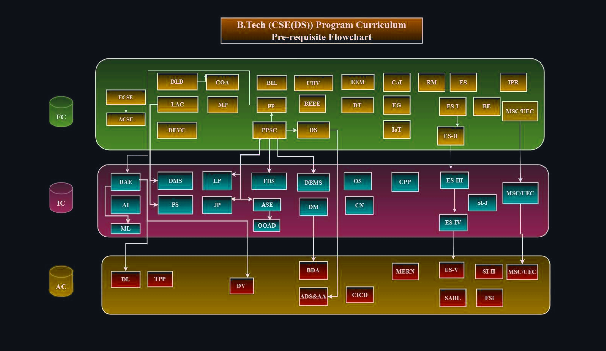
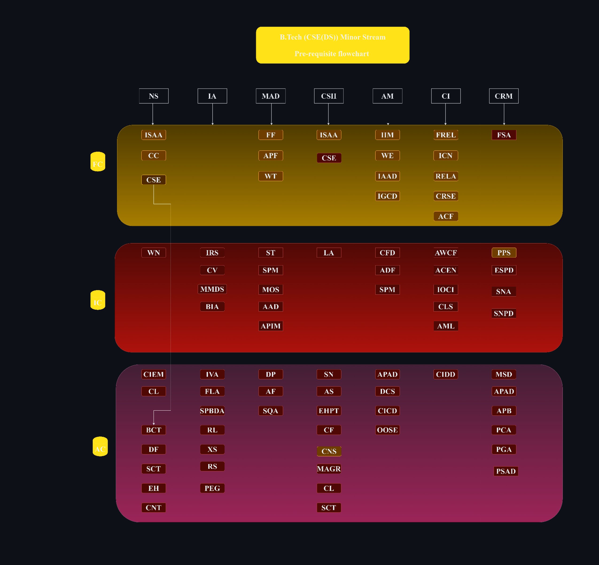
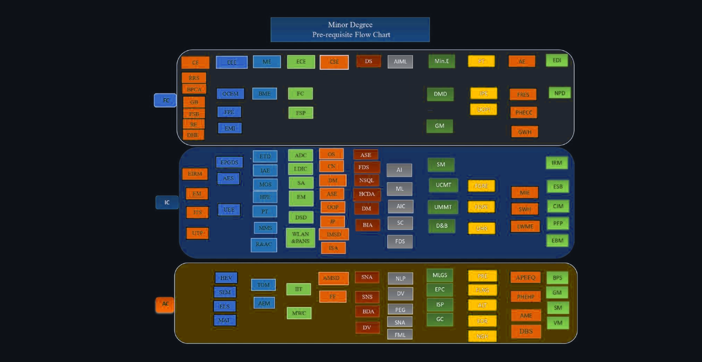

# B.Tech CSE (Data Science) — Program Curriculum & Syllabus (2025)

**Institution:** Aditya University (Aditya Nagar, ADB Road, Surampalem – 533 437)  
**Department:** Department of Data Science / Computer Science and Engineering  
**Program:** B.Tech — Four-Year Degree in Computer Science and Engineering (Data Science)  
**Applicable Batch:** Batches admitted from A.Y. 2025–26  
**Source PDF:** [`raw/ds-syllabus.pdf`](raw/ds-syllabus.pdf)

---

## Table of Contents

1. [Vision, Mission, PEOs, PSOs & Program Outcomes (POs)](#1-vision-mission-peos-psos--program-outcomes-pos)
2. [Programs, Minor Degrees & Minor Streams Offered](#2-programs-minor-degrees--minor-streams-offered)
3. [Credit Distribution & Category-Wise Course Tables](#3-credit-distribution--category-wise-course-tables)
4. [Pre-requisite Flowcharts & Course Abbreviations](#4-pre-requisite-flowcharts--course-abbreviations)
5. [Suggestive Semester-Wise Curriculum (Semesters I–VIII)](#5-suggestive-semester-wise-curriculum-semesters-iviii)
6. [Minor Stream Course Tables](#6-minor-stream-course-tables)
7. [University Open Elective Course Tables](#7-university-open-elective-course-tables)
8. [Minor Degree Course Tables (Other Branches)](#8-minor-degree-course-tables-other-branches)
9. [Detailed Course Syllabi — Major Core Courses (MCC)](#9-detailed-course-syllabi--major-core-courses-mcc)
10. [Detailed Course Syllabi — Multidisciplinary Courses (MDC)](#10-detailed-course-syllabi--multidisciplinary-courses-mdc)
11. [Detailed Course Syllabi — Ability Enhancement Courses (AEC)](#11-detailed-course-syllabi--ability-enhancement-courses-aec)
12. [Detailed Course Syllabi — Skill Enhancement Courses (SEC)](#12-detailed-course-syllabi--skill-enhancement-courses-sec)
13. [Detailed Course Syllabi — Value Added Courses (VAC)](#13-detailed-course-syllabi--value-added-courses-vac)
14. [Detailed Course Syllabi — Mandatory Courses (MC)](#14-detailed-course-syllabi--mandatory-courses-mc)
15. [Detailed Course Syllabi — Minor Streams & Open Electives](#15-detailed-course-syllabi--minor-streams--open-electives)

---

## 1. Vision, Mission, PEOs, PSOs & Program Outcomes (POs)

### Department Vision
To be a center of excellence in Data Science through innovative education and impactful research, fostering global recognition and sustainability.

### Department Mission
- **M1:** Equip students with advanced Data Science knowledge and skills to solve industrial and societal challenges.
- **M2:** Foster research and innovation through interdisciplinary collaboration in emerging technologies.
- **M3:** Collaborate with industry and community to develop inclusive, sustainable data-driven solutions.

### Program Educational Objectives (PEOs)
- **PEO 1:** Apply Data Science knowledge to create solutions for global and industrial challenges.
- **PEO 2:** Innovate through interdisciplinary research and sustain lifelong learning.
- **PEO 3:** Demonstrate ethics and build strong collaborations with industry.

### Program Specific Outcomes (PSOs)
- **PSO 1:** Apply data engineering to create scalable data systems.
- **PSO 2:** Employ data analytics and ML to analyze data and enable decisions.

### Program Outcomes (POs)
- **PO1 — Engineering knowledge:** Apply the knowledge of mathematics, science, engineering fundamentals, and an engineering specialization to the solution of complex engineering problems.
- **PO2 — Problem analysis:** Identify, formulate, review research literature, and analyze complex engineering problems reaching substantiated conclusions using first principles of mathematics, natural sciences, and engineering sciences.
- **PO3 — Design/development of solutions:** Design solutions for complex engineering problems and design system components or processes that meet the specified needs with appropriate consideration for the public health and safety, and the cultural, societal, and environmental considerations.
- **PO4 — Conduct investigations of complex problems:** Use research-based knowledge and research methods including design of experiments, analysis and interpretation of data, and synthesis of the information to provide valid conclusions.
- **PO5 — Engineering tool usage:** Create, select, and apply appropriate techniques, resources, and modern engineering and IT tools including prediction and modeling to complex engineering activities with an understanding of the limitations.
- **PO6 — The Engineer and the world:** Apply reasoning informed by the contextual knowledge to assess societal, health, safety, legal and cultural issues and the consequent responsibilities relevant to the professional engineering practice.
- **PO7 — Ethics:** Apply ethical principles and commit to professional ethics and responsibilities and norms of the engineering practice.
- **PO8 — Individual and collaborative teamwork:** Function effectively as an individual, and as a member or leader in diverse teams, and in multidisciplinary settings.
- **PO9 — Communication:** Communicate effectively on complex engineering activities with the engineering community and with society at large, such as being able to comprehend and write effective reports and design documentation, make effective presentations, and give and receive clear instructions.
- **PO10 — Project management and finance:** Demonstrate knowledge and understanding of the engineering and management principles and apply these to one's own work, as a member and leader in a team, to manage projects and in multidisciplinary environments.
- **PO11 — Life-long learning:** Recognize the need for and have the preparation and ability to engage in independent and life-long learning in the broadest context of technological change.

---

## 2. Programs, Minor Degrees & Minor Streams Offered

### UG Programs Offered
- **B.Tech in Computer Science and Engineering (Data Science)**
- **B.Tech in Computer Science and Engineering (Data Science) with Minor Degree in:**
  - Civil Engineering
  - Electrical and Electronics Engineering
  - Mechanical Engineering
  - Electronics and Communication Engineering
  - Petroleum Technology
  - Mining Engineering
  - Agricultural Engineering
  - Entrepreneurship Development and Incubation
  - Quantum Technologies

### Minor Streams Offered in B.Tech CSE (Data Science)
- Minor Stream in **Network Security**
- Minor Stream in **Intelligence Analytics**
- Minor Stream in **Mobile Application Development**
- Minor Stream in **Cyber Security** *(Industry Integrated Program — L&T)*
- Minor Stream in **Agile Methodology with DevOps Programming** *(Industry Integrated Program — L&T)*
- Minor Stream in **Cloud Infrastructure** *(Certification Programs — CISCO, Red Hat, Oracle, AWS, Google & Microsoft)*

---

## 3. Credit Distribution & Category-Wise Course Tables

### Credit Division Category-Wise

| S.No | Broad Category of Course | UGC | Credits |
| :---: | :--- | :---: | :---: |
| 1 | Major Core Courses (MCC) | 80 | 85 |
| 2 | Minor Stream Courses (MSC) **(or)** University Open Elective Courses (UEC) | 32 | 32 |
| 3 | Multidisciplinary Courses (MDC) | 9 | 9 |
| 4 | Ability Enhancement Courses (AEC) | 8 | 9 |
| 5 | Skill Enhancement Courses (SEC) | 9 | 5 |
| 6 | Value Added Courses (VAC) | 6–8 | 4 |
| 7 | Summer Internships (SI) | 2–4 | 4 |
| 8 | Full Semester Internship (PROJ) | 12 | 12 |
| 9 | Mandatory Courses (MC) | — | 0 |
| **Total** | **Total Credits to be earned for B.Tech Degree** | **160** | **160** |

> **Course Levels:** `FC` = Foundation Courses | `IC` = Intermediate-level Courses | `AC` = Advanced Courses  
> *Note: To acquire a minor degree, a student has to earn 20 credits in addition to the 160 credits.*

---

### Major Core Courses (MCC) — 85 Credits

| Course Code | Course Name | Level | L | T | P | C | CIE | SEE | Total | Pre-requisite |
| :---: | :--- | :---: | :---: | :---: | :---: | :---: | :---: | :---: | :---: | :---: |
| `2501MA01` | Linear Algebra & Calculus | FC | 2 | 1 | 0 | 3 | 50 | 50 | 100 | — |
| `2501MA02` | Differential Equations & Vector Calculus | FC | 2 | 1 | 0 | 3 | 50 | 50 | 100 | — |
| `2501PH02` | Modern Physics | FC | 2 | 0 | 1 | 3 | 50 | 50 | 100 | — |
| `2501ME01` | Engineering Graphics | FC | 1 | 0 | 2 | 3 | 50 | 50 | 100 | — |
| `2501CS01` | Programming for Problem Solving Using C | FC | 2 | 0 | 2 | 4 | 50 | 50 | 100 | — |
| `2501IT01` | Business Intelligence Lab | FC | 0 | 0 | 2 | 2 | 50 | 50 | 100 | — |
| `2501CS03` | Data Structures | FC | 2 | 0 | 2 | 4 | 50 | 50 | 100 | PPSC |
| `2501CS71` | Computer Organization & Architecture | FC | 2 | 1 | 0 | 3 | 50 | 50 | 100 | DLD |
| `2501IT42` | Programming with Python | FC | 2 | 0 | 2 | 4 | 50 | 50 | 100 | PPSC |
| `2501CS08` | Object Oriented Programming through C++ | IC | 2 | 0 | 2 | 4 | 50 | 50 | 100 | PPSC |
| `2501MA08` | Discrete Mathematics | IC | 2 | 1 | 0 | 3 | 50 | 50 | 100 | LAC |
| `2501CS34` | Fundamentals of Data Science | IC | 2 | 0 | 1 | 3 | 50 | 50 | 100 | PPSC |
| `2501IT05` | Database Management Systems | IC | 2 | 0 | 2 | 4 | 50 | 50 | 100 | PPSC |
| `2501MA09` | Probability & Statistics | IC | 2 | 1 | 0 | 3 | 50 | 50 | 100 | LAC |
| `2501AI02` | Artificial Intelligence | IC | 2 | 0 | 1 | 3 | 50 | 50 | 100 | — |
| `2501IT06` | Java Programming | IC | 2 | 0 | 2 | 4 | 50 | 50 | 100 | PPSC |
| `2501CS09` | Language Processors | IC | 2 | 1 | 0 | 3 | 50 | 50 | 100 | PPSC |
| `2501IT07` | Agile Software Engineering | IC | 2 | 0 | 1 | 3 | 50 | 50 | 100 | PPSC |
| `2501CS13` | Operating Systems | IC | 2 | 0 | 1 | 3 | 50 | 50 | 100 | — |
| `2501CS07` | Computer Networks | IC | 2 | 0 | 1 | 3 | 50 | 50 | 100 | — |
| `2501AI03` | Data Mining | IC | 1 | 0 | 2 | 3 | 50 | 50 | 100 | — |
| `2501CS10` | Advanced Data Structures and Algorithm Analysis | AC | 2 | 0 | 1 | 3 | 50 | 50 | 100 | DS |
| `2501AI05` | Machine Learning | IC | 2 | 0 | 2 | 4 | 50 | 50 | 100 | DAE |
| `2501AI11` | Deep Learning | AC | 2 | 0 | 2 | 4 | 50 | 50 | 100 | DAE |
| `2501AI04` | Big Data Analytics | AC | 2 | 0 | 1 | 3 | 50 | 50 | 100 | DM |
| `2501AI19` | Data Visualization | AC | 2 | 0 | 1 | 3 | 50 | 50 | 100 | DAE |
| **Total** | | | **48** | **6** | **31** | **85** | | | | |

---

### Multidisciplinary Courses (MDC) — 9 Credits

| Course Code | Course Name | Level | L | T | P | C | CIE | SEE | Total | Pre-requisite |
| :---: | :--- | :---: | :---: | :---: | :---: | :---: | :---: | :---: | :---: | :---: |
| `2501EE01` | Basic Electrical & Electronics Engineering | FC | 2 | 0 | 2 | 4 | 50 | 50 | 100 | — |
| `2501EC95` | Digital Logic Design | FC | 2 | 1 | 0 | 3 | 50 | 50 | 100 | — |
| `2501MB01` | Engineering Economics & Management | FC | 2 | 0 | 0 | 2 | 50 | 50 | 100 | — |
| **Total** | | | **6** | **1** | **2** | **9** | | | | |

---

### Ability Enhancement Courses (AEC) — 9 Credits

| Course Code | Course Name | Level | L | T | P | C | CIE | SEE | Total | Pre-requisite |
| :---: | :--- | :---: | :---: | :---: | :---: | :---: | :---: | :---: | :---: | :---: |
| `2501EN01` | Essential Cognitive Skills for Engineers | FC | 0 | 0 | 1 | 1 | 100 | — | 100 | — |
| `2501EN02` / `2501UC03–06` | Advanced Cognitive Skills for Engineers **(or)** Proficiency in Foreign Language (Japanese/German/Spanish/French) | FC | 0 | 0 | 1 | 1 | 100 | — | 100 | ECSE |
| `2501UC07` | Design Thinking using AI | FC | 0 | 0 | 1 | 1 | 100 | — | 100 | — |
| `2501UC08` | Universal Human Values | FC | 2 | 0 | 0 | 2 | 100 | — | 100 | — |
| `2501UC09` | Technical Paper Publication | AC | 0 | 0 | 2 | 2 | 100 | — | 100 | — |
| `2501CS72` | Student Activity Based Learning | AC | 0 | 0 | 0 | 2 | 100 | — | 100 | — |
| **Total** | | | **2** | **0** | **5** | **9** | | | | |

---

### Skill Enhancement Courses (SEC) — 5 Credits

| Course Code | Course Name | Level | L | T | P | C | CIE | SEE | Total | Pre-requisite |
| :---: | :--- | :---: | :---: | :---: | :---: | :---: | :---: | :---: | :---: | :---: |
| `2501CS17` | Object Oriented Analysis & Design using UML | IC | 0 | 0 | 2 | 2 | 50 | 50 | 100 | ASE |
| `2501AI34` | Web Application Development using MERN Stack | AC | 0 | 0 | 2 | 2 | 50 | 50 | 100 | — |
| `2501CS19` | CI/CD using DevOps | AC | 0 | 0 | 1 | 1 | 100 | — | 100 | — |
| **Total** | | | **0** | **0** | **5** | **5** | | | | |

---

### Value Added Courses (VAC) — 4 Credits

| Course Code | Course Name | Level | L | T | P | C | CIE | SEE | Total | Pre-requisite |
| :---: | :--- | :---: | :---: | :---: | :---: | :---: | :---: | :---: | :---: | :---: |
| `2501CS04` | Internet of Things | FC | 0 | 0 | 1 | 1 | 50 | 50 | 100 | — |
| `2501AI06` | Data Analysis Essentials | IC | 0 | 0 | 2 | 2 | 50 | 50 | 100 | PP |
| `2501UC11` | Employability Skills-I | FC | 0 | 0 | 3 | 0 | 100 | — | 100 | — |
| `2501UC13` | Employability Skills-II | FC | 0 | 0 | 3 | 0 | 100 | — | 100 | ES-I |
| `2501UC14` | Employability Skills-III | IC | 0 | 0 | 3 | 0 | 100 | — | 100 | ES-II |
| `2501UC15` | Employability Skills-IV | IC | 0 | 0 | 3 | 0 | 100 | — | 100 | ES-III |
| `2501UC16` | Employability Skills-V | AC | 0 | 0 | 3 | 1 | 100 | — | 100 | ES-IV |
| **Total** | | | **0** | **0** | **18** | **4** | | | | |

---

### Summer Internships (SI), Full Semester Internship (PROJ) & Mandatory Courses (MC)

| Category | Course Code | Course Name | Level | L | T | P | C | CIE | SEE | Total |
| :---: | :---: | :--- | :---: | :---: | :---: | :---: | :---: | :---: | :---: | :---: |
| **SI** | `2501CS20` | Summer Internship-I | IC | 0 | 0 | 2 | 2 | 100 | — | 100 |
| **SI** | `2501CS21` | Summer Internship-II | AC | 0 | 0 | 2 | 2 | 100 | — | 100 |
| **PROJ** | `2501CS22` | Full Semester Internship | AC | 0 | 0 | 12 | 12 | 50 | 50 | 100 |
| **MC** | `2501AC01` | Environmental Science | FC | 2 | 0 | 0 | 0 | 100 | — | 100 |
| **MC** | `2501AC02` | Constitution of India | FC | 2 | 0 | 0 | 0 | 100 | — | 100 |
| **MC** | `2501AC03` | Research Methodology | FC | 2 | 0 | 0 | 0 | 100 | — | 100 |
| **MC** | `2501AC04` | Intellectual Property Rights & Patents | FC | 2 | 0 | 0 | 0 | 100 | — | 100 |
| **MC** | `2501AC05` | Indian Knowledge Systems | FC | 2 | 0 | 0 | 0 | 100 | — | 100 |

---

## 4. Pre-requisite Flowcharts & Course Abbreviations

### 4.1 Program Curriculum Pre-requisite Flowchart (Dark Mode)

| Foundation Courses (FC) | Intermediate-Level Courses (IC) | Advanced Courses (AC) |
| :--- | :--- | :--- |
| **EG:** Engineering Graphics | **DMS:** Discrete Mathematics | **ADSAA:** Advanced Data Structures & Algorithm Analysis |
| **LAC:** Linear Algebra & Calculus | **FDS:** Fundamentals of Data Science | **DL:** Deep Learning |
| **DEVC:** Differential Equations & Vector Calculus | **DBMS:** Database Management Systems | **BDA:** Big Data Analytics |
| **MP:** Modern Physics | **PS:** Probability & Statistics | **DV:** Data Visualization |
| **PP:** Programming with Python | **AI:** Artificial Intelligence | **TPP:** Technical Paper Publication |
| **PPSC:** Programming for Problem Solving Using C | **JP:** Java Programming | **MERN:** Web Application Development using MERN Stack |
| **BIL:** Business Intelligence Lab | **CPP:** Object Oriented Programming Through C++ | **CICD:** CI/CD using DevOps |
| **DS:** Data Structures | **LP:** Language Processors | **SI-II:** Summer Internship-II |
| **BEEE:** Basic Electrical & Electronics Engineering | **ASE:** Agile Software Engineering | **FSI:** Full Semester Internship |
| **DLD:** Digital Logic Design | **OS:** Operating Systems | **ES-V:** Employability Skills-V |
| **COA:** Computer Organization & Architecture | **CN:** Computer Networks | **SABL:** Student Activity Based Learning |
| **EEM:** Engineering Economics & Management | **DM:** Data Mining | |
| **ECSE:** Essential Cognitive Skills for Engineers | **OOAD:** Object Oriented Analysis & Design using UML | |
| **ACSE:** Advanced Cognitive Skills for Engineers | **DAE:** Data Analysis Essentials | |
| **DT:** Design Thinking using AI | **ML:** Machine Learning | |
| **UHV:** Universal Human Values | **SI-I:** Summer Internship-I | |
| **ES-I / ES-II:** Employability Skills I & II | **ES-III / ES-IV:** Employability Skills III & IV | |
| **IoT:** Internet of Things | **MSC / UEC:** Minor Stream / University Elective Courses | |
| **ES / CoI / RM / IPR:** Mandatory Courses | | |

---

### 4.2 Minor Stream Pre-requisite Flowchart (Dark Mode)

---

### 4.3 Minor Degree Pre-requisite Flowchart (Dark Mode)

---

## 5. Suggestive Semester-Wise Curriculum (Semesters I–VIII)

### I Semester

| Course Code | Course Title | Category | Level | L | T | P | Total Credits | Total Hours |
| :---: | :--- | :---: | :---: | :---: | :---: | :---: | :---: | :---: |
| `2501MA01` | Linear Algebra & Calculus | MCC | FC | 2 | 1 | 0 | 3 | 3 |
| `2501PH02` | Modern Physics | MCC | FC | 2 | 0 | 1 | 3 | 4 |
| `2501CS01` | Programming for Problem Solving Using C | MCC | FC | 2 | 0 | 2 | 4 | 6 |
| `2501IT01` | Business Intelligence Lab | MCC | FC | 0 | 0 | 2 | 2 | 4 |
| `2501ME01` | Engineering Graphics | MCC | FC | 1 | 0 | 2 | 3 | 5 |
| `2501EC95` | Digital Logic Design | MDC | FC | 2 | 1 | 0 | 3 | 3 |
| `2501EN01` | Essential Cognitive Skills for Engineers | AEC | FC | 0 | 0 | 1 | 1 | 2 |
| `2501UC07` | Design Thinking using AI | AEC | FC | 0 | 0 | 1 | 1 | 2 |
| **Total** | | | | **9** | **2** | **9** | **20** | **29** |

### II Semester

| Course Code | Course Title | Category | Level | L | T | P | Total Credits | Total Hours |
| :---: | :--- | :---: | :---: | :---: | :---: | :---: | :---: | :---: |
| `2501MA02` | Differential Equations & Vector Calculus | MCC | FC | 2 | 1 | 0 | 3 | 3 |
| `2501CS03` | Data Structures | MCC | FC | 2 | 0 | 2 | 4 | 6 |
| `2501IT42` | Programming with Python | MCC | FC | 2 | 0 | 2 | 4 | 6 |
| `2501CS71` | Computer Organization & Architecture | MCC | FC | 2 | 1 | 0 | 3 | 3 |
| `2501EE01` | Basic Electrical & Electronics Engineering | MDC | FC | 2 | 0 | 2 | 4 | 6 |
| `2501EN02` | Advanced Cognitive Skills for Engineers | AEC | FC | 0 | 0 | 1 | 1 | 2 |
| `2501UC08` | Universal Human Values | AEC | FC | 2 | 0 | 0 | 2 | 2 |
| `2501UC11` | Employability Skills-I * | VAC | FC | 0 | 0 | 3 | 0 | 3 |
| `2501AC01` | Environmental Science | MC | FC | 2 | 0 | 0 | 0 | 2 |
| **Total** | | | | **14** | **2** | **10** | **21** | **33** |

### III Semester

| Course Code | Course Title | Category | Level | L | T | P | Total Credits | Total Hours |
| :---: | :--- | :---: | :---: | :---: | :---: | :---: | :---: | :---: |
| `2501MA09` | Probability & Statistics | MCC | IC | 2 | 1 | 0 | 3 | 3 |
| `2501CS10` | Advanced Data Structures and Algorithm Analysis | MCC | AC | 2 | 0 | 1 | 3 | 4 |
| `2501CS34` | Fundamentals of Data Science | MCC | IC | 2 | 0 | 1 | 3 | 4 |
| `2501IT05` | Database Management Systems | MCC | IC | 2 | 0 | 2 | 4 | 6 |
| `2501IT07` | Agile Software Engineering | MCC | IC | 2 | 0 | 1 | 3 | 4 |
| `2501CS08` | Object Oriented Programming through C++ | MCC | IC | 2 | 0 | 2 | 4 | 6 |
| `2501AI06` | Data Analysis Essentials | VAC | IC | 0 | 0 | 2 | 2 | 4 |
| `2501UC13` | Employability Skills-II * | VAC | FC | 0 | 0 | 3 | 0 | 0 |
| `2501AC02` | Constitution of India | MC | FC | 2 | 0 | 0 | 0 | 2 |
| **Total** | | | | **14** | **1** | **9** | **22** | **33** |

### IV Semester

| Course Code | Course Title | Category | Level | L | T | P | Total Credits | Total Hours |
| :---: | :--- | :---: | :---: | :---: | :---: | :---: | :---: | :---: |
| `2501MA08` | Discrete Mathematics | MCC | IC | 2 | 1 | 0 | 3 | 3 |
| `2501AI03` | Data Mining | MCC | IC | 1 | 0 | 2 | 3 | 5 |
| `2501IT06` | Java Programming | MCC | IC | 2 | 0 | 2 | 4 | 6 |
| `2501CS13` | Operating Systems | MCC | IC | 2 | 0 | 1 | 3 | 4 |
| — | Minor Stream Course-1 / University Elective Course-1 | MSC/UEC | FC | 2 | 0 | 0 | 2 | 2 |
| — | Minor Stream Course-2 / University Elective Course-2 | MSC/UEC | FC | 2 | 0 | 1 | 3 | 4 |
| `2501AI34` | Web Application Development using MERN Stack | SEC | AC | 0 | 0 | 2 | 2 | 4 |
| `2501UC14` | Employability Skills-III * | VAC | FC | 0 | 0 | 3 | 0 | 0 |
| `2501AC03` | Research Methodology | MC | FC | 2 | 0 | 0 | 0 | 2 |
| **Total** | | | | **13** | **1** | **11** | **20** | **30** |

### V Semester

| Course Code | Course Title | Category | Level | L | T | P | Total Credits | Total Hours |
| :---: | :--- | :---: | :---: | :---: | :---: | :---: | :---: | :---: |
| `2501CS07` | Computer Networks | MCC | IC | 2 | 0 | 1 | 3 | 4 |
| `2501CS09` | Language Processors | MCC | IC | 2 | 1 | 0 | 3 | 3 |
| `2501AI02` | Artificial Intelligence | MCC | AC | 2 | 0 | 1 | 3 | 4 |
| — | Minor Stream Course-3 / University Elective Course-3 | MSC/UEC | IC/AC | 2 | 0 | 2 | 4 | 4 |
| — | Minor Stream Course-4 / University Elective Course-4 | MSC/UEC | IC/AC | 2 | 0 | 2 | 4 | 4 |
| — | Minor Stream Course-5 / University Elective Course-5 | MSC/UEC | IC/AC | 2 | 0 | 1 | 3 | 4 |
| `2501CS17` | Object Oriented Analysis & Design using UML | SEC | IC | 0 | 0 | 2 | 2 | 4 |
| `2501UC15` | Employability Skills-IV * | VAC | FC | 0 | 0 | 3 | 0 | 0 |
| `2501CS20` | Summer Internship-I | SI | IC | 0 | 0 | 2 | 2 | 4 |
| `2501AC04` | Intellectual Property Rights & Patents | MC | FC | 2 | 0 | 0 | 0 | 0 |
| **Total** | | | | **14** | **1** | **14** | **24** | **31** |

### VI Semester

| Course Code | Course Title | Category | Level | L | T | P | Total Credits | Total Hours |
| :---: | :--- | :---: | :---: | :---: | :---: | :---: | :---: | :---: |
| `2501AI05` | Machine Learning | MCC | IC | 2 | 0 | 2 | 4 | 6 |
| `2501AI19` | Data Visualization | MCC | AC | 2 | 0 | 1 | 3 | 4 |
| `2501AI04` | Big Data Analytics | MCC | AC | 2 | 0 | 1 | 3 | 4 |
| — | Minor Stream Course-6 / University Elective Course-6 | MSC/UEC | IC/AC | 2 | 0 | 1 | 3 | 4 |
| — | Minor Stream Course-7 / University Elective Course-7 | MSC/UEC | IC/AC | 2 | 0 | 1 | 3 | 4 |
| — | Minor Stream Course-8 / University Elective Course-8 | MSC/UEC | IC/AC | 2 | 0 | 2 | 4 | 4 |
| `2501CS04` | Internet of Things | VAC | FC | 0 | 0 | 1 | 1 | 2 |
| `2501AC05` | Indian Knowledge Systems | MC | FC | 2 | 0 | 0 | 0 | 2 |
| **Total** | | | | **14** | **0** | **9** | **21** | **30** |

### VII Semester

| Course Code | Course Title | Category | Level | L | T | P | Total Credits | Total Hours |
| :---: | :--- | :---: | :---: | :---: | :---: | :---: | :---: | :---: |
| `2501AI11` | Deep Learning | MCC | AC | 2 | 0 | 2 | 4 | 6 |
| `2501MB01` | Engineering Economics & Management | MDC | FC | 2 | 0 | 0 | 2 | 2 |
| — | Minor Stream Course-9 / University Elective Course-9 | MSC/UEC | AC | 2 | 0 | 1 | 3 | 4 |
| — | Minor Stream Course-10 / University Elective Course-10 | MSC/UEC | AC | 2 | 0 | 1 | 3 | 4 |
| `2501CS19` | CI/CD using DevOps | SEC | AC | 0 | 0 | 1 | 1 | 2 |
| `2501CS21` | Summer Internship-II | SI | AC | 0 | 0 | 2 | 2 | 4 |
| **Total** | | | | **8** | **0** | **7** | **15** | **22** |

### VIII Semester

| Course Code | Course Title | Category | Level | L | T | P | Total Credits | Total Hours |
| :---: | :--- | :---: | :---: | :---: | :---: | :---: | :---: | :---: |
| `2501UC09` | Technical Paper Publication | AEC | AC | 0 | 0 | 2 | 2 | 4 |
| `2501CS72` | Student Activity Based Learning | AEC | AC | 0 | 0 | 0 | 2 | 0 |
| `2501UC16` | Employability Skills-V * | VAC | AC | 0 | 0 | 3 | 1 | 6 |
| `2501CS22` | Full Semester Internship | PROJ | AC | 0 | 0 | 12 | 12 | 24 |
| **Total** | | | | **0** | **0** | **17** | **17** | **34** |

---

## 6. Minor Stream Course Tables (32 Credits Each)

### 6.1 Minor Stream: Network Security
| Course Code | Course Name | Level | L | T | P | C | Pre-requisite |
| :---: | :--- | :---: | :---: | :---: | :---: | :---: | :---: |
| `2501CS32` | Cyber Security Essentials | FC | 2 | 0 | 1 | 3 | — |
| `2501CS30` | Information Security Analysis & Audit | FC | 2 | 0 | 0 | 2 | — |
| `2501CS23` | Cloud Computing | FC | 2 | 0 | 2 | 4 | — |
| `2501CS24` | Wireless Networks | IC | 2 | 0 | 1 | 3 | — |
| `2501CS25` | Cloud IoT & Edge ML | AC | 2 | 0 | 1 | 3 | — |
| `2501CS28` | Ethical Hacking | AC | 2 | 0 | 2 | 4 | — |
| `2501CS27` | Digital Forensics | AC | 2 | 0 | 1 | 3 | — |
| `2501CS26` | Block Chain Technologies | AC | 2 | 0 | 2 | 4 | CSE |
| `2501CS31` | Cyber Laws | AC | 2 | 0 | 1 | 3 | — |
| `2501CS33` | Secure Coding Techniques | AC | 2 | 0 | 1 | 3 | — |

### 6.2 Minor Stream: Intelligence Analytics
| Course Code | Course Name | Level | L | T | P | C | Pre-requisite |
| :---: | :--- | :---: | :---: | :---: | :---: | :---: | :---: |
| `2501AI07` | Computer Vision | IC | 2 | 0 | 1 | 3 | DAE |
| `2501AI26` | Information Retrieval Systems | IC | 2 | 0 | 1 | 3 | — |
| `2501AI18` | Mining Massive Data Sets | IC | 2 | 0 | 1 | 3 | DM |
| `2501CS36` | Business Intelligence & Analytics | IC | 2 | 0 | 2 | 4 | PPSC |
| `2501CS35` | Image & Video Analytics | AC | 2 | 0 | 0 | 2 | — |
| `2501CS38` | Security & Privacy for Big Data Analytics | AC | 2 | 0 | 1 | 3 | — |
| `2501AI09` | Reinforcement Learning | AC | 2 | 0 | 2 | 4 | DAE |
| `2501AI13` | Recommender Systems | AC | 2 | 0 | 2 | 4 | DAE |
| `2501AI16` | Prompt Engineering & GenAI | AC | 2 | 0 | 1 | 3 | ML |
| `2501AI08` | Expert Systems | AC | 2 | 0 | 1 | 3 | — |

### 6.3 Minor Stream: Mobile Application Development
| Course Code | Course Name | Level | L | T | P | C | Pre-requisite |
| :---: | :--- | :---: | :---: | :---: | :---: | :---: | :---: |
| `2501IT12` | Flutter Fundamentals | FC | 0 | 0 | 2 | 2 | — |
| `2501IT14` | Web Technologies | FC | 2 | 0 | 2 | 4 | JP |
| `2501IT15` | Software Testing | IC | 2 | 0 | 1 | 3 | ASE |
| `2501IT16` | Software Project Management | IC | 2 | 0 | 1 | 3 | ASE |
| `2501IT17` | Mobile Operating System | IC | 2 | 0 | 1 | 3 | — |
| `2501CS24` | Wireless Networks | IC | 2 | 0 | 1 | 3 | — |
| `2501AI24` | API & Micro Services | IC | 2 | 0 | 2 | 4 | JP |
| `2501CS25` | Cloud IoT & Edge ML | AC | 2 | 0 | 1 | 3 | — |
| `2501CS28` | Ethical Hacking | AC | 2 | 0 | 2 | 4 | — |
| `2501IT22` | Software Quality Assurance | AC | 2 | 0 | 1 | 3 | ASE |

### 6.4 Minor Stream: Cyber Security (Industry Integrated Program — L&T)
| Course Code | Course Name | Level | L | T | P | C | Pre-requisite |
| :---: | :--- | :---: | :---: | :---: | :---: | :---: | :---: |
| `2501CS32` | Cyber Security Essentials | FC | 2 | 0 | 1 | 3 | — |
| `2501CS30` | Information Security Analysis & Audit | FC | 2 | 0 | 0 | 2 | — |
| `2501CS42` | Linux Administration | IC | 0 | 0 | 3 | 3 | — |
| `2501IT03` | Cryptography & Network Security | AC | 2 | 0 | 1 | 3 | — |
| `2501CS43` | Secure Networking | AC | 0 | 0 | 3 | 3 | — |
| `2501CS44` | Application Security | AC | 0 | 0 | 3 | 3 | — |
| `2501CS45` | Ethical Hacking & Penetration Testing | AC | 0 | 0 | 3 | 3 | — |
| `2501CS46` | Cyber Forensic | AC | 0 | 0 | 3 | 3 | — |
| `2501CS47` | Malware Analysis & Governance, Risk & Compliance | AC | 0 | 0 | 3 | 3 | — |
| `2501CS31` | Cyber Laws | AC | 2 | 0 | 1 | 3 | — |
| `2501CS33` | Secure Coding Techniques | AC | 2 | 0 | 1 | 3 | — |

### 6.5 Minor Stream: Agile Methodology with DevOps Programming (L&T)
| Course Code | Course Name | Level | L | T | P | C | Pre-requisite |
| :---: | :--- | :---: | :---: | :---: | :---: | :---: | :---: |
| `2501CS48` | IT Infrastructure Management | FC | 0 | 0 | 3 | 3 | — |
| `2501CS49` | Web Engineering | FC | 0 | 0 | 2 | 2 | — |
| `2501CS50` | Intro to Azure & AWS DevOps | FC | 0 | 0 | 3 | 3 | — |
| `2501CS51` | Intro to Google Cloud DevOps | FC | 0 | 0 | 3 | 3 | — |
| `2501CS52` | Cloud Fundamentals & DevOps | IC | 0 | 0 | 3 | 3 | — |
| `2501CS53` | Agile with DevOps Fundamentals & Usage | IC | 0 | 0 | 3 | 3 | — |
| `2501IT16` | Software Project Management | IC | 2 | 0 | 1 | 3 | ASE |
| `2501CS54` | Agile based Project Automation with DevOps | AC | 0 | 0 | 3 | 3 | — |
| `2501CS55` | DevOps Container Services | AC | 0 | 0 | 3 | 3 | — |
| `2501CS56` | CI & CD (Continuous Integration & Continuous Development) | AC | 0 | 0 | 3 | 3 | — |
| `2501CS57` | Object Oriented Software Engineering | AC | 0 | 0 | 3 | 3 | — |

### 6.6 Minor Stream: Cloud Infrastructure (CISCO, Red Hat, Oracle, AWS, Google & Microsoft)
| Course Code | Course Name | Level | L | T | P | C | Pre-requisite |
| :---: | :--- | :---: | :---: | :---: | :---: | :---: | :---: |
| `2501CS68` | Enterprise Linux Fundamentals | FC | 0 | 0 | 2 | 2 | — |
| `2501CS58` | Linux System Administration | FC | 0 | 0 | 3 | 3 | — |
| `2501CS59` | Introduction to Cloud Networking | FC | 1 | 0 | 3 | 4 | — |
| `2501CS60` | Routing & Switching Essentials | FC | 0 | 0 | 3 | 3 | — |
| `2501CS62` | Advanced Cloud Networking | IC | 1 | 0 | 3 | 4 | — |
| `2501CS67` | Introduction to Cloud Computing Core Concepts | IC | 0 | 0 | 3 | 3 | — |
| `2501CS61` | Cloud Architecture & Platform Services | FC | 0 | 0 | 3 | 3 | — |
| `2501CS63` | Enterprise Cloud Infrastructure | IC | 0 | 0 | 3 | 3 | — |
| `2501CS69` | Cloud Security | IC | 1 | 0 | 3 | 4 | — |
| `2501CS64` | Machine Learning Services on Cloud | IC | 0 | 0 | 3 | 3 | — |

---

## 7. University Open Elective Course Tables

- **AI & ML Track (32 Credits):** `2501AI02` Artificial Intelligence (3C), `2501AI05` Machine Learning (4C), `2501AI27` AI & Data Science (3C), `2501AI28` AI in Healthcare (3C), `2501AI11` Deep Learning (4C), `2501AI10` Natural Language Processing (3C), `2501AI09` Reinforcement Learning (3C), `2501AI29` AI in Agriculture (3C), `2501AI30` Robotics & AI (3C), `2501AI31` AI in Finance & Economics (3C).
- **Production Excellence Track (32 Credits):** `2501ME81` Fundamentals of Production Excellence (2C), `2501ME82` Six Sigma for Production Excellence (3C), `2501ME83` Quality Excellence in Production (3C), `2501ME84` Digital Transformation for Production Excellence (3C), `2501ME85` Agile Production Systems (3C), `2501ME86` Process Excellence & Optimization (3C), `2501ME87` Risk Management in Production Excellence (3C), `2501ME88` Ethical & Social Responsibility in Production Excellence (3C), `2501ME89` Data-Driven Decision Making for Production Excellence (3C), `2501ME58` Industry 5.0 for Engineers (3C), `2501ME90` Cost Excellence in Production (3C).
- **Supply Chain Management Track (32 Credits):** `2501MB17` Introduction to Supply Chain Management (2C), `2501MB18` Logistics & Distribution Management (3C), `2501MB19` Supply Chain Project Management (3C), `2501MB20` Supply Chain Innovation & Trends (3C), `2501MB21` Supply Chain Analytics (3C), `2501MB22` Demand Planning & Forecasting (3C), `2501MB23` Supply Chain Risk Management (3C), `2501MB24` Inventory Management & Control (3C), `2501MB25` E-Commerce & Supply Chain Management (3C), `2501MB26` Operations Management (3C), `2501MB27` Supply Chain Ethics & Corporate Social Responsibility (3C).
- **Sustainability Track (32 Credits):** `2501CE74` Introduction to Sustainable Development (2C), `2501CE66`/`2501CE79` Natural Disaster Management & Mitigation (3C), `2501CE81` Waste Water Management (3C), `2501CE82` Integrated Solid Waste Management for a Smart City (3C), `2501CE83` Watershed Management (3C), `2501EE33` Energy Audit, Conservation & Management (3C), `2501EE06` Electric Power Generation, Transmission & Distribution Systems (3C), `2501CE75` Sustainable Agriculture & Food Systems (3C), `2501CE76` Sustainable Supply Chain Management (3C), `2501CE77` Sustainable Production Excellence (3C), `2501CE78` AI in Environmental Science and Sustainability (3C).
- **Security Track (32 Credits):** `2501CS32` Cybersecurity Essentials (3C), `2501IT35` Security in Software Development (3C), `2501CS28` Ethical Hacking (3C), `2501CS69` Cloud Security (3C), `2501IT36` Security & Compliance in Business (3C), `2501IT37` Cryptography & Data Security (3C), `2501IT38` Security Awareness & Social Engineering (3C), `2501IT39` Cybersecurity Policy & Strategy (3C), `2501IT40` Security in Emerging Technologies (3C), `2501CS30` Information Security Analysis & Audit (2C), `2501IT41` Financial Information Security & Privacy (3C).
- **Others Track:** `2501CE80` Remote Sensing & GIS Applications (3C), `2501EE36` Electric Energy Storage Systems (3C), `2501EE43` Electrical Safety (3C), `2501EE54` Hybrid & Electric Vehicles (3C), `2501ME73` Organizational Behaviour (3C), `2501ME36` Sustainable Energy Systems (3C), `2501ME37` Solar Energy Systems (3C), `2501ME60` Composite Materials (3C), `2501EC82` Communication Systems (3C), `2501EC83` Electronic Measurements & Instrumentation (3C), `2501EC84` Introduction to Embedded Systems (3C), `2501EC85` Fundamentals of Image Processing (3C), `2501EC77` Sensors and Transducers (3C), `2501CS03` Data Structures (4C), `2501CS65` Computer Organization (3C), `2501CS13` Operating Systems (3C), `2501IT05` Database Management Systems (4C), `2501IT07` Agile Software Engineering (3C), `2501CS07` Computer Networks (3C), `2501IT06` Java Programming (4C), `2501CS68` Enterprise Linux Fundamentals (2C), `2501CS67` AWS Cloud Foundations (3C), `2501CS66` AWS Cloud Development (3C), `2501CS70` Continuous Integration & Delivery using DevOps (3C), `2501IT24` Fundamentals of Salesforce Administration (2C), `2501IT34` Advanced Salesforce Administration (3C), `2501IT23` Principles of Pega Systems (3C), `2501IT26` Pega System Architecture & Design (3C), `2501MB04` Entrepreneurship Development & Incubation (3C), `2501MB05` Business Ethics & Corporate Governance (3C), `2501MB06` Entrepreneurship Development & Business Management (3C), `2501EC29` SoC Design (3C), `2501CS23` Cloud Computing (4C).

---

## 8. Minor Degree Course Tables (Other Branches — 20 Credits Each)

- **Minor Degree in Data Science (for non-DS branches):** `2501IT07` Agile Software Engineering (3C), `2501CS34` Fundamentals of Data Science (3C), `2501CS12` NoSQL Databases (2C), `2501AI03` Data Mining (3C), `2501CS37` Health Care Data Analytics / `2501CS36` Business Intelligence & Analytics (3C), `2501AI04` Big Data Analytics / `2501AI19` Data Visualization (3C), `2501CS41` Social Network Analysis / `2501CS40` Social Networks & Semantic Web (3C).
- **Minor Degree in Civil Engineering:** `2501CE25` Repair & Rehabilitation of Structures (3C), `2501CE43` Building Planning & Computer-Aided Drawing (2C), `2501CE27` Green Buildings (3C), `2501CE40` Fundamentals of Soil Behaviour (3C), `2501CE54` Railway Engineering / `2501CE47` Docks & Harbour Engineering (3C), `2501CE36` Environmental Impact & Risk Management / `2501CE37` Environmental Management (3C), `2501CE56` Urban Transportation Planning / `2501CE49` Intelligent Transportation Systems (3C).
- **Minor Degree in Electrical and Electronics Engineering:** `2501EE55` Operation & Control of Electric Machines (2C), `2501EE56` Fundamentals of Power Electronics (2C), `2501EE13` Electrical Measurements & Instrumentation (4C), `2501EE53` Electric Power Generation, Transmission and Distribution Systems (3C), `2501EE34` Alternative Energy Sources / `2501EE27` Utilization of Electrical Energy (3C), `2501EE37` Hybrid Electric Vehicles / `2501EE35` Special Electric Machines (3C), `2501EE43` Electrical Safety / `2501EE30` Methods & Algorithms for Intelligent Control (3C).
- **Minor Degree in Mechanical Engineering:** `2501ME74` Basic Mechanical Engineering (2C), `2501ME04` Engineering Thermodynamics (3C), `2501ME77` Introduction to Automobile Engineering / `2501ME78` Mechanics of Solids (3C), `2501ME12` Heat Power Engineering / `2501ME40` Refrigeration & Air Conditioning (3C), `2501ME75` Production Technology (3C), `2501ME76` Metallurgy & Material Science (3C), `2501ME79` Theory of Machines / `2501ME80` Advanced Engineering Metrology (3C).
- **Minor Degree in Electronics & Communication Engineering:** `2501EC87` Fundamentals of Communications (3C), `2501EC88` Fundamentals of Signal Processing (3C), `2501EC89` Analog & Digital Circuits (2C), `2501EC42` Wireless LAN's & PAN's (3C), `2501EC90` Linear & Digital IC Applications / `2501EC91` Sensors & Actuators (3C), `2501EC92` Embedded Microcontrollers / `2501EC93` Digital System Design (3C), `2501EC67` Introduction to Internet of Things / `2501EC74` Modern Wireless Communications (3C).
- **Minor Degree in Petroleum Technology:** `2501PT27` Introduction to Petroleum Engineering (2C), `2501PT35` Unit Operations in Petroleum Industry (3C), `2501PT47` Fundamentals of Geology & Reservoir Engineering (3C), `2501PT48` Fundamentals of Drilling & Production Engineering / `2501PT16` Unconventional Hydrocarbon Resources (3C), `2501PT49` Natural Gas Hydrates / `2501PT05` Fundamentals of Liquefied Natural Gas (3C), `2501PT50` Artificial Lift Techniques / `2501PT03` Enhanced Oil Recovery (3C), `2501PT12` Petroleum Refinery Engineering (3C).
- **Minor Degree in Mining Engineering:** `2501MN03` Development of Mineral Deposits (3C), `2501MN41` Green Mining (3C), `2501MN06` Surface Mining (3C), `2501MN24` Drilling & Blasting (3C), `2501MN07` Underground Coal Mining Technology / `2501MN08` Underground Metal Mining Technology (3C), `2501MN14` Mine Legislation & General Safety / `2501MN28` Environmental Pollution & Control (3C), `2501MN45` Industrial Safety Practices / `2501MN46` Ground Control (2C).
- **Minor Degree in Agricultural Engineering:** `2501AE82` Fundamentals of Renewable Energy Sources (3C), `2501AE83` Post-harvest Engineering of Cereal Crops (3C), `2501AE84` Ground Water Hydrology (3C), `2501AE85` Micro Irrigation Systems (2C), `2501AE86` Surface Water Hydrology / `2501AE87` Land & Water Management Engineering (3C), `2501AE88` Agricultural Process Engineering & Food Quality / `2501AE89` Post-harvest Engineering for Horticultural Produce (3C), `2501AE90` Agricultural Machinery & Equipment / `2501AE91` Design of Bio-energy Systems (3C).
- **Minor Degree in Entrepreneurship Development & Incubation:** `2501MB07` New Product Development (3C), `2501MB08` Entrepreneurship & Small Business Management (2C), `2501MB09` Insurance & Risk Management (3C), `2501MB10` Change & Innovations Management (3C), `2501MB11` Personal Financial Planning / `2501MB12` E-Business Management (3C), `2501MB13` Business Policy & Strategic Management / `2501MB14` Green Marketing (3C), `2501MB15` Startup Management / `2501MB16` Venture Management (3C).
- **Minor Degree in Quantum Technologies (18 Credits):** `251EC097` Survey of Quantum Technologies and Application (3C), `251EC098` Foundations of Quantum Technologies (3C), `251EC099` Basic Programming Lab / `251EC100` Basic Laboratory Course for Quantum Technologies (3C), `251EC101` Quantum Algorithms and Cryptography (3C NPTEL MOOC), plus one from (`251EC102` Intro to Quantum Computation, `251EC103` Intro to Quantum Communication, `251EC104` Intro to Quantum Sensing, `251EC105` Intro to Quantum Materials — 3C) and one from (`251EC106` Engineering Foundations of Quantum Technologies, `251EC107` Solid State Physics for Quantum Technologies, `251EC108` Quantum Optics, `251EC109` Quantum Cybersecurity, `251EC110` Quantum Machine Learning — 3C).

---

## 9. Detailed Course Syllabi — Major Core Courses (MCC)

### 9.1 `2501MA01` — Linear Algebra & Calculus (L:2, T:1, P:0, C:3)
- **Course Outcomes:** Solve systems of linear equations (CO1); Calculate eigenvalues and eigenvectors (CO2); Apply differential calculus for one and several variable functions (CO3); Calculate maxima/minima of functions of several variables (CO4); Compute areas and volumes using multiple integrals (CO5).
- **Unit I — System of Linear Equations:** Vector Space, Linear Independence, Rank of a matrix by echelon form, normal form, Inverse of Non-singular matrices by Gauss-Jordan method, Solutions of Linear Systems: Existence, Uniqueness, Solving the system by Gauss elimination method.
- **Unit II — Eigenvalues, Eigenvectors:** Eigenvalues and properties (without proof), Eigenvectors, Diagonalization of a matrix, Cayley-Hamilton Theorem (without proof), Quadratic forms, Reduction of Quadratic form to canonical forms by Orthogonal Transformation, Nature of Quadratic forms.
- **Unit III — One & Several Variable Calculus:** Cauchy's mean value theorem, Taylor's and Maclaurin theorems with remainders (without proof), Problems and applications. Limit, Continuity, partial derivatives and their geometrical interpretation.
- **Unit IV — Functions of Several Variables:** Total differential and differentiability, derivatives of composite and implicit functions, derivatives of higher order and their commutativity, Euler's theorem on homogeneous functions, Taylor's and Maclaurin's expansion of functions of two variables. Jacobians, maxima and minima, constrained maxima/minima problems using Lagrange's method of multipliers.
- **Unit V — Multiple Integrals:** Double integrals, triple integrals, change of order of integration, change of variables to polar, cylindrical and spherical coordinates. Finding areas (by double integrals) and volumes (by double integrals and triple integrals).
- **Textbooks:** R. K. Jain & S. R. K. Iyengar, *Advanced Engineering Mathematics* (5th Ed.); Glyn James, *Advanced Modern Engineering Mathematics* (5th Ed.).

---

### 9.2 `2501MA02` — Differential Equations & Vector Calculus (L:2, T:1, P:0, C:3)
- **Course Outcomes:** Solve first-order linear ODEs (CO1); Solve higher-order linear ODEs (CO2); Solve linear PDEs (CO3); Calculate gradient, divergence, and curl (CO4); Compute work done and flux using vector integration (CO5).
- **Unit I — Ordinary Differential Equations of First Order and First Degree:** Solution of first order linear differential equations, exact differential equations and equations reducible to exact differential equations, Orthogonal Trajectories, Modelling of RL-circuit.
- **Unit II — Linear Differential Equations of Higher Order:** Solution of linear differential equations with constant coefficients, method of variation of parameters, solution of simultaneous linear differential equations. Cauchy's homogeneous Linear Equations, Legendre's Linear Equations. Study of oscillations arising in LCR circuit.
- **Unit III — Partial Differential Equations:** Solution of linear PDE of first order by Lagrange's method, solution of homogeneous linear PDE of higher order with constant coefficients.
- **Unit IV — Vector Differentiation:** Gradient of a scalar field, finding angle between two surfaces, directional derivative. Divergence and solenoidal fields. Curl and irrotational fields, Finding Scalar Potential.
- **Unit V — Vector Integration:** Line integrals, work done by a force, conservative force field, surface integral, flux, volume integral. Green's theorem, Stokes' theorem and Gauss divergence theorem.
- **Textbooks:** E. Kreyszig, *Advanced Engineering Mathematics* (10th Ed.); B. S. Grewal, *Higher Engineering Mathematics* (44th Ed.).

---

### 9.3 `2501PH02` — Modern Physics (L:2, T:0, P:1, C:3)
- **Unit I — Wave Optics Interference & Diffraction:** Principle of Superposition, Interference in thin films (reflected geometry), Newton's Rings, wavelength & refractive index determination. Fresnel and Fraunhofer Diffraction, Single slit, Double slit, N-Slits Diffraction Grating, Rayleigh's criterion, Resolving power of grating.
- **Unit II — Lasers & Optical Fibres:** Spontaneous and Stimulated emission, population inversion, Einstein's coefficients, Ruby laser, He-Ne laser. Principle of propagation in Optical Fiber, Acceptance angle, Numerical Aperture, Classification of Optical fibers.
- **Unit III — Quantum Mechanics:** Matter waves, de Broglie's hypothesis, Davisson and Germer Experiment, Heisenberg's Uncertainty Principle, wave function interpretation, Schrödinger Time-dependent and Time-Independent wave equations, Particle in a 1D potential box.
- **Unit IV — Free Electron Theory & Band Theory of Solids:** Classical free electron theory, Quantum free electron theory, Fermi energy state, Fermi-Dirac distribution, Density of states. Bloch Theorem, Origin of energy bands, classification of crystalline solids.
- **Unit V — Semiconductor Physics:** Intrinsic & extrinsic semiconductors, carrier concentration, Fermi level, Hall effect & Hall coefficient, Drift and Diffusion currents, Einstein's equation. PN junction diode, Zener diode, MOS capacitor, MOSFET structure & I-V characteristics.
- **Textbooks:** M. N. Avadhanulu & T. V. S. Arun Murthy, *Engineering Physics* (S. Chand, 2024); Satyendra Sharma & Jyotshna Sharma, *Engineering Physics* (Pearson).

---

### 9.4 `2501ME01` — Engineering Graphics (L:1, T:0, P:2, C:3)
- **Practice Modules:**
  1. Introduction to Engineering Graphics & AutoCAD, Dimensioning, Conventions.
  2. Construction of Cycloids (Cycloid, Epicycloid, Hypocycloid) and Involutes (Pentagon, Circle).
  3. Introduction to Orthographic Projection (Four Quadrants, First & Third Angle, Projections of Points).
  4. Projection of Straight Lines-I (Parallel, perpendicular, inclined to one plane).
  5. Projection of Straight Lines-II (Inclined to both reference planes).
  6. Projection of Planes-I (Perpendicular/inclined to one plane: Rectangle, Pentagon, Hexagon, Rhombus).
  7. Projection of Planes-II (Inclined to both reference planes).
  8. Projection of Solids-I (Axis perpendicular/parallel to H.P and V.P: Prisms, Pyramids, Cylinder, Cone).
  9. Projection of Solids-II (Axis inclined to one reference plane and parallel to another).
  10. Development of Surfaces-I (Prisms and Cylinder).
  11. Development of Surfaces-II (Pyramids and Cone).
  12. Conversion of Isometric views to Orthographic views & vice versa.
- **Textbooks:** N. D. Bhatt, *Engineering Drawing* (54th Ed., 2024); K. Venugopal, *Engineering Drawing and Graphics* (2nd Ed.).

---

### 9.5 `2501CS01` — Programming for Problem Solving Using C (L:2, T:0, P:2, C:4)
- **Unit I — Introduction to Programming and Problem Solving:** Algorithms, Top-down & Bottom-up strategies, Time & space complexities, Flowcharts, Pseudocode. Structure of C Program, Compilation & Execution, Primitive Data Types, Variables, Constants, I/O, Operators, Type Conversion & Casting.
- **Unit II — Control Structures:** Conditional Statements (`if`, `if-else`, `else-if` ladder, `switch`), Loops (`for`, nested `for`, `while`, `do-while`), `break`, `continue`, `goto`.
- **Unit III — Arrays & Strings:** 1D and 2D arrays, Strings, string handling functions. Sorting: Bubble sort, Selection sort. Searching: Linear search, Binary search.
- **Unit IV — Functions:** Function Declaration and Definition, Return Types and Arguments, Arrays as parameters, Scope and Lifetime of Variables, Storage classes, Recursion.
- **Unit V — Pointers & File Handling:** Dereferencing and address operators, pointer arithmetic, arrays & functions with pointers, Command line arguments, Dynamic memory allocation (`malloc`, `calloc`, `realloc`, `free`), Null, generic, and dangling pointers. Text and binary file I/O, Random file access.
- **Textbooks:** Reema Thareja, *Programming in C* (Oxford, 2nd Ed.); Brian W. Kernighan & Dennis M. Ritchie, *The C Programming Language* (Prentice-Hall).

---

### 9.6 `2501IT01` — Business Intelligence Lab (L:0, T:0, P:2, C:2)
- **Practice Modules:**
  1. Introduction to Excel (interface, `SUM`, `AVERAGE`, `IF`, `VLOOKUP`, CSV/text import).
  2. Data Analysis with Excel (Sorting, filtering, `INDEX/MATCH`, `SUMIFS`, `COUNTIFS`, Charts, PivotTables).
  3. Advanced Excel Features (Tables, structured references, named/dynamic ranges, data validation).
  4. Introduction to Power BI Desktop (interface, importing data from multiple sources).
  5. Data Preparation in Power BI – I (Power Query transformation, cleaning, shaping, filtering).
  6. Data Preparation in Power BI – II (Combining data sources, loading into data model).
  7. Data Modeling in Power BI – I (Table relationships, calculated columns and measures using DAX).
  8. Data Modeling in Power BI – II (DAX functions: `CALCULATE`, `FILTER`, `RELATED`, Date/Time functions).
  9. Visualization Basics in Power BI – I (Bar, line, pie charts, formatting, titles, legends).
  10. Visualization Basics in Power BI – II (Slicers, filters, drill-down capabilities).
  11. Advanced Visualizations in Power BI – I (TreeMap, Waterfall chart, KPIs, custom visuals).
  12. Advanced Visualizations & Dashboards in Power BI – II (Dashboard layout, bookmarks, drill-through).

---

### 9.7 `2501CS03` — Data Structures (L:2, T:0, P:2, C:4)
- **Unit I — Structures and Unions:** Nested Structures, Arrays of Structures, Structures and Functions, Self-Referential Structures, Unions, `enum`, `typedef`, Bit Fields. Introduction to Data Structures & types.
- **Unit II — Introduction to Linear Data Structures & Sorting:** ADTs, Time and space complexity analysis. Sorting Techniques: Quick sort, Merge sort, Radix sort.
- **Unit III — Linked Lists:** Singly linked lists, Doubly linked lists, Circular linked lists (representation and operations), Comparing arrays and linked lists, Applications.
- **Unit IV — Stacks & Queues:** Stack properties, operations, array & linked-list implementations, applications (balanced brackets, postfix evaluation). Queue properties, operations, Circular queues, Priority queues, Deques, array & linked-list implementations.
- **Unit V — Non-Linear Data Structures (Trees & Graphs):** Tree terminology, Binary tree traversals, Binary Search Tree (BST) insertion & deletion. Graph terminology, Adjacency Matrix & Adjacency List representations, BFS and DFS traversals.
- **Textbooks:** Reema Thareja, *Data Structures using C* (Oxford, 3rd Ed.); K. V. Sambasivarao & S. Rama Sree, *Data Structures* (S. Chand).

---

### 9.8 `2501CS71` — Computer Organization & Architecture (L:2, T:1, P:0, C:3)
- **Unit I — Basic Structure of Computers:** Organization, Historical Perspective, Bus Structures. Data Representation: Fixed-Point & Floating-Point Representation, Binary Codes, Error Detection Codes. Computer Arithmetic: Addition, Subtraction, Multiplication & Division Algorithms.
- **Unit II — Register Transfer Language & Basic Computer Design:** RTL, Bus and Memory Transfers, Arithmetic, Logic & Shift Microoperations, ALU. Instruction Codes, Computer Registers, Instruction Cycle, Memory-Reference Instructions, I/O and Interrupt.
- **Unit III — Central Processing Unit & Microprogrammed Control:** General Register Organization, Stack Organization, Instruction Formats, Addressing Modes, Data Transfer & Manipulation, Program Control, RISC. Control Memory, Address Sequencing, Design of Control Unit.
- **Unit IV — Memory & Input-Output Organization:** Memory Hierarchy, Main Memory, Auxiliary Memory, Associative Memory, Cache Memory, Virtual Memory. Peripheral Devices, I/O Interface, Asynchronous Data Transfer, Modes of Transfer, Priority Interrupts, DMA.
- **Unit V — Multiprocessors & Pipelining:** Characteristics of Multiprocessors, Interconnection Structures, Interprocessor Arbitration. Parallel Processing, Pipelining, Instruction Pipeline, RISC Pipeline, Array Processor.
- **Textbooks:** M. Morris Mano, *Computer System Architecture* (3rd Ed., Pearson); Carl Hamacher et al., *Computer Organization* (5th Ed., McGraw-Hill).

---

### 9.9 `2501IT42` — Programming with Python (L:2, T:0, P:2, C:4)
- **Unit I — Programming Fundamentals:** Program Development Cycle, I/O, Operators, Type Conversions, Expressions, Data Types, Decision Making (`if`, `if-else`, `if-elif-else`), Loops (`while`, `for`, nested loops).
- **Unit II — Python Data Types:** Strings & String Methods, Lists, Tuples, Dictionaries, Sets & Set Comprehensions.
- **Unit III — Functions and Packages:** Parameters, Local vs. Global Variables, Default & Keyword Arguments, Lambda Functions, Modules (`import`, `from-import`), Standard Modules, Packages, Recursion.
- **Unit IV — Object Oriented Programming & File Operations:** Classes, Objects, Constructors, Destructors, Inheritance, Operator Overloading, Polymorphism. File I/O (`read`, `readline`, `readlines`, `write`, `writelines`, `seek`).
- **Unit V — Errors, Exceptions & GUI:** Syntax Errors, Exception Handling (`try`, `except`, `finally`, `raise`), User-Defined Exceptions. Terminal vs. GUI-Based Programs.
- **Textbooks:** Kenneth A. Lambert, *Fundamentals of Python: First Programs* (Cengage, 2018); Magnus Lie Hetland, *Beginning Python* (2nd Ed.).

---

### 9.10 `2501CS08` — Object Oriented Programming through C++ (L:2, T:0, P:2, C:4) — *[III Sem]*
- **Course Outcomes:** Demonstrate OOP concepts using C/C++ constructs (CO1); Develop applications using constructors and destructors (CO2); Apply C++ features for problem solving (CO3); Apply inheritance and file I/O (CO4); Design C++ classes using templates and STL (CO5).
- **Unit I — Introduction to C++:** Differences between C and C++, Evolution of C++, Key Concepts of OOP, Structure of C++ Program, Advantages of OOP, Scope Resolution Operator, Namespaces, Default Arguments, Access Specifiers.
- **Unit II — Classes and Objects:** Declaring Objects, Access Specifiers & Scope, Member Functions, Inline Functions, `static` Member Variables & Functions, `friend` Functions, Overloading Member Functions, Array of Objects, Objects as Parameters/Return Types, Nested Classes. Constructors & Destructors (Parameterized, Overloaded, Copy Constructor, Anonymous Objects).
- **Unit III — Operator Overloading, Inheritance & Polymorphism:** `operator` Keyword, Rules, Unary & Binary Operator Overloading (member & friend functions). Inheritance Types (Single, Multiple, Multi-level, Hierarchical, Hybrid), Virtual Base Classes, Object as Class Member, Abstract Classes, `this` Pointer, Pointers to Derived/Base Classes. Static & Dynamic Binding, Virtual Functions, Pure Virtual Functions, Virtual Destructor.
- **Unit IV — Generic Programming with Templates:** Function Templates, Overloading Function Templates, Class Templates, Class Templates with Multiple Parameters, Bubble Sort & Linked List with Templates, Templates vs. Macros.
- **Unit V — Exception Handling, Files & STL:** Principles of Exception Handling (`try`, `throw`, `catch`, Multiple Catch). Stream File I/O. Standard Template Library (STL): Containers (Sequence & Associative), Algorithms, Iterators, `vector`, `list`, `deque`, `map`.
- **Textbooks:** Herbert Schildt, *The Complete Reference C++* (4th Ed., TMH); Bjarne Stroustrup, *The C++ Programming Language* (4th Ed., Pearson).

---

### 9.11 `2501MA08` — Discrete Mathematics (L:2, T:1, P:0, C:3)
- **Unit I — Logic:** Propositional Logic, Well-Formed Formulas, Truth Tables, Tautologies, Equivalence, Duality Law, Tautological Implications, Normal Forms (DNF/CNF), Theory of Inference for Statement Calculus. Predicate Logic, Quantifiers, Inference Theory for Predicate Calculus.
- **Unit II — Relations:** Properties of Binary Relations, Relation Matrix, Digraph, Operations, Partition and Covering, Transitive Closure, Warshall's Algorithm, Equivalence Relations, Partial Ordering, Hasse Diagrams.
- **Unit III — Combinatorics:** Basics of Counting, Permutations (with repetitions, circular, restricted), Combinations (restricted), Binomial and Multinomial Theorems.
- **Unit IV — Recurrence Relations:** Formulation of Recurrence Relations, Solving by Substitution, Generating Functions, and Method of Characteristic Roots.
- **Unit V — Graph Theory:** Basic Concepts, Adjacency & Incidence Matrices, Isomorphism, Euler & Hamiltonian Graphs, Planar Graphs & Euler's Formula. Trees, Spanning Trees, BFS, DFS, Minimum Spanning Trees (Kruskal's), Graph Coloring & Chromatic Number.
- **Textbooks:** Kenneth H. Rosen, *Discrete Mathematics and its Applications* (McGraw-Hill); J. P. Tremblay & R. Manohar, *Discrete Mathematical Structures with Applications to Computer Science* (TMH).

---

### 9.12 `2501CS34` — Fundamentals of Data Science (L:2, T:0, P:1, C:3) — *[III Sem]*
- **Course Outcomes:** Explain fundamental concepts of Data Science (CO1); Implement data collection and preprocessing techniques (CO2); Demonstrate proficiency in data loading, storage, and file handling (CO3); Conduct Exploratory Data Analysis (EDA) using visualization and statistical techniques (CO4); Use Neo4j and Cypher to manage and analyze graph data (CO5).
- **Unit I — Introduction to Data Science:** Definition and Scope, History and Evolution, Applications, Data Science Lifecycle, Data Types and Structures, Tools and Technologies in Data Science.
- **Unit II — Data Collection and Preprocessing:** Data Collection Methods, Data Cleaning and Handling Missing Values, Data Transformation (Normalization and Standardization), Feature Engineering and Feature Scaling, Data Integration and Aggregation.
- **Unit III — Data Loading, Storage, and File Formats:** Reading/Writing Text Data, Delimited Formats, JSON Data, XML and HTML Web Scraping (BeautifulSoup), Binary Data Formats, HDF5 Format, Reading Microsoft Excel Files, Interacting with Databases, Storing and Loading Data in MongoDB.
- **Unit IV — Exploratory Data Analysis (EDA):** Descriptive Statistics, Data Visualization Techniques (Histograms, Box Plots, Scatter Plots), Correlation and Covariance Analysis, Univariate, Bivariate, and Multivariate Analysis, Pattern Detection and Anomaly Identification.
- **Unit V — Data Science Tools:** Neo4j for Graph Databases, Cypher Graph Query Language, `nltk` and `SQLite` for Text Mining and Analytics.
- **Textbooks:** Wes McKinney, *Python for Data Analysis* (O'Reilly, 1st Ed.); Rachel Schutt & Cathy O'Neil, *Doing Data Science* (O'Reilly, 1st Ed.).

---

### 9.13 `2501IT05` — Database Management Systems (L:2, T:0, P:2, C:4) — *[III Sem]*
- **Course Outcomes:** Describe fundamental concepts of DBMS (CO1); Interpret relational databases using SQL (CO2); Apply normalization techniques for database design (CO3); Illustrate transaction management mechanisms (CO4); Optimize database performance with indexing, query optimization, and recovery strategies (CO5).
- **Unit I — Introduction to DBMS:** History and Architecture, Need and Purpose, Applications, Data and Metadata, Levels of Abstraction, Three-Schema Architecture, Structure of DBMS, Database Users & DBA Roles, Parallel and Distributed Databases, Specialty Databases (Spatial, Temporal, Multimedia, NoSQL). View of Data: Schema, Data Models (Relational, ER, Object-based, Semi-structured), Database Design Steps, Centralized and Client-Server Architecture.
- **Unit II — Relational Model & Basic SQL:** Structure of Relational Model (Domain, Attribute, Tuple, Relation), Database Schema, Keys (Primary, Candidate, Alternate, Foreign), Handling `NULL` Values, Relational Algebra (Fundamental Operations). Basic SQL: Data types, DDL (`CREATE`, `ALTER`), DML (`INSERT`, `DELETE`, `UPDATE`), `SELECT`, `WHERE`, Arithmetic & Logical Operations, SQL Functions, `GROUP BY` and `HAVING`.
- **Unit III — ER Model & Advanced SQL:** Entities, Attributes, Relationships, Constraints, Specialization, Generalization, Inheritance, Subclasses & Superclasses using ER Diagrams. Advanced SQL: Key & Integrity Constraints, Nested and Correlated Subqueries, Grouping, Aggregation, Ordering, Joins (Natural, Equi, Outer, Left, Right, Inner), Views (Updatable and Non-updatable), Relational Set Operations (`UNION`, `INTERSECT`, `EXCEPT`).
- **Unit IV — Normalization & Transaction Concept:** Purpose of Normalization/Schema Refinement, Functional Dependency, 1NF, 2NF, 3NF, Surrogate Key, BCNF, Lossless Join and Dependency Preserving Decomposition, 4NF, 5NF. Transaction State, ACID Properties, Concurrent Executions, Serializability, Recoverability, Recovery Algorithms, DCL (`GRANT`, `REVOKE`) and TCL (`COMMIT`, `SAVEPOINT`, `ROLLBACK`).
- **Unit V — Indexing Techniques & Database Tuning:** B+ Trees (Search, Insert, Delete), File Organization and Indexing, Cluster Indexes, Primary and Secondary Indexes, Hash-Based vs. Tree-Based Indexing, Comparison of File Organizations. Database Performance Tuning, Query Optimization Algorithms, Backup and Recovery.
- **Textbooks:** Abraham Silberschatz, Henry F. Korth & S. Sudarshan, *Database System Concepts* (8th Ed., McGraw-Hill); Raghu Ramakrishnan & Johannes Gehrke, *Database Management Systems* (4th Ed., McGraw-Hill).

---

### 9.14 `2501MA09` — Probability & Statistics (L:2, T:1, P:0, C:3) — *[III Sem]*
- **Course Outcomes:** Apply Bayes' theorem (CO1); Apply discrete and continuous probability distributions (CO2); Compute sampling distributions of means/variances and maximum errors (CO3); Apply hypothesis tests concerning means, proportions, variances, and attributes (CO4); Apply correlation and regression concepts to statistical data (CO5).
- **Unit I — Probability and Random Variables:** Conditional Probability and Bayes' Theorem, Discrete and Continuous Random Variables, Mathematical Expectation, Variance, and Moment Generating Function (MGF).
- **Unit II — Probability Distributions:** Binomial, Poisson, Normal, and Exponential Distributions.
- **Unit III — Data Analytics and Sampling Theory:** Primary and Secondary Data, Categorical and Continuous Variables, Data Visualization, Measures of Central Tendency (Mean, Mode, Median) and Variability (Variance, SD). Population and Samples, Sampling Distribution of Means and Variance (with and without replacement), Central Limit Theorem (without proof), Point and Interval Estimations, Maximum Error of Estimate.
- **Unit IV — Tests of Hypothesis:** Null and Alternative Hypothesis, Type I and Type II Errors, Level of Significance, One-tail and Two-tail Tests. Tests concerning One Mean and Two Means (Large Sample Z-test and Small Sample t-test), Tests on Proportions, Chi-Square ($\chi^2$) Test, and F-test.
- **Unit V — Correlation and Regression:** Method of Least Squares (Straight line, Parabola, Exponential, Power curves), Karl Pearson's Correlation Coefficient, Spearman's Rank Correlation, Regression Lines, Regression Coefficients and Properties (without proof).
- **Textbooks:** Miller & Freund's, *Probability and Statistics for Engineers* (9th Ed., Pearson, 2020); S. C. Gupta & V. K. Kapoor, *Fundamentals of Mathematical Statistics* (12th Ed., Sultan Chand, 2020).

---

### 9.15 `2501AI02` — Artificial Intelligence (L:2, T:0, P:1, C:3)
- **Unit I — Introduction:** Foundations & History of AI, Agents and Environments, Rationality, Nature of Environments, Structure of Agents. Practice in LISP & Prolog.
- **Unit II — Problem Formulation & Search:** Production Systems, Control Strategies, Problem Characteristics, Uninformed Search (BFS, DFS) and Informed/Heuristic Search Strategies.
- **Unit III — Problem Solving Methods:** Problem Graphs, Matching, Indexing, Heuristic Functions, Local Search & Optimization (Hill Climbing, TSP), Nondeterministic Actions, Constraint Satisfaction, Game Playing.
- **Unit IV — Knowledge Representation & Planning:** Predicate Logic, Resolution, Structured Knowledge Representation (Semantic Networks, Frames), Classical Planning (STRIPS, K-STRIPS), Strategic Explanations.
- **Unit V — Expert Systems:** Architecture, Roles, Knowledge Acquisition, Meta-knowledge, Heuristics, Typical Expert Systems (MYCIN, DART, XCON), Expert System Shells.
- **Textbooks:** Stuart Russell & Peter Norvig, *Artificial Intelligence: A Modern Approach* (3rd Ed., Pearson); George F. Luger, *Artificial Intelligence* (2nd Ed.).

---

### 9.16 `2501IT06` — Java Programming (L:2, T:0, P:2, C:4)
- **Unit I — Introduction to Java:** JVM Architecture, Building Blocks, Control Statements, Operators, Type Conversion, Command Line Arguments, Arrays.
- **Unit II — Classes & Strings:** Class, Object, Methods, Constructors & Overloading, `this`, `static`, `final`, `String`, `StringTokenizer`, `StringBuffer`, `StringBuilder`.
- **Unit III — Inheritance & Interfaces:** Types of Inheritance, `super`, Method Overriding, `abstract` Classes, Dynamic Method Dispatch, Interfaces, Multiple Inheritance.
- **Unit IV — Packages, Collections & I/O:** User-defined Packages, Access Specifiers, `java.util` Collection Framework (`ArrayList`, `LinkedList`, `Iterator`, `Comparator`, `HashMap`, `TreeMap`, `HashSet`, `TreeSet`, `Hashtable`), `java.io` Streams, Wrapper Classes.
- **Unit V — Exception Handling, Multithreading & JDBC:** `try`, `catch`, `throw`, `throws`, `finally`, Custom Exceptions. Thread Lifecycle, Priorities, Synchronization, Inter-thread Communication. JDBC Architecture, Drivers, CRUD Operations with MySQL.
- **Textbooks:** Herbert Schildt, *The Complete Reference Java* (8th Ed., TMH); Anita Seth & B. L. Juneja, *Java: One Step Ahead* (Oxford).

---

### 9.17 `2501CS09` — Language Processors (L:2, T:1, P:0, C:3)
- **Unit I — Finite Automata & Regular Expressions:** DFA, NFA, $\epsilon$-NFA, Equivalence of NFA and DFA, Minimization of FA.
- **Unit II — Grammars, PDA & Turing Machines:** Chomsky Hierarchy, Pumping Lemma, CFGs, Derivation Trees, Ambiguity, Left Recursion & Left Factoring, Pushdown Automata (PDA), Turing Machines (TM).
- **Unit III — Phases of Compiler & Lexical Analyzer:** Phases of Compilation, Input Buffering, Token Specification & Recognition, LEX.
- **Unit IV — Syntax Analysis & Syntax-Directed Translation:** Top-down Parsing (Predictive/LL), Bottom-up Parsing (Operator-precedence, LR: SLR, CLR, LALR), YACC, S-attributed and L-attributed SDDs.
- **Unit V — Intermediate Code Generation, Code Optimization & Code Generation:** Three-Address Code, Backpatching, Run-time Storage Management, Basic Blocks & Flow Graphs, DAGs, Peephole Optimization, Register Allocation.
- **Textbooks:** J. E. Hopcroft, R. Motwani & J. D. Ullman, *Introduction to Automata Theory, Languages and Computation* (3rd Ed., Pearson); A. V. Aho, M. S. Lam, R. Sethi & J. D. Ullman, *Compilers: Principles, Techniques, and Tools* (2nd Ed., Pearson).

---

### 9.18 `2501IT07` — Agile Software Engineering (L:2, T:0, P:1, C:3) — *[III Sem]*
- **Course Outcomes:** Apply software engineering practices and evaluate SDLC models (CO1); Analyze Agile methodologies and compare with traditional models (CO2); Evaluate Agile impact on requirements engineering and manage unstable requirements (CO3); Design and implement testing strategies using TDD and automation tools (CO4); Apply SOLID design principles and execute refactoring techniques (CO5).
- **Unit I — Introduction to Software Engineering & Life Cycle Models:** Define Software Engineering, Software Process, Software Engineering Practice, Software Myths. Process Classification, Phased Development Life Cycle, Waterfall, Spiral, and Evolutionary Models, Software Project Management Process, Project Planning and Estimation, Gathering Requirements, Software Design, Software Testing, Software Quality and Reliability. *(Case Study: Developing a Student Management System - SMS)*
- **Unit II — Fundamentals of Agile Methodology:** Theories for Agile Management, Agile Software Development, Traditional Model vs. Agile Model, Classification of Agile Methods, Agile Manifesto and Principles, Agile Project Management, Agile Team Interactions, Ethics in Agile Teams, Agility in Design, Testing, Agile Documentation, Agile Drivers, Capabilities and Values. *(Case Study: Implementing Agile Methodology in a Software Development Project)*
- **Unit III — Agile Processes & Requirements Engineering:** Lean Production, SCRUM, Crystal, Feature Driven Development (FDD), Adaptive Software Development (ASD), Extreme Programming (XP): Method overview, lifecycle, work products, roles, and practices. Impact of Agile Processes in RE, Current Agile Practices, Overview of RE Using Agile, Managing Unstable Requirements, Requirements Elicitation. *(Case Study: Agile Processes and RE in a Healthcare Software Project)*
- **Unit IV — Agile Testing:** Agile lifecycle and its impact on testing, Test-Driven Development (TDD), xUnit framework and tools for TDD, Testing user stories, acceptance tests and scenarios, Planning and managing testing cycle, Exploratory testing, Risk-based testing, Regression tests, Test Automation, Tools to support the Agile tester. *(Case Study: Implementing TDD for a Healthcare Application)*
- **Unit V — Agile Software Design and Development:** Agile design practices, SOLID Design Principles (Single Responsibility Principle, Open-Closed Principle, Liskov Substitution Principle, Interface Segregation Principle, Dependency Inversion Principle), Need and significance of Refactoring, Refactoring Techniques, Continuous Integration, Automated build tools, Version control. *(Case Study: Refactoring an E-Commerce Backend Using Agile Design Principles)*
- **Textbooks:** Ugrasen Suman, *Software Engineering – Concepts and Practices* (Cengage Learning); Torgeir Dingsøyr et al., *Agile Software Development: Current Research and Future Directions* (Springer).

---

### 9.19 `2501CS13` — Operating Systems (L:2, T:0, P:1, C:3)
- **Unit I — OS Overview & System Structures:** OS Functions, Structures, Operations, System Calls, `fork()`, `wait()`, `exec()`, `exit()`, System Boot.
- **Unit II — Process Management & Scheduling:** Process Concept, IPC, CPU Scheduling Algorithms (FCFS, SJF, Priority, Round Robin), Multithreading Models & `pthreads`.
- **Unit III — Synchronization & Deadlocks:** Race Conditions, Critical Section, Semaphores, Mutexes, Monitors, Classical IPC Problems (Dining Philosophers, Readers-Writers). Deadlock Characterization, Banker's Algorithm, Detection & Recovery.
- **Unit IV — Memory Management & File Systems:** Contiguous Allocation (MFT, MVT), Paging, Segmentation, Virtual Memory, Demand Paging, Page Replacement (FIFO, Optimal, LRU), Thrashing. File System Implementation & Allocation Strategies.
- **Unit V — Secondary Storage & Protection:** Disk Scheduling, RAID, Access Matrix, System Security.
- **Textbooks:** A. Silberschatz, P. B. Galvin & G. Gagne, *Operating System Concepts* (12th Ed., Wiley); William Stallings, *Operating Systems* (7th Ed., Prentice-Hall).

---

### 9.20 `2501CS07` — Computer Networks (L:2, T:0, P:1, C:3)
- **Unit I — Network Overview:** OSI & TCP/IP Reference Models, LAN Topologies, IEEE 802.x, Wireless Networking.
- **Unit II — Data Link Protocols:** Framing (Character & Bit Stuffing), Error Detection & Correction, Flow Control, Sliding Window Protocols.
- **Unit III — Media Access Control (MAC):** ALOHA, CSMA, CSMA/CD, CSMA/CA, Controlled Access, FDMA, TDMA, CDMA.
- **Unit IV — Network Layer & Routing:** Shortest Path, Flooding, Distance Vector, Link State, Hierarchical Routing, Congestion Control, Leaky Bucket & Token Bucket.
- **Unit V — Transport & Application Layers:** IPv4/IPv6, ICMP, UDP, TCP, HTTP, Email, TELNET, DNS, SNMP, NS2 Simulation.
- **Textbooks:** A. S. Tanenbaum & D. J. Wetherall, *Computer Networks* (5th Ed., Pearson); B. A. Forouzan, *Data Communications and Networking* (5th Ed., McGraw-Hill).

---

### 9.21 `2501AI03` — Data Mining (L:1, T:0, P:2, C:3)
- **Unit I — Data Warehousing & OLAP:** Data Cube, OLAP Operations, KDD Process, ETL, Data Mining Functionalities & Architecture.
- **Unit II — Data Preprocessing:** Attribute Types, Statistical Descriptions, Similarity & Dissimilarity Measures, Data Cleaning, Integration, Transformation, Reduction, Discretization.
- **Unit III — Classification & Prediction:** Decision Tree Induction (ID3, J48/C4.5), Model Overfitting, Classifier Evaluation Metrics.
- **Unit IV — Frequent Pattern & Association Rule Mining:** Apriori Algorithm, FP-Growth Algorithm, Pattern Evaluation, Correlation Analysis.
- **Unit V — Cluster Analysis:** K-Means, Partitioning & Hierarchical Clustering, Spatial, Multimedia, Text & Web Mining.
- **Textbooks:** Jiawei Han, Micheline Kamber & Jian Pei, *Data Mining: Concepts and Techniques* (3rd Ed., Elsevier); Pang-Ning Tan et al., *Introduction to Data Mining* (Pearson).

---

### 9.22 `2501CS10` — Advanced Data Structures & Algorithm Analysis (L:2, T:0, P:1, C:3) — *[III Sem]*
- **Course Outcomes:** Analyze algorithm efficiency and hashing techniques (CO1); Illustrate balanced search trees and priority queues (CO2); Analyze Divide & Conquer and Greedy algorithms (CO3); Analyze Dynamic Programming algorithms (CO4); Design Backtracking and Branch & Bound algorithms (CO5).
- **Unit I — Introduction to Algorithm Analysis & Hashing:** Space and Time Complexity Analysis, Asymptotic Notations ($O, \Omega, \Theta$). Static Hashing, Hash Tables, Hash Functions, Collision Resolution Techniques (Open Addressing: Linear Probing, Quadratic Probing, Double Hashing; Chaining), Dynamic / Extendable Hashing.
- **Unit II — Search Trees & Priority Queues (Heaps):** AVL Trees (Creation, Insertion, Rotations, Deletion, Applications), B-Trees (Creation, Insertion, Deletion, Applications), Priority Queues / Binary Heaps (Min-Heap, Max-Heap, Insertion, Deletion, Heapify, Applications).
- **Unit III — Divide and Conquer & Greedy Method:** Divide and Conquer General Method, Binary Search, Merge Sort, Quick Sort. Greedy General Method, Job Sequencing with Deadlines, Fractional Knapsack Problem, Minimum Cost Spanning Trees (Kruskal's and Prim's Algorithms), Single-Source Shortest Paths (Dijkstra's Algorithm).
- **Unit IV — Dynamic Programming:** General Method, Single-Source Shortest Paths with General Weights (Bellman-Ford Algorithm), All-Pairs Shortest Paths (Floyd-Warshall Algorithm), Optimal Binary Search Trees (OBST), 0/1 Knapsack Problem, Travelling Salesperson Problem (TSP).
- **Unit V — Backtracking & Branch and Bound:** Backtracking General Method, N-Queens Problem, Sum of Subsets Problem, Graph Coloring, Hamiltonian Cycles. Branch and Bound General Method, 0/1 Knapsack Problem (LC Branch and Bound), Travelling Salesperson Problem (Branch and Bound).
- **Textbooks:** Ellis Horowitz, Sartaj Sahni & Dinesh Mehta, *Fundamentals of Data Structures in C++* (2nd Ed., Universities Press); Ellis Horowitz, Sartaj Sahni & Sanguthevar Rajasekaran, *Computer Algorithms in C++* (2nd Ed., Universities Press).

---

### 9.23 `2501AI05` — Machine Learning (L:2, T:0, P:2, C:4)
- **Unit I — Introduction:** Types of ML Systems, Statistical Learning, Supervised vs. Unsupervised Learning, Feasibility of Learning.
- **Unit II — Concept, Bayesian & Instance-Based Learning:** Find-S, Candidate Elimination, Version Spaces, MLE & MAP, Naive Bayes, Bayesian Networks, k-NN, Curse of Dimensionality.
- **Unit III — Linear Models & Support Vector Machines:** Linear & Logistic Regression, SVM (Hard/Soft Margin, Primal-Dual, Kernel Trick, RBF).
- **Unit IV — Classifier Evaluation & Unsupervised Clustering:** Precision, Recall, F1, ROC, Cross-Validation, Bootstrapping. Partitional, Hierarchical, MST, EM, and DBSCAN Clustering.
- **Unit V — Ensemble Learning & Computational Learning Theory:** Bagging, Boosting, AdaBoost, Random Forest. PAC Learnability, VC Dimension, Regularization.
- **Textbooks:** Aurélien Géron, *Hands-On Machine Learning with Scikit-Learn, Keras, and TensorFlow* (2nd Ed., O'Reilly); Dirk P. Kroese et al., *Data Science and Machine Learning* (2019).

---

### 9.24 `2501AI11` — Deep Learning (L:2, T:0, P:2, C:4)
- **Unit I — Deep Learning Concepts:** Perceptron, Tensors, Hyperparameters, Bias-Variance, Overfitting/Underfitting, Keras, TensorFlow, PyTorch.
- **Unit II — Neural Networks:** Feedforward Networks, MLP, Backpropagation, Feature Engineering, Binary & Multi-class Classification.
- **Unit III — Optimization & Regularization:** SGD, Mini-batch, RMSprop, Adagrad, Adadelta, Adam, Adamax. Activations (Sigmoid, Tanh, ReLU, Leaky ReLU, Softmax), Loss Functions, L1/L2 Regularization, Dropout, Batch Normalization.
- **Unit IV — Convolutional Neural Networks (CNNs):** Convolution & Pooling Layers, Backpropagation in CNNs, Pre-trained Architectures (LeNet, AlexNet, VGG16, ResNet).
- **Unit V — Recurrent Neural Networks (RNNs):** Sequence-to-Sequence Modeling, Word Embeddings, Bidirectional RNNs, Beam Search, Perplexity, GRU, LSTM.
- **Textbooks:** Ian Goodfellow, Yoshua Bengio & Aaron Courville, *Deep Learning* (MIT Press); Josh Patterson & Adam Gibson, *Deep Learning: A Practitioner's Approach* (O'Reilly).

---

### 9.25 `2501AI04` — Big Data Analytics (L:2, T:0, P:1, C:3)
- **Unit I — Introduction to Big Data:** Big Data Platform, Challenges, Analytic Processes & Tools, HDFS File Operations.
- **Unit II — Stream Processing:** Mining Data Streams, Stream Data Model, Sampling, Filtering, Counting Distinct Elements, Counting Ones in a Window, Decaying Windows, RTAP.
- **Unit III — Hadoop & MapReduce:** HDFS Architecture, MapReduce Framework, Shuffle & Sort, Task Execution, Formats & Types.
- **Unit IV — Pig & Hive:** Pig Architecture & Pig Latin Scripting, Hive Data Types, HiveQL DDL/DML, Joins & Querying.
- **Unit V — Apache Spark:** Spark Architecture, Jobs, Stages, Tasks, RDDs, Shared Variables, Spark SQL on Hive & Parquet.
- **Textbooks:** Tom White, *Hadoop: The Definitive Guide* (4th Ed., O'Reilly); Holden Karau et al., *Learning Spark* (O'Reilly).

---

### 9.26 `2501AI19` — Data Visualization (L:2, T:0, P:1, C:3)
- **Unit I — Visualization & Perception:** Visual Perception, Gestalt Principles, Information Overload, Python Visualization Basics.
- **Unit II — Visual Representations:** Reference Model, Visual Mapping, Visual Analytics, R Visualization & Tableau Setup.
- **Unit III — Classification of Visualization Systems:** 1D, 2D, and Multi-dimensional Data, Text & Document Visualization, Tableau Data Aggregation.
- **Unit IV — Visualization of Groups:** Trees, Graphs, Clusters, Networks, Metaphorical Visualization.
- **Unit V — Volumetric Data & Evaluation:** Vector Fields, Maps & GIS Systems, Collaborative Visualizations, Tableau Dashboards.
- **Textbooks:** Matthew O. Ward, Georges Grinstein & Daniel Keim, *Interactive Data Visualization* (2nd Ed., A K Peters); Tamara Munzner, *Visualization Analysis & Design* (CRC Press).

---

## 10. Detailed Course Syllabi — Multidisciplinary Courses (MDC)

- **`2501EE01` — Basic Electrical & Electronics Engineering (L:2, T:0, P:2, C:4):**
  - *Unit I:* DC & AC Circuits (Ohm's Law, KCL, KVL, R-L-C circuits, RMS/Average values, Power factor).
  - *Unit II:* Machines & Measuring Instruments (DC machines, Transformers, Synchronous & Induction motors, Moving coil/iron instruments, Wheatstone bridge, Megger).
  - *Unit III:* Energy Resources, Electricity Bill & Safety Measures (Hydel, Thermal, Solar, Wind, Fuse, MCB, Earthing).
  - *Unit IV:* Semiconductor Devices (PN Junction Diode, Zener Diode & Regulator, BJT CB/CE/CC configurations).
  - *Unit V:* Basic Electronic Circuits & Digital Electronics (Rectifiers, Number Systems, Logic Gates, BCD/Excess-3/Gray/Hamming codes, Half & Full Adders).
- **`2501EC95` — Digital Logic Design (L:2, T:1, P:0, C:3):**
  - *Unit I:* Digital Systems, Binary Numbers, Base Conversions, $r$'s and $(r-1)$'s Complements, Signed Numbers, BCD, 2421, 8421, Excess-3, Gray Codes.
  - *Unit II:* Boolean Algebra, De Morgan's Theorems, Canonical & Standard Forms, Logic Gates, 2/3/4-Variable K-Maps, POS/SOP Simplification, Don't Care Conditions.
  - *Unit III:* Combinational Logic (Half/Full Adders & Subtractors, Ripple Carry Adder, BCD Adder, Decoders, Encoders, Priority Encoder, Multiplexers, Demultiplexers, Magnitude Comparator).
  - *Unit IV:* Sequential Circuits (Latches, RS, JK, D, T Flip-Flops, Shift Registers, Ripple & Synchronous Counters, Ring & Johnson Counters).
  - *Unit V:* Programmable Logic Devices (PROM, PAL, PLA).
- **`2501MB01` — Engineering Economics & Management (L:2, T:0, P:0, C:2):**
  - *Unit I:* Managerial Economics, Law of Demand, Elasticity of Demand, Demand Forecasting.
  - *Unit II:* Production Function, Isoquants & Isocosts, Cost Concepts, Cost-Volume-Profit (CVP) & Break-Even Analysis.
  - *Unit III:* Market Structures, Financial Accounting (Journal, Ledger, Trial Balance, Final Accounts), Capital Budgeting.
  - *Unit IV:* Operations Management, Functions of Management, Motivation Theories, SWOT Analysis, Inventory Control (EOQ, ABC).
  - *Unit V:* HRM, Marketing Management, Project Management using PERT and CPM.

---

## 11. Detailed Course Syllabi — Ability Enhancement Courses (AEC)

- **`2501EN01` — Essential Cognitive Skills for Engineers (L:0, T:0, P:1, C:1):** LSRW skills across 5 units (*Outstanding People, Survival, Talent, Life Lessons, Chance* — Cambridge Empower B2 Level).
- **`2501EN02` — Advanced Cognitive Skills for Engineers (L:0, T:0, P:1, C:1):** Professional communication, interviews, group discussions, debates, and email/report writing across 5 units (*Around the Globe, City Living, Dilemmas, Discoveries, Possibilities*).
- **`2501UC07` — Design Thinking using AI (L:0, T:0, P:1, C:1):**
  - *Unit I:* Design Thinking Process, Shared Model, MVP & Prototyping.
  - *Unit II:* Real-time Design Interaction, Empathy, AI Transcription & Summarization Tools.
  - *Unit III:* Design Thinking in IT, Business Process Modeling, Scenario-based Prototyping with LLMs.
  - *Unit IV:* Strategic Innovation, Storytelling, Logo & UI Prototyping (Figma/Canva).
  - *Unit V:* Design Thinking Workshop (Empathize, Define, Ideate, Prototype, Test).
- **`2501UC08` — Universal Human Values (L:1, T:1, P:0, C:2):**
  - *Unit I:* Introduction to Value Education, Self-Exploration, Continuous Happiness & Prosperity.
  - *Unit II:* Harmony in the Human Being (Self $I$ and Body, Self-regulation & Health).
  - *Unit III:* Harmony in the Family and Society (Trust, Respect, Justice, Universal Human Order).
  - *Unit IV:* Harmony in Nature and Existence (Interconnectedness across Four Orders of Nature).
  - *Unit V:* Professional Ethics, Humanistic Education, Holistic Technologies.

---

## 12. Detailed Course Syllabi — Skill Enhancement Courses (SEC)

- **`2501CS17` — Object Oriented Analysis & Design using UML (L:0, T:0, P:2, C:2):** Event analysis, Use Case Diagrams, Domain Class Diagrams, CRUD Matrices, System & Detailed Sequence Diagrams, Communication/Collaboration Diagrams, Package, Component, Statechart, Activity, and Deployment Diagrams across case studies (ATM, Library, Online Book Shop, Customer Support, POS, Restaurant).
- **`2501AI34` — Web Application Development using MERN Stack (L:0, T:0, P:2, C:2):** HTML5, CSS3 & Box Model, JavaScript ES6+, TypeScript, Node.js & NPM, Express.js (Routing, Middleware, Sessions/JWT, REST APIs), MongoDB & Mongoose CRUD, React.js (JSX, Components, Props, State, Hooks, React Router), plus full-stack MERN Cornerstone Project.
- **`2501CS19` — CI/CD using DevOps (L:0, T:0, P:1, C:1):** Agile SDLC & XP Automation, Git Version Control (branching/merging), Static Code Analysis, Maven Build Automation, Tomcat Deployment, Jenkins Pipelines & Quality Gates.

---

## 13. Detailed Course Syllabi — Value Added Courses (VAC)

- **`2501CS04` — Internet of Things (L:0, T:0, P:1, C:1):** Arduino UNO & Raspberry Pi architecture, Sensors (Temperature, Moisture, LDR, Ultrasonic, IR, PIR) & Actuators (LED, Buzzer, Servo), Cloud IoT Platform integration & visualization.
- **`2501AI06` — Data Analysis Essentials (L:0, T:0, P:2, C:2) — *[III Sem]*:**
  - *Weeks 1–5 (NumPy):* Creating `ndarray`s, dimensions/shape/reshaping/flattening/transpose, expanding/squeezing/sorting, 1D/2D/3D indexing & slicing, stacking, concatenating, and broadcasting.
  - *Weeks 6–9 (Pandas & File I/O):* DataFrames, `concat()`, conditional filtering, handling `NaN`s, `groupby()`, reading Text, CSV, Excel, JSON, Pickle, PIL images, Glob, and SQL databases.
  - *Weeks 10–12 (Web Scraping, Preprocessing & Matplotlib):* Web scraping in Python, Feature Scaling, Standardization, Label & One-Hot Encoding on Loan Prediction dataset, Matplotlib visualizations (Bar, Pie, Box, Histogram, Line/Subplots, Scatter).
- **`2501UC11` to `2501UC16` — Employability Skills I to V:**
  - *ES-I (`2501UC11`):* Number System, LCM & HCF, Ratio & Proportion, Averages; Number/Letter Series & Analogy, Odd Man Out; Parts of Speech & Vocabulary.
  - *ES-II (`2501UC13` — III Sem):* Problems on Ages, Partnership, Percentages, Profit & Loss; Coding-Decoding, Ranking, Alphabet & Direction Tests; Written Communication & Present Tense.
  - *ES-III (`2501UC14`):* Simple & Compound Interest, Time & Work, Pipes & Cisterns; Blood Relations, Calendar, Clocks, Cubes & Dice, Coded Inequalities; GD & Reading Comprehension.
  - *ES-IV (`2501UC15`):* Time, Speed & Distance, Trains, Boats & Streams, Mensuration I & II; Venn Diagrams, Syllogisms, Non-Verbal Reasoning, Seating Arrangement; Resume, Letter, Email & Report Writing.
  - *ES-V (`2501UC16`):* Permutations & Combinations, Probability, Data Interpretation, Logarithms, Statistics; Puzzles, Data Sufficiency, Statements & Arguments/Assumptions/Conclusions; Interview & Negotiation Skills.

---

## 14. Detailed Course Syllabi — Mandatory Courses (MC)

- **`2501AC01` — Environmental Science (2-0-0-0):** Natural Resources, Ecosystems & Biodiversity Conservation, Environmental Pollution & Solid Waste Management, Social Issues & Environmental Legislation, Human Population & Environment.
- **`2501AC02` — Constitution of India (2-0-0-0) — *[III Sem]*:** Historical Background, Preamble, Fundamental Rights & Duties, Directive Principles; Union Government (President, PM, Parliament, Supreme Court); State Government (Governor, CM, State Secretariat); Local Administration (Panchayati Raj, Municipalities); Election Commission & Constitutional Bodies (CAG, UPSC, SC/ST/OBC Commissions).
- **`2501AC03` — Research Methodology (2-0-0-0):** Meaning & Process of Research, Problem Identification, Research Design, Interpretation & Report Writing, Statistical Techniques & Tools.
- **`2501AC04` — Intellectual Property Rights & Patents (2-0-0-0):** WIPO, TRIPS, WTO; Copyrights & Neighboring Rights; Patents & Patenting Procedure; Trademarks & Trade Secrets; Cyber Law & IT Act 2000.
- **`2501AC05` — Indian Knowledge Systems (2-0-0-0):** Vedas, Upanishads, Gurukula System; Ancient Indian Civilization & Philosophical Traditions; Temple Architecture & Classical Arts; Ayurveda, Yoga, Water Conservation & Sustainable Agriculture; Protection of Traditional Knowledge (TK).

---

## 15. Detailed Course Syllabi — Minor Streams & Open Electives

Complete unit-wise syllabi for all Minor Stream courses (Network Security, Intelligence Analytics, Mobile Application Development, Cloud Infrastructure), University Open Electives (AI & ML, Production Excellence, Supply Chain Management, Sustainability, Security, Others), and Minor Degree courses (Data Science, Civil, EEE, ME, ECE, Petroleum, Mining, Agriculture, Entrepreneurship, Quantum Technologies) are available in [`raw/ds-syllabus.pdf`](raw/ds-syllabus.pdf):

| Section in `raw/ds-syllabus.pdf` | PDF Page Range |
| :--- | :---: |
| **Program Curriculum, Flowcharts & Semester Tables** | Pages 1–42 |
| **Major Core Courses (MCC) Detailed Syllabi** | Pages 43–149 |
| **Multidisciplinary Courses (MDC) Detailed Syllabi** | Pages 150–157 |
| **Ability Enhancement Courses (AEC) Detailed Syllabi** | Pages 158–169 |
| **Skill Enhancement Courses (SEC) Detailed Syllabi** | Pages 170–182 |
| **Value Added Courses (VAC) Detailed Syllabi** | Pages 183–194 |
| **Mandatory Courses (MC) Detailed Syllabi** | Pages 195–205 |
| **Minor Stream: Network Security Detailed Syllabi** | Pages 206–234 |
| **Minor Stream: Intelligence Analytics Detailed Syllabi** | Pages 235–262 |
| **Minor Stream: Mobile Application Development Detailed Syllabi** | Pages 263–291 |
| **Minor Stream: Cloud Infrastructure Detailed Syllabi** | Pages 294–318 |
| **University Open Electives Detailed Syllabi** | Pages 319–540 |
| **Minor Degrees (All Branches) Detailed Syllabi** | Pages 541–767 |
