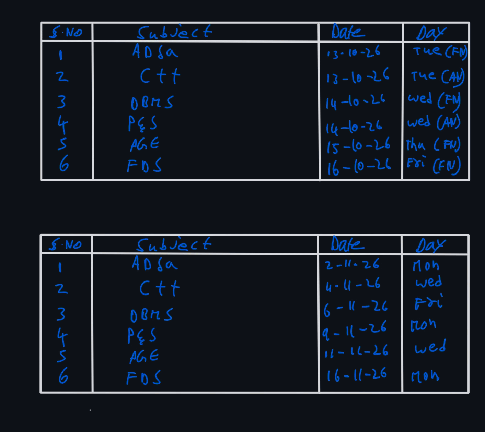

# B.Tech III Semester — CSE (Data Science) Exam Schedule (Oct–Nov 2026)

**Branch:** Computer Science and Engineering (Data Science)  
**Semester:** III Semester (A.Y. 2026–2027)  
**Source Image:** [`raw/exam-schedule.webp`](raw/exam-schedule.webp)

---

## 1. Internal Examinations – II (Mid-2) Schedule (October 2026)

| S.No | Subject Code | Subject | Date | Day & Session |
| :---: | :---: | :--- | :---: | :--- |
| 1 | `2501CS10` | **ADSA** — Advanced Data Structures & Algorithm Analysis | 13-10-2026 | Tuesday (FN — 10:30 AM – 12:00 PM) |
| 2 | `2501CS08` | **C++** — Object Oriented Programming through C++ | 13-10-2026 | Tuesday (AN — 02:30 PM – 04:00 PM) |
| 3 | `2501IT05` | **DBMS** — Database Management Systems | 14-10-2026 | Wednesday (FN — 10:30 AM – 12:00 PM) |
| 4 | `2501MA09` | **P&S** — Probability & Statistics | 14-10-2026 | Wednesday (AN — 02:30 PM – 04:00 PM) |
| 5 | `2501IT07` | **ASE** — Agile Software Engineering | 15-10-2026 | Thursday (FN — 10:30 AM – 12:00 PM) |
| 6 | `2501CS34` | **FDS** — Fundamentals of Data Science | 16-10-2026 | Friday (FN — 10:30 AM – 12:00 PM) |

---

## 2. Semester End / Final Exam Schedule (November 2026)

| S.No | Subject Code | Subject | Date | Day |
| :---: | :---: | :--- | :---: | :--- |
| 1 | `2501CS10` | **ADSA** — Advanced Data Structures & Algorithm Analysis | 02-11-2026 | Monday |
| 2 | `2501CS08` | **C++** — Object Oriented Programming through C++ | 04-11-2026 | Wednesday |
| 3 | `2501IT05` | **DBMS** — Database Management Systems | 06-11-2026 | Friday |
| 4 | `2501MA09` | **P&S** — Probability & Statistics | 09-11-2026 | Monday |
| 5 | `2501IT07` | **ASE** — Agile Software Engineering | 11-11-2026 | Wednesday |
| 6 | `2501CS34` | **FDS** — Fundamentals of Data Science | 16-11-2026 | Monday |

---

## 3. Handwritten Schedule Reference (Dark Mode)

